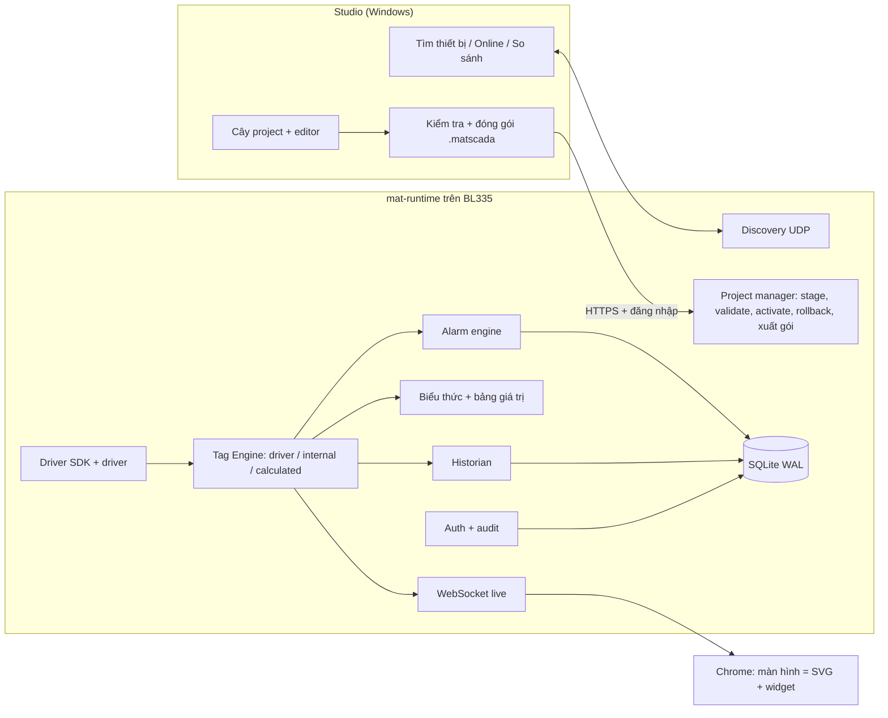

# Lộ trình v2 (đề xuất): từ vertical slice tới miniSCADA đầy đủ

**Trạng thái:** đã duyệt ngày 2026-10-11, Phương án B (mục 7); quyết định 3, 5, 6 còn chờ người dùng · **Ngày:** 2026-10-10 · **Đi kèm:** [Định hướng UX/UI Studio](../architecture/studio-ux.md)

Tài liệu này thay các mục §0, §12.2, §13, §15 của [Master Plan](../../mAT_SCADA_Master_Plan.md) và kéo theo việc sửa Constitution VII (phạm vi MVP, Constitution 2.0.0).

## 0. Tóm tắt

- Sản phẩm đang ở **cuối Sprint 1 trên 8 sprint MVP** (vertical slice). Nền runtime đã vững, nhưng **gần như chưa có tính năng SCADA**: chưa có driver thật, chưa ghi Tag, chưa có DB, alarm, biểu đồ; Studio chưa tìm thiết bị, chưa đọc lên, chưa nạp xuống; web runtime chỉ hiện một màn hình SVG có binding viết tay.
- Danh sách tính năng mong muốn (driver đa giao thức, tag nội bộ và tính toán, lưu DB, alarm, widget web, điều khiển, gắn Tag cho SVG bằng giao diện, Studio kiểu TIA Portal) **gấp khoảng 2 lần MVP hiện tại** và **vượt Constitution VII** ("MVP không alarm/trend/historian, không driver ngoài Mock/Modbus").
- Đề xuất **Phương án B "SCADA trước, trình vẽ sau"**: mỗi giai đoạn giao một lát dùng được đầu-cuối. Trình vẽ SVG tự do (rủi ro lớn nhất của Master Plan) dời về sau; trong lúc đó người dùng vẽ bằng Inkscape/Illustrator rồi import và gắn Tag trong Studio.
- Cần chốt 7 quyết định ở mục 7 trước khi viết spec giai đoạn 1.

## 1. Hiện trạng so với yêu cầu

✅ có · 🟡 có một phần · ❌ chưa có

**Studio**

| Yêu cầu | | Hiện trạng |
|---|---|---|
| Quét BL335 đang online trong mạng | ❌ | Gõ địa chỉ tay rồi gọi `/api/v1/system/info` (`apps/studio/src/device.ts` của Sprint 1, nay là [model/device.ts](../../apps/studio/src/model/device.ts)). Có ở feature 005 |
| Kết nối, đọc project đang chạy về (upload) | ❌ | Thiết bị có `/api/v1/projects/active` (project đã nạp, dạng JSON để hiển thị) nhưng chưa có API xuất nguyên gói; Studio chưa có lệnh đọc lên |
| Cấu hình rồi nạp xuống (download) | ❌ | Studio sửa được `project.json`, `tags.json` trên đĩa. Project đi chung gói runtime (`package-runtime.ps1`), chép lên bằng SSH rồi chạy `deploy.sh` |
| Giao diện | 🟡 | Một trang form 5 tab (Cấu hình, Kiểm tra, Thiết bị, Xem trước, Giới thiệu). Chưa có cây project, canvas, inspector |

**Driver và Tag**

| Yêu cầu | | Hiện trạng |
|---|---|---|
| Modbus TCP/RTU, MQTT, OPC UA, S7, MC/SLMP, FINS, EtherNet/IP, BACnet/IP, REST, WebSocket | ❌ | Chỉ có Mock Tag ([drivers/simulation](../../drivers/simulation/): bồn + bơm, 500 Tag `SIM.*`). Schema Tag chỉ nhận `source.kind = "mock"` |
| Tag nội bộ | ❌ | |
| Ghi Tag (điều khiển) | ❌ | Không có API hay bản tin ghi; runtime chỉ đọc. Ghi Tag bắt buộc có đăng nhập, phân quyền, audit (Constitution V) |

**Logic và dữ liệu**

| Yêu cầu | | Hiện trạng |
|---|---|---|
| Tính toán `+ − × ÷` (tag tính toán, biểu thức) | ❌ | Schema giữ chỗ `expression` nhưng validator trả `E_TRANSFORM_UNSUPPORTED` |
| Parse giá trị (`1` → `"Normal"`) | 🟡 | Chỉ ở phía hiển thị: binding `discreteMap` đổi giá trị thành chữ hoặc màu ([transforms.ts](../../packages/binding-engine/src/transforms.ts)). Chưa có bảng giá trị dùng chung, chưa đổi theo khoảng, chưa có ở server |
| Lưu dữ liệu vào DB (theo chu kỳ, theo thay đổi) | ❌ | Runtime chưa có SQLite |
| Alarm, alarm log | ❌ | |

**Web runtime**

| Yêu cầu | | Hiện trạng |
|---|---|---|
| Card, chart line/bar/pie, chart lịch sử, báo cáo, bảng dữ liệu, alarm view | ❌ | Web runtime chỉ hiện **một màn hình SVG** (màn hình đầu) và thanh trạng thái kết nối ([main.ts](../../apps/runtime-web/src/main.ts)) |
| Ô nhập setpoint, nút, công tắc | ❌ | Phụ thuộc ghi Tag |
| Nhiều màn hình, điều hướng | ❌ | |

**SVG**

| Yêu cầu | | Hiện trạng |
|---|---|---|
| Import SVG chuẩn | 🟡 | Có sanitizer (đang là denylist, còn nợ Constitution V) và công cụ `svg:inspect`. **Chưa có trình import**: `data-mat-uid` phải tự thêm vào file SVG |
| Text hiển thị giá trị Tag | ✅ | `text.content`, định dạng số lẻ và hậu tố |
| Đổi màu theo Tag | ✅ | `style.fill`, `style.stroke` qua `discreteMap`. Chưa đổi màu theo khoảng giá trị |
| Cutaway (mức chất lỏng) | ✅ | `geometry.levelPercent` cho `rect`, 4 hướng |
| Quay, ẩn/hiện, độ mờ | ✅ | `transform.rotate` (quay liên tục theo BOOL hoặc rpm), `style.visibility`, `style.opacity` |
| Di chuyển, co giãn, nhấp nháy, dòng chảy | ❌ | |
| Link (chuyển màn hình, popup) | ❌ | |
| Điều khiển (nhấp để ghi Tag) | ❌ | |
| Gắn Tag bằng giao diện | ❌ | Mọi binding đang **viết tay JSON** |

Phần đã vững và giữ lại: giao thức live 1.0.0 (snapshot, delta, heartbeat, 4429, hàng đợi 256 KB), Tag Store, validator TS và C++ dùng chung bộ vector, render SVG trong Shadow DOM, binding engine, deploy/rollback bằng script + systemd, CI cục bộ. Số đo trên BL335: 10 client × 500 Tag, RSS khoảng 3 MB, CPU khoảng 12 % ([báo cáo Sprint 1](../reports/sprint1-acceptance.md)).

## 2. Vì sao chưa có, và xung đột phạm vi

- Master Plan đặt ưu tiên số 1 là **SVG Designer + binding + animation + deploy** (Sprint 2–6); Modbus làm song song. Alarm, trend, historian, OPC UA nằm **sau MVP**; S7, MC, FINS, MQTT là backlog P2; EtherNet/IP, BACnet là P3; REST và WebSocket chưa có trong kế hoạch; widget (card, chart, nút) chưa có sprint nào. Theo kế hoạch cũ, phần lớn danh sách mới nằm trong bản thương mại đầu tiên, dự kiến sau 9–12 tháng (Master Plan §15).
- **Constitution VII** loại alarm, trend, historian và driver ngoài Mock/Modbus khỏi MVP. Muốn làm sớm phải **sửa Constitution** theo mục Governance (ghi lý do, tăng version, rà lại spec/plan liên quan). Đề xuất lên 2.0.0 vì định nghĩa lại phạm vi MVP.
- Các nguyên tắc khác giữ nguyên: II (Studio và runtime dùng chung package, render trên Chrome), III (ngân sách BL335), IV (Chrome, 10 client), V (không script tùy ý, SVG allowlist, ghi Tag phải có quyền và audit), VI (test trước).

## 3. Kiến trúc bổ sung

- **Tag Engine v1:** loại `driver`, `internal` (bộ nhớ, tùy chọn giữ qua mất điện), `calculated` (biểu thức), `simulation`; scaling thô sang giá trị kỹ thuật; deadband; bảng giá trị; hàng đợi ghi.
- **Driver SDK** (`drivers/sdk`, `core/driver-manager`): kênh (TCP, serial, broker, endpoint) → thiết bị → Tag; nhóm quét; gộp block; timeout, kết nối lại; chẩn đoán theo kênh, thiết bị, Tag. Driver chỉ phát `TagUpdate`/`WriteResult` (Constitution II).
- **Biểu thức:** bản C++ cho tag tính toán, bản TS cho hiển thị, dùng chung bộ vector. **Không script.**
- **Alarm, historian, auth/audit** dùng chung SQLite WAL trên phân vùng data.
- **Discovery:** mat-runtime trả lời gói tìm thiết bị trong LAN.
- **`packages/ui-components`:** widget dạng web component, dùng chung cho web runtime và Studio Preview.
- **Mô hình màn hình v1:** một màn hình gồm nhiều item xếp lớp trên cùng hệ tọa độ thiết kế (ví dụ 1920×1080): item `svg` (đồ họa import, binding theo `elementUid` như hiện nay) và item `widget` (card, chart, nút…). Widget là phần tử HTML đặt chồng lên SVG, **không** nằm trong SVG vì sanitizer cấm `foreignObject`. Chốt bằng ADR.

## 4. Lộ trình đề xuất (Phương án B)

| | A: giữ Master Plan | B: đề xuất |
|---|---|---|
| Tìm thiết bị, đọc lên, nạp xuống | Sprint 6 (khoảng 11–13 tuần nữa) | GĐ 1 (khoảng 5–7 tuần nữa) |
| Driver ngoài Modbus | Sau MVP | Song song từ sau GĐ 2 |
| Widget (card, chart, nút, công tắc) | Chưa có trong kế hoạch | GĐ 3a |
| Alarm, lịch sử, báo cáo | Sau MVP | GĐ 4, GĐ 5 |
| Trình vẽ SVG đầy đủ | Sprint 3 | GĐ 6; trước đó import và gắn Tag |
| Đổi lại | SCADA đến muộn | Phải sửa Constitution; trình vẽ đến muộn |

Mỗi giai đoạn là một feature Spec Kit (`specs/004-…` trở đi; GĐ 1 chia hai feature, xem mục 8). Ước lượng thô theo đội ngũ Master Plan §2 (2 FE, 1 C++, 0,5 QA, 0,5 Tech Lead); đội 1–2 người nhân 1,8–2.

| GĐ | Nội dung | Cần trước | Ước lượng |
|---|---|---|---|
| 0 | Đóng Sprint 1 | | khoảng 1 tuần |
| 1 | Studio mới; tìm thiết bị, đọc lên, nạp xuống; HTTPS, đăng nhập | 0 | 4–6 tuần |
| 2 | Tag v1, driver SDK, Modbus TCP/RTU, tag nội bộ và tính toán, bảng giá trị, ghi Tag | 1 | 5–6 tuần |
| 3a | Màn hình v1: widget, điều khiển, nhiều màn hình, trình bố trí màn hình | 2 | 4–5 tuần |
| 3b | SVG: import, gắn Tag, animation, sự kiện bằng giao diện | 3a | 3–4 tuần |
| 4 | Alarm | 2, 3a | 3–4 tuần |
| 5 | Lưu trữ dữ liệu, biểu đồ lịch sử, báo cáo | 2, 3a | 4–6 tuần |
| D | Các đợt driver (mục 4.8) | 2 | song song |
| 6 | Hoàn thiện, pilot; trình vẽ SVG đầy đủ | 3b | 3 tuần + |

Cộng dồn khoảng 27–35 tuần (6–8 tháng) tới bản pilot; thêm 6–8 tuần pilot và phát hành (Master Plan §15) thì khoảng 8–10 tháng tới bản thương mại đầu tiên. Alarm đặt trước lưu trữ vì ghi DB ít (dễ kiểm độ bền khi mất điện) mà giá trị vận hành cao; có thể đổi thứ tự nếu cần biểu đồ lịch sử sớm. Muốn các đợt driver chạy song song thật sự cần thêm 1 dev C++.

### 4.0 GĐ 0: đóng Sprint 1

**Trạng thái (2026-10-11):**

- **Phần dev xong.** Đã kiểm và xử lý cả 93 phát hiện của audit; T063 và test transport CivetWeb đã có; `deploy.sh` giữ unit đi cặp với bản backup. `ci-local.ps1` xanh: ctest 377, Vitest 252, vector 82. Chi tiết: [handoff Sprint 1](../handoff/sprint1.md).
- **Còn phần người dùng:**
  - T078, T088;
  - T074 (khởi động lại BL335), chạy `rollback.sh` thật;
  - xác nhận SC-006 hạ xuống "Đạt một phần";
  - commit mốc.

- **Dev:** T063 (test khởi động với project lỗi). Vá các lỗi do workflow audit `wf_bea101bb-082` nêu; lúc viết tài liệu này workflow còn đang kiểm chứng, đã xác nhận:
  - live-client vẫn áp delta khi nhảy sequence, màn hình hiện trạng thái ghép (FR-012);
  - validator TS và C++ kết luận khác nhau với BOM, UTF-8 hỏng, số nguyên viết dạng `10.0` (FR-008);
  - Studio coi SVG > 1 MB là "thiếu file" trong khi runtime chấp nhận (FR-032).

  Đang chờ kiểm chứng: thiếu test tự động cho 4429/4408 (T044), tài liệu deploy thiếu bước chép `.sha256`, vài số trong báo cáo nghiệm thu không khớp file đo. Sau đó chạy lại `ci-local.ps1` và build lại bộ cài Studio.
- **Người dùng:** T078 (10 tab Chrome trên ≥ 2 máy), T088 (thao tác Studio), cho phép T074 (khởi động lại BL335) và chạy thử `rollback.sh` một lần (chưa có bằng chứng đã chạy trên thiết bị).
- **Khởi tạo git** và commit mốc trước GĐ 1.

### 4.1 GĐ 1: Studio mới và làm việc với thiết bị

**Trạng thái (2026-10-11):**

- [specs/004-studio-shell](../../specs/004-studio-shell/spec.md): **phần phát triển xong** (2026-10-11): khung kiểu IDE, Bảng Tag, Thiết lập project, xem trước, theo dõi thiết bị chỉ đọc, xem lưu trữ; Studio 0.2.0. **Xong 86/86** (2026-10-11): người dùng đã duyệt giao diện ("giao diện ok") theo [mockup bản 1](../architecture/mockups/studio-shell.html); nghiệm thu theo dõi với BL335 thật đạt (T075: độ trễ 0–1 ms, nhả phiên 26 ms). Kết quả: [004-acceptance.md](../reports/004-acceptance.md), [ADR-009](../adr/009-studio-ui-stack.md).
- [specs/005-device-online](../../specs/005-device-online/spec.md): có spec và [plan](../../specs/005-device-online/plan.md) (research, data model, contracts, quickstart); ADR [010](../adr/010-device-discovery-https.md) tìm thiết bị + HTTPS, [011](../adr/011-auth-roles-audit.md) đăng nhập + audit, [012](../adr/012-project-package-deploy.md) gói project + nạp xuống, đều Proposed; có [tasks](../../specs/005-device-online/tasks.md) (166 task, analyze: 0 CRITICAL; các điểm analyze còn lại sửa ngày 2026-10-11). 5 câu hỏi của plan đã trả lời ngày 2026-10-11, khi người dùng giao toàn quyền quyết định. Trạng thái 2026-10-12: cả bốn story đã cài và kiểm trên x64 (`tools/device-it.ps1`, [báo cáo nghiệm thu](../reports/005-acceptance.md)); chờ người dùng cho phép SSH để cài runtime 0.4.0 lên BL335 và đo (T158–T165). Quyết định 5 (Q2): khuyến nghị VPN, không tự mở cổng; port-forward HTTPS chỉ khi người dùng chọn.
- GĐ 0 đang làm song song.

**Thiết bị**

- **Tìm thiết bị:** trả lời gói UDP broadcast trong LAN: tên, model, MAC, IP, phiên bản runtime, project đang chạy và digest, trạng thái, cổng HTTPS, fingerprint chứng chỉ. Chỉ trả lời nguồn cùng subnet, giới hạn tần suất, gói trả lời nhỏ (chống khuếch đại), tắt được trong `runtime.json`, không chứa bí mật.
- **HTTPS:** chứng chỉ tự sinh cho từng thiết bị; Studio ghim fingerprint ở lần kết nối đầu.
- **Đăng nhập, phân quyền, audit** (kéo từ Sprint 5):
  - tài khoản cục bộ; role `viewer`, `operator`, `engineer`, `administrator`; khóa tạm sau 5 lần sai; mật khẩu quản trị đặt bằng lệnh trên thiết bị lúc cài;
  - **đổi 2026-10-11** (spec 005 Q3, người dùng giao toàn quyền quyết định): mật khẩu băm **Argon2id** thay PBKDF2 (tham số chốt bằng số đo trên BL335, ADR-011); token phiên gửi trong header `Authorization: Bearer` thay cookie + CSRF, vì Studio là client duy nhất của API kỹ thuật. Cookie `HttpOnly; Secure; SameSite=Strict` + CSRF để GĐ 2, khi trang xem trên Chrome cần đăng nhập. **Đổi 2026-10-11** (spec 006 D2, người dùng giao toàn quyền quyết định): ở GĐ 2 trang xem vẫn không ghi được gì, nên đăng nhập trên Chrome (cookie + CSRF, quy trình chứng chỉ CA của khách hàng) chuyển sang **GĐ 3a**, khi widget điều khiển trên web ghi được Tag;
  - audit vào `audit.db` (SQLite, `synchronous=FULL`, Constitution 2.0.1).
- **Gói `.matscada`** (ZIP, manifest, checksum; chặn ZIP bomb và path traversal; tối đa 50 MiB) và **API nạp xuống**: stage → validate (validator C++) → backup → activate → health check → tự rollback; giữ N bản trước. Project tách khỏi gói runtime.
  - **Đổi 2026-10-11** (spec 005 research R12): bỏ tùy chọn "lưu kèm nguồn project". Gói luôn chứa toàn bộ nguồn project, nên đọc lên luôn đầy đủ.
  - Thứ tự story theo spec 005: US1 tìm thiết bị + đăng nhập, US2 nạp xuống (cùng P1), US3 đọc lên + so sánh (P2), US4 chẩn đoán + audit (P3).
- **API đọc lên:** tải gói đang chạy (role `engineer`).
- **Chẩn đoán cơ bản:** CPU, RAM, dung lượng, uptime, số client.

**Studio**

- Khung giao diện mới theo [studio-ux.md](../architecture/studio-ux.md): cây project, editor dạng tab, inspector, task card, thanh trạng thái, theme sáng/tối. Chuyển các chức năng Sprint 1 (cấu hình, bảng Tag, kiểm tra, xem trước) vào khung mới.
- Hộp thoại **Thiết bị trong mạng**; danh sách thiết bị đã lưu; thêm tay theo IP:cổng (bắt buộc khi qua WAN hoặc khác subnet).
- **Online** (đăng nhập, viền cam, trạng thái ở thanh dưới), **Đọc lên** (thành project mới hoặc so với project đang mở), **So sánh offline/online**, **Nạp xuống** có bước xem trước (kết quả kiểm tra, khác biệt, ảnh hưởng như "4 client sẽ tải lại") và bước kết quả; nút khôi phục bản trước.

Gợi ý chia user story cho spec: P1 tìm thiết bị + online, P2 đọc lên + so sánh, P3 nạp xuống.

**Nghiệm thu**

- Trong LAN, Studio tìm thấy BL335 trong ≤ 3 s; thiết bị qua WAN thêm tay được.
- Đọc lên ngay sau khi nạp xuống cho digest giống hệt.
- Gói không hợp lệ hoặc hỏng bị từ chối, bản cũ vẫn chạy. Mất điện giữa lúc kích hoạt: khởi động lại với bản hợp lệ.
- Không đăng nhập hoặc thiếu quyền: 401/403 và có audit; sai mật khẩu 5 lần bị khóa tạm.
- Mọi chức năng Sprint 1 vẫn đạt trên khung Studio mới.

### 4.2 GĐ 2: Tag, driver nền tảng, tính toán, ghi Tag

**Trạng thái (2026-10-11):** một feature [specs/006-tags-modbus](../../specs/006-tags-modbus/spec.md) (D1), có spec và [plan](../../specs/006-tags-modbus/plan.md) (research, data model, contracts, quickstart); ADR [014](../adr/014-driver-sdk-modbus.md) driver SDK + Modbus, [015](../adr/015-expression-language.md) ngôn ngữ biểu thức, [016](../adr/016-studio-grid-ime.md) lưới Studio + bộ gõ, [017](../adr/017-tag-engine-v1.md) Tag Engine v1 + định dạng 0.2.0 + ghi Tag, [018](../adr/018-viewer-source-filter.md) lọc nguồn cho trang xem, đều Proposed. Phiên bản: runtime 0.5.0, định dạng project 0.2.0, API thiết bị 1.1.0, giao thức live 1.2.0 (alarm của GĐ 4 sẽ là 1.3.0). Cổng RS485 của BL335 chờ người dùng chạy lệnh kiểm chỉ đọc (quickstart §8 của 006).

**Trạng thái feature 006 (2026-10-13):** **code xong và đã thử trên x64** (Modbus TCP/RTU, Tag Engine v1, Tag tính toán, ghi Tag có audit, lọc nguồn, Studio 0.4.0 với các editor mới; `driver-it`, fuzz ngắn, `node --test`), **chờ BL335**: cổng RS485 và sandbox serial (unit hay drop-in, luật udev: T169, T217), số đo SC-011 và hiệu năng trên thiết bị, PLC thật (§7 quickstart), thử tay bộ gõ SC-013 (T215), fuzz 1 giờ (T209), review bảo mật (T210), nghiệm thu `docs/reports/006-acceptance.md`. Mọi mục này vẫn chưa đạt. Hướng dẫn triển khai: [mat-runtime.md](../deployment/mat-runtime.md) mục 5c.

**Thiết bị**

- **Tag v1** (schema 0.2.0, có migration từ 0.1): loại, địa chỉ, kiểu dữ liệu, scaling, deadband, thứ tự byte/word, quyền R/RW, giới hạn nhập, đơn vị, bảng giá trị.
- **Driver SDK:** nhóm quét (nhanh/thường/chậm), gộp thanh ghi liên tiếp, timeout, thử lại, kết nối lại có backoff, hàng đợi ghi ưu tiên hơn đọc, chẩn đoán (trạng thái, số lỗi, chu kỳ quét thực tế).
- **Modbus TCP và Modbus RTU.** BL335 có `ttyAS0–5`, `ttyS0–3`, `ttyUSB0–3` ([device-profile](../reports/device-profile.md)); cần xác nhận cổng nào nối RS485 và cách điều khiển chiều truyền.
- **Tag nội bộ** (giữ qua mất điện thì ghi eMMC có gom) và **tag tính toán**: `+ − × ÷ %`, so sánh, logic, `? :`, `min`, `max`, `abs`, `round`, `clamp`, `text(tag, bảng)`.
- **Bảng giá trị** (như "Text list" của WinCC): giá trị hoặc khoảng → chữ + màu, ví dụ `1 → "Normal"` màu xanh, `2 → "Alarm"` màu đỏ. Dùng cho tag chuỗi phía server, binding SVG, widget, alarm, báo cáo.
- **Ghi Tag:** `POST /api/v1/tags/write`; kiểm role, quyền RW của Tag, giới hạn, trạng thái kết nối; audit (ai, lúc nào, IP, giá trị cũ/mới, kết quả); trả `ACCEPTED`, `REJECTED`, `TIMEOUT`, `FAILED`, `CONFIRMED`.
  - **Đổi 2026-10-11** (spec 006 D2, D33; người dùng giao toàn quyền quyết định): ở GĐ 2 **chỉ ghi được từ Bảng theo dõi online của Studio**, qua API HTTPS có đăng nhập của 005 (token Bearer, cùng chuỗi kiểm và bảng quyền; role tối thiểu operator).
  - Trang xem trên Chrome giữ chỉ đọc, HTTP 8080, không đăng nhập, tới GĐ 3a.
  - Vì trang xem nay hiện dữ liệu PLC thật, phần không cần đăng nhập mặc định chỉ phục vụ nguồn trong mạng riêng (đặt được `any` hoặc `off`); kênh dữ liệu sống của Studio gửi kèm phiên nên Online từ xa vẫn chạy.

**Studio**

- Editor **Kết nối** (kênh, thiết bị, nút thử kết nối), **Bảng Tag** dạng lưới (thêm hàng loạt, điền xuống, dán từ Excel, nhập/xuất CSV, lọc, báo lỗi theo ô), **Bảng giá trị**, **Tag tính toán** (gợi ý tên Tag, kiểm biểu thức khi gõ).
- **Bảng theo dõi online** (như Watch table của TIA): giá trị sống, quality, ghi giá trị có xác nhận. Trang chẩn đoán driver.
- **Mô phỏng trong Studio** (hằng, ramp, sin, ngẫu nhiên, bật/tắt, nhập tay) để thử không cần thiết bị.

**Test:** giả lập Modbus slave trong CI (Docker x64), cặp cổng serial ảo cho RTU, bàn thử có PLC thật.

**Nghiệm thu**

- Đọc/ghi ≥ 1 PLC thật qua Modbus TCP và ≥ 1 thiết bị RS485 qua Modbus RTU.
- 500 Tag/1 s qua Modbus TCP với 10 client: CPU trung bình ≤ 30 %, RSS ≤ 150 MB (Constitution III).
- Rút cáp PLC: Tag thành BAD trong ≤ 2 chu kỳ quét, tự kết nối lại. Viewer ghi bị từ chối; audit đủ.
- Tag tính toán cho cùng kết quả ở TS và C++ trên bộ vector chung.

### 4.3 GĐ 3a: màn hình v1, widget và điều khiển

**Trạng thái (2026-10-13):** một feature [specs/007-screens-widgets](../../specs/007-screens-widgets/spec.md) (D1), có spec (6 user story, 79 FR, 24 SC), [plan](../../specs/007-screens-widgets/plan.md) (research R1–R25, data model, 7 contract, quickstart), [tasks](../../specs/007-screens-widgets/tasks.md) (157 task) và [mockup](../architecture/mockups/studio-screens.html); **chưa có mã**. ADR [013](../adr/013-screen-model-v1.md) mô hình màn hình v1, [019](../adr/019-widget-library.md) thư viện widget, [020](../adr/020-realtime-chart.md) biểu đồ thời gian thực (uPlot), [021](../adr/021-web-login-certificates.md) đăng nhập trên Chrome và chứng chỉ, [022](../adr/022-screen-editor.md) trình bố trí màn hình, đều Proposed. Phiên bản: runtime 0.6.0, định dạng project 0.3.0, API thiết bị 1.2.0, Studio 0.5.0; giao thức live giữ 1.2.0 (alarm của GĐ 4 vẫn là 1.3.0). Quyết định chính (người dùng giao toàn quyền 2026-10-11):

- định dạng 0.3.0 (màn hình = `items` xếp lớp; widget HTML đặt chồng lên SVG; co bằng một phép `transform`; tải lười từng màn hình);
- 15 widget (thêm `panel`), danh mục JSON dùng chung cho hai validator;
- cookie `__Host-mat_sid` + CSRF theo phiên + `Origin`, dùng chung bộ xác thực 005, cookie không vào API kỹ thuật; `viewerLogin` mặc định `off`;
- ghi Tag vẫn một đường (`POST /api/v1/tags/write`), API 1.2.0 thêm `expect`, `pulseMs` (BL335 giữ nhịp xung), `context`;
- chứng chỉ có SAN IP, `device.crt`, `--make-csr`, `--import-cert`;
- thêm đúng một thư viện ngoài (uPlot, MIT).

Còn lại: toàn bộ phần cài đặt; các bước trên BL335 (đo SC-002, SC-003, SC-004, xung SC-010, chứng chỉ SC-019) chờ SSH và người.

**Web runtime**

- Mô hình màn hình v1; nhiều màn hình; menu điều hướng; URL giữ màn hình khi F5; popup.
- Thư viện widget (`packages/ui-components`, dùng chung với Studio):

| Nhóm | Widget |
|---|---|
| Hiển thị | Card giá trị (nhãn, giá trị, đơn vị, quality, màu theo bảng giá trị), nhãn chữ, đèn báo, đồng hồ kim, thanh mức |
| Biểu đồ thời gian thực | Line (uPlot, đệm dữ liệu trên trình duyệt), bar, pie/donut |
| Bảng | Bảng giá trị Tag sống |
| Điều khiển | Nút (đặt giá trị, đảo, xung, chuyển màn hình, popup), công tắc, ô nhập setpoint (min/max, xác nhận), thanh trượt, danh sách chọn theo bảng giá trị |

- Điều khiển có hộp xác nhận, trạng thái đang gửi và kết quả; tự khóa với viewer, khi mất kết nối hoặc quality xấu.

**Studio:** trình bố trí màn hình: canvas zoom/pan/lưới/snap; kéo widget từ Toolbox; di chuyển, đổi cỡ, căn chỉnh, xếp lớp; inspector (Chung, Hiển thị, Gắn Tag, Sự kiện, Bảo mật); kéo Tag từ cây thả vào thuộc tính; xem trước bằng mô phỏng hoặc thiết bị.

**Nghiệm thu**

- Dựng dashboard ≥ 20 widget hoàn toàn trong Studio (không viết tay JSON), nạp xuống, vận hành từ Chrome.
- Viewer không ghi được; operator ghi có xác nhận và audit.
- Mở màn hình ≤ 2 s; 10 client cùng F5 xong ≤ 5 s (Master Plan §6).

### 4.4 GĐ 3b: SVG import, gắn Tag, animation, sự kiện

**Trạng thái (2026-10-13):** một feature [specs/008-svg-import-binding](../../specs/008-svg-import-binding/spec.md) (D1), có spec (6 user story, 67 FR, 22 SC), [plan](../../specs/008-svg-import-binding/plan.md) (research R1–R24, data model, 6 contract, quickstart) và [tasks](../../specs/008-svg-import-binding/tasks.md); **chưa có mã**. ADR [023](../adr/023-svg-import-allowlist-uid.md) nhập SVG bằng allowlist, UID và nhập lại, [024](../adr/024-binding-animation-0.4.md) binding 0.4.0 và animation, [025](../adr/025-svg-element-events.md) sự kiện của phần tử SVG, [026](../adr/026-symbol-library-svg-editing.md) thư viện ký hiệu và chọn phần tử trong Studio, đều Proposed. Phiên bản: runtime 0.7.0, định dạng project 0.4.0, Studio 0.6.0; API thiết bị 1.2.0 và giao thức live 1.2.0 không đổi (alarm của GĐ 4 vẫn là 1.3.0). Quyết định chính (người dùng giao toàn quyền 2026-10-11):

- định dạng 0.4.0 (binding mở rộng, sự kiện SVG, trần 64 item `svg`; 0.3 → 0.4 chỉ đổi số phiên bản);
- allowlist trên DOM đã parse thay denylist, giới hạn 5 MiB / 20.000 phần tử / độ sâu 32, importer ở package riêng `@mat/svg-import`, báo cáo import có mã lý do;
- nhập lại giữ UID bằng bốn bước (UID, `id`, cấu trúc, hình học), mơ hồ thì hỏi, mồ côi chặn Nạp xuống;
- hợp biến đổi giữ `transform` gốc (sửa lỗi im lặng của 0.2), mức chất lỏng bằng `clipPath`, nhấp nháy và dòng chảy bằng Web Animations;
- sự kiện nhấp dùng chung `ControlController` và đường ghi của 007 (không đường mới);
- 10 fixture: 4 Inkscape xuất thật, 3 Illustrator và 3 CorelDRAW **mô phỏng** (không có phần mềm trên máy dev; ghi rõ giới hạn, thay bằng file thật khi có).

Còn lại: toàn bộ phần cài đặt; các bước trên BL335 (đo SC-005, SC-007) chờ SSH và người; file thật từ Illustrator và CorelDRAW chờ người dùng.

- **Importer:** sanitizer allowlist trên DOM đã parse (thay denylist hiện tại); giới hạn 5 MB, 20.000 node, độ sâu 32 (Constitution V); tự gán `data-mat-uid`, giữ UID khi import lại.
- **Gắn Tag cho phần tử SVG bằng inspector:** chữ hiển thị giá trị (định dạng, bảng giá trị); màu fill/stroke theo bảng giá trị hoặc theo khoảng; cutaway mức chất lỏng (`rect`, và hình bất kỳ qua `clipPath`); quay, quay liên tục; di chuyển, co giãn; nhấp nháy; dòng chảy trong ống; ẩn/hiện.
- **Sự kiện:** nhấp để chuyển màn hình, mở popup, ghi/đảo/xung Tag (có xác nhận và kiểm quyền).
- Thư viện ký hiệu cơ bản: bơm, van, bồn, motor, ống.
- **Nghiệm thu:** 10 fixture từ Inkscape, Illustrator, CorelDRAW import và hiển thị đúng ở Studio và Chrome; SVG độc hại bị loại; màn hình bồn nước + motor dựng lại hoàn toàn trong Studio.

### 4.5 GĐ 4: alarm

**Trạng thái (2026-10-13):** một feature [specs/009-alarms](../../specs/009-alarms/spec.md) (D1), có spec (6 user story, 100 FR, 24 SC), [plan](../../specs/009-alarms/plan.md) (research R1–R25, data model, 7 contract, quickstart) và [tasks](../../specs/009-alarms/tasks.md) (137 task); **chưa có mã**. ADR [027](../adr/027-alarm-model-engine.md) mô hình alarm và động cơ, [028](../adr/028-alarm-log-storage.md) alarm log, [029](../adr/029-alarm-live-api.md) live 1.3.0 và API, [030](../adr/030-alarm-web-studio.md) web và Studio, đều Proposed. Phiên bản: runtime 0.8.0, định dạng project 0.5.0 (nối tiếp 0.4.0 của 3b; migration 0.4 → 0.5), API thiết bị 1.3.0, Studio 0.7.0 (giữa 3b 0.6.0 và 010 0.8.0), giao thức live 1.3.0, `@mat/ui-components` 0.3.0 (3b dùng 0.2.0); runtime 0.8.0 nằm giữa 3b (0.7.0) và 010 (0.9.0). Quyết định chính (người dùng giao toàn quyền 2026-10-11):

- mỗi ngưỡng HH/H/L/LL là một instance độc lập, trạng thái ISA-18.2 (4 trạng thái + shelved/disabled), không biểu thức riêng;
- `alarm.db` riêng, `synchronous=NORMAL` kèm audit FULL ghi trước khi xác nhận; mất điện chỉ đẩy về phía an toàn (chưa xác nhận), không xin ngoại lệ Constitution thứ ba;
- tự cách ly alarm chập chờn để giữ ngân sách eMMC;
- đăng ký live riêng (`subscribeAlarms`), xác nhận chỉ qua REST;
- banner và trang Alarm dựng sẵn trong trang runtime, cộng hai widget `alarm-list`, `alarm-count`;
- CSV lịch sử sinh ở trình duyệt (UTF-8 BOM, chống công thức);
- hai bản động cơ (C++ và TS) với bộ vector chung.

Còn lại: toàn bộ phần cài đặt; các bước trên BL335 (đo SC-003, SC-008 cắt điện thật, SC-009, SC-011, SC-013) chờ SSH và người.

- **Định nghĩa:** alarm số (bit bật/tắt); alarm ngưỡng HH/H/L/LL có deadband và trễ bật/tắt; alarm mất kết nối/quality. Lớp alarm (mức ưu tiên, màu, nhấp nháy, cần xác nhận, âm thanh); nhóm/khu vực; nội dung có chèn giá trị.
- **Trạng thái** theo ISA-18.2 (có và chưa xác nhận → đã xác nhận → hết). Xác nhận cần role `operator` và ghi audit. Alarm log trong SQLite, có thời hạn lưu.
- Đẩy alarm qua WebSocket (giao thức live 1.3.0, tương thích ngược; 1.1.0 đã dùng cho 005, 1.2.0 cho 006).
- **Web:** banner alarm; bảng alarm đang có (lọc, sắp xếp, xác nhận, xác nhận tất cả); lịch sử alarm (chọn khoảng thời gian, lọc, xuất CSV); số alarm trên menu.
- **Studio:** bảng Alarm, lớp Alarm; thử alarm bằng mô phỏng.
- **Nghiệm thu:** 200 alarm; alarm hiện ≤ 1 s sau khi điều kiện đúng (cộng trễ đã cấu hình); mất điện không hỏng alarm log.

### 4.6 GĐ 5: lưu trữ dữ liệu, biểu đồ lịch sử, báo cáo

**Trạng thái (2026-10-13):** một feature [specs/010-history-reports](../../specs/010-history-reports/spec.md) (D1), có spec (9 user story, 64 FR, 25 SC), [plan](../../specs/010-history-reports/plan.md) (research R1–R16, data model, 7 contract, quickstart) và [tasks](../../specs/010-history-reports/tasks.md) (163 task, 8 task ⚠️🔌); **chưa có mã**. ADR [031](../adr/031-history-aggregates.md) bảng tổng hợp, [032](../adr/032-history-query-api.md) API truy vấn lịch sử, [033](../adr/033-browser-reports.md) báo cáo trên trình duyệt, [034](../adr/034-trigger-mode-write-estimate.md) chế độ trigger và ước tính ghi, đều Proposed. Phiên bản: runtime 0.9.0, Studio 0.8.0, `logging.json` 0.2.0, `reports.json` 0.1.0, `history.db` schema 2, API thiết bị 1.4.0, định dạng project 0.6.0, danh mục widget 0.5.0 (số API, định dạng, danh mục căn lại nếu thứ tự phát hành của 3b và alarm đổi). Quyết định chính (người dùng giao toàn quyền 2026-10-11):

- chế độ **kết hợp đã có từ 003** (`onChange` + `maxIntervalMs`), chỉ đặt tên "Kết hợp" trong Studio; thêm `mode: trigger` (bốn kiểu cạnh);
- bảng tổng hợp phút và giờ dạng bảng dài `mat_agg` trên **tín hiệu giữ** (tích phân, `first` mang qua cửa sổ nên `delta` cộng đúng), ghi cùng giao dịch với dòng thô, khôi phục bằng mốc và upsert ghép; truy vấn dài đọc bảng này vì dòng thô rộng không đạt 2 s (24 giờ ≈ 150 MB);
- API `GET /api/v1/history/*` chỉ HTTPS và viewer, giảm điểm `minmax` mặc định (`lttb`, `decimate` dự phòng), kết nối đọc riêng, giới hạn tải (2 truy vấn, quét ≤ 64 MiB, hạn 10 s, 429), CSV phát dần có audit;
- báo cáo ngày/ca/tháng tính bằng `history-math` từ `aggregate`, xuất CSV, XLSX (tự viết trên `fflate`), PDF (`pdfmake` tải lười) trên trình duyệt; thư viện rà ở T005;
- ước tính ghi v2 và "chặn" ngân sách là **chặn mềm** (Constitution VII cấm chặn): Studio hỏi xác nhận khi nạp xuống, runtime đo `write_bytes` thực;
- **MQTT ngoài phạm vi** (để GĐ 6 cùng driver MQTT).

Còn lại: toàn bộ phần cài đặt; các bước trên BL335 (đo SC-004, SC-006, SC-009, SC-011, SC-022, cắt điện thật 100 lần SC-023) chờ SSH và người; thử tay Excel, Acrobat, bộ gõ.

**Cập nhật 2026-10-10:** theo yêu cầu người dùng, phần thiết bị của giai đoạn này được làm **trước GĐ 0–2**, thành feature `specs/003-data-logging/`: ghi SQLite theo nhóm, tự xóa theo số ngày, trần dung lượng, chuyển tiếp sang MySQL/MariaDB, SQL Server, PostgreSQL, InfluxDB với **bảng rộng** (mỗi dòng một thời điểm, mỗi Tag một cột) và thời gian theo **giờ địa phương UTC+7**. Cấu hình bằng JSON trong project (Constitution I: runtime trước, editor sau); biểu đồ lịch sử, báo cáo và editor trong Studio vẫn ở GĐ 5. Các ý dưới đây là phạm vi đầy đủ của giai đoạn.

**Trạng thái feature 003 (2026-10-10):** phần thiết bị đã xong và kiểm trên x64 (lưu SQLite, dọn theo thời hạn, trần dung lượng, chuyển tiếp chính xác một lần tới 4 loại DB thật, gửi bù khi mất kết nối, validator hai bản, `system/info`, tóm tắt trong tab Thiết bị), đã qua ba vòng review và sửa mọi mục tìm được (báo cáo §6). Người dùng đã chốt (2026-10-10): kết nối DB mặc định `tls: verify-full`; chấp thuận ngoại lệ `synchronous=FULL` cho giao dịch xóa mốc gửi (Constitution 1.1.1). Đã chạy trên BL335 ngày 2026-10-11: SC-001, SC-002 đạt; 10 lần `kill -9` không hỏng file; gửi tới 4 loại DB (DB thử qua đường hầm). Lần deploy đầu bắt được một lỗi SQLite 3.54.0 chỉ có trên máy 32-bit: đã vá, và CI thêm bước smoke armhf. Còn cắt điện thật (cần người ở cạnh thiết bị) và thử với DB thật của người dùng. Kết quả: [003-acceptance.md](../reports/003-acceptance.md), quyết định: [ADR-008](../adr/008-data-logging.md). Chưa làm (vẫn thuộc GĐ 5): chế độ kết hợp và theo Tag kích hoạt, bảng tổng hợp 1 phút/1 giờ, biểu đồ lịch sử, báo cáo, editor lưu trữ trong Studio.

- **Nhóm lưu trữ:** theo chu kỳ N giây; theo thay đổi có deadband; kết hợp (theo thay đổi nhưng ít nhất N giây ghi một lần); theo Tag kích hoạt. Ghi gom vào SQLite WAL; thời hạn lưu theo số ngày và dung lượng; bảng tổng hợp 1 phút và 1 giờ (min, max, avg, last).
- **API truy vấn** có giảm điểm (tối đa N điểm mỗi đường), xuất CSV.
- **Ước tính ghi eMMC:** Studio và validator tính MB/ngày và số ngày lưu được; cảnh báo hoặc chặn khi vượt ngân sách (mục 5).
- **Web:** biểu đồ lịch sử (nhiều đường, chọn khoảng, zoom/pan, con trỏ đọc giá trị); bar/pie trên số tổng hợp (ví dụ điện năng theo ca, theo ngày); **báo cáo** theo mẫu ngày/ca/tháng (min, max, avg, tổng, cuối) xuất CSV, XLSX, PDF; bảng dữ liệu lịch sử. Báo cáo sinh trên trình duyệt để không tốn CPU BL335.
- **Studio:** editor lưu trữ (nhóm, Tag, chế độ, chu kỳ, deadband, thời hạn) hiện ước tính ghi ngay khi sửa; editor mẫu báo cáo.
- **Tùy chọn, chốt sau:** chuyển tiếp sang DB ngoài (MySQL, SQL Server, PostgreSQL, InfluxDB) hoặc MQTT theo kiểu store-and-forward.
- **Nghiệm thu:** 200 Tag lưu theo thay đổi trong 7 ngày, nằm trong ngân sách ghi; truy vấn 24 giờ ≤ 2 s; mất điện 100 lần không hỏng DB (Master Plan §14.5).

### 4.7 GĐ 6 và sau đó

**Trạng thái (2026-10-13):** một feature [specs/011-pilot-hardening](../../specs/011-pilot-hardening/spec.md) (D1), có spec (9 user story, 143 FR, 43 SC), [plan](../../specs/011-pilot-hardening/plan.md) (research R1–R32, data model, 7 contract, quickstart) và [tasks](../../specs/011-pilot-hardening/tasks.md) (208 task); **chưa có mã**. ADR [035](../adr/035-release-trust-ota.md) tin cậy phát hành và OTA, [036](../adr/036-security-hardening.md) gia cố bảo mật, [037](../adr/037-logic-v2.md) logic v2, [038](../adr/038-svg-editor-templates.md) trình vẽ SVG, template và faceplate, đều Proposed. Phiên bản: runtime 1.0.0, Studio 1.0.0, định dạng project 1.0.0 (bản dựng `1.0.0-rc.N`, gắn `1.0.0` ở Go/No-Go sau pilot). Quyết định chính (người dùng giao toàn quyền 2026-10-11):

- xử lý toàn bộ 18 phát hiện Medium của 005, 006, 007 (allowlist `Host` với IP literal luôn nhận, khóa đăng nhập theo cặp (tên, IP), nhật ký xung bền và nhả khi khởi động, Modbus TCP cô lập timeout theo `transactionId`, `persist()` ngoài mutex, từ chối file thừa, giới hạn kết nối theo nguồn), kèm `cppcheck`, `clang-tidy`, `cargo audit`, `npm audit`, rà license, fuzz;
- tải, soak 7 ngày, mất điện 100 lần trên BL335 bằng bộ công cụ có test (x64 trước); pilot ≥ 30 ngày với tiêu chí ra số hóa (uptime ≥ 99,9 %, 0 sự cố S1, độ trễ phía thiết bị p95 ≤ 500 ms, ghi eMMC ≤ 2 GB/ngày, tuổi thọ ước tính ≥ 5 năm);
- bộ cài ký Authenticode (ba chế độ ký, cổng `-Release`, kiểm bằng chứng chỉ thử; chứng chỉ thật là việc công ty), gói phát hành ký ECDSA P-256, SBOM CycloneDX;
- **OTA: làm, mặc định tắt** (`mat-updater` root nhỏ, kiểm lại chữ ký ở root, 8 bước, tự quay về); quy trình thủ công vẫn hỗ trợ;
- logic v2 khai báo (`logic.json`), hai engine dùng chung vector, ghi PLC có khai báo, giới hạn, audit bền, mặc định tắt (cần Constitution PATCH 2.0.2);
- trình vẽ SVG (`@mat/svg-edit`, lệnh đảo ngược 100 bước, lớp, tự lưu), template bung khi lưu, faceplate là popup có tham số;
- thông báo alarm ngoài, recipe, API dữ liệu ra, mobile, Buildroot: **kế hoạch** ở `docs/plans/post-1.0-backlog.md`, không làm ở GĐ 6.

Còn lại: toàn bộ phần cài đặt; các bước trên BL335 (tải, soak, mất điện, OTA thật), chứng chỉ ký thật, cài thử trên Windows sạch, site pilot và nghiệm thu của khách hàng chờ SSH, người và khách hàng.

- Hoàn thiện và pilot (Master Plan Sprint 7: tải, soak 7 ngày, mất điện, review bảo mật, bộ cài ký số).
- Trình vẽ SVG đầy đủ (Master Plan Sprint 3: sửa phần tử bên trong SVG, group, undo/redo 100 bước); faceplate/template.
- Logic v2: luật sự kiện (khi điều kiện đúng thì đặt Tag), timer, counter, cộng dồn lưu lượng, giờ chạy, lịch.
- Thông báo alarm (email, Telegram/Zalo), recipe, API dữ liệu ra cho hệ thống khác (REST, MQTT), giao diện mobile, cập nhật runtime OTA, image Buildroot.

### 4.8 Các đợt driver

Mỗi driver trước khi phát hành phải có (Master Plan §12.2): bảng model/firmware đã thử, license, mức đọc/ghi, phần cứng thử, RAM/CPU đo trên BL335, giả lập chạy trong CI.

| Đợt | Driver | Cách làm, thư viện | Ghi chú |
|---|---|---|---|
| 1 (GĐ 2) | Modbus TCP, Modbus RTU | Tự viết (khuyến nghị: giao thức đơn giản, tự kiểm soát gộp block và timing) hoặc libmodbus (LGPL-2.1, phải link động) | |
| 2 | Siemens S7 qua PUT/GET (S7-1200/1500/300/400) | Tự viết S7comm (khuyến nghị) hoặc Snap7 (LGPL-3.0; điều khoản thay thư viện trên thiết bị nhúng cần rà soát pháp lý) | S7-1200/1500 phải bật PUT/GET và tắt "optimized block access" cho DB cần đọc. Truy cập symbolic thì dùng OPC UA server có sẵn trên PLC |
| 2 | Mitsubishi MC/SLMP (khung 3E binary) | Tự viết theo tài liệu công khai | iQ-R, iQ-F (FX5), Q, L; phải mở cổng MC trong PLC |
| 2 | Omron FINS (UDP/TCP) | Tự viết theo tài liệu công khai | CP, CJ, CS; NJ/NX ưu tiên EtherNet/IP hoặc OPC UA |
| 3 | MQTT (subscribe/publish, payload JSON) | Eclipse Paho C hoặc libmosquitto (EPL-2.0/EDL-1.0) | TLS; Sparkplug B để sau |
| 3 | OPC UA client | open62541 (MPL-2.0) | Chứng chỉ, security policy, subscription; đo RAM kỹ |
| 3 | HTTP/HTTPS REST (poll + JSONPath) | libcurl hoặc client của CivetWeb | Mật khẩu/API key lưu trên thiết bị, không nằm trong project (Constitution V) |
| 3 | WebSocket client | Client của CivetWeb (đã vendored) | |
| 4 | EtherNet/IP (CIP explicit: Logix, Micro800, Omron NJ/NX) | libplctag (MPL-2.0 hoặc LGPL-2+) | |
| 4 | BACnet/IP client | bacnet-stack (license phải rà soát) hoặc tự viết tập con | Who-Is, ReadPropertyMultiple, COV, WriteProperty có priority |

Thứ tự đợt 2–4 dựa trên nhận định PLC Siemens, Mitsubishi, Omron phổ biến ở khách hàng trong nước; **chốt theo khách hàng thực tế** (quyết định 3). Mỗi driver mất khoảng 1–4 tuần tùy độ phức tạp; OPC UA và BACnet lâu nhất.

## 5. Ràng buộc phải giữ

- **Ngân sách BL335** (Constitution III): mỗi driver, mỗi tính năng đo RSS/CPU trên thiết bị trước khi đánh dấu xong. Hiện còn dư nhiều (RSS khoảng 3/150 MB, CPU khoảng 12/30 %), nhưng OPC UA, historian và alarm sẽ dùng phần lớn chỗ dư.
- **Ghi eMMC ≤ 2 GB/ngày.** Ước tính thô: mỗi bản ghi lịch sử tốn khoảng 100 byte ghi ở mức hệ điều hành (dữ liệu + index + WAL), chưa tính khuếch đại ghi bên trong eMMC; phải đo lại trên thiết bị.

  | Cấu hình lưu | Bản ghi/ngày | Ghi/ngày (ước tính) |
  |---|---|---|
  | 500 Tag, mỗi 1 s | 43,2 triệu | khoảng 4,3 GB: **gấp đôi ngân sách**; DB tăng khoảng 2 GB/ngày, phân vùng data 3 GB đầy sau chưa tới 2 ngày |
  | 500 Tag, mỗi 10 s | 4,3 triệu | khoảng 0,43 GB |
  | 500 Tag theo thay đổi, khoảng 10 % Tag đổi mỗi giây | khoảng 4,3 triệu | khoảng 0,43 GB |

  Vì vậy mặc định lưu theo thay đổi có deadband, chỉ lưu Tag được chọn, ghi gom; Studio và validator cảnh báo theo ước tính.

  **Cập nhật 2026-10-10:** người dùng chọn bảng rộng (một dòng chứa cả nhóm Tag). Với cùng 500 Tag ghi mỗi 1 s trong một nhóm, ước tính giảm còn khoảng 86.400 dòng × 4,5 KB × 2 (WAL) ≈ 0,8 GB/ngày, nằm trong ngân sách. Tần suất do người dùng cấu hình; vượt ngân sách chỉ cảnh báo (Constitution VII 1.1.0).
- **Bảo mật:** runtime hiện **mở ra Internet qua port-forward 9080 và chưa có xác thực**. API nạp xuống (GĐ 1) và ghi Tag điều khiển máy (GĐ 2) chỉ được bật khi đã có HTTPS, đăng nhập, phân quyền, audit. Từ khi trang runtime ghi được Tag, tức **từ GĐ 3a** (đổi 2026-10-11 theo spec 006 D2: ở GĐ 2 chỉ Studio ghi Tag), trang runtime phải chạy HTTPS (cookie `Secure`); chứng chỉ tự ký làm Chrome cảnh báo, nên cần quy trình nạp chứng chỉ CA của khách hàng (Master Plan §11.3). Tới lúc đó trang xem vẫn HTTP, không đăng nhập, chỉ đọc; từ runtime 0.5 (GĐ 2) phần không cần đăng nhập mặc định chỉ phục vụ nguồn trong mạng riêng ([ADR-018](../adr/018-viewer-source-filter.md)): xem qua port-forward 9080 thì phải đặt `viewerAccess: any`. Khuyến nghị làm việc từ xa qua VPN, đóng port-forward khi không demo. Tìm thiết bị chỉ chạy trong LAN (broadcast không qua router).
- **Không script tự do** (Constitution V): "logic" là biểu thức và khối chức năng có sẵn. Lệnh ghi từ logic xuống PLC phải khai báo rõ và có audit; interlock an toàn vẫn ở PLC.
- **License:** rà soát từng thư viện trước khi tích hợp (bảng 4.8); ưu tiên tự viết các giao thức đơn giản.
- **Dùng chung code** (Constitution II): widget, biểu thức, bảng giá trị viết một lần trong `packages/*` cho cả Studio Preview và web runtime.

## 6. Rủi ro chính

| Rủi ro | Mức | Giảm thiểu |
|---|---|---|
| Phạm vi lớn so với nhân sự | Cao | Mỗi giai đoạn giao được đầu-cuối; chốt thứ tự; driver theo khách hàng thực tế |
| Thiếu PLC thật để thử driver | Cao | Giả lập trong CI và bàn thử tối thiểu (cần danh sách phần cứng có sẵn) |
| Mở ghi Tag, nạp xuống qua mạng | Cao | HTTPS và đăng nhập trước; VPN; audit; review bảo mật mỗi giai đoạn |
| Mòn eMMC do lưu trữ | Trung bình | Ước tính trong Studio, mặc định theo thay đổi, đo trên thiết bị, theo dõi tuổi thọ eMMC |
| License (LGPL-3.0, BACnet) | Trung bình | Tự viết hoặc rà soát pháp lý trước khi dùng |
| Làm lại giao diện Studio kéo dài | Trung bình | Làm khung trước (GĐ 1), editor theo từng giai đoạn; dùng thư viện docking và lưới có sẵn |
| CPU khi chạy nhiều driver + alarm + lưu trữ | Trung bình | Đo từng bước; giới hạn số Tag theo gói license |

## 7. Quyết định cần chốt

1. **Đã chốt 2026-10-11:** **Phương án B**. Người dùng: "làm v2 đi chứ".
2. **Đã chốt 2026-10-11** (đi kèm quyết định 1): Constitution VII lên 2.0.0; Master Plan §0, §12.2, §13, §15 ghi chú "thay bởi lộ trình v2".
3. **Đã chốt 2026-10-11** (người dùng giao toàn quyền quyết định cho phiên làm việc ngày 2026-10-11): thứ tự driver theo mục 4.8 — Modbus TCP/RTU ở GĐ 2, rồi Siemens S7, Mitsubishi MC/SLMP, Omron FINS, MQTT, OPC UA; đổi thứ tự khi có số liệu khách hàng thật. Thử driver bằng máy chủ mô phỏng trong CI (Modbus TCP qua mạng Docker, RTU qua cổng nối tiếp ảo) và trên BL335 với mô phỏng chạy ở máy khác; thử RS485 thật cần bộ chuyển và người ở cạnh thiết bị.
4. **Đã chốt 2026-10-10:** tần suất lưu do người dùng cấu hình (vượt ngân sách eMMC chỉ cảnh báo); SQLite trên thiết bị tự xóa bản ghi cũ hơn N ngày; chuyển tiếp sang MySQL/MariaDB, SQL Server, PostgreSQL, InfluxDB; bảng rộng (mỗi Tag một cột); thời gian theo giờ địa phương UTC+7. Làm trước dưới dạng feature 003 (mục 4.6). Constitution lên 1.1.0.
5. **Đã chốt 2026-10-11** (người dùng giao toàn quyền quyết định cho phiên làm việc ngày 2026-10-11): GĐ 1 hỗ trợ cả hai cách. Trong LAN, Studio tự tìm thiết bị. Qua WAN, người dùng thêm thiết bị theo IP:cổng qua VPN, đường hầm SSH hoặc port-forward. Cả hai cách đều bắt buộc HTTPS và đăng nhập; khuyến nghị VPN; không tự mở cổng. Trang xem 9080 giữ tới GĐ 2 (khuyến nghị đóng ra Internet khi không cần). **Cập nhật cùng ngày (spec 006 D2, D33):**
   - trang xem vẫn chỉ đọc, không đăng nhập tới GĐ 3a;
   - từ runtime 0.5 (GĐ 2), phần không đăng nhập mặc định chỉ phục vụ nguồn trong mạng riêng ([ADR-018](../adr/018-viewer-source-filter.md));
   - muốn xem qua port-forward 9080 phải đặt `viewerAccess: any`.
6. **Đã chốt 2026-10-11:** người dùng duyệt giao diện Studio 0.2.0 với màu nhấn petrol và logo chữ "m" tạm; khi có nhận diện thương hiệu thì chỉ đổi token (mục 7 của [studio-ux.md](../architecture/studio-ux.md)).
7. **Đã chốt 2026-10-10:** đã khởi tạo git, commit mốc `60578be`.

## 8. Bước tiếp theo sau khi chốt

1. Làm GĐ 0 (bắt đầu 2026-10-11).
2. `/speckit-constitution` để sửa Constitution VII; cập nhật Master Plan.
3. Viết ADR: 009 ngăn xếp UI Studio, 010 tìm thiết bị và HTTPS, 011 đăng nhập, phân quyền và audit, 012 gói `.matscada` và nạp xuống/đọc lên, 013 mô hình màn hình v1 (SVG + widget), 014 driver SDK (số 010–012 đổi theo plan của feature 005, 2026-10-11). Plan của feature 006 (2026-10-11) viết 014 driver SDK và Modbus, cùng 015 ngôn ngữ biểu thức, 016 lưới Studio và bộ gõ (thay phần lưới của 009), 017 Tag Engine v1, định dạng 0.2.0 và ghi Tag, 018 lọc nguồn cho trang xem; 013 là mô hình màn hình v1 (GĐ 3a, feature 007; plan của 007 viết thêm 019 thư viện widget, 020 biểu đồ thời gian thực, 021 đăng nhập trên Chrome và chứng chỉ, 022 trình bố trí màn hình). (ADR-008 đã dùng cho lưu trữ dữ liệu trên thiết bị, feature 003; phần biểu đồ lịch sử/báo cáo của GĐ 5 bổ sung vào ADR đó hoặc ADR mới.)
4. GĐ 1 chia hai feature Spec Kit (số 003 đã dùng cho lưu trữ dữ liệu):
   - `specs/004-studio-shell/`: khung Studio mới, chuyển các chức năng Sprint 1 sang khung mới. Không phụ thuộc thiết bị; bố cục chốt bằng mockup trước khi code ([mockup](../architecture/mockups/studio-shell.html)).
   - `specs/005-device-online/`: tìm thiết bị, HTTPS, đăng nhập và audit, gói `.matscada`, nạp xuống, đọc lên, so sánh. Cần ADR 010–012 và thử trên BL335.

   Lý do chia: phần khung giao được sớm và chỉ cần người dùng duyệt giao diện; phần thiết bị cần thiết kế bảo mật riêng. Hai feature làm song song được, nghiệm thu GĐ 1 khi cả hai xong.
