# Feature 012: bảng ảnh trước và sau (SC-008, T054)

Ngày chụp: 2026-10-20, nhánh `012-screen-grid-layout`. Trạng thái: **chờ người dùng duyệt** (SC-008).

## Cách làm

- **Trước:** ảnh đã commit trong `docs/user/img/` ở commit `04a09219` (điểm rẽ nhánh của 012 khỏi `gd6`), lấy bằng
  `git show 04a09219:docs/user/img/<tệp>`. Riêng màn hình bố cục lưới chưa có trước 012 (xem mục 2).
- **Sau:** `node tools/docs-screenshots.mjs --build --theme=vivid --out=<thư mục>` (thêm cờ `--theme`, `--out` cho
  việc này). Cùng công cụ, cùng dữ liệu tất định, cùng khung 1366 × 768, Chrome headless, chế độ sáng, tiếng Việt.
  `--theme=vivid` ép `theme` của project mẫu: trang vận hành nhận qua `projects/active`; Studio mở project đã nâng lên
  định dạng 1.1 trong bộ nhớ.
- **PDF:** cùng bảng báo cáo (mẫu `dien-ngay` của `projects/history-demo`, dữ liệu `tests/report-vectors/report-day-60min.json`),
  xuất bằng `buildPdf` của `packages/report-export` ở `04a09219` (trước) và hiện tại với chủ đề `vivid` (sau); trang 1
  chuyển PNG bằng pdf.js (bản trong `unpdf`) trên Chrome headless, tỉ lệ 1,6.
- Ảnh trong [img/012/](img/012/), PNG bảng màu, mỗi ảnh dưới 110 KB.

## Sáu màn hình chuẩn và lý do chọn

| # | Màn hình | Lý do chọn |
|---|---|---|
| 1 | Trang vận hành, màn hình Tổng quan | Màn hình người vận hành nhìn nhiều nhất; có thẻ giá trị, đèn, đồng hồ kim, nút, băng alarm |
| 2 | Màn hình bố cục lưới | Tính năng chính của 012 (hàng, cột 12, biểu đồ ECharts/uPlot, bảng Tag) |
| 3 | Trang Alarm | Màu mức alarm là chỗ dễ hỏng tương phản khi đổi bảng màu |
| 4 | Trang Lịch sử (xu hướng) | Biểu đồ uPlot theo giao diện mới (màu, kiểu nét, chú giải dạng thẻ) |
| 5 | Trang Báo cáo | Bảng số liệu và nút xuất; đầu vào của mẫu PDF mới |
| 6 | Studio, trình soạn màn hình | Nơi kỹ sư thấy chủ đề lúc thiết kế (canvas và xem trước theo `theme` của project) |

## 1. Tổng quan (trang vận hành)

| Trước 012 | Sau 012 (vivid) |
|---|---|
| 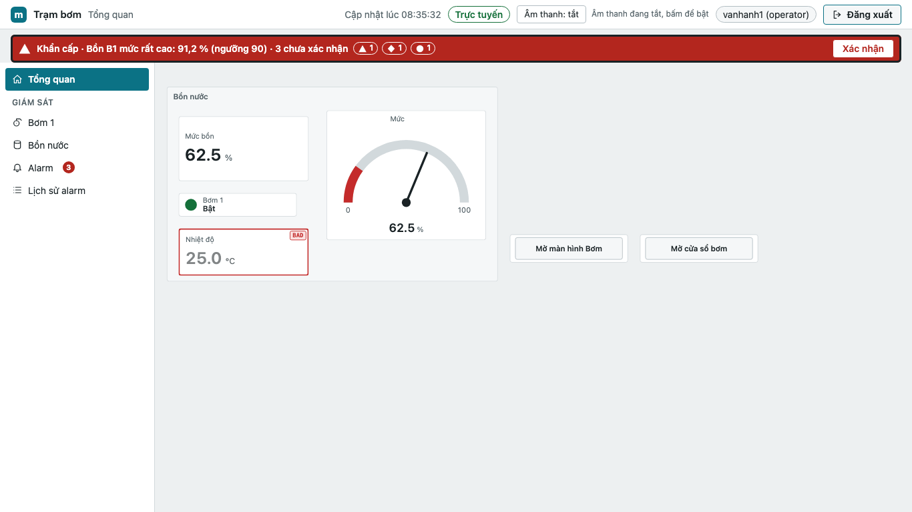 | 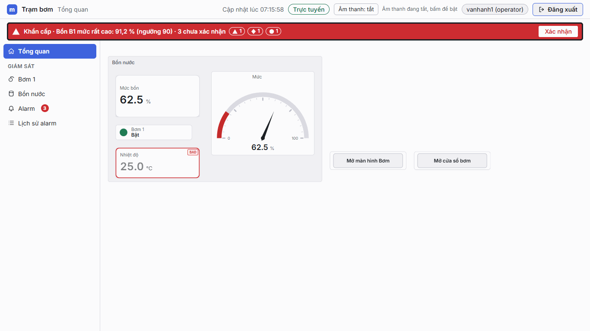 |

- Màu nhấn đổi từ xanh cổ vịt sang xanh lam (thanh điều hướng, nút); nền trang sáng hơn, gần trắng.
- Phông Inter nhúng sẵn thay phông hệ thống; thẻ giá trị bo góc 10 px.
- Đồng hồ kim vẽ bằng ECharts: vạch chia, cung vùng màu, kim thon; số đọc nằm dưới núm kim (đã sửa chỗ đè, xem mục Sửa).

## 2. Màn hình bố cục lưới

Trước 012 không có bố cục lưới, nên cột trái là **cùng màn hình ở chủ đề `industrial`** (giá trị token cũ, mặc định
cho project chưa đặt `theme`) để so màu; cột phải là `vivid`.

| industrial (token như trước 012) | vivid |
|---|---|
| 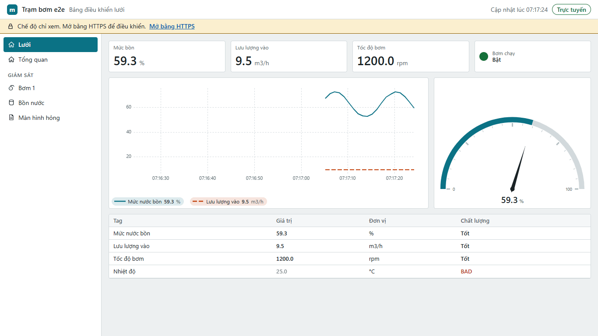 | 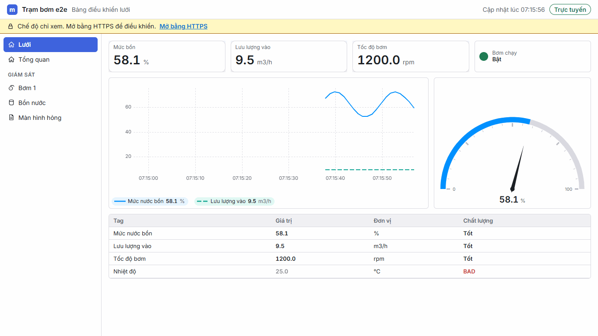 |

- Lưới 12 cột: hàng thẻ số liệu, hàng biểu đồ đường + đồng hồ, hàng bảng Tag; các ô thẳng mép, khoảng cách đều 12 px.
- Biểu đồ đường: lưới nét đứt mảnh, chú giải dạng thẻ có giá trị hiện tại; trục thời gian `HH:mm:ss` (đã sửa, xem mục Sửa).
- vivid: bảng màu Radix (xanh lam, xanh ngọc) và nền sáng; industrial giữ màu cũ.

## 3. Trang Alarm

| Trước 012 | Sau 012 (vivid) |
|---|---|
| 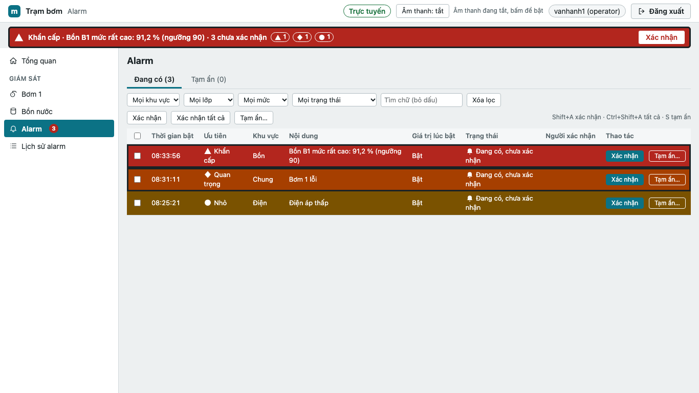 | 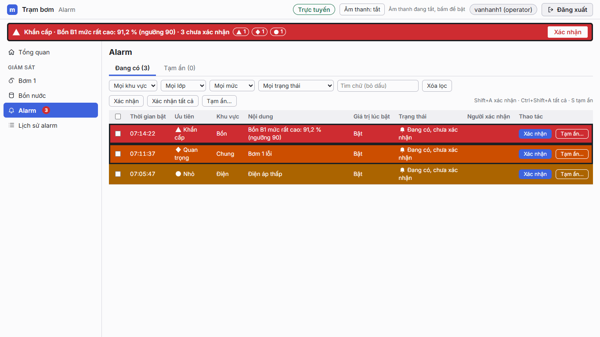 |

- Màu mức alarm sáng hơn (đỏ, cam, hổ phách) nhưng chữ trắng vẫn đọc rõ; viền nhấn alarm chưa xác nhận giữ nguyên.
- Nút "Xác nhận" theo màu nhấn mới; phông Inter, ô lọc rộng hơn chút.

## 4. Trang Lịch sử (xu hướng)

| Trước 012 | Sau 012 (vivid) |
|---|---|
|  | 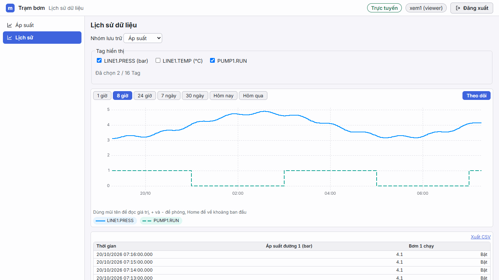 |

- Đường xu hướng màu chuỗi của chủ đề (xanh lam, xanh ngọc nét đứt), lưới nét đứt thay lưới liền.
- Chú giải dạng thẻ có nền nhạt theo màu đường; nút khoảng thời gian theo màu nhấn mới.

## 5. Trang Báo cáo

| Trước 012 | Sau 012 (vivid) |
|---|---|
|  | 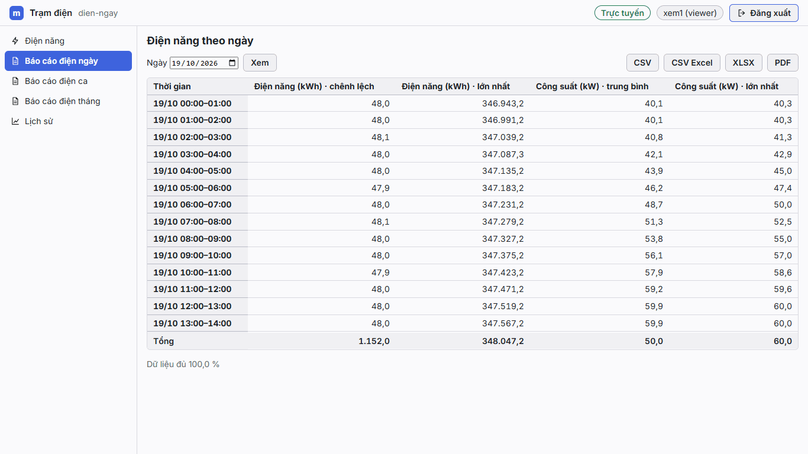 |

- Bảng bo góc, nền tiêu đề và dòng tổng xám nhạt; phông Inter, chữ số đều cột.
- Bố cục trang không đổi (biểu đồ và thẻ số liệu mới nằm trong tệp PDF/XLSX xuất ra).

## 6. Studio: trình soạn màn hình

| Trước 012 (canvas tự do, xem trước Mô phỏng) | Sau 012 (trình soạn lưới, xem trước Mô phỏng, vivid) |
|---|---|
| 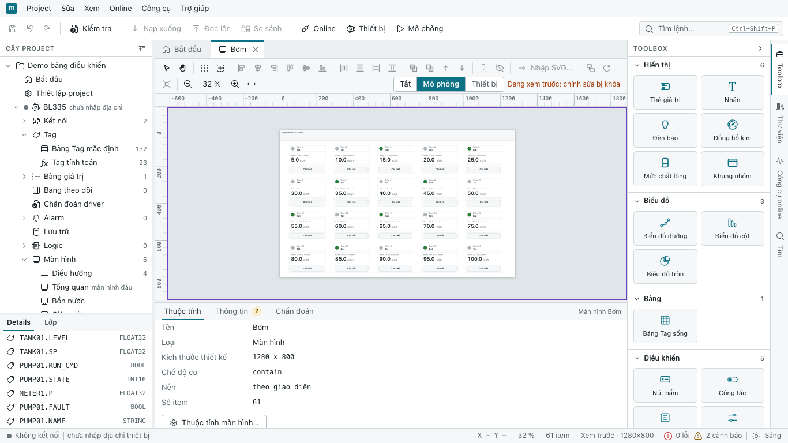 | 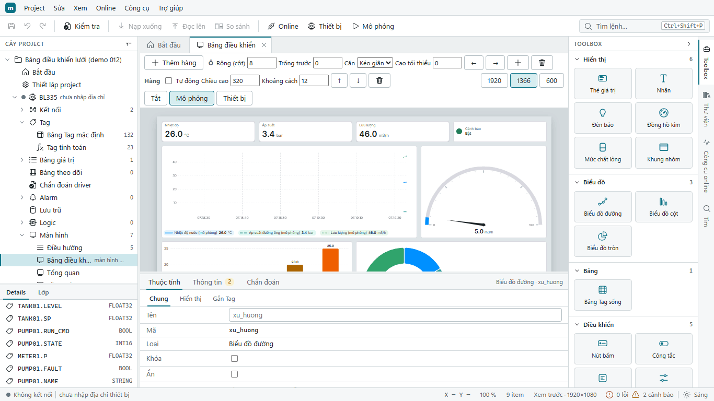 |

- Khung IDE của Studio giữ token riêng (không đổi theo chủ đề project, đúng thiết kế); canvas và xem trước theo `theme`.
- Thanh công cụ lưới: thêm hàng, số cột, căn, chiều cao, khoảng cách, xem thử 1920/1366/600.
- Xem trước có biểu đồ đường, đồng hồ, biểu đồ cột và tròn ECharts với màu vivid.
- Cột phải là project `grid-demo` (định dạng 1.1, vivid sẵn): ép `dashboard-demo` lên 1.1 trong bộ nhớ sinh 12 thông
  báo kiểm tra không liên quan giao diện, nên không dùng để so.

## 7. Mẫu báo cáo PDF (trang 1)

| Trước 012 | Sau 012 (vivid) |
|---|---|
| 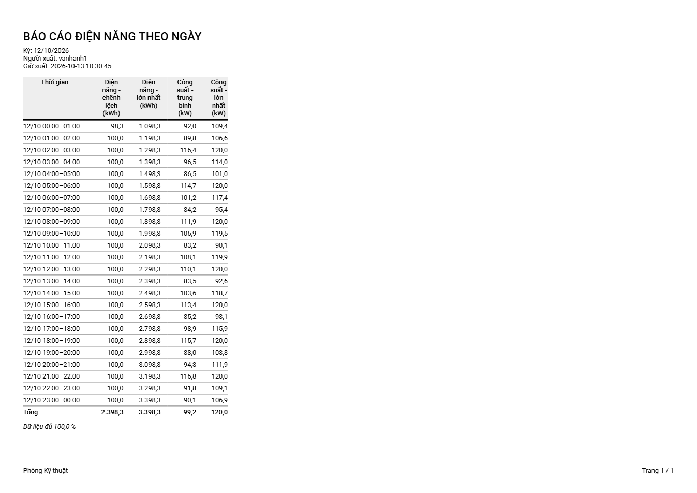 | 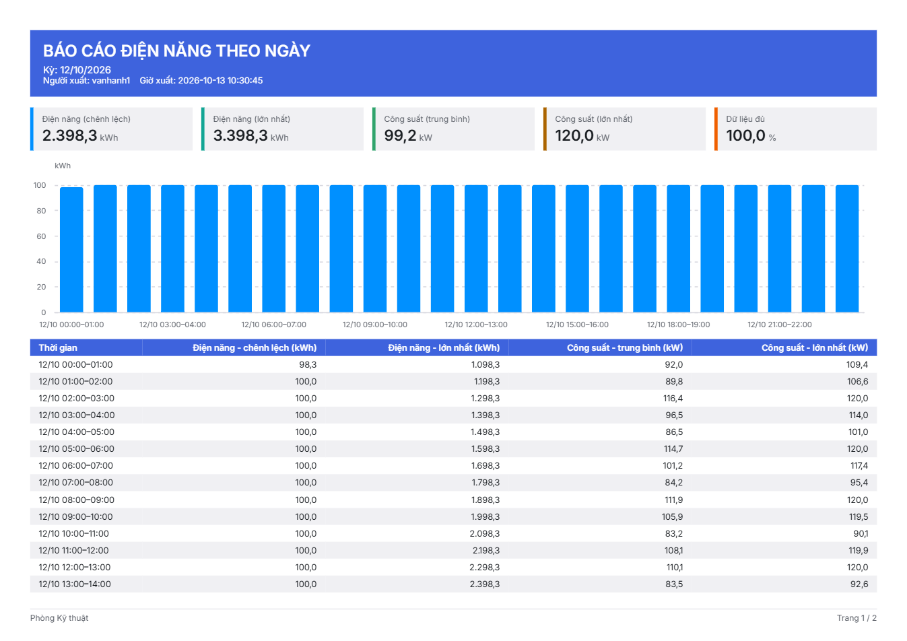 |

- Dải tiêu đề màu nhấn (tiêu đề, kỳ, người xuất, giờ xuất); hàng thẻ số liệu tổng hợp có đơn vị và "Dữ liệu đủ".
- Biểu đồ cột vector (ECharts SSR) trước bảng; bảng kẻ xen kẽ, hàng tiêu đề màu nhấn, cột rộng đủ để tiêu đề một dòng.
- Phông Inter nhúng thay Roboto; chân trang có đường kẻ và "Trang x / n". Do có biểu đồ, bảng 24 hàng sang trang 2.

## Sửa giao diện trong lúc chụp

| Chỗ xấu thấy trên ảnh | Sửa | Test |
|---|---|---|
| Đồng hồ kim: số đọc đè lên núm kim | Tâm đồng hồ cách đáy 10 px (trước 8), bỏ lề âm của số đọc (`packages/ui-components/src/widgets/gauge.ts`) | `gauge.test.ts` |
| Biểu đồ đường thời gian thực: nhãn trục kiểu Mỹ `10/20/26 7:04am`, `:25`, `:30` (Studio xem trước còn ra `1/1/70`) | Nhãn 24 giờ `HH:mm`/`HH:mm:ss`, thêm `dd/MM` khi qua ngày; giãn vạch 80 px (`clockLabels` trong `packages/ui-components/src/chart/line-chart.ts`) | `line-chart.test.ts` |
| PDF: bảng hụt mép phải khoảng 10 % so với dải tiêu đề và thẻ số liệu | Bảng hụt không quá 25 % bề rộng trang thì chia nốt cho cột số (`planLayout`, `packages/report-export/src/pdf/pdf.ts`); bảng ít cột vẫn gọn | `pdf.test.ts` |
| Ảnh lưới: biểu đồ đường gần trống vì chụp sau 4 s | Công cụ chụp chờ 20 s ở cảnh lưới (`tools/docs-screenshots.mjs`) | |

## Giới hạn

- Ảnh chụp bằng Chrome trên Windows; **chưa thử trong WebView2 (Studio cài đặt) và trên trình duyệt nối BL335**.
  Phông Inter nhúng nên chữ nên giống, khung cửa sổ có thể khác.
- Chỉ chụp chế độ sáng và chủ đề vivid; chủ đề `dark` chưa đưa vào bảng này.
- Thời gian và số liệu khác nhau giữa hai cột vì dữ liệu giả chạy theo giờ chụp.
- Ảnh "trước" là ảnh tài liệu của bản 011 (chụp 2026-10-19), cùng công cụ và cùng cảnh, không chụp lại từ bản cũ.
- Ảnh trong `docs/user/img/` chưa chụp lại sau các sửa ở trên.
