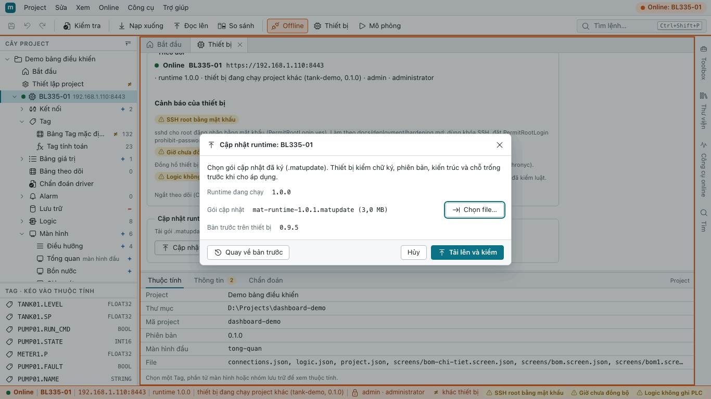
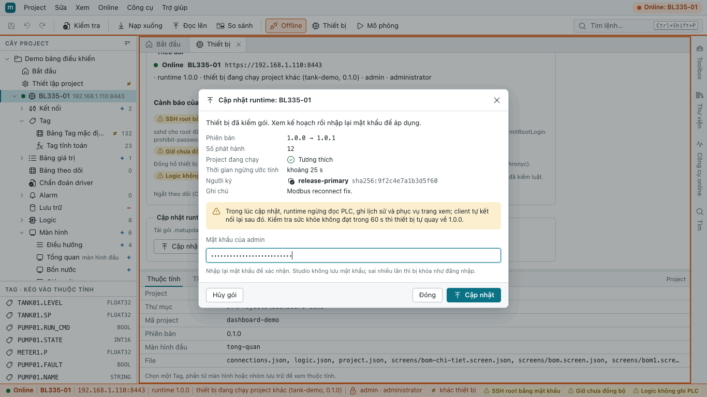
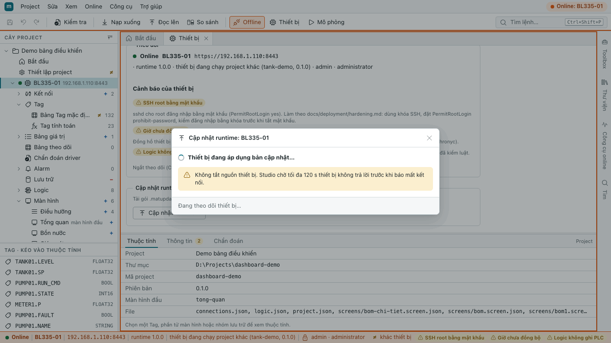
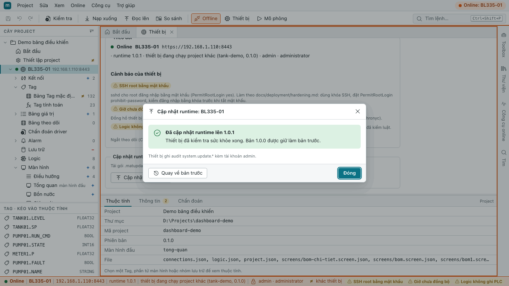
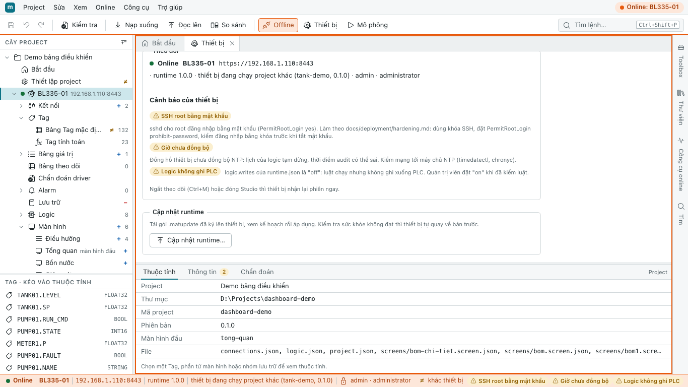

# Hướng dẫn quản trị viên

Dành cho người cài đặt và giữ hệ thống chạy: thiết bị BL335, tài khoản, chứng chỉ, sao lưu, cập nhật, gia cố, chẩn đoán. Chi tiết kỹ thuật đầy đủ của từng khóa cấu hình: [mat-runtime.md](../deployment/mat-runtime.md). Alarm: [alarm-operations.md](../deployment/alarm-operations.md).

Áp dụng cho bản 1.0: runtime 1.0.0 (API thiết bị 1.5.0) và Studio 1.0. Mọi mục trong tài liệu này đã có trong runtime 1.0.0: khóa đăng nhập, kiểm `Host`, giới hạn kết nối theo nguồn, `--check-data`, chẩn đoán, ghi PLC từ logic, cập nhật runtime qua mạng (OTA, gói `.matupdate`, `mat-updater`), kiểm chữ ký bản phát hành. Riêng chữ ký số Authenticode của bộ cài Studio cần chứng chỉ ký mã thật của công ty: bản thử và bản rc chưa có (mục 2.2).

Chữ trên màn hình được trích nguyên văn từ phần mềm. Ảnh chụp màn hình chụp giao diện web của Studio (thiết bị là thiết bị giả lập của bộ kiểm thử) trên Chrome (macOS, chế độ headless, khung 1366 × 768, theme sáng) với dữ liệu mẫu, dựng lại được bằng `node tools/docs-screenshots.mjs`; trên Windows phông chữ và khung cửa sổ có thể khác chút.

Quy ước trong tài liệu:

- Lệnh `mat-runtime …` chạy trên thiết bị, trong phiên SSH `root` (BL335 không có `sudo`). Đường dẫn đầy đủ: `/opt/mat-runtime/bin/mat-runtime`. Lệnh chỉ đọc dữ liệu chạy bằng user của dịch vụ: `runuser -u matscada -- mat-runtime …`.
- `<địa chỉ>` là IP hoặc tên của thiết bị trong LAN. **Không** ghi mật khẩu, IP công cộng hay cổng SSH của thiết bị vào tài liệu, ticket hay chat chung.
- Mọi thay đổi trên thiết bị ghi vào sổ thay đổi của site kèm cách hoàn tác.

## 1. Vai trò

| Vai trò | Được làm |
|---|---|
| `viewer` | xem trang vận hành, chẩn đoán; không điều khiển |
| `operator` | thêm: điều khiển trên trang vận hành, xác nhận và tạm ẩn alarm |
| `engineer` | thêm: nạp xuống, đọc lên, khôi phục project bằng Studio, thử kết nối |
| `administrator` | thêm: đọc audit, dừng ghi PLC của logic (mục 9), cập nhật runtime qua mạng và quay về bản trước (mục 7.2) |

Quyền root trên thiết bị (SSH) đứng ngoài các vai trò trên: tạo tài khoản, sửa cấu hình, bật ghi PLC từ logic, bật cập nhật qua mạng.

## 2. Cài đặt

### 2.1. Runtime trên BL335 (lần đầu hoặc cập nhật thủ công)

Cần: gói `mat-runtime-armhf.tar.gz` và tệp `.sha256` đi kèm, script `deploy.sh` và `rollback.sh` (trong `deployment/device/`), phiên SSH root.

1. Kiểm cổng 8080 còn trống (không in gì là trống; in `mat-runtime` là bản cũ, `deploy.sh` tự thay):

   ```sh
   ssh root@<địa chỉ> "ss -ltnp | grep ':8080 '"
   ```

2. Chép gói, `.sha256`, `deploy.sh`, `rollback.sh` vào một thư mục tạm trên máy, rồi chạy `deploy.sh` trong một phiên SSH (thư mục tạm tên ngẫu nhiên):

   ```sh
   tar -C /tmp/up -cf - . | ssh root@<địa chỉ> 'D=$(mktemp -d) && tar -C "$D" -xf - && sh "$D/deploy.sh" "$D/mat-runtime-armhf.tar.gz"; rc=$?; rm -rf "$D"; exit $rc'
   ```

3. `deploy.sh` làm: kiểm SHA-256, giải nén vào `/opt/mat-runtime.new`, kiểm project, cài cấu hình lần đầu, sao lưu bản đang chạy vào `/opt/mat-runtime.prev`, kích hoạt, kiểm tra sức khỏe trong 15 s. Không đạt thì **tự rollback**.
4. Lần đầu: `deploy.sh` hỏi mật khẩu cho tài khoản `admin` (vai trò administrator) nếu có terminal; nếu không, nó in "BƯỚC BẮT BUỘC" kèm lệnh tạo tài khoản (mục 4).
5. Ghi lại **fingerprint** mà `deploy.sh` in ra (dùng ở mục 3).

Kiểm tra sau cài:

```sh
systemctl status mat-runtime --no-pager
wget -qO- http://127.0.0.1:8080/api/v1/system/info
journalctl -u mat-runtime -n 50 --no-pager
```

Rollback tay về bản trước: `sh /opt/mat-runtime/deployment/rollback.sh` (bản hỏng giữ ở `/opt/mat-runtime.failed`).

### 2.2. mAT Studio trên Windows

1. Chạy bộ cài `mAT Studio_<phiên bản>_x64-setup.exe`. mAT SCADA là sản phẩm dùng nội bộ: bộ cài **không có chữ ký số Authenticode của CA** (quyết định 2026-10-19, không mua chứng chỉ ký mã), nên Windows báo nhà phát hành không xác định ("Unknown publisher") và SmartScreen có thể hiện "Windows protected your PC": chọn **More info → Run anyway**. Chỉ cài khi tệp đến từ kênh nội bộ tin cậy và `SHA256SUMS` khớp (mục 7.3); `SHA256SUMS.sig` được ký bằng khóa phát hành nội bộ nên vẫn kiểm được tính toàn vẹn của cả bộ phát hành.
2. Lần đầu tìm thiết bị, Windows có thể hỏi cho phép qua tường lửa: chọn **mạng riêng**.
3. Studio cần WebView2 (có sẵn trên Windows 10/11 cập nhật).

## 3. Chứng chỉ HTTPS

Thiết bị tự sinh chứng chỉ ở lần chạy đầu. Studio và Chrome kiểm thiết bị bằng **fingerprint SHA-256** của chứng chỉ.

- Đọc fingerprint trên thiết bị:

  ```sh
  runuser -u matscada -- /opt/mat-runtime/bin/mat-runtime --cert-fingerprint
  mat-runtime --cert-info     # chủ thể, SAN, hạn, fingerprint
  ```

- Đưa fingerprint cho kỹ sư qua kênh tin cậy (đọc trực tiếp, giấy) để họ so khi ghim trong Studio.
- **Chrome trên máy vận hành:** mở `https://<địa chỉ>:8443/device.crt` để tải chứng chỉ, so fingerprint, rồi cài vào "Trusted Root Certification Authorities" của Windows (`certmgr.msc`, hoặc `certutil -addstore -f Root mat-device.crt` với quyền quản trị; nhiều máy: Group Policy). Khởi động lại Chrome.
- Đặt **IP tĩnh** cho BL335: chứng chỉ ghi IP của thiết bị. Đổi IP thì chạy `mat-runtime --regen-cert` (fingerprint đổi: Studio phải ghim lại, máy vận hành phải cài lại chứng chỉ).
- Dùng CA của công ty: `mat-runtime --make-csr --san <IP>,<tên miền>` → gửi CSR cho CA → `mat-runtime --import-cert chain.pem` → `systemctl restart mat-runtime`. CA phải ký bằng **ECDSA**; chứng chỉ ký RSA bị từ chối.

## 4. Tài khoản

Tài khoản nằm trong `/etc/mat-runtime/users.json` (`0640 root:matscada`; runtime từ chối tệp có quyền khác). Chỉ tạo trên thiết bị bằng root; không có đăng ký hay quên mật khẩu trên web.

```sh
mat-runtime --user-add admin --role administrator     # hỏi mật khẩu hai lần, không hiện ký tự
mat-runtime --user-add kysu1 --role engineer
mat-runtime --user-add vanhanh1 --role operator
mat-runtime --user-add xem1 --role viewer
mat-runtime --user-list
mat-runtime --user-passwd kysu1                       # đổi mật khẩu
mat-runtime --user-role kysu1 operator                # đổi vai trò
mat-runtime --user-disable kysu1                      # tắt (người nghỉ việc)
mat-runtime --user-enable kysu1
```

Mật khẩu không bao giờ là tham số dòng lệnh. Dùng trong script: `printf '%s\n' "$MAT_PW" | mat-runtime --user-add kysu2 --role engineer --password-stdin`.

**Mật khẩu:** mật khẩu mới dài **15 đến 128 ký tự**, khác tên tài khoản, dạng Unicode dựng sẵn (bộ gõ Unikey/EVKey đặt "Unicode dựng sẵn"). Tài khoản có sẵn với mật khẩu cũ ngắn hơn không bị buộc đổi, nhưng nên đổi. Mỗi người một tài khoản; không dùng chung `admin`.

**Khóa đăng nhập tạm:**

- Sai 5 lần liên tiếp thì khóa **cặp (tên tài khoản, IP máy)** đó 5 phút (kể cả khi gõ đúng). Lặp lại trong 24 giờ thì gấp đôi, tối đa 60 phút; không bao giờ khóa vĩnh viễn. Trang báo `AUTH_LOCKED`.
- Cùng tài khoản từ máy khác vẫn đăng nhập được: người ngoài không khóa được tài khoản của người khác từ xa.
- Một IP sai 20 lần (mọi tên) trong 10 phút: mọi đăng nhập từ IP đó bị khóa 5 phút. Nhiều người sau cùng một NAT có thể bị khóa chung.
- Quá 2 lần kiểm mật khẩu cùng lúc (`maxConcurrentLogins`): 429 `LOGIN_BUSY`, thử lại sau 1 s, không khóa ai; audit có `auth.busy` (tối đa một dòng mỗi phút, kèm số lần bị từ chối). Thấy nhiều `auth.busy`: có máy đang thử mật khẩu hàng loạt.
- Một tên bị sai ≥ 50 lần trong 10 phút từ ≥ 5 IP: audit `auth.distributed_attack` (không khóa). Gặp mục này: kiểm tra mạng, đổi mật khẩu tài khoản đó.
- Mở khóa sớm: `mat-runtime --user-unlock <tên>` (mọi cặp của tên đó, có hiệu lực trong 2 s) hoặc `mat-runtime --user-unlock-all` (mọi cặp và mọi IP, trong 5 s). Khởi động lại dịch vụ cũng xóa mọi khóa.
- `--user-unlock-all` để tệp yêu cầu `/var/lib/mat-runtime/auth-unlock.req` cho runtime đọc. Runtime chỉ dùng tệp này khi là tệp thường của root, quyền `0600`; tệp khác (do `matscada` hay người khác tạo, quyền rộng hơn, thư mục, liên kết) bị xóa không dùng, có audit `account.unlock` bị từ chối mã `UNLOCK_REQUEST_REFUSED`. Vì vậy luôn chạy lệnh bằng root, không bằng `runuser -u matscada`.

**Phiên:** hết sau 30 phút rảnh (`webSessionIdleMin`, 5–480; trạm 24/7 có thể đặt 480), tối đa 12 giờ (`webSessionMaxHours`). Tối đa 12 phiên web cùng lúc (`webMaxSessions`).

## 5. Cấu hình mạng và gia cố

Cấu hình ở `/etc/mat-runtime/runtime.json`. Sửa xong: `systemctl restart mat-runtime`, rồi xem cảnh báo bằng `journalctl -u mat-runtime -n 50 --no-pager`. Sai kiểu hoặc ngoài khoảng: runtime không chạy và in tên khóa sai. Khóa lạ: bỏ qua kèm `warning: bỏ qua khóa không hỗ trợ` (gõ sai tên khóa thì runtime dùng mặc định: luôn đọc cảnh báo).

### 5.1. Tên truy cập (`allowedHosts`)

Thiết bị kiểm tiêu đề `Host` của mọi yêu cầu (chống DNS rebinding). Luôn nhận: mọi địa chỉ IP, `localhost`, tên máy của thiết bị và `<tên máy>.local`. Truy cập bằng tên khác (DNS nội bộ, DDNS) bị trả 421 `HOST_NOT_ALLOWED`. Thêm tên:

```json
"allowedHosts": ["scada.nhamay.vn"]
```

So khớp chính xác, không phân biệt hoa thường, không có ký tự đại diện; tối đa 32 tên. Kiểm áp cho HTTP, HTTPS và kênh dữ liệu sống, trước mọi xử lý khác, nên mở bằng IP hay qua NAT, chuyển cổng vẫn được. `"hostCheck": "off"` tắt kiểm, chỉ dùng khi gỡ rối (cảnh báo `HOST_CHECK_OFF`).

Mỗi lần từ chối có audit `access.denied` kèm tên đã gõ (cắt còn 64 ký tự). Để audit không bị một máy dò tên làm đầy, runtime ghi một dòng cho mỗi (IP, mã) mỗi phút; các lần sau trong phút được cộng vào một dòng tổng (`detail.repeated`). Thấy nhiều dòng `HOST_NOT_ALLOWED` từ một máy trong LAN: máy đó đang mở thiết bị bằng tên chưa khai (thêm vào `allowedHosts`) hoặc có trang lạ đang dò thiết bị.

### 5.2. Ai được xem

| Khóa | Giá trị nên dùng | Ghi chú |
|---|---|---|
| `viewerAccess` | `private` (mặc định) | trang xem không đăng nhập chỉ cho địa chỉ mạng riêng; `any` chỉ khi demo (cảnh báo `VIEWER_PUBLIC`); `off` tắt trang xem |
| `viewerLogin` | `off` cho kiosk trong phòng điều khiển; `required` khi trang có thể bị mở từ ngoài LAN | `required`: không có dữ liệu nếu chưa đăng nhập |
| `maxConnPerSource` | 48 (mặc định; khoảng 4–64) | số kết nối đồng thời tối đa mỗi IP (HTTP, HTTPS, WebSocket cộng chung); chống một máy chiếm hết worker. Runtime áp tối đa 75 % `httpsThreads` (mặc định 64, tức 48): đặt cao hơn thì runtime dùng mức đó và in cảnh báo lúc khởi động |
| `maxLiveClientsPerSource` | không đặt (mặc định nửa số phiên dữ liệu sống, làm tròn lên: 5 của 10); khoảng 1–10 | số trang nhận dữ liệu sống cùng lúc tối đa của một IP. Đặt `10` khi nhiều máy vận hành đi qua cùng một NAT hoặc VPN (thiết bị thấy chúng là một IP), hoặc một máy mở nhiều tab |

Giới hạn theo IP được tính ở hai mức:

- **Theo từng cổng:** mỗi cổng có nhóm worker riêng, nên một IP giữ tối đa 75 % worker của cổng đó: 18 trong 24 worker HTTP (`threads`, cổng 8080) và 48 trong 64 worker HTTPS (`httpsThreads`, cổng 8443). Hai cổng cộng lại vẫn không quá `maxConnPerSource`. Vượt thì kết nối mới bị đóng ngay, trước cả bắt tay TLS.
- **Phiên dữ liệu sống:** thiết bị phục vụ tối đa 10 trang nhận dữ liệu sống cùng lúc; một IP giữ tối đa `maxLiveClientsPerSource`. Trang thứ 6 từ cùng một IP (mặc định) hiện "Máy này đã mở tối đa 5 kết nối dữ liệu sống. Đóng bớt tab hoặc thử lại sau." và tự thử lại; khi cả thiết bị đã đủ 10 trang thì là "Hệ thống đã đạt tối đa 10 kết nối. Vui lòng thử lại sau.".

Kết nối HTTPS rảnh được giữ 3 s rồi đóng. Mặc định 64 worker HTTPS (`httpsThreads`): đủ cho 10 trang mở cùng lúc sau một địa chỉ (NAT, VPN) cả khi cùng bấm F5, và vẫn chừa 16 worker cho máy khác. Đừng hạ `maxConnPerSource` khi nhiều trạm vận hành đi qua cùng một NAT hoặc VPN; ở site như vậy đặt `"maxLiveClientsPerSource": 10`, nếu không chỉ 5 trạm đầu nhận được dữ liệu sống.

### 5.3. Gia cố thiết bị

- **SSH:** dùng khóa SSH cho root (`PermitRootLogin prohibit-password`) hoặc `PasswordAuthentication no`, rồi `systemctl reload ssh`. Khi root còn đăng nhập bằng mật khẩu, thiết bị báo cảnh báo `SSH_ROOT_PASSWORD` (đọc `/etc/ssh/sshd_config` lúc khởi động và 10 phút một lần). Đổi mật khẩu root mặc định ngay khi nhận thiết bị.
- **Truy cập từ xa:** dùng **VPN** vào LAN của thiết bị. Không chuyển cổng (port-forward) 22, 8080, 8443 ra Internet. Nếu bắt buộc chuyển cổng HTTPS: giới hạn nguồn ở router, `viewerLogin: required`, mật khẩu dài. Router làm SNAT thì bộ lọc mạng riêng của thiết bị không còn tác dụng.
- **Mạng:** IP tĩnh; NTP cho đồng hồ (lịch và báo cáo cần giờ đúng); chỉ mở UDP 8446 (tìm thiết bị) trong LAN, hoặc tắt bằng `"discoveryEnabled": false`.
- **Tệp:** không đổi quyền `users.json`, `secrets.json` (`0640 root:matscada`), thư mục `/var/lib/mat-runtime` (`0700 matscada`).
- Hướng dẫn gia cố chi tiết kèm bộ luật tường lửa mẫu (gồm `nft ct count` giới hạn kết nối ở tầng mạng): `docs/deployment/hardening.md` trong bộ mã nguồn (không đi kèm bộ cài).

## 6. Sao lưu và khôi phục

### 6.1. Có gì cần sao lưu

| Nội dung | Nơi trên thiết bị | Ghi chú |
|---|---|---|
| Cấu hình | `/etc/mat-runtime/runtime.json` | |
| Tài khoản | `/etc/mat-runtime/users.json` | chỉ có băm mật khẩu, vẫn giữ kín |
| Mật khẩu DB ngoài | `/etc/mat-runtime/secrets.json` | **bí mật**: lưu bản sao mã hóa |
| Chứng chỉ và khóa | `/var/lib/mat-runtime/tls/` | **bí mật**; giữ thì không phải ghim lại |
| Project đang chạy và 3 bản dự phòng | `/var/lib/mat-runtime/projects/` | bản chính nên nằm ở máy kỹ sư (Đọc lên) |
| Lịch sử, alarm, audit | `/var/lib/mat-runtime/{history,alarm,audit}.db*` | lớn dần; chép kèm tệp `-wal`, `-shm` |
| Giá trị giữ qua mất điện | `/var/lib/mat-runtime/retain/` | |

Bản project tốt nhất là thư mục project trên máy kỹ sư. Nếu mất: Studio, **Đọc lên…** > **Thành project mới**.

### 6.2. Sao lưu

Dừng dịch vụ vài giây để có bản nhất quán (trong lúc dừng không có dữ liệu):

```sh
systemctl stop mat-runtime
tar -C / -czf /root/mat-backup-$(date +%Y%m%d).tar.gz etc/mat-runtime var/lib/mat-runtime
systemctl start mat-runtime
```

Chép tệp sao lưu ra khỏi thiết bị (máy quản trị, ổ mã hóa). Kiểm chỗ trống trước: `df -h /root /var/lib`.

### 6.3. Khôi phục

1. Cài runtime cùng phiên bản (mục 2.1) nếu thiết bị mới.
2. Khôi phục:

   ```sh
   systemctl stop mat-runtime
   tar -C / -xzf /root/mat-backup-<ngày>.tar.gz
   chown -R matscada:matscada /var/lib/mat-runtime && chmod 0700 /var/lib/mat-runtime
   chown root:matscada /etc/mat-runtime/users.json /etc/mat-runtime/secrets.json
   chmod 0640 /etc/mat-runtime/users.json /etc/mat-runtime/secrets.json
   systemctl start mat-runtime
   ```

3. Kiểm: `runuser -u matscada -- mat-runtime --project-status`, `runuser -u matscada -- mat-runtime --check-history` ("integrity: ok"), `runuser -u matscada -- mat-runtime --alarm-db-check`.

Kiểm một lần mọi kho dữ liệu (lịch sử, alarm, audit, project, retain, nhật ký xung, trạng thái logic), chỉ đọc, không cần dừng dịch vụ, tối đa khoảng 30 s:

```sh
runuser -u matscada -- mat-runtime --check-data          # thêm --json để in một đối tượng JSON
```

Mã thoát: 0 nguyên vẹn; 1 chỉ có cảnh báo phục hồi được (ví dụ `-wal` còn dữ liệu, xung chưa nhả: lần chạy sau tự xử lý); 2 có mục hỏng (khôi phục từ sao lưu); 3 sai tham số hoặc cấu hình. Tệp không có (thiết bị chưa từng tạo) báo "missing", không phải lỗi. Thời gian kiểm tối đa đặt bằng `--budget-s` (mặc định 25 s); hết giờ thì mục đó là cảnh báo "chưa kiểm hết".

### 6.4. Khôi phục project

Studio, **Online** > **Khôi phục bản trước…**: chọn một trong 3 bản dự phòng. Xem trạng thái trên thiết bị: `runuser -u matscada -- mat-runtime --project-status`.

## 7. Cập nhật runtime

### 7.1. Thủ công bằng `deploy.sh`

Như mục 2.1. Luôn dùng được, kể cả khi cập nhật qua mạng hỏng. Trước khi cập nhật: sao lưu (mục 6.2), báo người vận hành, chọn giờ thấp điểm. `deploy.sh` giữ bản cũ ở `/opt/mat-runtime.prev`; rollback bằng `rollback.sh`.

Lên bản mới mà rồi phải rollback về bản cũ: bản cũ có thể không đọc được project hay cấu hình mới (xem mục 11). Bản 0.9 trở về trước từ chối khởi động khi gặp khóa cấu hình lạ: bỏ các khóa mới khỏi `runtime.json` trước khi rollback.

### 7.2. Qua mạng từ Studio (OTA)

Cập nhật runtime qua mạng dùng gói `.matupdate` do nhà phát hành ký bằng ECDSA P-256. Mặc định **tắt**; quy trình thủ công ở mục 7.1 luôn dùng được và là đường khôi phục khi OTA hỏng.

**Thành phần trên thiết bị** (`deploy.sh` cài sẵn từ gói có thư mục `updater/`):

| Thành phần | Chạy bằng | Việc |
|---|---|---|
| `mat-runtime` | `matscada` | nhận gói qua HTTPS (chỉ administrator), kiểm sơ bộ, giữ gói đã kiểm 30 phút; khi người dùng xác nhận bằng mật khẩu thì ghi yêu cầu cho `mat-updater` |
| `mat-updater` (`/usr/lib/mat-updater/`) | root, chạy một lần mỗi yêu cầu | **kiểm lại toàn bộ** gói trên bản sao của root, giải nén, tự kiểm bản mới, đổi bản đang chạy sang `/opt/mat-runtime.prev`, kiểm tra sức khỏe 60 s, tự quay về khi không đạt |
| `mat-updater-recover.service` | root, trước `mat-runtime` | hoàn tất hoặc quay về khi lần cập nhật bị mất điện cắt ngang |
| `mat-update-verify` | ai cũng chạy được | kiểm chữ ký và từng tệp của gói (mục 7.3) |
| `/etc/mat-runtime/trusted-keys/*.pem` | root, `0644` | khóa công khai tin cậy (tối đa 4), nằm ngoài phần được cập nhật |

Chính `mat-updater` không bao giờ được thay qua OTA: gói có thư mục `updater/` bị từ chối `UPDATER_MANUAL_ONLY`, phải cài bằng `deploy.sh` (mục 7.1).

**Bật OTA** (root, trên thiết bị):

1. Kiểm có khóa tin cậy: `ls -l /etc/mat-runtime/trusted-keys/` (ít nhất một tệp `.pem`) và `mat-runtime --trust-key list` (keyId và nhãn từng khóa). `deploy.sh` chỉ cài khóa đi kèm gói khi thư mục chưa có khóa nào; không bao giờ ghi đè khóa đã có.
2. Sửa `runtime.json`: `"update": {"enabled": true}` (khóa phụ: `maxPackageMiB`, mặc định 64, khoảng 8–256; `trustedKeysDir`, mặc định `/etc/mat-runtime/trusted-keys`). Rồi `systemctl restart mat-runtime` và kiểm `systemctl status mat-updater.path` báo `active (waiting)`.
3. Bật mà chưa có khóa: cảnh báo `UPDATE_KEYS_MISSING`, mọi gói bị từ chối. Tắt lại: `"enabled": false` rồi khởi động lại dịch vụ (Studio hiện "OTA đang tắt: root bật update.enabled trong runtime.json").

**Khóa tin cậy** (root):

```sh
mat-runtime --trust-key list
mat-runtime --trust-key add /tmp/release-backup.pub.pem --label release-backup   # chỉ khóa công khai ECDSA P-256, tối đa 4
mat-runtime --trust-key remove sha256:<keyId>
```

Thay đổi bằng `--trust-key` có audit `system.keys.updated` ở lần khởi động runtime sau. Xoay khóa (định kỳ, hoặc khi khóa ký chính bị lộ): nhà phát hành phát gói **keyset** ký bằng một khóa đang tin cậy (thường là khóa dự phòng); cài như một cập nhật bình thường từ Studio, khóa mới có hiệu lực ngay, không khởi động lại runtime. Gói keyset không được gỡ chính khóa đã ký nó (`KEYSET_SELF_REVOKE`), và gói keyset cũ hơn gói đã cài bị từ chối (`UPDATE_DOWNGRADE`), nên không phát lại được để thêm khóa đã thu hồi. Cả hai khóa bị lộ: tắt OTA, cài khóa mới tại chỗ bằng `--trust-key` hoặc `deploy.sh`.

**Cập nhật từ Studio** (tài khoản administrator, Online, HTTPS):

1. Trang **Thiết bị**, khung "Cập nhật runtime" (hoặc task card cùng tên ở Công cụ online): bấm **Cập nhật runtime…**.
2. **Chọn file…** gói `.matupdate`, bấm **Tải lên và kiểm**. Thiết bị kiểm theo thứ tự: phong bì, chữ ký, băm, danh sách tệp, kiến trúc, gói mới hơn bản đang chạy (`releaseSeq`), bản đang chạy đủ mới để lên thẳng (`minFromVersion`), định dạng project đang chạy, chỗ trống.
3. Đọc kế hoạch: **Phiên bản** (từ → đến), **Số phát hành**, **Project đang chạy** (**Tương thích** hay không), **Thời gian ngừng ước tính**, **Người ký**, **Ghi chú**. Gói đã kiểm được giữ 30 phút; **Hủy gói** để bỏ.
4. Nhập lại mật khẩu của mình rồi bấm **Cập nhật**. Mật khẩu sai trả `REAUTH_FAILED` và được tính như đăng nhập sai (khóa theo cặp tên, IP; `AUTH_LOCKED`, `LOGIN_BUSY` như mục 4).
5. Theo dõi: "Thiết bị đang áp dụng bản cập nhật…", rồi "Dịch vụ runtime đang khởi động lại, Studio chờ thiết bị trả lời…". **Không tắt nguồn thiết bị.** Dịch vụ ngừng khoảng 10–30 s; trang vận hành tự nối lại. Phiên đăng nhập của Studio mất khi runtime khởi động lại: đăng nhập lại để xem kết quả.









Trạng thái mà thiết bị báo (`GET /api/v1/system/update`, Studio đọc):

| Trạng thái | Ý nghĩa |
|---|---|
| `idle` | không có cập nhật nào đang làm |
| `receiving` | đang nhận gói |
| `verified` | gói đã kiểm xong, chờ người xác nhận (tối đa 30 phút) |
| `applying` | `mat-updater` đang cài; nạp xuống project bị chặn (`DEVICE_BUSY`) |
| `committed` | bản mới chạy và qua kiểm tra sức khỏe; bản cũ giữ ở `/opt/mat-runtime.prev`. Studio: "Đã cập nhật runtime lên …" |
| `rolled-back` | bản mới không qua kiểm tra sức khỏe trong 60 s (tiến trình sống, `system/info` qua HTTP và HTTPS đúng phiên bản và đúng project): bản cũ chạy lại, bản hỏng giữ ở `/opt/mat-runtime.failed`, cảnh báo `UPDATE_ROLLED_BACK` 30 ngày. Studio: "Không cập nhật được: thiết bị đang chạy …" kèm lý do |
| `failed` | `mat-updater` không làm xong (kiểm lại gói không đạt, yêu cầu dày hơn 1 lần mỗi 5 phút `RATE_LIMITED`, bị cắt ngang trước bước đổi bản…): thường bản đang chạy không đổi; đọc lý do (`code`, `reason`) bằng `mat-runtime --update-status` |

Studio mất liên lạc quá 120 s thì báo "Mất kết nối với thiết bị quá 120 s": đợi vài phút, Online lại và mở Cập nhật runtime, hoặc trên thiết bị chạy `mat-runtime --update-status` (thêm `--json` để in JSON) và `journalctl -u mat-updater -u mat-runtime --no-pager`.

**Quay về bản trước:** trong hộp Cập nhật runtime, **Quay về bản trước** (cần mật khẩu, audit `system.update.manual-rollback`) chạy lại bản ở `/opt/mat-runtime.prev`; không có bản trước thì báo `UPDATE_NO_PREVIOUS`. Trên thiết bị: `rollback.sh` (mục 2.1).

**Giới hạn:** một cập nhật mỗi 5 phút; gói ≤ `update.maxPackageMiB`; chỗ trống ≥ 3 lần kích thước gói; nạp xuống project và cập nhật không chạy cùng lúc (`DEVICE_BUSY` cả hai chiều); gửi gói quá chậm hoặc đứt giữa chừng thì `UPDATE_RECEIVE_ABORTED`. Mọi bước có audit `system.update.*` (`accepted`, `rejected`, `applying`, `committed`, `rolled-back`, `cancelled`, `manual-rollback`) kèm tài khoản.

**Mã lỗi thường gặp** (đủ danh sách: [error-codes.md](error-codes.md#update)):

| Mã | Nghĩa | Việc cần làm |
|---|---|---|
| `UPDATE_DISABLED` | OTA đang tắt | root bật `update.enabled` (trên) |
| `UPDATE_KEYS_MISSING` | thiết bị chưa có khóa tin cậy | `--trust-key add` hoặc `deploy.sh` |
| `UPDATE_SIGNATURE_INVALID` | chữ ký không đúng với khóa tin cậy nào | không cài; lấy gói từ kênh chính thức |
| `UPDATE_PACKAGE_INVALID` | gói hỏng hoặc sai định dạng (chi tiết trong `detail.code`) | tải lại gói |
| `UPDATE_DOWNGRADE` | gói không mới hơn bản đang chạy | không hạ cấp qua OTA; dùng `rollback.sh` hoặc `deploy.sh` |
| `UPDATE_ARCH_MISMATCH` | gói cho kiến trúc khác | chọn gói armhf |
| `UPDATE_PROJECT_INCOMPATIBLE` | project đang chạy không chạy được trên bản mới | nạp project phù hợp trước hoặc dùng gói khác |
| `UPDATE_TOO_LARGE`, `INSUFFICIENT_SPACE` | gói quá cỡ, thiết bị thiếu chỗ | giải phóng chỗ (`df -h /var/lib /opt`) |
| `UPDATER_MANUAL_ONLY` | gói kèm `mat-updater` mới | cài bằng `deploy.sh` (mục 7.1) |
| `UPDATE_NOT_FOUND` | gói đã hết hạn 30 phút hoặc đã hủy | tải lại gói |
| `REAUTH_FAILED` | mật khẩu xác nhận sai | nhập lại; sai nhiều lần thì bị khóa như đăng nhập |
| `DEVICE_BUSY` | đang nạp xuống project hoặc đang có cập nhật khác | chờ xong rồi làm lại |

### 7.3. Kiểm bản phát hành trước khi cài

Mỗi bản phát hành có `SHA256SUMS` và chữ ký `SHA256SUMS.sig`. Kiểm bằng `mat-update-verify SHA256SUMS --sig SHA256SUMS.sig --keys deployment/keys/` (mã thoát 0 hợp lệ; 3 chữ ký sai; 4 không có khóa; 5 gói hoặc `SHA256SUMS` sai; 6 gói không hợp thiết bị). Kiểm một gói `.matupdate` với bản đang cài: `/usr/lib/mat-updater/mat-update-verify <gói>.matupdate --keys /etc/mat-runtime/trusted-keys --installed /opt/mat-runtime`.

`deploy.sh` cũng kiểm `SHA256SUMS.sig` khi tệp này nằm cạnh gói, bằng `mat-update-verify` **đã cài** trên thiết bị. Lần cài đầu (chưa có bộ kiểm đã cài) nó in `CẢNH BÁO TIN-LẦN-ĐẦU (TOFU)`; khi đó nên ghim khóa phát hành: `sh deploy.sh <gói> --expect-key-id sha256:<hex>` với keyId do nhà phát hành công bố (thiếu chữ ký thì dừng thay vì chỉ cảnh báo).

## 8. Chẩn đoán và KPI

- `GET /api/v1/system/info` (HTTP, mạng riêng): phiên bản, project, cảnh báo (`warnings`), trạng thái lưu trữ, alarm. Trên thiết bị: `wget -qO- http://127.0.0.1:8080/api/v1/system/info`.
- Studio: Inspector của thiết bị, tab **Chẩn đoán** (CPU, RAM, dung lượng trống, giờ, số phiên); **Audit của thiết bị** (administrator).
- Xuất audit: `runuser -u matscada -- mat-runtime --export-audit --from "2026-10-01 00:00" --format csv > audit.csv`.
- Lưu trữ: `runuser -u matscada -- mat-runtime --history-stats` (số dòng, dung lượng, số lần chạy).
- Log: `journalctl -u mat-runtime --since "1 hour ago" --no-pager`.
- Số luồng: `ls /proc/$(pidof mat-runtime)/task | wc -l` (khoảng 100 là bình thường: 24 worker HTTP và 64 worker HTTPS, khoảng 10 luồng chức năng, mỗi kênh Modbus TCP thêm một luồng).
- Ghi eMMC: `system/info`, mục `historian.io` (`bytesPerDay`). Ngân sách: ≤ 2 GB/ngày.

**Chẩn đoán dài hạn (KPI):** `GET https://<địa chỉ>:8443/api/v1/diagnostics` (cần đăng nhập, vai trò `viewer` trở lên; tab **Chẩn đoán** của Studio đọc cùng địa chỉ này). Ngoài các khối cũ (CPU, bộ nhớ, đĩa, phiên), bản 1.0 thêm:

| Khóa | Ý nghĩa |
|---|---|
| `uptimeS` | số giây runtime đã chạy |
| `restarts` | số lần khởi động lại và nguyên nhân lần cuối: `crash` (lần trước không dừng sạch, kể cả mất điện), `update` (đổi phiên bản), `systemd-restart` (dừng sạch), `unknown` |
| `rssMb`, `rssPeakMb` | RAM của runtime hiện tại và cao nhất (MiB) |
| `cpuPct` | CPU của runtime, trung bình 5 phút |
| `fdCount`, `threads` | số tệp đang mở, số luồng |
| `ioWriteBytesToday` | byte ghi từ 00:00 theo từng phần (lịch sử, alarm, audit, retain, logic…) |
| `emmcLife` | tuổi thọ eMMC đọc từ thiết bị; `null` kèm `emmcLifeReason` khi không đọc được |
| `liveLagP95Ms` | độ trễ dữ liệu sống p95 trong 5 phút gần nhất |
| `timeSynced` | đồng hồ thiết bị đã đồng bộ chưa (lịch của logic và báo cáo cần giờ đúng) |

Giá trị không biết là `null`, không bao giờ là 0. Trong pilot, `tools/pilot/collect.ps1` thu dữ liệu này mỗi 15 phút và `tools/pilot/kpi.mjs` tính KPI (xem [docs/pilot/criteria.md](../pilot/criteria.md)).

Ngưỡng tham khảo: RSS ≤ 150 MB, CPU trung bình ≤ 30 %, `liveLagP95Ms` ≤ 500 ms, ghi eMMC ≤ 2 GB/ngày.

### Cảnh báo của thiết bị

`system/info` có danh sách mã `warnings`; Studio hiện chúng ở thông tin thiết bị. `warningDetails` cho mỗi mã thêm thông điệp tiếng Việt, thời điểm bắt đầu (`since`) và `detail` (ví dụ danh sách Tag của `PULSE_STUCK`); `detail` chỉ có khi request mang phiên đăng nhập (giảm thông tin cho người dò từ ngoài). Cảnh báo tự hết khi nguyên nhân hết, trừ `UPDATE_ROLLED_BACK` (giữ 30 ngày).



| Mã | Ý nghĩa | Việc cần làm |
|---|---|---|
| `VIEWER_PUBLIC` | trang vận hành mở cho mọi địa chỉ (`viewerAccess` = `any`) | về `private` sau khi demo (mục 5.2) |
| `HTTPS_DOWN` | cổng HTTPS không chạy: trang mở qua HTTP không điều khiển được | `journalctl`; lỗi chứng chỉ thì `--cert-info`, `--regen-cert` (mục 3) |
| `TLS_NO_IP_SAN` | chứng chỉ không có IP của thiết bị: Chrome báo lỗi tên | đặt IP tĩnh rồi `mat-runtime --regen-cert` (mục 3) |
| `TLS_SAN_MISMATCH` | chứng chỉ ghi IP khác IP hiện tại của thiết bị | như trên |
| `HOST_CHECK_OFF` | kiểm `Host` đang tắt (`hostCheck` = `off`) | bật lại sau khi gỡ rối (mục 5.1) |
| `SSH_ROOT_PASSWORD` | root đăng nhập SSH được bằng mật khẩu | chuyển sang khóa SSH (mục 5.3); cảnh báo hết sau tối đa 10 phút |
| `PULSE_STUCK` | một lệnh xung chưa nhả được sau khi khởi động | kiểm PLC, nhả bit bằng tay (mục 10) |
| `LOGIC_WRITES_OFF` | project có ghi PLC từ logic nhưng thiết bị đang tắt ghi | bật theo mục 9 sau khi duyệt, hoặc để tắt nếu chủ ý |
| `LOGIC_THROTTLED` | lệnh ghi của logic bị chặn vì vượt giới hạn tần suất | kỹ sư sửa luật (mục 9) |
| `LOGIC_RETAIN_LOST` | trạng thái lưu của logic (counter, cộng dồn, giờ chạy) bị mất, bắt đầu lại từ 0 | báo kỹ sư nhập lại giá trị nếu cần; `--check-data` (mục 6.3) |
| `TIME_NOT_SYNCED` | đồng hồ thiết bị chưa đồng bộ: lịch của logic báo BAD, giờ trong báo cáo có thể sai | kiểm NTP (`timedatectl`) |
| `UPDATE_KEYS_MISSING` | OTA đang bật nhưng chưa có khóa tin cậy | `--trust-key add` (mục 7.2) hoặc tắt OTA |
| `UPDATE_ROLLED_BACK` | bản cập nhật vừa cài không chạy được, thiết bị đã về bản trước | đọc lý do bằng `--update-status`; báo nhà phát hành |
| `ALARM_LOG_PAUSED`, `ALARM_LOG_ERROR`, `ALARM_DROPPED` | kho lịch sử alarm tạm dừng (đĩa đầy), lỗi, hoặc phải bỏ thay đổi do hàng đợi đầy | [alarm-operations.md](../deployment/alarm-operations.md) |

Cảnh báo ở lúc nạp xuống (mã `W_…`) và mã lỗi khác: [error-codes.md](error-codes.md).

## 9. Ghi xuống PLC từ logic (`logic.writes`)

Logic của project (định dạng 1.0.0, runtime 1.0.0) có thể ghi xuống PLC qua danh sách "Ghi PLC" mà kỹ sư khai ([engineer-guide.md](engineer-guide.md) mục 9). Thiết bị **mặc định chặn** mọi lệnh ghi của logic (`"logic": {"writes": "off"}`): luật vẫn chạy, lệnh bị chặn ghi audit `logic.write.suppressed` (gộp 60 s) và thiết bị báo cảnh báo `LOGIC_WRITES_OFF`. Studio hiện chip "Ghi PLC: tắt", "Ghi PLC: bật" hoặc "Ghi PLC: dừng".

- **Bật** (sau khi kỹ sư và người phụ trách an toàn đã duyệt danh sách ghi): root sửa `runtime.json` thành `"logic": {"writes": "on"}`, rồi `systemctl restart mat-runtime`. Không bật được từ Studio hay web (API trả 403 `LOGIC_ENABLE_ROOT_ONLY`).
- **Dừng khẩn:** administrator trong Studio, Online, tab Logic: nhấp chip "Ghi PLC" > **Dừng ghi của logic…**, tích "Tôi hiểu việc bật lại cần quyền root trên thiết bị.", bấm **Dừng ghi ngay**. Có hiệu lực ngay, giữ qua khởi động lại (cờ dừng nằm trong `/var/lib/mat-runtime/logic-state.json`), audit `logic.writes.disabled`. Chỉ lệnh ghi PLC dừng; Tag logic, timer, counter, lịch vẫn chạy. Thiết bị đang được logic điều khiển giữ trạng thái hiện tại trên PLC.
- **Bỏ lệnh dừng** (sau khi đã tìm ra nguyên nhân): root chạy `mat-runtime --logic-writes-reset` trên thiết bị. Lệnh ghi audit `logic.writes.enabled` rồi để tệp yêu cầu `<dataDir>/logic-writes-reset.req`; runtime áp dụng trong 5 s khi project có `logic.json` đang chạy (hoặc ở lần khởi động sau), ghi audit `logic.writes.enabled` lần nữa, giữ nguyên số thứ tự cạnh của luật trong `logic-state.json`. Không cần xóa `logic-state.json`, không cần khởi động lại. `logic.writes` của `runtime.json` vẫn quyết định: đang `"off"` thì logic vẫn không ghi.
- Giới hạn: `logic.maxWritesPerMin` (mặc định 20, khoảng 1–60 lệnh mỗi phút cho mọi luật). Vượt thì lệnh bị từ chối và luật bị tạm hãm (`LOGIC_THROTTLED`).
- Khóa khác: `logic.scanMs` (chu kỳ quét, mặc định 100 ms, 50–1000), `logic.flushS` (chu kỳ lưu trạng thái giữ qua mất điện, mặc định 60 s, 10–600).
- Mỗi lệnh ghi của logic có audit, người thực hiện `logic:<id luật>`.

## 10. Lệnh xung và mất điện (`pulseRecovery`)

Nút xung bật bit rồi tự nhả sau N ms. Runtime ghi nhật ký xung `/var/lib/mat-runtime/pulse.journal`. Nếu runtime bị dừng hay mất điện giữa xung, lần khởi động sau runtime **nhả lại** bit đó khi nối được PLC (thử mỗi 5 s, tối đa 10 phút), ghi audit nguồn `pulse-recovery`.

- Hết 10 phút chưa nhả được: cảnh báo `PULSE_STUCK` kèm danh sách Tag. Kiểm PLC bằng tay, rồi root chạy `mat-runtime --pulse-ack all` (hoặc `--pulse-ack <mã yêu cầu>`) để đóng mục và tắt cảnh báo (có audit `pulse.ack`, hiệu lực trong 5 s).
- Project mới đổi đích của Tag (kênh, thiết bị, địa chỉ, `host`, `unitId`, `addressBase`): runtime không nhả bit cũ (có thể là bit khác, PLC khác), báo `PULSE_STUCK`; xử lý như trên.
- `"pulseRecovery": "off"`: không tự nhả, chỉ báo `PULSE_STUCK`.
- **PLC phải tự nhả bit lệnh xung** sau một thời gian (ví dụ gấp đôi xung dài nhất). Nhật ký xung chỉ rút ngắn thời gian kẹt, không thay được bảo vệ trong PLC.

## 11. Ma trận phiên bản

| Studio | Runtime | Định dạng project | Kết quả |
|---|---|---|---|
| 1.0 | 1.0.0 (API 1.5.0) | 0.1 đến 0.6 và 1.0.0 | đầy đủ (bản hiện tại, gồm cập nhật qua mạng khi thiết bị bật OTA) |
| 0.8 | 0.9 | 0.1 đến 0.6 | đầy đủ (bản trước) |
| 1.0 | 0.9 hoặc cũ hơn | 1.0.0 | Studio ẩn logic (chip "Logic: chưa hỗ trợ"), **chặn** nạp xuống project 1.0.0 kèm hướng dẫn cập nhật runtime; project định dạng cũ vẫn nạp xuống được |
| 0.8 hoặc cũ hơn | 1.0.0 | 1.0.0 | Studio cũ từ chối mở project 1.0.0; project định dạng cũ vẫn nạp xuống được |

Bản dựng trước khi phát hành chính thức mang hậu tố `-rc.N` (Studio và runtime `1.0.0-rc.1`, …): trong bảng trên chúng thuộc dòng 1.0 / 1.0.0. Mỗi runtime có `minRuntimeVersion` của project: runtime cũ hơn từ chối với `E_RUNTIME_TOO_OLD`. Phép so chỉ dùng phần số (`1.0.0-rc.1` nhận project `minRuntimeVersion` 1.0.0). Xem phiên bản đang chạy: `system/info` (khóa `runtimeVersion`) hoặc tab Thiết bị của Studio.

## 12. Sự cố thường gặp

| Hiện tượng | Kiểm | Xử lý |
|---|---|---|
| Trang không mở | `systemctl status mat-runtime`; `ss -ltnp` | xem `journalctl`; lỗi cấu hình thì sửa khóa được nêu tên |
| Chrome `NET::ERR_CERT_AUTHORITY_INVALID` | | cài chứng chỉ (mục 3) |
| Chrome `NET::ERR_CERT_COMMON_NAME_INVALID` | cảnh báo `TLS_NO_IP_SAN` hoặc `TLS_SAN_MISMATCH` | `mat-runtime --regen-cert` sau khi đặt IP tĩnh |
| 421 `HOST_NOT_ALLOWED` | mở bằng tên miền chưa khai | thêm vào `allowedHosts` (mục 5.1) |
| Người dùng báo bị khóa | audit `auth.lockout` | `mat-runtime --user-unlock <tên>`; nếu thấy `auth.distributed_attack`: kiểm mạng |
| 403 `SOURCE_NOT_ALLOWED` trên trang xem | truy cập từ ngoài mạng riêng | VPN; hoặc `viewerAccess` (mục 5.2) |
| Đăng nhập, ghi bị từ chối `AUDIT_UNAVAILABLE` | `df -h /var/lib`; `journalctl` | giải phóng chỗ; audit phải ghi được thì mới cho thay đổi |
| Cảnh báo `SSH_ROOT_PASSWORD` | `/etc/ssh/sshd_config` | mục 5.3 |
| Cảnh báo `PULSE_STUCK` | Tag trong `detail` | kiểm PLC, nhả bit bằng tay, rồi `mat-runtime --pulse-ack all` (mục 10) |
| Lưu trữ dừng ghi | `system/info` mục `historian` | kiểm `historianMinFreeMB`, dung lượng |
| Sau mất điện nghi hỏng dữ liệu | `--check-data` (mục 6.3), `--check-history`, `--alarm-db-check` | tệp hỏng được đổi tên `*.corrupt-<thời điểm>`; khôi phục từ sao lưu nếu cần |
| Nhiều trạm sau một NAT/VPN: trang chậm hoặc thiếu dữ liệu sống | log khởi động có dòng `maxConnPerSource`; giá trị `maxConnPerSource`, `httpsThreads` | về mặc định 48 và 64 (mục 5.2) |
| Cảnh báo `LOGIC_WRITES_OFF` | project có ghi PLC từ logic, thiết bị đang tắt | bật theo mục 9 sau khi đã duyệt; hoặc để tắt nếu chủ ý |
| Cảnh báo `LOGIC_THROTTLED` | luật ghi quá `logic.maxWritesPerMin` | kỹ sư sửa luật (thường do điều kiện dao động); không nâng giới hạn khi chưa rõ nguyên nhân |
| Nạp xuống tự quay về bản cũ | thông báo ở Studio; `--project-status` | đọc lý do (kiểm tra sức khỏe không đạt); sửa project rồi nạp lại |
| Trang báo "Máy này đã mở tối đa 5 kết nối dữ liệu sống" | nhiều trạm sau một NAT/VPN, hoặc nhiều tab trên một máy | đóng tab thừa; site có NAT/VPN: `"maxLiveClientsPerSource": 10` (mục 5.2) |
| Bấm **Đăng nhập** báo thiết bị bận (`LOGIN_BUSY`) liên tục | audit `auth.busy` | có máy đang thử mật khẩu hàng loạt: tìm IP trong audit, chặn ở mạng |
| Cảnh báo `UPDATE_ROLLED_BACK` | `mat-runtime --update-status` | bản cũ đang chạy, không cần làm gì ngay; gửi lý do và `journalctl -u mat-updater` cho nhà phát hành |
| Cập nhật từ Studio báo `UPDATE_KEYS_MISSING` hoặc `UPDATE_DISABLED` | `--trust-key list`; `update.enabled` | mục 7.2 |
| OTA hỏng hẳn (không đăng nhập được, `mat-updater` lỗi) | `systemctl status mat-updater.path`; `journalctl -u mat-updater` | cài lại bằng `deploy.sh` (mục 2.1) hoặc `rollback.sh` |
| Cảnh báo `TIME_NOT_SYNCED` | `timedatectl` | bật NTP; lịch của logic báo BAD đến khi đồng hồ đồng bộ |

## 13. Bảng tác vụ kiểm tra

Giáo trình: [docs/training/admin.md](../training/admin.md). Làm trên bàn thử, không làm trên thiết bị đang điều khiển máy thật.

| # | Mục tiêu | Các bước | Kết quả mong đợi |
|---|---|---|---|
| A1 | Cài runtime | mục 2.1 trên bàn thử | `deploy.sh` báo thành công; `system/info` có `project.status` = `active` |
| A2 | Tạo tài khoản | tạo `kysu1` (engineer) và `vanhanh1` (operator) | `--user-list` có hai dòng; đăng nhập được bằng Studio và Chrome |
| A3 | Từ chối mật khẩu ngắn | `--user-passwd vanhanh1` với mật khẩu 10 ký tự | lệnh báo "mật khẩu quá ngắn: cần ít nhất 15 ký tự" |
| A4 | Mở khóa | đăng nhập sai 5 lần trên Chrome, rồi `--user-unlock vanhanh1` | lần thứ 6 báo bị khóa; sau mở khóa đăng nhập được |
| A5 | Chứng chỉ cho Chrome | tải `/device.crt`, so fingerprint, cài vào kho Windows | Chrome mở `https://…:8443/` không cảnh báo |
| A6 | Thêm tên truy cập | thêm tên vào `allowedHosts`, khởi động lại | mở bằng tên đó được; tên khác báo 421 |
| A7 | Sao lưu | mục 6.2 | có tệp `.tar.gz` ngoài thiết bị; dịch vụ chạy lại |
| A8 | Khôi phục | xóa một tài khoản, khôi phục từ sao lưu (mục 6.3) | tài khoản trở lại; `--check-history` "integrity: ok" |
| A9 | Khôi phục project | Studio **Khôi phục bản trước…** | `--project-status` hiện bản đã chọn đang chạy |
| A10 | Rollback runtime | `rollback.sh` trên bàn thử | bản trước chạy; `system/info` hiện phiên bản trước |
| A11 | Gia cố SSH | đổi sang khóa SSH, `PermitRootLogin prohibit-password` | sau tối đa 10 phút cảnh báo `SSH_ROOT_PASSWORD` hết |
| A12 | Đọc audit | Studio **Audit của thiết bị**, lọc theo tài khoản | thấy đăng nhập, nạp xuống của A2–A9 |
| A13 | Chẩn đoán | đọc `system/info`, tab Chẩn đoán, `journalctl` | nêu được phiên bản, RSS, cảnh báo đang có |
| A14 | Cập nhật qua mạng | bàn thử có khóa thử trong `trusted-keys/`: bật `update.enabled`, cập nhật từ Studio bằng gói thử | Studio "Đã cập nhật runtime lên …"; `--update-status` báo `committed`; audit `system.update.committed` |
| A15 | Kiểm dữ liệu | `runuser -u matscada -- mat-runtime --check-data --json`; rồi `systemctl kill -s KILL mat-runtime` và chạy lại lệnh | lần đầu mã thoát 0; sau `kill` mã thoát 0 hoặc 1 (cảnh báo phục hồi được), không có mục `damaged` |
| A16 | Chỉ số dài hạn | đăng nhập (viewer), đọc `GET /api/v1/diagnostics` | nêu được `uptimeS`, `restarts` (nguyên nhân `crash` sau A15), `rssMb`, `timeSynced` |
| A17 | Dừng khẩn ghi PLC của logic | trên bàn thử có `logic.writes` = `on`: Studio, administrator, **Dừng ghi của logic…**; khởi động lại dịch vụ | chip "Ghi PLC: dừng" giữ qua khởi động lại; audit `logic.writes.disabled`; bật lại theo mục 9 |
| A18 | Quay về bản trước sau OTA | sau A14: **Cập nhật runtime…** > **Quay về bản trước**, nhập mật khẩu | `system/info` hiện phiên bản trước; audit `system.update.manual-rollback` |
| A19 | Nhiều trạm sau một NAT | mở trang vận hành ở 6 tab trên cùng một máy; đặt `"maxLiveClientsPerSource": 10`, khởi động lại, mở lại | lần đầu tab thứ 6 báo "Máy này đã mở tối đa 5 kết nối dữ liệu sống"; sau khi đặt 10 cả 6 tab có dữ liệu sống |
