# Hướng dẫn kỹ sư: dựng project bằng mAT Studio

Dành cho kỹ sư tự động hóa dựng project, nạp xuống BL335 và chẩn đoán. Làm theo thứ tự các mục; mỗi mục có tác vụ kiểm tra ở [mục 14](#14-bảng-tác-vụ-kiểm-tra). Bài thực hành dùng project mẫu `projects/training-demo/`.

Áp dụng cho bản 1.0: Studio 1.0, runtime 1.0.0 (API thiết bị 1.5.0), định dạng project 1.0.0. Studio vẫn mở được project định dạng 0.1 đến 0.6 (mục 3); logic, template và faceplate cần định dạng 1.0.0 và runtime 1.0.0 trở lên. Thuật ngữ: [glossary.md](glossary.md). Mã lỗi: [error-codes.md](error-codes.md).

Tên nút, menu và thông báo được trích nguyên văn từ Studio. Ảnh chụp màn hình chụp giao diện web của Studio (cùng giao diện với Studio trên Windows; thiết bị là thiết bị giả lập của bộ kiểm thử) trên Chrome (macOS, chế độ headless, khung 1366 × 768, theme sáng) với dữ liệu mẫu, dựng lại được bằng `node tools/docs-screenshots.mjs`; trên Windows phông chữ và khung cửa sổ có thể khác chút.

## 1. Chuẩn bị

- Máy Windows 10/11 đã cài mAT Studio. Cài đặt: [admin-guide.md](admin-guide.md) mục 2.
- Tài khoản trên thiết bị có vai trò `engineer` (nạp xuống, đọc lên, khôi phục) hoặc `administrator`.
- PLC thật, hoặc PLC giả lập trên máy tính (dưới đây).
- Bản sao của `projects/training-demo/` (chép cả thư mục sang chỗ làm việc của bạn).

**PLC giả lập Modbus TCP** (cần Node.js, chạy từ thư mục mã nguồn của mAT SCADA):

```sh
node tools/modbus-sim/sim.mjs --tcp 1502 --control 1503 --map tools/modbus-sim/maps/training-demo.json
```

Giả lập mở cổng 1502 trên máy tính, có mức bồn (`HR100`) và lưu lượng (`HR101`) dao động, mức đặt (`HR200`), lệnh bơm (`C10`), bit lỗi bơm (`HR12.3`). Giả lập chỉ dùng cho huấn luyện và thử, không dùng ở nhà máy.

<a id="help-studio"></a>

## 2. Giao diện Studio

Studio bố trí như một công cụ kỹ thuật: cây project bên trái, vùng editor theo tab ở giữa, Inspector bên phải, thanh trạng thái ở dưới.

- Menu: **Project**, **Sửa**, **Xem**, **Online**, **Công cụ**, **Trợ giúp**.
- Thanh công cụ: **Project mới**, **Mở project**, Lưu, hoàn tác, **Kiểm tra**, **Nạp xuống**, **Đọc lên**, **So sánh**, **Online**/**Offline**, **Thiết bị**, **Mô phỏng**, **Tìm lệnh…** (Ctrl+Shift+P).
- Thanh trạng thái: trạng thái thiết bị ("Không kết nối", "Đang theo dõi", "Online"), tài khoản, số lỗi và cảnh báo, chip so sánh với thiết bị, nhãn "MÔ PHỎNG" khi đang mô phỏng.
- Chế độ Online có viền cam quanh cửa sổ.
- Task card bên phải đổi theo editor đang mở: **Toolbox** (widget) ở editor Màn hình, **Khối / Tag** ở editor Logic.
- Studio là công cụ **cấu hình**, không vẽ: đồ họa SVG vẽ bằng phần mềm ngoài (Inkscape, Illustrator, CorelDRAW) rồi **Nhập SVG** và gắn Tag (mục 7).
- Phím tắt: menu **Trợ giúp** > **Phím tắt**.
- Tài liệu này: menu **Trợ giúp** > **Hướng dẫn sử dụng** (F1) mở bản HTML đi kèm bộ cài, đúng mục của editor đang mở; không cần mạng.


<a id="help-project"></a>

## 3. Mở và tạo project

**Project mới** (cách thường dùng): **Project** > **Project mới…** (Ctrl+N), hoặc nút lớn **Tạo project mới** ở tab **Bắt đầu** khi chưa mở project. Hộp thoại **Project mới** hỏi:

- **Tên project** (bắt buộc, tối đa 80 ký tự).
- **Mã project**: tự sinh từ tên, bỏ dấu, chữ thường, gạch nối (`Trạm bơm Số 1` → `tram-bom-so-1`); sửa được, 2–48 ký tự. Mã là `projectId` và là tên thư mục project. Nút mũi tên vòng sinh lại mã từ tên.
- **Thư mục chứa**: mặc định `Documents\mAT SCADA`; **Chọn…** để chọn thư mục khác, **Mặc định** để quay về. Studio tạo thư mục con theo mã project trong thư mục chứa; dòng **Project sẽ nằm ở** hiện đường dẫn đầy đủ và báo ngay nếu thư mục đó đã có project hoặc có tệp khác (khi đó không tạo được, đổi mã hoặc thư mục chứa).
- **Mẫu**: **Trống** (một màn hình lưới **Tổng quan** với một hàng ba ô trống, chưa có Tag và kết nối), **Mẫu trạm bơm** (Tag mô phỏng, màn hình lưới **Bảng điều khiển** kiểu dashboard: hai hàng thẻ chỉ số màu, ba biểu đồ có tiêu đề và đường ngưỡng, đồng hồ, trạng thái bơm, bảng Tag, faceplate bơm; chạy được ngay ở chế độ **Mô phỏng**) **Dashboard tối** (chỉ màn hình dashboard đó cùng Tag của nó; chọn mẫu này thì chủ đề tự chuyển sang **Tối**, đổi lại được) hoặc **Mẫu sơ đồ công nghệ (SVG)** (sơ đồ trạm bơm nước sạch vẽ bằng SVG có hoạt ảnh, chủ đề **Tối**; mục 7.3).
- Trang vận hành dùng **một giao diện ATSCADA** duy nhất (không còn chọn chủ đề).
 **Tạo project**: Studio ghi project định dạng 1.1, mở nó (cây project đầy đủ) và mở sẵn màn hình đầu. Đang có thay đổi chưa lưu thì Studio hỏi Lưu, Không lưu hay Hủy trước khi mở hộp thoại, như khi mở project khác. Project vừa tạo lên đầu danh sách **Mở gần đây** (tab **Bắt đầu** và menu **Project**).
 cách khác:

- **Từ project mẫu có sẵn:** chép `projects/training-demo/` (bài thực hành của tài liệu này) thành thư mục mới, mở bằng **Project** > **Mở project…** (Ctrl+O). Đổi tên trong **Thiết lập project**.
- **Từ thiết bị:** **Online** > **Thiết bị trong mạng…** > chọn thiết bị > **Đọc lên thành project mới** (mục 10).

Lưu bằng Ctrl+S. Studio cho lưu cả khi còn lỗi ("Đã lưu … Còn n lỗi: thiết bị sẽ từ chối project này."), nhưng không cho nạp xuống.

Thư mục project gồm các tệp JSON đọc được: `project.json`, `tags.json`, `connections.json`, `screens/<id>.screen.json`, `alarms.json`, `alarm-classes.json`, `logging.json`, `reports.json`, `graphics/*.svg`; project 1.0.0 có thêm `logic.json` (mục 9) và `templates/<id>.template.json` (mục 8). Nên quản lý thư mục này bằng git hoặc sao lưu định kỳ.

Project định dạng cũ hơn (0.1 đến 0.6, ví dụ `training-demo` đang ở 0.6.0): Studio hỏi "Mở project định dạng …" với **Nâng cấp**, **Mở chỉ đọc**, **Hủy**. Hộp liệt kê việc nâng cấp sẽ làm; nâng cấp lên 1.0.0 chỉ đổi trong bộ nhớ, đĩa chỉ đổi khi bấm Lưu. Ở lần lưu đầu Studio sao lưu bản cũ vào `.mat-backup/<định dạng cũ>-<giờ UTC>/` trong thư mục project. Project 1.0.0 cần runtime 1.0.0: nạp xuống thiết bị chạy runtime cũ hơn bị chặn kèm hướng dẫn cập nhật runtime.

<a id="help-modbus"></a>

## 4. Kết nối Modbus

Mở **Kết nối** trên cây project.

1. **Thêm kênh Modbus TCP**: điền tên, **Địa chỉ máy** (IP của PLC), **Cổng TCP** (thường 502; giả lập: 1502).
2. **Thêm kênh Modbus RTU** (RS485): chọn **Cổng serial** từ danh sách của thiết bị, **Tốc độ baud**, bit dữ liệu, **Chẵn lẻ**, bit dừng. Cổng phải có trong `serialPorts` của thiết bị, nếu không Studio báo `E_SERIAL_NOT_ALLOWED`.
3. Chọn kênh, **Thêm thiết bị trường**: **Unit ID** (TCP) hoặc **Địa chỉ slave** (RTU), **Thứ tự byte**, **Chờ trả lời**, **Số lần thử lại**.
4. **Thử kết nối** (cần Online, tài khoản engineer): nhập **Địa chỉ đọc thử** và **Số thanh ghi hoặc bit**. Kết quả "Kết nối được" kèm **Giá trị thô (hex)** và **Cách hiểu**, hoặc "Không thành công" kèm lý do. Lệnh thử chạy trên thiết bị, nên thiết bị phải thấy được mạng của PLC.

Với `training-demo`, kênh "PLC giả lập (huấn luyện)" trỏ `127.0.0.1:1502`. Khi runtime chạy trên BL335 và giả lập chạy trên máy tính, đổi **Địa chỉ máy** thành IP của máy tính.

**Nhóm quét**: Nhanh (250 ms), Thường (1 s), Chậm (5 s). Đặt Tag quan trọng vào nhóm Nhanh, đừng đặt tất cả.

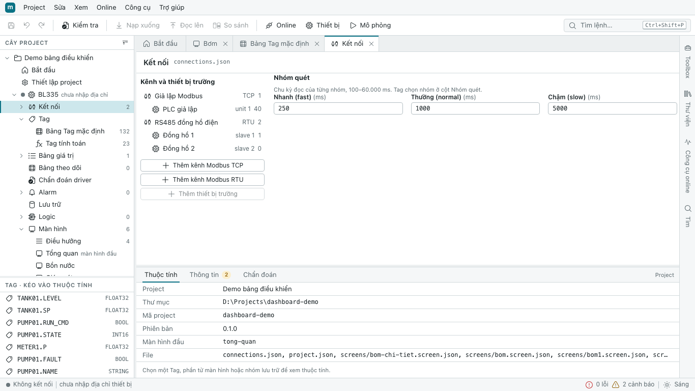

<a id="help-s7"></a>

### 4.1. Kết nối Siemens S7 (S7-1200, S7-1500, S7-300, S7-400)

Runtime đọc/ghi PLC Siemens bằng giao thức S7 (ISO-on-TCP, cổng 102), kiểu truy cập tuyệt đối "PUT/GET". Cần project định dạng 1.1 (project 1.0 có kênh S7 bị `E_DRIVER_VERSION`). Driver mới, **chưa thử với PLC thật** (chỉ thử với giả lập `tools/s7-sim`): hãy kiểm kỹ ở công trình đầu tiên.

**Chuẩn bị PLC trong TIA Portal** (S7-1200/1500; S7-300/400 không cần bước này):

1. Thiết bị > **Properties** > **Protection & Security** > **Connection mechanisms**: đánh dấu **Permit access with PUT/GET communication from remote partner**. Thiếu bước này mọi Tag BAD `S7_FUNCTION_NOT_AVAILABLE`.
2. Mỗi DB cần đọc: chuột phải DB > **Properties** > **Attributes**: bỏ chọn **Optimized block access**, rồi biên dịch và nạp xuống. DB còn "optimized" làm Tag BAD `S7_ACCESS_DENIED`. Cột **Offset** của DB (sau khi biên dịch) cho số byte dùng trong địa chỉ.
3. Mức bảo vệ của CPU không được chặn đọc/ghi từ HMI (Full access, hoặc mật khẩu chỉ cho mức cao hơn).

**Thêm kênh**: **Kết nối** > **Thêm kênh Siemens S7**: **Địa chỉ máy** (IP của PLC), **Cổng TCP** 102, **Rack**/**Slot** (S7-1200/1500: 0/1; S7-300: 0/2; S7-400: theo cấu hình phần cứng) hoặc **TSAP** đích và nguồn (4 chữ số hex, khi đi qua CP hoặc PLC cần kiểu kết nối khác; nhập TSAP thì bỏ rack/slot, nếu không Studio báo `E_S7_TSAP`), **PDU** (240–960, mặc định 480: S7-1200 thường chỉ nhận 240, runtime tự dùng số nhỏ hơn mà PLC trả lời). Mỗi kênh S7 có đúng một CPU với **Chờ trả lời**, **Số lần thử lại**, **Khe gộp tối đa (byte)**. **Thử kết nối** chưa hỗ trợ kênh S7: nạp xuống rồi xem **Chẩn đoán driver** (PDU đã thương lượng, TSAP, mã lỗi S7).

**Địa chỉ Tag S7** (không phân biệt hoa thường; viết kiểu Đức `E`/`A` cũng được, Studio đổi thành `I`/`Q`):

| Địa chỉ | Vùng | Kiểu Tag (thô) | Kiểu S7 |
|---|---|---|---|
| `DB1.DBX0.0`, `M0.1`, `I0.1` (`E0.1`), `Q0.0` (`A0.0`) | bit | BOOL | BOOL |
| `DB1.DBB4`, `MB10`, `IB0`, `QB1` | byte | UINT16 | BYTE |
| `DB1.DBB26` | byte | STRING, **Độ dài chuỗi** n | CHAR (n = 1) hoặc mảng n CHAR |
| `DB1.DBW2`, `MW10`, `IW2`, `QW4` | word | INT16 / UINT16 | INT / WORD |
| `DB1.DBD4`, `MD20`, `ID4`, `QD8` | dword | INT32 / UINT32 / FLOAT32 | DINT / DWORD / REAL |
| `DB1.LREAL8` | 8 byte | FLOAT64 | LREAL |
| `DB1.STRING32` | n + 2 byte | STRING, **Độ dài chuỗi** n (≤ 250) | STRING[n] |

- DB 1–65535, byte 0–65535, bit 0–7. Sai cú pháp `E_ADDR_SYNTAX`; ngoài khoảng `E_ADDR_RANGE`; kiểu Tag không hợp với cỡ địa chỉ, hoặc ghi vùng `I`: `E_ADDR_AREA`. Tag S7 không có **Thứ tự byte** (S7 luôn big-endian).
- Tag lớn hơn một lần đọc của PDU: `E_ADDR_READ_LIMIT` (PDU − 18 byte); Tag ghi được lớn hơn một lần ghi: `E_ADDR_WRITE_LIMIT` (PDU − 28 byte).
- CHAR và STRING dùng bảng mã Latin-1: ghi chuỗi có chữ Việt có dấu bị từ chối (`NOT_SENT_UNSUPPORTED`). Ghi STRING giữ nguyên byte độ dài tối đa của PLC.
- Runtime gộp Tag cùng nhóm quét, cùng vùng/DB và gần nhau thành một khoảng, nhiều khoảng (tối đa 20) vào một yêu cầu, không vượt PDU. Tag lỗi riêng (DB không có `S7_OBJECT_NOT_FOUND`, ngoài cỡ DB `S7_ADDRESS_OUT_OF_RANGE`) không làm hỏng Tag khác.
- Không hỗ trợ: truy cập symbolic (DB "optimized"), LINT/ULINT/LWORD, DATE/TIME, WSTRING, vùng bộ đếm/timer (C, T).

<a id="help-fins"></a>

### 4.2. Kết nối Omron FINS (CP1, CJ1, CJ2, CS1)

Cần project định dạng 1.1 (project cũ hơn: **Nâng cấp** trước; nút bị khóa kèm lý do). PLC phải có cổng Ethernet nói FINS: CJ1W-ETN21 hoặc CS1W-ETN21, cổng có sẵn của CJ2, CP1L-EM/EL, hoặc CP1W-CIF41 trên CP1. Dòng NJ/NX dùng EtherNet/IP hoặc OPC UA, không dùng kênh này. **Chưa thử với PLC thật**: driver được kiểm trên giả lập theo tài liệu FINS công khai của Omron (W342, W421); hãy thử kết nối và đối chiếu vài giá trị trước khi đưa vào vận hành.

1. **Thêm kênh Omron FINS**: điền **Địa chỉ PLC** (IP của bộ Ethernet), **Giao thức** `udp` (mặc định) hoặc `tcp`, **Cổng FINS** (mặc định 9600).
   - FINS/UDP: mỗi lệnh một gói; mất gói thì gửi lại với SID mới (**Số lần gửi lại**, mặc định 1). **Nút nguồn** để 0: BL335 dùng byte cuối IP của nó (ví dụ BL335 `192.168.250.5` là nút 5); không được trùng nút của PLC hay máy khác trong mạng FINS.
   - FINS/TCP: giữ kết nối; khi bắt tay, PLC cấp nút cho BL335 và cho biết nút của nó, không cần đặt nút. Mỗi bộ Ethernet nhận số kết nối FINS/TCP có hạn (thường 16): hết chỗ thì runtime báo `FINS_TCP_REFUSED`.
2. **Thêm thiết bị trường**: **Nút đích** (để 0: UDP lấy byte cuối IP của PLC, TCP lấy nút khi bắt tay), **Mạng đích** (0 nếu cùng mạng), **Unit đích** (0 là CPU). **Thứ tự word** mặc định `CDAB`: word thấp ở địa chỉ thấp như PLC Omron lưu DINT, REAL, LREAL. **Chờ trả lời** mặc định 500 ms.
3. Gom đọc: Tag liền nhau đọc chung một lệnh 0101 (tối đa **Tối đa word mỗi lần đọc**, 999); Tag lẻ (khối không quá 8 word) gom vào lệnh 0104 (**Đọc nhiều vùng**, tối đa 64 phần tử). Tắt **Đọc nhiều vùng** nếu PLC cũ không hỗ trợ lệnh 0104.
4. **Thử kết nối** của thiết bị FINS: để trống địa chỉ thì đọc **Model CPU** (lệnh 0501); có địa chỉ (`D100`, `CIO10.03`, `T5`) thì đọc 1–4 word hoặc bit. Lỗi của PLC hiện kèm **Mã kết thúc** và nghĩa (ví dụ `1103`: địa chỉ ngoài vùng nhớ).

**Địa chỉ Tag FINS** (bảng Tag gợi ý cú pháp khi ô địa chỉ sai):

| Vùng | Ví dụ | Ghi chú |
|---|---|---|
| DM | `D100`, `D100.05` | D0–D32767; bit 0–15 chỉ với BOOL |
| CIO | `CIO10.03`, `CIO0` | CIO0–CIO6143 |
| Work, Holding | `W5`, `W5.00`, `H2` | W0–W511, H0–H1535 |
| Auxiliary | `A448` | A0–A1471; A0–A447 chỉ đọc |
| EM | `E0_100`, `EC_5` | bank 0–C (hex), mỗi bank 0–32767 |
| Timer, Counter | `T5`, `C12` | kiểu INT16/UINT16: giá trị hiện tại; kiểu BOOL: cờ hoàn thành (chỉ đọc) |

- Kiểu: INT = INT16, UINT = UINT16, DINT = INT32, UDINT = UINT32, REAL = FLOAT32, LREAL = FLOAT64, STRING (ký tự đầu ở byte cao, như PLC lưu).
- **BCD**: đánh dấu `bcd` ở nguồn của Tag (INT16/UINT16 4 chữ số, INT32/UINT32 8 chữ số), ví dụ giá trị hiện tại của timer khi PLC đặt chế độ BCD. Ghi số quá số chữ số bị từ chối `NOT_SENT_UNSUPPORTED`.
- Chép địa chỉ từ CX-Programmer được, kể cả số 0 đứng đầu (`D00100`).

**Cấu hình trên PLC bằng CX-Programmer** (hoặc CX-Integrator):

1. **Địa chỉ IP và nút FINS**: trong Unit Setup của bộ Ethernet (CJ2: Built-in EtherNet/IP Port Settings), đặt IP, mặt nạ mạng. Nút FINS của PLC thường bằng byte cuối IP (bảng xoay node number trên CJ1W-ETN21 phải khớp).
2. **Chuyển đổi địa chỉ FINS/UDP**: chọn **Automatic generation (dynamic)** để PLC trả lời về đúng IP và cổng của BL335. Nếu chọn bảng IP (IP address table) thì thêm dòng nút của BL335 → IP của BL335.
3. **Cổng FINS/UDP**: mặc định 9600. Bộ Ethernet đời cũ (ETN11) chỉ trả lời về cổng 9600: đặt **Cổng UDP nguồn** của kênh là 9600.
4. **FINS/TCP**: bật FINS/TCP server và số kết nối trong tab FINS/TCP; nếu bật **IP address protection**, thêm IP của BL335.
5. **Bảng định tuyến** (Routing table, CX-Integrator): chỉ cần khi đi qua nhiều mạng FINS (Controller Link, cầu nối). Khi đó đặt **Mạng nguồn** của kênh và **Mạng đích**, **Nút đích** của thiết bị đúng số trong bảng. Cùng mạng thì để mạng 0.
6. Nạp Unit Setup xuống rồi khởi động lại bộ Ethernet (hoặc tắt bật PLC) để cấu hình có hiệu lực.

Lý do quality của Tag FINS lấy từ mã kết thúc: `FINS_ADDRESS` (11xx, địa chỉ ngoài vùng), `FINS_MODE` (22xx, ví dụ PLC ở PROGRAM), `FINS_WRITE_DENIED` (21xx), `FINS_ROUTING` (01xx, 02xx, 05xx: sai nút, mạng, bảng định tuyến). Chẩn đoán đếm theo mã kết thúc bốn chữ số. Danh sách đủ ở [Mã lỗi](error-codes.md).

<a id="help-mc"></a>

### 4.3. Kết nối PLC Mitsubishi (MC protocol / SLMP)

Runtime nói thẳng MC protocol (SLMP) với CPU có cổng Ethernet hoặc module Ethernet của iQ-R, iQ-F (FX5U, FX5UC), Q, L; không cần gateway Modbus. Cần project định dạng 1.1 (project cũ: nâng cấp ở **Cài đặt project**).

**Trong GX Works3 (iQ-R, FX5)**; GX Works2 cho Q, L tương tự ở mục *Built-in Ethernet Port Setting*:

1. **Parameter → Module Parameter → Ethernet Port → Basic Settings → Own Node Settings**: đặt IP của PLC; **Communication Data Code** chọn **Binary** (khớp **Mã truyền** = binary của kênh; chọn ASCII thì kênh cũng phải ascii).
2. **Object Device Connection Configuration Setting**: kéo **SLMP Connection Module** vào, đặt **Protocol** TCP (hoặc UDP, khớp **Giao thức** của kênh) và **Port No.** (ví dụ 5007; khớp **Cổng** của kênh).
3. Cho phép ghi khi PLC đang RUN: Q/L bật *Enable online change (FTP, MC Protocol)* ở Built-in Ethernet Port Setting; iQ-R, FX5 cho phép ghi lúc RUN trong thiết lập Ethernet/bảo mật của module. Không bật thì mọi lệnh ghi trả `DEVICE_EXCEPTION` (end code của PLC hiện ở chi tiết kết quả ghi).
4. Ghi tham số xuống PLC, tắt nguồn bật lại (hoặc reset) để tham số Ethernet có hiệu lực.

**Trong Studio:**

1. **Kết nối → Thêm kênh Mitsubishi MC**: **Địa chỉ máy** (IP của PLC), **Cổng** (mặc định 5007), **Khung** 3E (mặc định) hoặc 4E, **Mã truyền** binary/ascii, **Giao thức** tcp/udp.
2. **Thêm thiết bị trường**: PLC nối trực tiếp giữ **Mạng** 0, **Trạm** 255, **Module I/O đích** 03FF, **Trạm module đích** 0. Qua mạng CC-Link IE/MELSECNET tới PLC khác: số mạng, số trạm của PLC đích. **Cách viết X, Y**: hex cho Q, L, iQ-R; **octal** cho FX5/iQ-F (GX Works3 viết X0–X7, X10…).
3. Nhiều PLC sau một CPU gateway: chọn khung **4E** (có số thứ tự, trả lời muộn bị bỏ đúng); với 3E, một lần hết thời gian chờ làm runtime đóng và mở lại kết nối.

**Địa chỉ Tag** viết như GX Works: `D100` (INT16), `D200` với kiểu FLOAT32 (REAL, chiếm D200–D201), `D300` INT32 (DINT), `D100.5` (bit 5 của D100, BOOL; bit viết một chữ số hex 0–F), `M10`, `X1F`, `Y20`, `B1F`, `L5`, `SM400` (BOOL), `W1A`, `R10`, `ZR1000`, `SD210`, `TN0` (giá trị hiện tại timer), `CN3` (giá trị hiện tại counter). X, Y, B, W là số hex; còn lại thập phân. Kiểu dữ liệu: INT16 = INT, UINT16 = WORD, INT32 = DINT, UINT32 = UDINT, FLOAT32 = REAL, FLOAT64 = LREAL, STRING theo word (độ dài ký tự). Thứ tự byte mặc định là của Mitsubishi (word thấp trước, ký tự đầu ở byte thấp); chỉ đổi **Thứ tự byte** của Tag khi chương trình PLC tự sắp khác.

- Bit trong word (`D100.5`) chỉ ghi được khi thiết bị đặt **Ghi bit trong word** = rmw (đọc word, đổi bit, ghi lại; cảnh báo `W_BIT_RMW` vì có thể đè thay đổi của chương trình PLC giữa hai bước). Nên dùng bit M cho lệnh điều khiển.
- Runtime gom Tag liền nhau thành một lệnh đọc khối (tối đa 960 word); các Tag lẻ ở nhiều vùng gom vào một lệnh đọc rải (Random Read, tối đa 192 điểm). PLC không hỗ trợ đọc rải: tắt **Đọc rải**.
- PLC báo lỗi (end code) thì Tag BAD với lý do `MC_END_RANGE` (địa chỉ ngoài vùng của PLC: khối được chia để chỉ Tag sai bị BAD), `MC_END_DEVICE`, `MC_END_COMMAND` (thường do mã truyền binary/ascii không khớp PLC) hoặc `MC_END_OTHER`; **Chẩn đoán driver** hiện mã cụ thể dạng hex (ví dụ `C056`).

**Chưa thử với PLC thật**: driver đã kiểm trên giả lập (`tools/mc-sim`) theo cấu trúc khung của tài liệu công khai của Mitsubishi; thử với PLC thật trước khi dùng cho sản xuất. Chưa có nút **Thử kết nối** cho kênh MC: xem trạng thái ở **Chẩn đoán driver** sau khi nạp xuống.

### 4.4. Kết nối BACnet/IP (bộ điều khiển tòa nhà)

Cần project định dạng 1.1 (project cũ hơn: **Nâng cấp** trước; nút bị khóa kèm lý do). Kênh BACnet/IP đọc và ghi đối tượng Analog, Binary, Multi-state (Input, Output, Value) của bộ điều khiển BMS qua UDP 47808: AHU, chiller, VAV, đồng hồ điện. **Chưa thử với thiết bị thật**: driver được kiểm trên giả lập theo chuẩn ASHRAE 135 (ví dụ mã hóa Annex F); hãy Thử kết nối và đối chiếu vài giá trị trước khi đưa vào vận hành.

1. **Thêm kênh BACnet/IP**: **Cổng UDP cục bộ** (mặc định 47808) và **Địa chỉ broadcast** của mạng (ví dụ `192.168.1.255`, dùng cho Tìm thiết bị). Thiết bị ở subnet khác: điền **BBMD** (BL335 đăng ký foreign device).
2. **Tìm thiết bị** (cần Online, tài khoản engineer): BL335 gửi Who-Is và liệt kê các thiết bị trả lời I-Am (instance, IP, mạng/MAC nếu sau router, APDU tối đa). Bấm **Thêm** để tạo thiết bị với các thông số đó. Trong vài giây chờ, kênh đang chạy có thể báo timeout rồi tự đọc lại.
3. Thiết bị: **Device instance**, **Địa chỉ IP** (thiết bị sau router MS/TP: IP của router, cộng **Mạng đích** và **MAC đích**), **Priority ghi mặc định** (16). Nâng cao: **APDU tối đa**, **Chờ trả lời** (500 ms; thiết bị MS/TP 1000–3000), **Số lần gửi lại**, **Dùng ReadPropertyMultiple**.
4. **Thử kết nối**: để trống địa chỉ thì đọc tên thiết bị; có địa chỉ (`AI:1`, `MSV:3:units`) thì đọc thuộc tính đó. Lỗi hiện kèm lớp và mã BACnet (ví dụ `unknown-object`).
5. **Duyệt đối tượng**: đọc object-list và tên đối tượng; chọn đối tượng rồi **Thêm Tag** để tạo Tag present-value (Analog: FLOAT32, Binary: BOOL, Multi-state: UINT16; Output và Value có quyền ghi).

**Địa chỉ Tag BACnet**: `loại:instance[:thuộc tính][@priority]`.

| Ví dụ | Ý nghĩa | Kiểu |
| --- | --- | --- |
| `AI:1` | present-value của Analog Input 1 | FLOAT32, FLOAT64, số nguyên |
| `AV:5@8` | Analog Value 5, ghi ở priority 8 | như trên |
| `BO:2` | Binary Output 2 (active = true) | BOOL, UINT16 |
| `MSV:3` | Multi-state Value 3 (trạng thái 1, 2, 3…) | UINT16, UINT32, INT16, INT32 |
| `AI:1:units` | đơn vị (BACnetEngineeringUnits, ví dụ 62 = °C) | UINT16, UINT32 |
| `AI:1:status-flags` | bit 0 in-alarm, 1 fault, 2 overridden, 3 out-of-service | UINT16 |
| `DEV:1001:object-name` | tên thiết bị | STRING |
| `AO:1:relinquish@8` | ghi bất kỳ giá trị: nhả priority 8 (NULL); đọc true khi priority 8 đang trống | BOOL |

Loại: `AI`, `AO`, `AV`, `BI`, `BO`, `BV`, `MSI`, `MSO`, `MSV`, `DEV`. Thuộc tính khác: `out-of-service`, `description`, `reliability`, `event-state` hoặc số (chỉ đọc). Chỉ present-value của Output và Value ghi được; priority 6 dành cho minimum on/off, không dùng được.

**Quality**: Tag present-value theo status-flags của đối tượng: fault là BAD (`BACNET_FAULT`), out-of-service hoặc overridden là UNCERTAIN (giữ giá trị). Lỗi theo từng Tag: `BACNET_UNKNOWN_OBJECT`, `BACNET_UNKNOWN_PROPERTY`; ghi bị từ chối: `DEVICE_EXCEPTION` kèm mã (40 = write-access-denied). Driver không dùng segmentation: mỗi yêu cầu vừa **APDU tối đa**; thiết bị không có ReadPropertyMultiple thì driver tự đọc từng thuộc tính.

### 4.5. Kết nối OPC UA

Dùng cho server OPC UA của PLC (S7-1500, Omron NJ/NX, Beckhoff…), Kepware hoặc SCADA khác. Cần project định dạng 1.1.

1. **Thêm kênh OPC UA**: điền **Endpoint** (`opc.tcp://192.168.0.20:4840`), **Chế độ bảo mật** và **Security policy** (None/None, hoặc Sign hay SignAndEncrypt với Basic256Sha256; khuyến nghị SignAndEncrypt), **Xác thực** (anonymous hoặc username).
2. Với username: điền **Tên đăng nhập** và **Mã bí mật (secretId)**, ví dụ `opcua-ua-1`. Mật khẩu không nằm trong project: đặt trên thiết bị bằng `sudo mat-runtime --set-secret opcua-ua-1` (gõ mật khẩu ở dòng tiếp theo). Thiếu mật khẩu thì Tag BAD `OPCUA_SECRET_MISSING`.
3. **Chứng chỉ server** (khi có mã hóa, cần Online): bấm **Lấy chứng chỉ**. Thiết bị hỏi server và hiện SHA-256, chủ thể, hạn. Đối chiếu SHA-256 với màn hình của server rồi bấm **Tin chứng chỉ này**. Runtime chỉ kết nối với server có đúng chứng chỉ này; server đổi chứng chỉ thì Tag BAD `OPCUA_CERT_UNTRUSTED` và **Chẩn đoán driver** hiện SHA-256 mới để tin lại.
4. Cho server tin chứng chỉ của thiết bị: thiết bị tự sinh chứng chỉ client ở lần kết nối mã hóa đầu (SHA-256 ở **Chẩn đoán driver**, mục `clientCertSha256`). Trên server, chuyển chứng chỉ này từ "Rejected" sang "Trusted" (TIA Portal, Kepware OPC UA Configuration…). Chưa làm thì Tag BAD `OPCUA_SECURITY_REJECTED`.
5. **Duyệt node** (cần Online): mở cây từ Objects, chọn một biến để **Thêm Tag** với NodeId và kiểu gợi ý. Không Online thì gõ NodeId vào cột **Địa chỉ** của Bảng Tag: `ns=2;s=Tank.Level`, `ns=3;i=1001`, `i=2258` (không có `ns=` là namespace 0). Dạng `nsu=` chưa hỗ trợ.
6. **Cách đọc**: subscription (mặc định, server gửi khi giá trị đổi, chu kỳ theo nhóm quét) hoặc poll (đọc định kỳ). Server từ chối subscription thì driver tự chuyển nhóm đó sang đọc định kỳ, **Chẩn đoán driver** có cảnh báo `OPCUA_SUBSCRIPTION_FALLBACK`.

Kiểu: Boolean, (S)Byte, (U)Int16/32/64, Float, Double, String, DateTime (vào Tag INT64 là ms Unix UTC, vào STRING là ISO 8601). Giá trị ngoài khoảng của kiểu Tag, mảng và kiểu cấu trúc: Tag BAD `OPCUA_TYPE_MISMATCH`. **Thử kết nối** không dùng cho kênh OPC UA: **Lấy chứng chỉ** là phép thử. Driver mới thử với server giả lập open62541, chưa thử với server thật (S7-1500, Kepware…).

### 4.6. OPC DA qua cầu nối

OPC DA (Kepware, Matrikon, RSLinx…) chỉ chạy trên Windows nên BL335 không đọc trực tiếp được. Dùng **mAT OPC DA Bridge** (ADR-049) cài trên chính máy có OPC DA server: cầu nối đọc/ghi OPC DA cục bộ và mở một Modbus TCP server cho BL335.

1. Trên máy OPC: giải nén `mat-opcda-bridge-<phiên bản>-windows-x64.zip`, tìm ItemID bằng `mat-opcda-bridge browse --prog-id <ProgID> [--path Kênh.Thiết bị]` (`+` là nhánh).
2. Khai báo `config.json` (mẫu `config.example.json`): `opc.progId`, `opc.updateRateMs`, `modbus.allow` (IP của BL335) và `items`: mỗi item có `id` (tên Tag mAT), `item` (ItemID OPC), `type` (`BOOL`, `INT16`, `UINT16`, `INT32`, `UINT32`, `FLOAT32`), `access` (`R` hoặc `RW`). Kiểm bằng `mat-opcda-bridge check --config config.json`.
3. Xuất bảng ánh xạ: `mat-opcda-bridge export-csv --config config.json --out opcda-map.csv`.
4. Trong Studio, **Kết nối** › **Thêm kênh Modbus TCP**: **Địa chỉ máy** = IP máy cầu nối, cổng 502; thêm một thiết bị trường Unit ID 1, thứ tự byte ABCD, địa chỉ cơ sở 1.
5. Chọn thiết bị đó, mục **OPC DA qua cầu nối** › **Nhập ánh xạ OPC DA…**, chọn `opcda-map.csv`. Mỗi item thành một Tag external (BOOL ở coil `C`, số ở `HR`); **Thêm Tag quality** tạo thêm `<tên>_Q` đọc thanh ghi `IR` (0 tốt, 1 không chắc, 2 xấu, 3 chưa có dữ liệu). Tag `BRIDGE_OK` = 1 khi cầu nối đang nối OPC server. Tag trùng tên được cập nhật, không Tag nào bị xóa; dòng lỗi được liệt kê.

Khi OPC server dừng, cầu nối trả ngoại lệ Modbus 0x0B nên các Tag dữ liệu thành quality xấu; cầu nối tự nối lại khi server chạy lại. Ghi vào item chỉ đọc bị từ chối (0x02), OPC từ chối ghi thì 0x04. Modbus không mang timestamp của OPC: thời điểm của Tag là lúc runtime đọc. Mỗi lần đổi danh sách item, xuất và nhập lại CSV (địa chỉ cấp liên tiếp theo thứ tự item). Cài dịch vụ và tường lửa: xem hướng dẫn quản trị.

### 4.7. Kết nối MQTT (broker)

Dùng để nhận dữ liệu từ cảm biến IoT, gateway hay hệ thống khác qua broker MQTT (Mosquitto, EMQX, HiveMQ…), và đẩy dữ liệu của thiết bị lên broker cho cloud/MES. MQTT 3.1.1, QoS 0 và 1. Cần project định dạng 1.1.

1. **Kết nối** › **Thêm kênh MQTT**: kênh có sẵn một broker (mỗi kênh một broker). Điền **Host** và **Cổng** (để trống: 1883, hoặc 8883 khi bật TLS), **Client id** (mỗi client trên broker phải khác nhau; trống thì `mat-<id kênh>`).
2. **TLS** (khuyến nghị khi đi qua mạng ngoài): bật TLS và điền **Chứng chỉ broker (SHA-256)**, 64 chữ số hex lấy từ quản trị broker, ví dụ `openssl x509 -in broker.crt -noout -fingerprint -sha256` (bỏ dấu `:`). Runtime chỉ kết nối broker có đúng chứng chỉ này; sai thì Tag BAD `MQTT_CERT_UNTRUSTED`. Dùng CA riêng của nhà máy thay cho ghim: thêm `"caCertPem": "-----BEGIN CERTIFICATE-----\n…"` vào khối `mqtt.tls` của `connections.json` (khi đó **Tên máy (SNI)** phải khớp chứng chỉ). Không ghim, không CA thì runtime không kết nối.
3. **Tài khoản**: **Tên đăng nhập** và **Mã bí mật (secretId)**, ví dụ `mqtt-mqtt1`. Đặt mật khẩu trên thiết bị: `sudo mat-runtime --set-secret mqtt-mqtt1` (gõ mật khẩu ở dòng tiếp theo). Thiếu mật khẩu: Tag BAD `MQTT_SECRET_MISSING`; sai: `MQTT_AUTH_FAILED`.
4. Mục nâng cao: **Keepalive** (30 s), **Clean session**, **Di chúc (LWT)**: topic, nội dung, QoS, retain, broker gửi khi thiết bị mất kết nối bất thường, ví dụ `mat/tram1/status` = `offline`; **Giới hạn publish** (20 tin/s cho mọi publish của kênh).
5. Broker: **Quá hạn dữ liệu** (`staleAfterMs`): không có tin cho một Tag quá thời gian này thì Tag UNCERTAIN `MQTT_STALE` (giữ giá trị cuối); 0 là không xét. **Thời hạn** (2000 ms) là thời gian chờ CONNACK, SUBACK, PUBACK.

**Địa chỉ Tag** (cột **Địa chỉ** của Bảng Tag, phân biệt hoa thường):

| Địa chỉ | Ý nghĩa |
| --- | --- |
| `plant/tank1/level` | nhận: payload là số/chữ (`21.5`, `true`, `ON`) |
| `sensors/+/data\|$.temp` | nhận từ mọi thiết bị `sensors/<x>/data`, lấy trường `temp` của JSON |
| `sensors/t9\|$.values[2].v` | phần tử thứ 3 của mảng `values` |
| `events/#;qos=1` | mọi topic dưới `events/`, subscribe QoS 1 |
| `pub:plant/cmd/sp\|$.data.sp;qos=1;retain` | chỉ gửi: ghi Tag (quyền RW) là publish `{"data":{"sp":<giá trị>}}` QoS 1 retain |
| `both:plant/mode` | nhận và gửi trên cùng topic |

`+` chiếm trọn một cấp, `#` chỉ ở cấp cuối; Tag `pub`/`both` không có wildcard. Tag ghi được phải là `pub:` hoặc `both:` (`E_MQTT_DIRECTION`). Payload thô: BOOL nhận `1/0/true/false/on/off`, số nguyên nhận cả `12.0`, ngoài miền của kiểu thì BAD `MQTT_PAYLOAD`; gửi BOOL là `1`/`0`. Topic không được chứa `|` và `;`.

**Nhóm publish** (sửa trong `connections.json`, khối `mqtt.publishGroups`): đẩy giá trị của nhiều Tag (bất kỳ kênh nào) thành một tin JSON theo chu kỳ và/hoặc khi đổi:

```json
"publishGroups": [
  { "topic": "mat/tram1/state", "tags": ["TANK01.LEVEL", "PUMP01.RUN"], "intervalMs": 5000, "onChange": true, "qos": 1 }
]
```

Tin: `{"ts":1730000000000,"values":{"TANK01.LEVEL":12.5,"PUMP01.RUN":true},"quality":{"TANK01.LEVEL":"GOOD","PUMP01.RUN":"GOOD"}}`. Tag không tồn tại: `E_MQTT_GROUP_TAG`.

Từ feature 025 một nhóm còn chọn Tag theo **mẫu tên** (`"tagPatterns": ["TANK01.*", "MOTOR0?.RUN"]`, tối đa 16 mẫu; `*` khớp mọi chuỗi, `?` một ký tự; Tag khớp được thêm sau `tags`, cần `tags` hoặc `tagPatterns`; mẫu không khớp Tag nào hoặc nhóm quá 500 Tag: `E_MQTT_GROUP_PATTERN`) và thêm **thời điểm từng giá trị** (`"timestamps": true` → `"sourceTs":{"TANK01.LEVEL":1729999999500}`). Dùng nhóm publish để đẩy dữ liệu ra broker của hệ thống khác: [API dữ liệu, mục 9](data-api.md#9-đẩy-dữ-liệu-ra-broker-mqtt).

Broker từ chối subscribe (ACL): Tag BAD `MQTT_SUBSCRIBE_REFUSED`. Mất broker: Tag BAD `DISCONNECTED`, tự kết nối lại sau 1 s, 2 s, 4 s… tối đa `reconnectMaxS`. **Thử kết nối** không dùng cho kênh MQTT: nạp xuống rồi xem **Chẩn đoán driver** (broker, TLS, số subscription, số tin nhận/gửi/bỏ, SHA-256 chứng chỉ broker). Chưa hỗ trợ QoS 2, MQTT 5, Sparkplug B, đệm tin khi mất kết nối. Driver mới thử với broker giả lập, chưa thử với broker thật.

<a id="help-tags"></a>

## 5. Tag

Mở **Tag** > **Bảng Tag mặc định**. Mỗi dòng là một Tag.

| Loại | Dùng khi | Ví dụ trong `training-demo` |
|---|---|---|
| Ngoài | đọc/ghi từ PLC | `BON.MUC` (`HR100`, thô INT16, đổi thang 0–27648 → 0–100 %) |
| Nội bộ | giá trị chỉ có trên runtime, có thể giữ qua mất điện | `BON.NGUONG_CAO` (giữ qua mất điện) |
| Tính toán | biểu thức từ Tag khác, chỉ đọc | `BON.THE_TICH` = `BON.MUC * 0.125` |
| Mô phỏng | tín hiệu giả để thử màn hình | `HL.SONG` (hình sin) |

- Tên Tag: chữ, số, gạch dưới, các đoạn cách nhau bằng dấu chấm (`BON.MUC`). Đổi tên bằng **Đổi tên Tag…** để Studio sửa mọi chỗ dùng.
- Kiểu: BOOL, INT16, UINT16, INT32, UINT32, INT64, UINT64, FLOAT32, FLOAT64, STRING.
- Địa chỉ: `HR100` (holding register), `IR`, `C10` (coil), `DI`, bit trong thanh ghi `HR12.3`. Sai cú pháp: `E_ADDR_SYNTAX`.
- **Quyền** `RW` để ghi được. Tag ghi được nên có **Ghi tối thiểu**/**Ghi tối đa**: runtime từ chối giá trị ngoài khoảng (`OUT_OF_LIMITS`).
- **Giữ qua mất điện** chỉ cho Tag nội bộ (`E_RETAIN`).
- Nhiều Tag: **Thêm hàng loạt…**, **Nhập CSV…**, **Dán từ Excel**.
- **Tag tính toán**: editor riêng có ô **Biểu thức**, danh sách **Tag đầu vào**, **Xem trước**. Lỗi thường gặp: `E_EXPR_SYNTAX`, `E_EXPR_UNKNOWN_TAG`, `E_EXPR_CYCLE`.

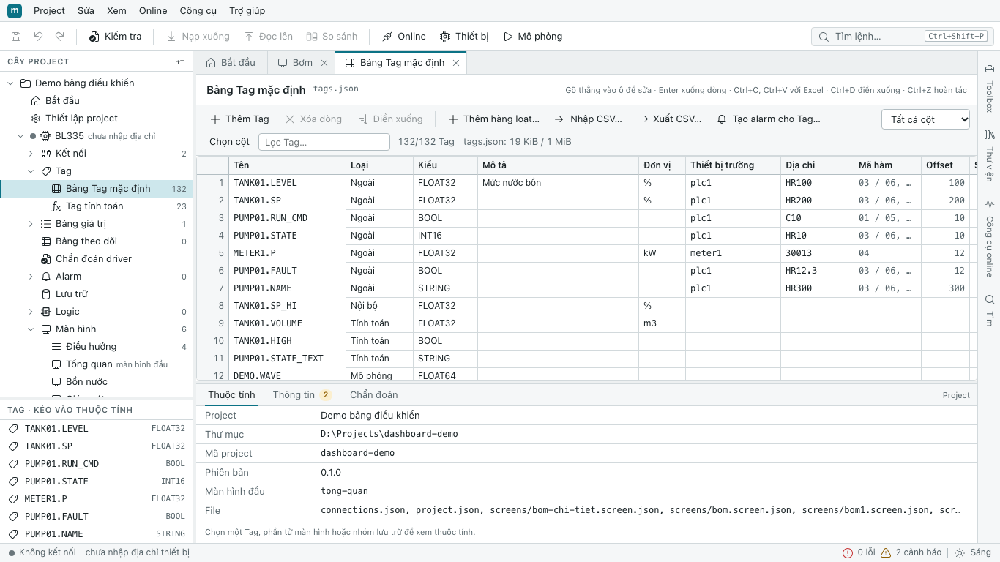

<a id="help-screens"></a>

## 6. Màn hình và widget

Mở **Màn hình** trên cây. **Thêm màn hình** hoặc **Thêm popup**; **Đặt làm màn hình đầu** cho màn hình mở đầu tiên; **Mở Điều hướng** để sửa menu của trang vận hành.

**Điều hướng (menu của trang vận hành).** Menu trên thiết bị gồm **đúng** các mục khai báo ở đây, theo thứ tự trên cây; trang vận hành không tự thêm mục nào. Bên trái là cây mục (màn hình, báo cáo, nhóm một cấp, tối đa 32 mục; kéo hoặc Alt+↑/↓ để sắp xếp). Dưới cây là nhóm **Trang hệ thống**: **Alarm**, **Lịch sử alarm**, **Lịch sử**, **Công thức**, **Quản trị**; bấm **+** ở một dòng để thêm trang đó vào menu (vào nhóm đang chọn nếu có), rồi đặt nhãn, biểu tượng (để **Mặc định** thì dùng biểu tượng sẵn của trang) và vị trí như mục màn hình. Mỗi trang hệ thống chỉ thêm một lần.

- Trang cần tính năng tương ứng: Alarm và Lịch sử alarm cần project có alarm, Lịch sử cần cấu hình lưu trữ, Công thức cần công thức (recipe). Thiếu thì dòng hiện cảnh báo vàng, kiểm tra project báo `W_NAV_SYSTEM` và trang vận hành bỏ qua mục đó.
- **Quản trị** chỉ hiện với quản trị viên. Không thêm mục Quản trị thì quản trị viên vẫn vào được bằng đường dẫn `#/quan-tri`.
- Mục **Alarm** có huy hiệu số alarm chưa xác nhận.
- **Chuông cảnh báo** (cột phải, dưới **Vị trí menu**): bỏ chọn **Hiện chuông và thông báo khẩn cấp** để ẩn chuông và thông báo alarm khẩn cấp ở thanh trên cùng (âm thanh alarm, trang Alarm và widget alarm vẫn chạy).
- Không khai báo mục nào thì trang vận hành tự liệt kê mọi màn hình và báo cáo (không có trang hệ thống). **Vị trí menu** **Ẩn menu** thì không có menu.
- Trang hệ thống và Chuông cảnh báo cần project định dạng 1.1. Project cũ hơn (0.5, 0.6, 1.0) giữ cách cũ: trang vận hành tự thêm Alarm, Lịch sử alarm, Lịch sử, Quản trị cuối menu; nâng cấp project lên 1.1 rồi thêm các trang hệ thống để tự quyết menu.

Hộp công cụ có ô **Tìm component…** ở trên cùng (gõ tên hoặc công dụng, có dấu hay không dấu đều được, ví dụ "bom", "den thap"); rê chuột lên một component để xem mô tả ngắn. Các nhóm widget:

- Hiển thị: **Thẻ giá trị**, **Nhãn**, **Đèn báo**, **Đồng hồ kim**, **Mức chất lỏng** (thanh hoặc bồn chứa), **Khung nhóm**, **Nhãn đa trạng thái**, **Đèn tháp**, và các widget dashboard: **KPI so với mục tiêu**, **Thanh tiến độ**, **Danh sách trạng thái**, **Đồng hồ ngày giờ**, **Ghi chú**, **Ảnh** (mục 6.1.1, 6.1.2).
- Biểu đồ: **Biểu đồ đường**, **Biểu đồ cột**, **Biểu đồ tròn**; bảng: **Bảng Tag sống**. Biểu đồ, đồng hồ kim và bảng có thuộc tính **Tiêu đề**: điền vào thì widget thành khung có thanh tiêu đề (như các khung "Biểu đồ nhiệt độ" của dashboard).
- Điều khiển: **Nút bấm**, **Công tắc**, **Đặt giá trị**, **Thanh trượt**, **Chọn từ danh sách**, **Hẹn giờ Từ–Đến**, **Thiết bị (motor, bơm, quạt, van)**.

Component thả vào đã có sẵn giá trị khởi đầu (nhãn, màu, kiểu bồn, bảng trạng thái Dừng/Chạy/Lỗi…); chỉ việc kéo Tag thả lên component. Tab **Hiển thị** của Inspector chia thuộc tính theo nhóm **Dữ liệu**, **Hiển thị**, **Màu & biểu tượng**, **Ngưỡng & cảnh báo**, **Hành động**; canvas cập nhật ngay khi sửa (xem trước).
- Alarm: **Danh sách alarm**, **Đếm alarm**; lịch sử: **Lịch sử: biểu đồ đường**, **Lịch sử: bảng dòng**, **Lịch sử: biểu đồ cột**, **Lịch sử: biểu đồ tròn**.

Inspector có các tab **Chung**, **Hiển thị**, **Gắn Tag**, **Sự kiện**, **Bảo mật**.

**Gắn Tag:** kéo Tag từ Details thả vào ô của widget, hoặc **Chọn Tag…**. **Dùng đơn vị, bảng, giới hạn của Tag** điền sẵn đơn vị và giới hạn.

**Sự kiện** "Khi bấm": **Ghi giá trị**, **Đảo giá trị**, **Ghi xung**, **Chuyển màn hình**, **Mở popup**, **Đóng popup**. **Hộp xác nhận** bắt buộc với mọi lệnh ghi giá trị số; chỉ nút hoặc công tắc BOOL mới được bỏ xác nhận. **Vai trò tối thiểu** mặc định là `operator`; đặt `engineer` cho chỉnh thông số (ví dụ "Ngưỡng mức cao" trong `training-demo`). Project định dạng 1.1 có hai mức riêng để xem và để thao tác (mục 6.3).

**Nút xung:** runtime giữ nhịp bật rồi nhả. Chương trình PLC vẫn phải tự xóa bit lệnh xung sau một thời gian (ví dụ gấp đôi độ dài xung): runtime nhả lại xung dở khi khởi động lại, nhưng không thay được bảo vệ trong PLC.

**Xem trước:** chế độ **Mô phỏng** (thanh công cụ) chạy Tag mô phỏng ngay trong Studio, không cần thiết bị. Chế độ **Thiết bị** hiện giá trị sống khi Online.

### 6.1. Bố cục lưới (hàng và cột)

Project định dạng 1.1 trở lên. Màn hình mới mặc định là **bố cục lưới**: trang gồm các **hàng**, mỗi hàng chia trên **12 cột**, mỗi **ô** chứa một component. Vị trí do ô quyết định, không nhập X, Y. (**Thêm màn hình (bố cục tự do)** vẫn có cho cách đặt theo tọa độ cũ; **Chuyển sang bố cục lưới** đổi một màn hình tự do sang lưới, có xem trước và hoàn tác.)


1. **Thêm hàng** → chọn mẫu chia cột: `12`, `6+6`, `4+4+4`, `3+3+3+3`, `8+4`, `4+8`, `3+6+3`, hoặc **Tự nhập…** (ví dụ `2+8+2`, tổng không quá 12). Cột bên phải của menu là **Mẫu hàng có sẵn widget**: **4 thẻ chỉ số** (hàng cao 116 px, bốn thẻ màu khác nhau có biểu tượng), **3 biểu đồ** (cao 260 px: đường, cột, tròn có tiêu đề), **2 biểu đồ + 1** (cao 260 px: đường 5 cột, cột 4 cột, đồng hồ 3 cột), **1 biểu đồ rộng** (cao 300 px). Widget đã đặt sẵn tên, màu; chỉ việc kéo Tag thả vào từng ô. Hàng có chiều cao cố định nên mọi ô cùng hàng cao bằng nhau.

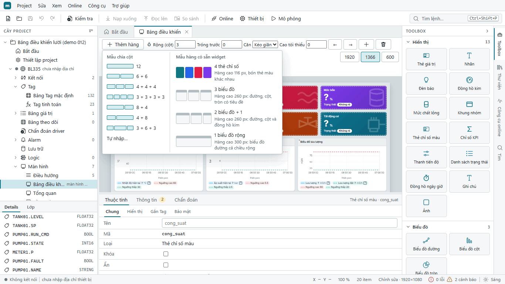
2. **Gắn component:** kéo widget từ Toolbox thả **vào ô** (ô sáng lên khi rê vào), hoặc chọn ô rồi nhấp đúp widget trong Toolbox. Ô đã có component thì Studio hỏi **Thay**.
3. **Đổi độ rộng:** kéo đường chia giữa hai ô (bám theo 1/12), hoặc nhập **Rộng (cột)** ở thanh thuộc tính khi ô đang chọn; **Trống trước** để chừa cột trống bên trái ô; **Căn** (kéo giãn, đầu, giữa, cuối); **Cao tối thiểu**.
4. **Hàng:** **Tự động** (cao theo nội dung) hoặc bỏ chọn để nhập chiều cao cố định; **Khoảng cách** giữa các ô; nút ↑ ↓ đổi thứ tự, 🗑 xóa hàng (xóa cả component trong hàng).
5. **Xem trước** ở chiều rộng **1920**, **1366**, **600**: dưới 768 điểm ảnh các ô xếp chồng thành một cột (máy tính bảng dọc, điện thoại).

Bàn phím khi ô có focus: ← → ↑ ↓ chuyển ô; **Alt+↑/↓** đổi thứ tự hàng; **Alt+←/→** đổi thứ tự ô; **Ctrl+←/→** thu, nới ô một cột; **Enter** chọn ô; **Delete** xóa component của ô. Mọi thao tác hoàn tác được bằng Ctrl+Z.

Lỗi thường gặp: `E_LAYOUT_SPAN` (tổng các ô của hàng quá 12 cột), `E_LAYOUT_ITEM_POS` (component lưới có tọa độ, hoặc component màn hình tự do thiếu tọa độ), `E_LAYOUT_VERSION` (project chưa nâng lên 1.1); cảnh báo `W_LAYOUT_ITEM_ORPHAN` (component không nằm trong ô nào, không hiển thị). Bản sao template chưa chèn được vào màn hình lưới.

#### 6.1.1. Widget dashboard

| Widget | Dùng cho | Thuộc tính chính |
|---|---|---|
| **Thẻ giá trị** (`card`) | Một giá trị Tag đọc to. Một component cho mọi kiểu thẻ (từ bản này "Thẻ chỉ số màu" đã gộp vào đây) | **Kiểu nền**: nền nhạt (mặc định, vạch màu bên trái), đặc màu (chữ trắng, biểu tượng lớn mờ), viền màu, trơn (kiểu cũ); **Màu nhấn** (10 màu: xanh dương, xanh ngọc, xanh lá, cam, đỏ hồng, tím, chàm, xanh lơ, ô liu, xám đá) hoặc **Màu nhấn tự chọn**; **Biểu tượng** (21 hình: nhiệt độ, độ ẩm, dòng chảy, gió, ánh sáng, bóng đèn, khí CO₂, lửa, quạt, làm mát, bơm, van, điện, nguồn, áp suất, mức bồn, động cơ, bánh răng, đồng hồ, cảnh báo, ngôi sao); **Hiện đơn vị**, **Dòng trạng thái** ("Trạng thái: Tốt / Chú ý / Cảnh báo / Lỗi…"), **Đường xu hướng nhỏ**, **Mũi tên tăng giảm**, **Nháy nhẹ khi giá trị đổi** (mặc định bật); ngưỡng **Chú ý khi lớn/nhỏ hơn** (thẻ chuyển cam) và **Cảnh báo khi lớn/nhỏ hơn** (thẻ chuyển đỏ), khe **Tag cảnh báo** (BOOL, bật thì thẻ đỏ); **Nhấp nháy khi lớn/nhỏ hơn** |
| **KPI so với mục tiêu** (`kpi`) | Số đọc so với mục tiêu: "Mục tiêu: …", chênh lệch phần trăm có mũi tên, thanh mảnh | **Mục tiêu** (số) hoặc khe **Tag mục tiêu**, **Càng cao càng tốt** (đạt thì xanh, không đạt thì đỏ) |
| **Thanh tiến độ** (`progress`) | Phần trăm của giá trị trong thang Nhỏ nhất–Lớn nhất (mặc định theo Tag) | **Hướng**: thanh ngang hoặc vòng tròn, **Màu thanh** |
| **Danh sách trạng thái** (`status-list`) | Đèn trạng thái của tối đa 16 Tag (BOOL: Bật/Tắt; số: chữ của bảng giá trị) | **Tiêu đề**, **Tên từng mục**, **Chữ khi bật**, **Chữ khi tắt**, **Số cột** (1–4) |
| **Đồng hồ ngày giờ** (`clock`) | Giờ của thiết bị | **Định dạng** (giờ và ngày, chỉ giờ, chỉ ngày), **Múi giờ** (mặc định +07:00), **Hiện giây** |
| **Ghi chú** (`text`) | Chữ nhiều dòng (tối đa 300 ký tự), không định dạng HTML | **Tiêu đề**, **Nội dung ghi chú**, cỡ chữ, căn lề, màu |
| **Ảnh** (`image`) | Ảnh SVG có trong project (tệp `graphics/….svg`, nhập bằng **Nhập SVG**); không tải ảnh từ Internet | **Tệp ảnh SVG**, **Cách vừa khung**, **Mô tả ảnh** |

#### 6.1.2. Component công nghiệp (bản 037)

| Widget | Dùng cho | Thuộc tính chính |
|---|---|---|
| **Thiết bị (motor, bơm, quạt, van)** (`equipment`) | Biểu tượng thiết bị tô màu theo trạng thái: **Đang chạy** (xanh lá), **Dừng** (xám), **Lỗi** (đỏ, chữ nhấp nháy); cánh quạt, bánh công tác, đầu trục quay khi chạy; van: **Mở**/**Đóng** | Khe **Tag trạng thái chạy** (BOOL, hoặc số bằng **Giá trị "đang chạy"**), **Tag lỗi** (tùy chọn) hoặc **Giá trị "lỗi"**; **Loại thiết bị**, **Chuyển động khi chạy**; khe **Tag lệnh chạy/dừng** (tùy chọn, cần quyền ghi) cho hai nút **Chạy**/**Dừng** (BOOL ghi true/false; số ghi **Giá trị ghi khi chạy/dừng**), có hộp xác nhận và vai trò tối thiểu như nút bấm |
| **Đèn tháp** (`stack-light`) | Đèn tháp đỏ, vàng, xanh lá, xanh dương trên cột có đế; chỉ vẽ tầng đã gắn Tag | Khe **Tầng đỏ**, **Tầng vàng**, **Tầng xanh lá**, **Tầng xanh dương** (BOOL hoặc số khác 0 = sáng); **Đỏ nhấp nháy khi sáng**; hướng dọc hoặc ngang |
| **Nhãn đa trạng thái** (`multi-state`) | Chữ và màu theo giá trị (ví dụ 0 Dừng, 1 Chạy, 2 Lỗi), khối màu đặc hoặc nền nhạt, có biểu tượng | **Bảng trạng thái** (mỗi dòng Giá trị, Chữ, Màu, Nhấp nháy; tối đa 16); bảng trống thì dùng Bảng giá trị của Tag |

**Mức chất lỏng** có **Kiểu** "Bồn chứa" (bồn bo tròn có vạch chia, gợn sóng nhẹ trên mặt chất lỏng khi chạy, tắt bằng **Gợn sóng mặt chất lỏng**) và **Màu chất lỏng**. **Đèn báo** có **Quầng sáng khi bật** (mặc định bật). **Khung nhóm** có **Màu nhấn** (vạch màu và tiêu đề màu). Mọi chuyển động là CSS nhẹ, chỉ chạy ở trang vận hành (không chạy khi thiết kế) và tự tắt khi máy đặt "giảm chuyển động".

**Project cũ:** widget **Thẻ chỉ số màu** (`stat-tile`) vẫn chạy đúng trên thiết bị. Khi mở project trong Studio, mỗi thẻ tự đổi thành **Thẻ giá trị** kiểu **Đặc màu** giữ nguyên màu, biểu tượng, Tag; project được đánh dấu chưa lưu, bấm **Lưu** để ghi (không lưu thì tệp trên đĩa giữ nguyên).

**Biểu đồ đường** có thêm **Ngưỡng cao**, **Ngưỡng thấp** (vẽ đường nét đứt đỏ và xanh ngọc, có trong chú giải; trục giá trị tự nới để thấy ngưỡng) và **Nhãn trục thời gian**, **Nhãn trục giá trị**. **Đồng hồ kim** nay gọn trong khung (bán kính tối đa 150 px), số đọc ở dưới. **Khung nhóm** có **Kiểu khung** "Card có thanh tiêu đề".

Lỗi thường gặp: `E_FILE_MISSING` ở `props/src` (tệp ảnh của widget **Ảnh** không có trong project), `E_WIDGET_PROP` (đường dẫn ảnh không nằm trong `graphics/` hoặc không phải `.svg`, múi giờ không đúng dạng `±HH:MM`).

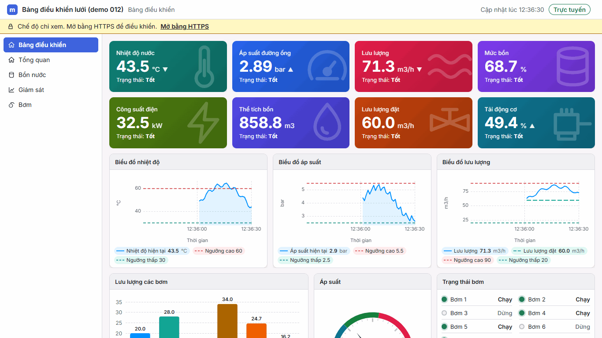

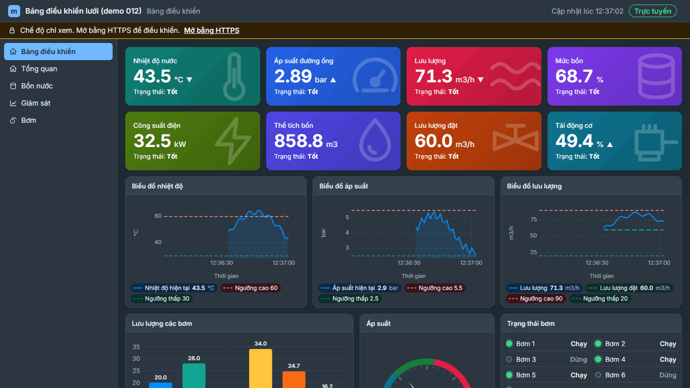

### 6.2. Chủ đề giao diện

Từ bản này trang vận hành, widget và xem trước màn hình dùng **một giao diện ATSCADA** duy nhất, giống giao diện ATSCADA FastWeb: nền xám xanh nhạt, khung trắng có thanh tiêu đề, menu trái nền tối, màu chủ đạo xanh ngọc. Không còn ô chọn chủ đề. Project cũ có trường `theme` vẫn mở và tải xuống bình thường; **Thiết lập project** chỉ ghi chú nhẹ rằng trường này được bỏ qua. Màu đặt riêng cho widget vẫn giữ.

**Trình soạn lưới thao tác nhanh:** nút mẫu cột một chạm (12, 6+6, 4+4+4, 3×4, 8+4, 4+8) cạnh **Thêm hàng**; chọn ô thì hiện thanh nhỏ trên ô (−/+ cột, thêm ô, xóa ô, tay nắm kéo đổi chỗ); kéo cạnh phải ô cuối hàng hoặc đường chia giữa hai ô để đổi số cột (đường lưới 12 cột hiện rõ khi kéo); kéo tay nắm ⋮⋮ ở đầu hàng để dời hàng; chiều cao hàng chọn nhanh Tự động/120/240/360; phím `+`/`−` đổi số cột, Alt+mũi tên đổi chỗ; mọi thao tác hoàn tác được (Ctrl+Z).

**Ô trống, kéo thả, sao chép, zoom:**

- Ô trống trong editor luôn cao tối thiểu 120 px, viền nét đứt màu nhấn, ghi **Kéo component từ Toolbox vào đây** và số cột (ví dụ 9/12). Ô đang chọn viền màu nhấn đậm; hàng đang rê chuột có viền nét đứt nhạt. Chỉ là hiển thị trong Studio, trang vận hành không đổi.
- **Kéo component** đã đặt (kéo thẳng ô có component) sang ô khác, kể cả ở hàng khác: thả vào **giữa** ô đích để đặt component vào ô đó (ô đã có thì hai ô đổi component); thả ở **mép trái/phải** (vạch màu nhấn) để chèn cả ô trước/sau ô đích (hàng đích thiếu cột thì ô co lại; hàng nguồn hết ô thì bị xóa). **Kéo tay nắm ⋮⋮** ở đầu hàng lên nửa trên/nửa dưới một hàng khác để chèn hàng phía trên/dưới (vạch ngang chỉ vị trí).
- **Sao chép, dán, nhân bản** (chọn ô trước; cũng có ở menu chuột phải): Ctrl+C sao chép component, Ctrl+Shift+C sao chép cả hàng, Ctrl+V dán (vào ô trống đang chọn, nếu không thì ngay sau ô chọn; hàng dán ngay dưới hàng chọn), Ctrl+D nhân bản component, Ctrl+Shift+D nhân bản hàng. Bản sao giữ nguyên mọi thuộc tính, Tag, sự kiện, bảo mật, có mã mới; dán được sang màn hình lưới khác. Đồ họa SVG không nhân bản được (mỗi file gắn Tag chỉ thuộc một item).
- **Zoom** (chỉ hiển thị): nút −, phần trăm (bấm để về 100 %), +, **Vừa khung** trên thanh công cụ; Ctrl+lăn chuột; Ctrl+= / Ctrl+− / Ctrl+0 (Vừa khung).
- Mọi thao tác trên hoàn tác được (Ctrl+Z).

Ở tab **Hiển thị** của **Đồng hồ kim**, mục **Vùng màu** mỗi vùng một dòng: **Từ**, **Đến**, ô màu và nút thùng rác **Xoá vùng**.

<a id="help-security"></a>

### 6.3. Bảo mật: vai trò tối thiểu và phân quyền trên thiết bị

Project định dạng 1.1. Kỹ sư chỉ đặt **mặc định theo vai trò** trong project; quyền theo từng người dùng và nhóm do quản trị viên đặt **trên thiết bị** (trang Quản trị của trang vận hành, [admin-guide.md](admin-guide.md#quan-tri-web), hoặc ngay trong Studio ở mục **Người dùng và quyền** của cây khi Online bằng tài khoản administrator, [admin-guide.md](admin-guide.md#quan-tri-studio)), **không** nằm trong project và không đi theo gói `.matscada`. Nạp xuống project mới không xóa quy tắc của quản trị viên.

**Component:** chọn component, Inspector, tab **Bảo mật**:

- **Vai trò tối thiểu để xem**: người có vai trò thấp hơn không thấy component (ô lưới để trống) và không nhận giá trị Tag của nó. Mặc định **Xem (viewer)**.
- **Vai trò tối thiểu để thao tác**: chỉ có ở component điều khiển (nút bấm, công tắc, đặt giá trị, thanh trượt, chọn từ danh sách, SVG có sự kiện ghi); không thấp hơn mức xem, không thể là viewer. Mặc định **Vận hành (operator)**. Component chỉ hiển thị báo "Component chỉ hiển thị (không có điều khiển hay sự kiện ghi) nên không có mức thao tác.".
- Dòng nhắc trong tab: "Đây là mức mặc định khi thiết bị chưa có quy tắc quyền. Quản trị viên phân quyền theo người dùng và nhóm trên trang Quản trị của thiết bị, nhưng không hạ được dưới mức này. Máy chủ kiểm quyền ở mọi lệnh ghi."

**Màn hình và popup:** **Thuộc tính màn hình…** → **Vai trò tối thiểu để xem**: người có vai trò thấp hơn không thấy màn hình trong menu và không mở được. Popup đặt như màn hình; nút mở popup mà người dùng không xem được thì khóa ("Cần quyền xem cửa sổ này").

Project định dạng 1.0 trở về trước giữ một mức **Vai trò tối thiểu** ở tab Bảo mật (chỉ khóa điều khiển trên giao diện). Ở project 1.1, `minRole` cũ vẫn được đọc như mức thao tác.

**Định danh ổn định:** quy tắc của quản trị viên trỏ tới màn hình và component bằng **mã** (`id`): `screen:<mã màn hình>`, `item:<mã màn hình>/<mã component>`. Đổi mã một màn hình hay component rồi nạp xuống thì quy tắc cũ thành **mồ côi** (không có hiệu lực; trang Quản trị báo và cho dọn), component mang mã mới dùng mặc định của project cho tới khi quản trị viên đặt lại quyền. Đổi tên hiển thị, nhãn, vị trí, ô lưới không ảnh hưởng. Trước khi đổi mã của nút điều khiển đã được phân quyền: báo quản trị viên.

**Lỗi kiểm tra:**

| Mã | Nghĩa | Cách sửa |
|---|---|---|
| `E_SECURITY_LEVEL` | vai trò tối thiểu sai: mức thao tác là viewer, thấp hơn mức xem hay khác `minRole` cũ, hoặc đặt mức mới ở project định dạng 1.0 | chọn lại mức; nâng project lên 1.1 trước khi dùng mức xem |
| `E_SECURITY_ITEM` | đặt mức thao tác cho component không thao tác được (widget chỉ hiển thị, SVG không có sự kiện ghi) | bỏ mức thao tác |

Studio và runtime dùng cùng luật kiểm: project báo lỗi ở Studio thì thiết bị cũng từ chối khi nạp xuống.

## 7. Đồ họa SVG

<a id="help-svg-import"></a>

### 7.1. Nhập SVG vẽ bằng công cụ khác

1. **Sửa** > **Thêm đồ họa SVG…** (Ctrl+Shift+I) hoặc nút **Nhập SVG…** trên thanh công cụ màn hình.
2. Hộp **Nhập SVG** hiện **Trước** và **Sau (đã làm sạch)**; báo cáo có tab **Đã loại**, **Đã chuyển**, **Cảnh báo**. Script, liên kết ngoài, phần tử lạ bị loại.
3. Bật **Tối ưu (gộp hình nhỏ cùng kiểu)** cho bản vẽ lớn. Bấm **Nhập**.
4. Sửa bản vẽ ở ngoài rồi **Nhập lại SVG…**: Studio đối chiếu theo UID, giữ binding đã gắn.

Tệp SVG từ 1 MiB có cảnh báo `W_SVG_HEAVY`; từ 5 MiB là lỗi `E_SVG_LIMIT`. Cách xuất SVG từ Inkscape, Illustrator, CorelDRAW: [svg-export.md](../guides/svg-export.md).

### 7.2. Gắn Tag cho phần tử SVG

Chọn item SVG rồi **vào đồ họa** bằng một trong các cách: nhấp đúp vào đồ họa, nhấn Enter, nút **Gắn Tag cho phần tử…** ở tab **Đồ họa** của bảng thuộc tính, hoặc mục cùng tên trong menu chuột phải. Cách làm giống nhau trên màn hình tự do và màn hình **bố cục lưới** (nhấp đúp vào ô chứa đồ họa, hoặc chọn ô rồi Enter). Khi đã vào, nhấp chọn phần tử trên hình (rê chuột thấy viền phần tử) hoặc trong tab **Phần tử** ở cột trái, rồi dùng tab **Gắn Tag**, **Sự kiện** của bảng thuộc tính; nhấn Esc để thoát. Có 13 loại hoạt ảnh, xếp theo mục đích; dưới tên mỗi loại có một dòng "dùng khi nào" và một ví dụ:

| Nhóm | Loại | Dùng khi nào (ví dụ) |
|---|---|---|
| Trạng thái (Bật/Tắt) | **Đổi màu nền** | đèn báo, motor, van: 0 = xám (dừng), 1 = xanh (chạy) |
| | **Hiện / ẩn** | Bật → hiện biểu tượng lỗi, Tắt → ẩn |
| | **Nhấp nháy (báo động)** | Tag lỗi = 1 → chớp |
| | **Đổi màu viền / màu đường** | như màu nền, cho viền hoặc đường kẻ |
| | **Làm mờ** | 0 = trong suốt, 1 = rõ |
| Hiển thị số | **Hiện số / chữ** | Tag = 25,4 → "25.4 °C" |
| | **Mức đầy (bồn, thanh)** | Tag 0–100 → 50 = đầy một nửa |
| Chuyển động | **Quay khi chạy** | gắn Tag Bật/Tắt của motor, quạt, bơm; Bật → quay |
| | **Xoay theo góc** | Tag = góc (độ): kim đồng hồ, van xoay; Tag = 90 → nghiêng 90° |
| | **Dòng chảy trong ống** | bơm Bật → nét đứt chạy dọc ống |
| | **Di chuyển ngang**, **Di chuyển dọc**, **Phóng to / thu nhỏ** | xe goòng, piston, thang nâng |

**Quay khi chạy** chọn tốc độ **Chậm**, **Vừa** (mặc định) hoặc **Nhanh**, không cần nhập số. Người dùng nâng cao chọn **Theo giá trị Tag (vòng/phút)** (chỉ cho Tag số): màn hình quay chậm lại, 600 vòng/phút = 1 vòng/giây, nên giá trị nhỏ như 10 gần như đứng yên. Binding quay của project cũ vẫn chạy như trước (hiện là **Tùy chỉnh (nâng cao)** nếu không khớp tốc độ có sẵn).

Khi bấm **Gợi ý** và chọn Tag, các loại hợp kiểu Tag được đánh dấu **Hợp Tag này** (BOOL: màu, hiện/ẩn, nhấp nháy, quay khi chạy, dòng chảy; số: hiện số, mức đầy, xoay theo góc).

Cách đổi giá trị: **Trực tiếp** (lấy thẳng giá trị Tag), **Đổi tỉ lệ** (VD Tag 0–100 → 0–360°), **Theo từng giá trị** (VD 0 → xám, 1 → xanh), **Bảng giá trị**, **Theo khoảng** (VD dưới 60 → xanh, 60–85 → vàng, trên 85 → đỏ). Thanh **Thử giá trị** cho xem trước: Tag BOOL có hai nút **Tắt** / **Bật**; Tag số có thanh trượt kèm đơn vị (độ cho Xoay theo góc, vòng/phút cho Quay khi chạy theo Tag). Hình ký hiệu mẫu cũ (tệp trong `graphics/symbols/` của project tạo trước đây) có thêm **Gắn nhanh** theo bộ phận.

### 7.3. Project mẫu sơ đồ công nghệ

`projects/svg-showcase/` (hoặc **Project mới…**, mẫu **Mẫu sơ đồ công nghệ (SVG)**) là sơ đồ trạm bơm nước sạch vẽ tay bằng SVG theo kiểu HMI hiệu năng cao: nền tối, thiết bị xám, màu chỉ cho trạng thái (chạy xanh lá, dừng xám, lỗi đỏ, cảnh báo cam) và loại môi chất (nước thô nâu nhạt, nước sạch xanh dương, hóa chất vàng). Hồ chứa → 3 bơm cấp → bể lắng → bể lọc → bồn nước sạch → 2 bơm đẩy → mạng cấp nước, có trạm châm Clo và tủ MCC. Mọi Tag là Tag mô phỏng hoặc tính toán: bơm chạy luân phiên, P-102 thỉnh thoảng lỗi, lưu lượng theo số bơm chạy.

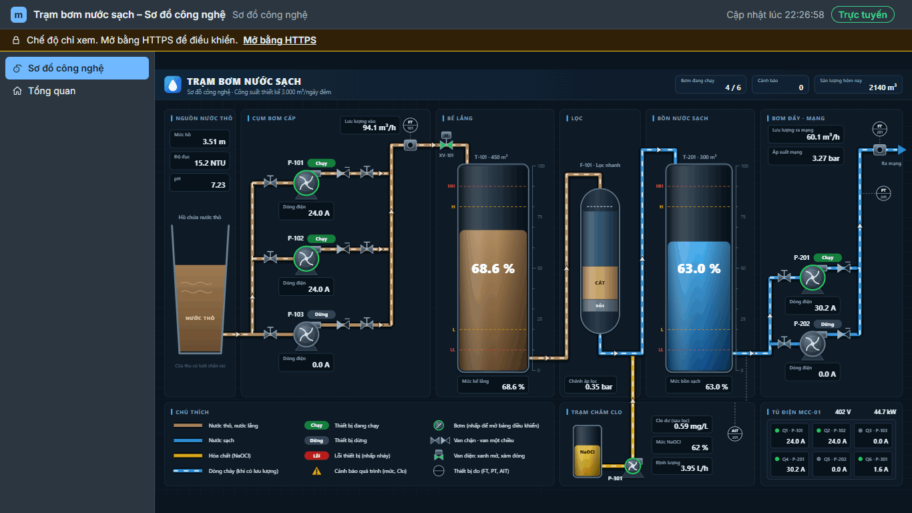

- Màn hình **Sơ đồ công nghệ**: một item SVG phủ toàn màn hình. Dùng Mức đầy (bồn; hồ chứa hình thang dùng đích `geometry.clipLevel`), Quay khi chạy (cánh bơm), Đổi màu viền và Đổi màu nền theo từng giá trị của Tag trạng thái 0/1/2, Dòng chảy trong ống (tốc độ theo lưu lượng, kèm Làm mờ để ẩn vạch khi lưu lượng bằng 0), Nhấp nháy (vỏ bơm khi lỗi), Hiện số / chữ (mức %, m³/h, bar, mg/L, A) và Hiện / ẩn (biểu tượng cảnh báo).
- Nhấp một bơm mở popup faceplate `faceplate-bom` (đèn chạy, lỗi, dòng điện, giờ chạy, chế độ, lệnh chạy tay) với `prefix` là mã bơm.

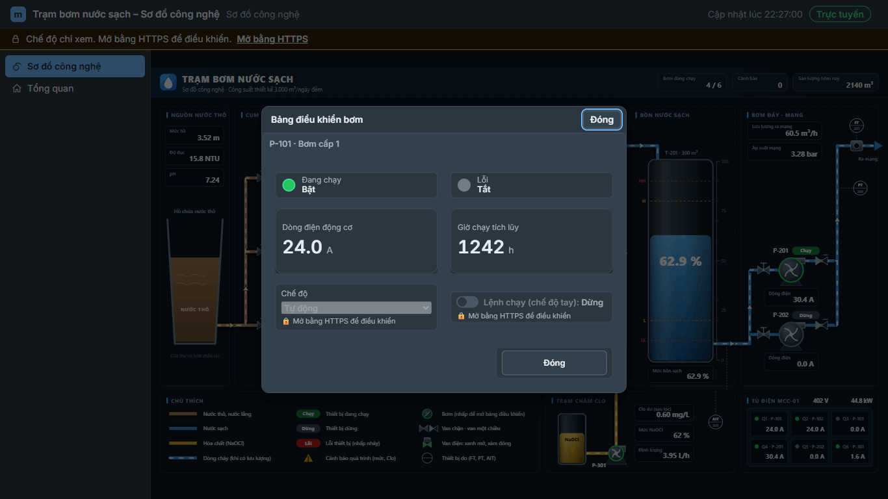

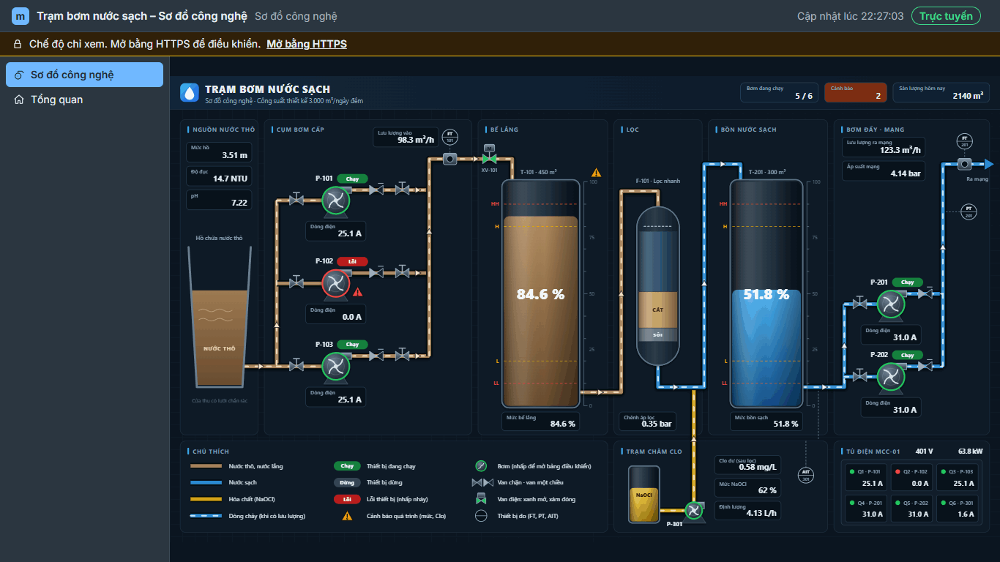

- Màn hình **Tổng quan** (lưới): hàng 4 thẻ chỉ số màu, hàng sơ đồ SVG 8 cột cạnh biểu đồ xu hướng mức 4 cột, hàng dòng điện động cơ và bảng giá trị.

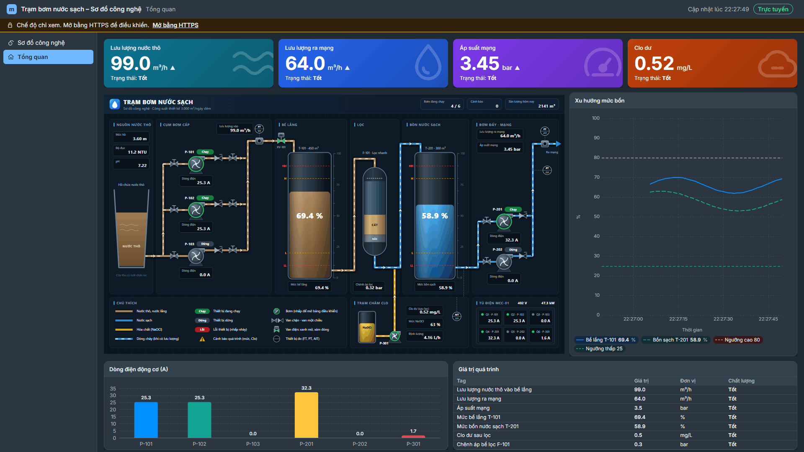

Trong Studio, vào đồ họa (Enter) rồi chọn phần tử để xem binding ở tab **Gắn Tag**; bấm **Mô phỏng** để xem sơ đồ chạy với Tag mô phỏng.

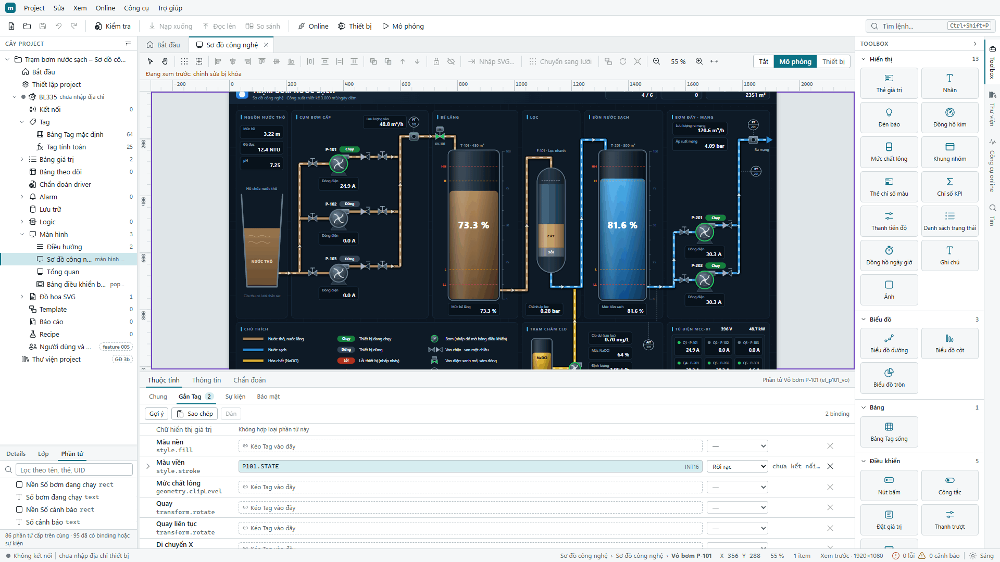

Bản vẽ, binding và Tag sinh từ `tools/svg-showcase/generate.mjs`; cách sửa: `projects/svg-showcase/README.md`.

<a id="help-templates"></a>

## 8. Template và faceplate

Dùng khi nhà máy có nhiều thiết bị giống nhau (ví dụ 20 bơm).

Cần project định dạng 1.0.0 (mục 3); project cũ hơn thì các lệnh template bị khóa với lý do "Cần project định dạng 1.0.0 (nâng cấp project)". Ví dụ đầy đủ: màn hình "Bơm" của `projects/dashboard-demo/` (template `bom`, 20 bản sao, popup `bom-chi-tiet`).

- **Template**: một nhóm widget vẽ một lần, có tham số, lưu ở `templates/<id>.template.json`. Chọn các widget trên màn hình, nhấp phải, **Tạo template…** (hoặc tìm "Tạo template" trong **Tìm lệnh…**). Hộp "Tạo template từ vùng chọn" cho đặt id, tên, tối đa 16 tham số và chọn chỗ nào thay bằng tham số. Tham số có kiểu `tagPrefix`, `string`, `number`, `color`; trong item viết `{tên}`, ví dụ `{prefix}.RUN`. Đây là thay chuỗi thuần, không phải biểu thức, không lồng. Template tối đa 120 item và chỉ gồm widget: item SVG không đưa vào template được.
- Mọi template nằm ở mục **Template** trên cây; trang của một template có danh sách bản sao (màn hình, trạng thái "khớp template" hay "lệch template"), các nút **Thêm bản sao…**, **Tham số…**, **Xóa template…**.
- **Bản sao**: **Thêm bản sao…**, chọn màn hình, đặt **Id bản sao** và giá trị tham số (ví dụ `prefix` = `PUMP07`; ô trống lấy mặc định). Khi lưu, bản sao được bung thành item thường, id dạng `<bản sao>.<item>` (ví dụ `pump7.lamp`); runtime không cần biết template.

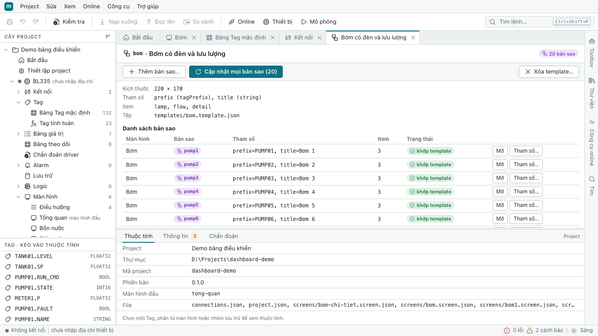

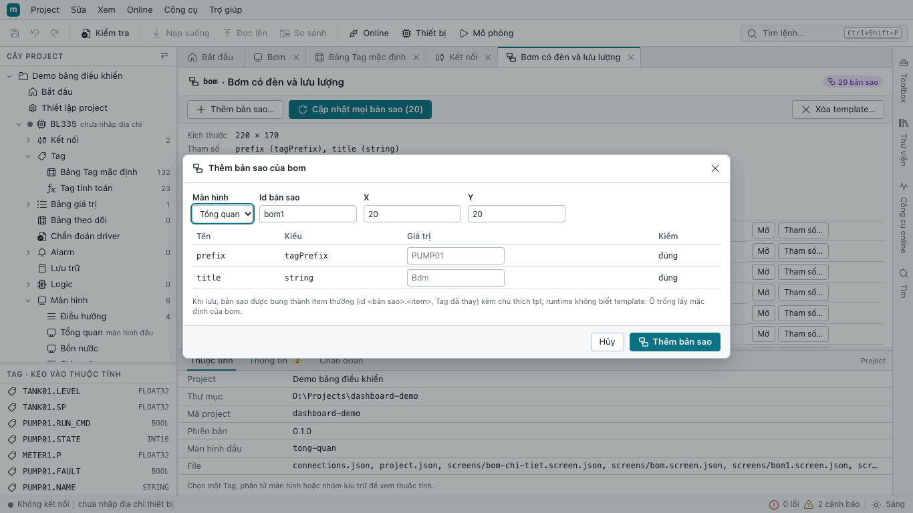

- Sửa template rồi **Cập nhật mọi bản sao (n)**: giữ riêng vị trí, cỡ, giá trị tham số và id của từng bản sao; một bước hoàn tác (Ctrl+Z). Item thêm tay vào bản sao bị xóa khi cập nhật (inspector báo `W_TEMPLATE_DRIFT`); muốn giữ thì **Bung thành item thường** cho bản sao đó trước. Xóa template còn bản sao: các bản sao được giữ lại dạng item thường.
- **Faceplate**: màn hình popup có tham số. Mở màn hình popup, trong inspector bấm **Tạo faceplate (tham số cho popup)**: Studio đổi tiền tố Tag chung của popup thành tham số `prefix`. Ở nút gọi popup, hành động **Mở popup** có ô **args…** để truyền giá trị, ví dụ mở `bom-chi-tiet` với `prefix` = `PUMP07`. Nút thuộc bản sao template lấy `args` từ tham số của template (chỉ xem). Studio kiểm trước mọi tổ hợp `args` được gọi; tham số sai thì báo `E_TEMPLATE_PARAM` hoặc `E_POPUP_ARGS`, Tag không có thì `E_TEMPLATE_TAG_REF`. Trên trang vận hành, popup chỉ đăng ký các Tag có trong project; `args` sai thì popup không mở và báo "tham số của cửa sổ sai (…)".

<a id="help-logic"></a>

## 9. Logic

Logic chạy trên runtime 1.0.0, theo chu kỳ quét (`logic.scanMs`, mặc định 100 ms). Mọi khối nằm trong `logic.json`, sửa ở nút **Logic** trên cây (các nhóm Luật, Timer, Counter, Cộng dồn, Giờ chạy, Lịch, Ghi PLC; tất cả mở chung tab "Logic"). Project chưa có logic: bấm **Tạo logic.json**. Project định dạng cũ hơn 1.0.0: editor báo "Logic cần project định dạng 1.0.0", nâng cấp project trước (mục 3).

Tab Logic có hai khung nhìn của cùng `logic.json`, chọn bằng nút **Sơ đồ** / **Bảng** đầu thanh công cụ (Studio nhớ lựa chọn trên máy): **Sơ đồ** (mặc định, mục 9.1) vẽ khối và dây nối kiểu FBD; **Bảng** liệt kê khối theo nhóm như trước (mục 9.2).

### 9.1. Sơ đồ khối

Mỗi khối là một nút: đầu khối có loại (Luật, TON/TOF/TP, Counter, Cộng dồn, Giờ chạy, Lịch, Ghi PLC) và id; bên trái là cổng vào (ô biểu thức: `when`, `in`, `up`, `down`, `reset`, `source`, `run`), bên phải là cổng ra (Tag logic `q`, `et`, `value`, `reached`, `total`…; luật có ↑ Khi lên và ↓ Khi xuống); dòng cuối tóm tắt tham số (giữ 5 s, PT 1 min, đặt trước 1000…). Biểu thức của cổng vào được vẽ thành cổng logic: `&&` là **AND**, `||` là **OR**, `!` là **NOT**, so sánh là ô "> 80", "< 20"…; phép tính khác (số học, hàm) là ô biểu thức. Tag đầu vào là hộp tên Tag gắn vào chân (đi theo khối). Đầu ra của khối dùng ở khối khác nối bằng dây liền; hành động của luật tới mục **Ghi PLC** hoặc Tag đích là dây đứt màu hổ phách. Chấm cổng xanh dương là BOOL, tím là số.

Sơ đồ không đổi định dạng `logic.json`. Vị trí khối lưu riêng trong tệp `logic.layout.json` cạnh `logic.json` (chỉ Studio dùng, không nạp xuống thiết bị); thiếu tệp này thì Studio tự sắp xếp.

- **Thêm khối**: kéo khối từ task card **Khối / Tag** vào sơ đồ (đặt ở chỗ thả), hoặc **Thêm khối** / Insert (đặt giữa vùng nhìn).
- **Dời khối**: kéo khối (căn lưới 16 px, giữ Alt để dời tự do) hoặc phím mũi tên (16 px, Shift: 64 px). **Tự sắp xếp** xếp lại mọi khối từ trái sang phải theo phụ thuộc.
- **Chọn nhiều khối**: Shift+bấm từng khối, hoặc kéo khung trên nền; Ctrl+A chọn hết, Esc bỏ chọn nhóm. Kéo, mũi tên, Delete, Ctrl+D áp cho cả nhóm, mỗi thao tác một bước hoàn tác.
- **Nối dây**: kéo từ cổng ra (Tag hoặc đầu ra khối) tới cổng vào hoặc chân của cổng logic: Studio thay đúng phần biểu thức đó bằng tên Tag. Kéo ↑/↓ của luật tới mục Ghi PLC thêm hành động Ghi PLC (giá trị cho phép đầu tiên), tới Tag đích thêm Đặt Tag `true`. Kéo một Tag từ task card thả vào cổng vào cũng nối. Khi đang kéo, cổng khác kiểu mờ đi.
- **Cổng logic**: kéo **AND**, **OR**, **NOT**, **So sánh** ở task card thả vào một cổng vào để bọc biểu thức hiện có (ví dụ `(x) && true`), rồi nối Tag vào chân còn trống.
- **Xóa dây**: nhấp dây rồi Delete (bỏ toán hạng khỏi AND/OR, cổng vào của khối thành trống). **Xóa khối**: Delete; **Nhân bản**: Ctrl+D (đầu ra theo id mới). Mỗi thao tác hoàn tác được bằng một lần Ctrl+Z.
- Nhấp một khối (hoặc Tab tới nó) để sửa ở **Inspector** như ở Bảng; Enter đưa con trỏ vào ô Id. Nhấp cổng logic hay hộp Tag đưa con trỏ vào đúng ô biểu thức.
- **Zoom**: Ctrl + lăn chuột, nút − / + (phím − +), **Vừa khung** (phím 0; không thu dưới 90 % để chữ còn đọc được, sơ đồ lớn hơn thì cuộn), **100 %**; lăn chuột, giữ Space rồi kéo, hoặc kéo bằng nút giữa để dời. Bản đồ nhỏ ở góc phải dưới: nhấp để tới vùng đó.
- **Khung dưới** (Inspector, Thông tin, Thử logic): kéo thanh chia để đổi chiều cao; nút ˅ ở góc phải hoặc Ctrl+J gập/mở (Studio nhớ chiều cao). Mở **Thử logic** ở Sơ đồ, khung dưới tự thấp lại để vùng vẽ còn ít nhất 55 % chiều cao.
- **Lỗi** của bộ kiểm tra hiện ngay trên sơ đồ: khối có lỗi viền đỏ, cổng vào và dây của biểu thức lỗi màu đỏ, Tag không có trong project là hộp viền đứt đỏ; danh sách vẫn ở tab **Thông tin**, nhấp đúp một dòng để chọn khối trên sơ đồ.
- **Thử logic** và **Online**: sơ đồ hiện giá trị sống. Dây và cổng BOOL đang TRUE màu xanh lá, giá trị số ghi cạnh cổng ra, khối vừa bắn sáng lên, timer đang đếm hiện "còn x s", mục Ghi PLC hiện giá trị Tag đích; mỗi khối có chip trạng thái (OK, SUSPENDED, THROTTLED, DISABLED; Online kèm số lần bắn).

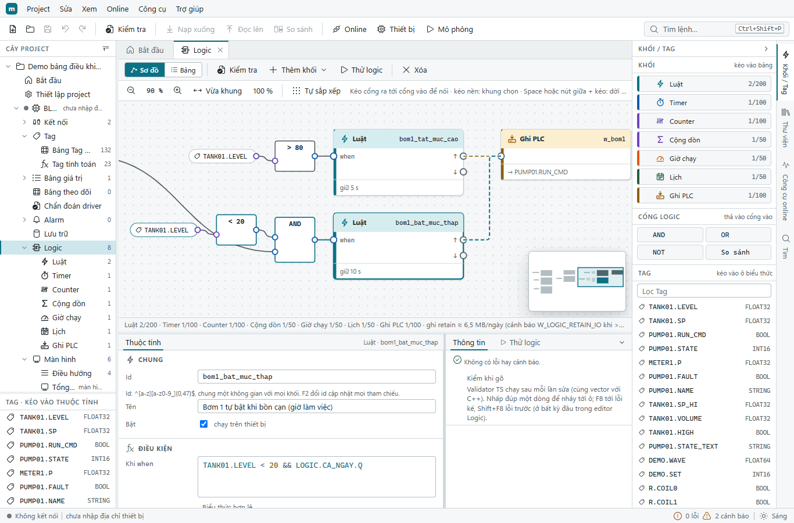

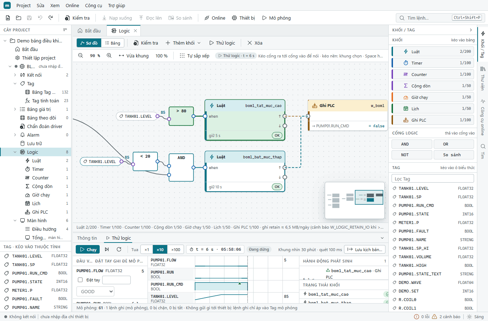

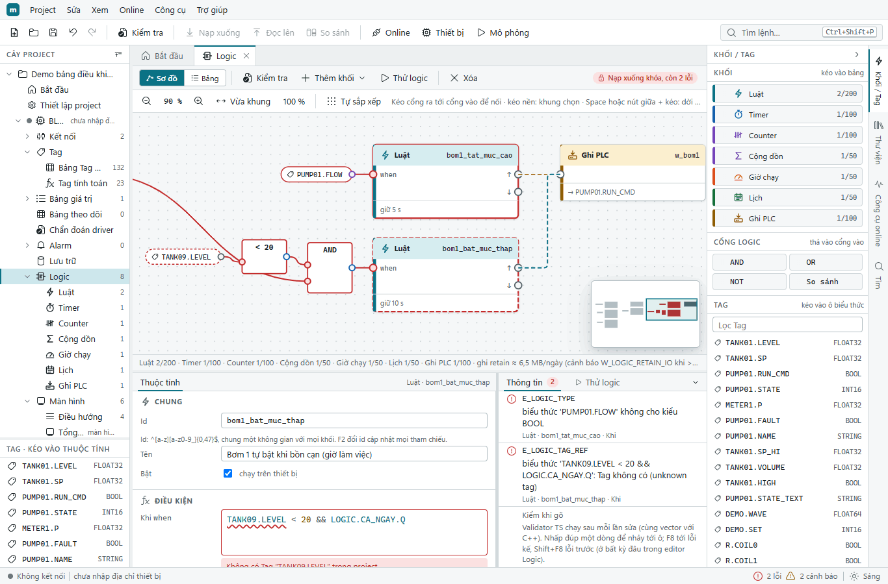

### 9.2. Bảng và các khối

Thao tác ở Bảng: **Thêm khối** (Insert), **Xóa** (Delete), **Chuyển lên**/**Chuyển xuống**, F2 đổi id (Studio cập nhật mọi tham chiếu), ô "Tìm id, tên, Tag", ô "Chỉ dòng lỗi", **Kiểm tra** (F7). Dock dưới có **Inspector** (trường của khối đang chọn), **Thông tin** (lỗi và cảnh báo, nhấp đúp để nhảy tới ô; F8 / Shift+F8 tới lỗi kế / trước ở bất kỳ đâu trong editor) và **Thử logic**. Task card **Khối / Tag** bên phải: kéo một khối vào bảng (hoặc nhấp đúp) để thêm, kéo một Tag vào ô biểu thức. Giới hạn: 200 luật, 100 timer, 100 counter, 50 cộng dồn, 50 giờ chạy, 50 lịch, 100 mục ghi (`E_LOGIC_LIMIT`).

| Khối | Dùng khi | Trường chính |
|---|---|---|
| Luật | "khi điều kiện đúng thì làm" | Khi (biểu thức BOOL), Giữ (ms), Khi lên, Khi xuống, Lặp |
| Timer | trễ bật, trễ tắt, xung | Kiểu `ton`/`tof`/`tp`, Vào, pt |
| Counter | đếm số lần khởi động | Đếm lên, Đếm xuống, Đặt lại, Preset |
| Cộng dồn | tổng lưu lượng | Nguồn, Đơn vị gốc, Hệ số, Cutoff |
| Giờ chạy | giờ chạy và lịch bảo dưỡng | Chạy, Bảo dưỡng mỗi (h) |
| Lịch | bật theo giờ trong tuần | Khung hằng tuần, Ngoại lệ |

Chi tiết từng khối (theo engine của runtime; **Thử logic** trong Studio dùng cùng bộ vector kiểm):

- **Timer** `ton` (trễ bật): đầu ra lên khi **Vào** đúng liên tục đủ `pt` ms; `tof` (trễ tắt): đầu ra lên ngay khi Vào đúng, xuống sau khi Vào sai đủ `pt` ms; `tp` (xung): cạnh lên của Vào cho đầu ra đúng trong `pt` ms, không kéo dài khi Vào lặp lại. `pt` nhỏ hơn chu kỳ quét được nâng lên bằng chu kỳ quét. Đầu ra phụ: thời gian đã chạy (ms).
- **Counter**: cạnh lên của **Đếm lên**/**Đếm xuống** tăng, giảm 1; cạnh lên của **Đặt lại** về 0; đầu ra giá trị và cờ "đạt **Preset**" (giá trị ≥ Preset).
- **Cộng dồn**: tích phân hình thang của **Nguồn** (lưu lượng) theo thời gian, nhân **Hệ số**, chia theo **Đơn vị gốc** của lưu lượng (`s`, `min`, `h`, `d`: m³/h thì chọn `h`). Giá trị dưới **Cutoff** tính là 0 (bỏ nhiễu khi bơm dừng). Nguồn BAD hoặc khoảng giữa hai lần quét quá 5 s thì không cộng; thời gian bỏ qua cộng vào đầu ra "giây trống" để biết tổng thiếu bao nhiêu. Có thể đặt ngưỡng quay vòng (về 0 khi vượt) và biểu thức đặt lại (cạnh lên).
- **Giờ chạy**: đếm giờ khi **Chạy** đúng và số lần khởi động; đầu ra "đến hạn bảo dưỡng" khi số giờ ≥ **Bảo dưỡng mỗi (h)**. Kỹ sư đặt lại sau bảo dưỡng bằng **Đặt lại về 0 trên thiết bị** (Online).
- **Lịch**: các khung hằng tuần (ngày trong tuần, giờ từ, giờ đến; khung qua nửa đêm được) và **Ngoại lệ** theo ngày (ngày lễ: bật hoặc tắt cả ngày). Giờ tính theo giờ địa phương cố định của project (không giờ mùa hè).
- Counter, cộng dồn, giờ chạy mặc định **Giữ khi tắt máy**; trạng thái lưu bị mất (tệp hỏng) thì bắt đầu lại từ 0 và thiết bị báo `LOGIC_RETAIN_LOST`.

- Luật: điều kiện **Khi** phải đúng liên tục trong **Giữ** (ms) mới thành cạnh. Tag đầu vào BAD, STALE hoặc lỗi biểu thức thì luật tạm treo (SUSPENDED): không hành động, không sinh cạnh giả. **Lặp** (≥ 10.000 ms, chỉ cho Khi lên) lặp lại hành động khi điều kiện còn đúng. Mặc định luật không bắn lúc runtime khởi động, trừ khi tích **Bắn khi khởi động**.
- Đầu ra của khối là "Tag logic" chỉ đọc, tên `LOGIC.<ID>.…` (ví dụ đầu ra `q` của timer). Ghi tay vào Tag logic bị từ chối `OWNED_BY_LOGIC`. Counter, cộng dồn, giờ chạy có ô **Giữ khi tắt máy**: giữ qua mất điện, mất tối đa một chu kỳ ghi (`logic.flushS`, mặc định 60 s).
- Lịch không theo giờ mùa hè; khi đồng hồ thiết bị chưa đồng bộ, đầu ra của lịch là BAD (`TIME_NOT_SYNCED`) và luật dùng nó tạm treo.
- Hành động (**Khi lên**, **Khi xuống**): **Đặt Tag**, **Đảo** (Tag nội bộ), **Ghi PLC**, **Xung**. Ghi xuống PLC chỉ qua mục đã khai ở nhóm **Ghi PLC**: mỗi mục là một **Tag thiết bị (RW)** kèm **Giá trị cho phép** (danh sách hoặc khoảng min đến max), **Cách nhau tối thiểu** (≥ 1.000 ms) và **Tối đa mỗi giờ**. Hành động ghi mục chưa khai là lỗi `E_LOGIC_WRITE_UNDECLARED`. Toàn thiết bị còn giới hạn `logic.maxWritesPerMin` (mặc định 20 lệnh mỗi phút); vượt thì lệnh bị từ chối và luật sang THROTTLED.
- Ghi từ logic **mặc định tắt trên thiết bị** (`logic.writes` = `off`): luật vẫn chạy, nhưng không lệnh nào tới PLC. Chỉ quản trị viên bật được, bằng quyền root trên thiết bị ([admin-guide.md](admin-guide.md) mục 9). Mỗi lệnh ghi của logic có audit với người thực hiện `logic:<id luật>`.
- **Dừng khẩn:** administrator dừng mọi lệnh ghi PLC của logic từ Studio (**Dừng ghi của logic…**); có hiệu lực ngay và giữ qua khởi động lại; luật, timer, counter vẫn chạy. Chỉ root bỏ được lệnh dừng, bằng `mat-runtime --logic-writes-reset` trên thiết bị (không có nút bật lại trong Studio: API trả `LOGIC_ENABLE_ROOT_ONLY`). Chi tiết: [admin-guide.md](admin-guide.md) mục 9.
- **Thử logic** (dock dưới): chạy mô phỏng ngay trong Studio, không cần thiết bị. **Chạy**/**Dừng** (Space), **Một quét**, tua ×1, ×10, ×100; **Đặt tay** giá trị và quality (GOOD, UNCERTAIN, BAD) của từng đầu vào; đường thời gian đầu vào, đầu ra (co giãn theo thời gian đã chạy, tối đa 5 phút, 30 phút, 2 giờ theo tốc độ) và danh sách hành động phát sinh. Lệnh ghi trong mô phỏng chỉ áp vào Tag mô phỏng ("Không gửi gì tới thiết bị"). **Lưu kịch bản…** lưu ca thử thành tệp JSON.

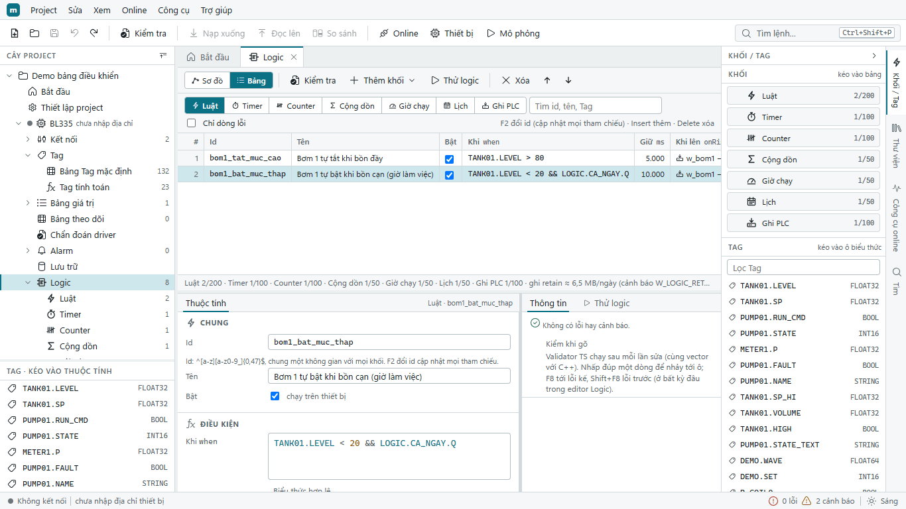

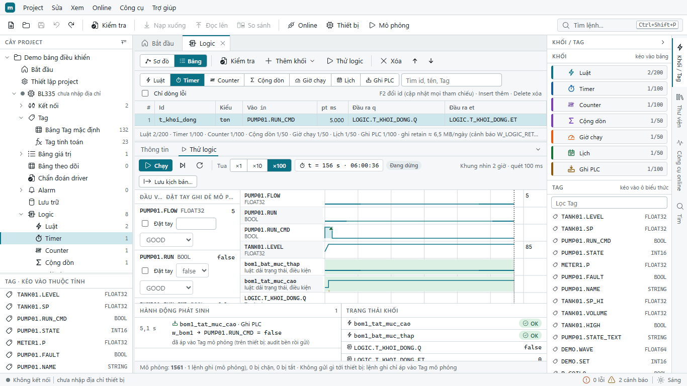

- **Online**: bảng khối có thêm cột **Trạng thái**, **Lần bắn cuối**, **Số lần** đọc từ thiết bị; thanh công cụ của tab có chip "Ghi PLC: tắt", "Ghi PLC: bật" hoặc "Ghi PLC: dừng" (nhấp để xem chi tiết; administrator có **Dừng ghi của logic…**, xem [admin-guide.md](admin-guide.md) mục 9). Inspector của counter, cộng dồn, giờ chạy có nút **Đặt lại về 0 trên thiết bị** (engineer, có audit).

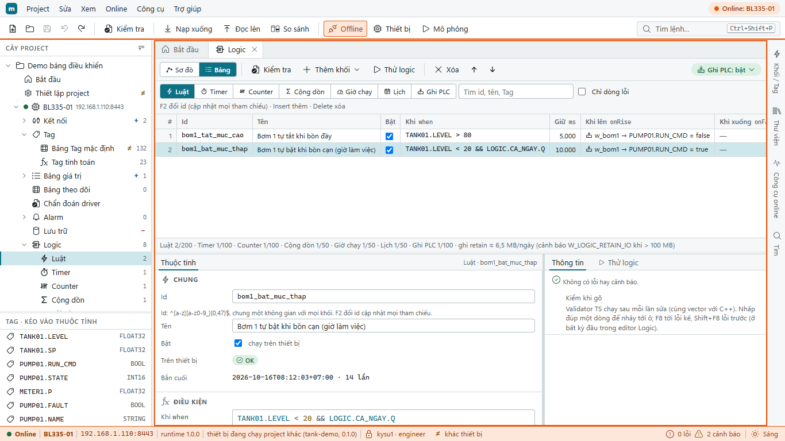

- Khi nạp xuống project có ghi từ logic, hộp xem trước có mục "Logic sẽ tự động ghi N Tag xuống PLC" kèm bảng Tag, giá trị cho phép, tần suất và luật ghi, và trạng thái ghi PLC của thiết bị đích (thiết bị đang tắt ghi thì có cảnh báo `W_LOGIC_WRITES_OFF`). Phải tích "Tôi đã xem danh sách…" mới nạp xuống được.
- Logic không thay logic an toàn của PLC: khóa liên động và dừng khẩn phải nằm trong PLC.

<a id="help-online"></a>

## 10. Online: thêm thiết bị, nạp xuống, đọc lên, so sánh

### 10.1. Thêm thiết bị và đăng nhập

1. **Online** > **Thiết bị trong mạng…**: Studio tìm runtime trong mạng LAN. Không thấy (khác mạng con, VPN): **Thêm theo địa chỉ…**.
2. Lần đầu, hộp "Xác nhận chứng chỉ" hiện **Fingerprint SHA-256 của chứng chỉ thiết bị**. So **từng cặp ký tự** với fingerprint do quản trị viên đọc trên thiết bị. Khớp thì **Ghim và tiếp tục**. Không khớp: dừng, báo quản trị viên.
3. **Đăng nhập…**: nhập tài khoản engineer.

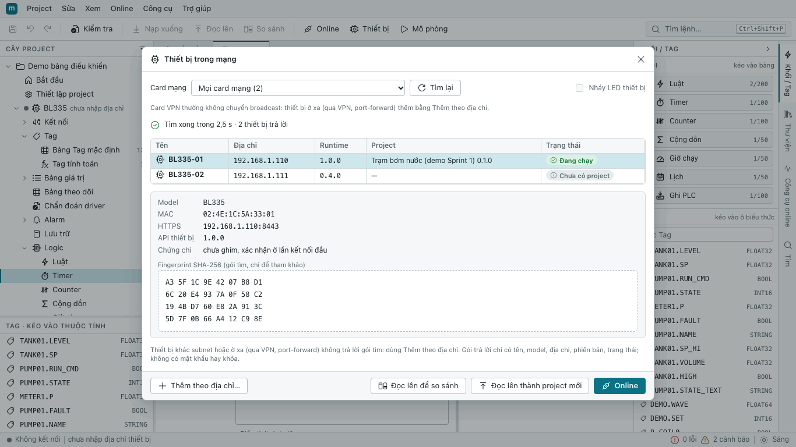

4. Fingerprint đổi sau này ("Chứng chỉ đã đổi"): chỉ **Gỡ ghim và xác nhận lại** khi quản trị viên xác nhận đã sinh lại chứng chỉ.

### 10.2. Nạp xuống

1. Lưu, **Kiểm tra** (F7): 0 lỗi.
2. **Online** > **Nạp xuống…** (Ctrl+L).
3. Đọc **xem trước**: Kiểm tra project, Tương thích runtime, Thay project đang chạy, Client sẽ tải lại, Dung lượng gói, Lưu trữ dữ liệu. Tích **Tôi đã đọc các cảnh báo**, bấm **Nạp xuống**.
4. Thiết bị chạy các bước: Gửi gói lên thiết bị, Kiểm tra gói, Kiểm tra project, Sao lưu bản đang chạy, Kích hoạt bản mới, Kiểm tra sức khỏe (15 s).
5. Lỗi trước bước kích hoạt: thiết bị không đổi gì. Kích hoạt xong mà kiểm tra sức khỏe không đạt: thiết bị **tự quay về** bản trước.
6. Trang vận hành đang mở tự tải lại ("Đang nạp project mới…").

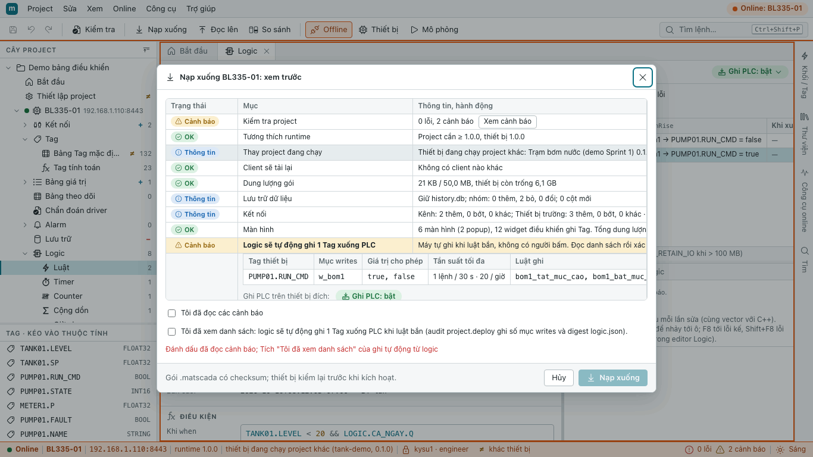

Nạp xuống nên làm ngoài giờ cao điểm và báo trước cho người vận hành.

### 10.3. Khôi phục bản trước

**Online** > **Khôi phục bản trước…**: danh sách các bản thiết bị đang giữ (bản chạy và 3 bản dự phòng) kèm người nạp và thời điểm. Chọn, **Khôi phục**.

### 10.4. Đọc lên và so sánh

- **Đọc lên…** > **Thành project mới**: lấy project đang chạy trên thiết bị về máy (dùng khi mất bản trên máy, hoặc tiếp quản từ người khác).
- **So sánh với thiết bị**: bảng `=` giống, `≠` khác, `+` chỉ có trên máy, `-` chỉ có trên thiết bị; **Đọc lên phần chọn** hoặc **Nạp xuống phần khác**. Thanh trạng thái hiện "project … khớp thiết bị" hoặc "khác thiết bị".

### 10.4a. Thiết lập thiết bị (administrator)

Online bằng tài khoản administrator, cây project › thiết bị có thêm nút **Thiết lập thiết bị**: tab **Chung** (bắt buộc đăng nhập, phạm vi xem, tên miền cho phép, kết nối live mỗi địa chỉ, OTA, tên thiết bị; cột Nguồn cho biết giá trị theo `runtime.json` hay đã đặt ở đây) và tab **Chứng chỉ** (vân tay, hạn, SAN; sinh lại có IP, tạo CSR, nhập chứng chỉ CA ký). Lưu làm runtime khởi động lại vài giây; đổi chứng chỉ thì Studio chờ thiết bị chạy lại, cho so vân tay rồi mới ghim lại. Mọi việc trước đây cần SSH đều làm ở đây; chi tiết: [admin-guide.md](admin-guide.md#device-settings).

### 10.5. Cập nhật runtime

Kỹ sư không cập nhật runtime: việc này cần tài khoản administrator và thiết bị đã bật OTA (administrator bật trong **Thiết bị › Thiết lập thiết bị**, [admin-guide.md](admin-guide.md) mục 5.0 và 7.2). Khi cần runtime mới (ví dụ nạp xuống bị chặn `E_RUNTIME_TOO_OLD` vì project 1.0.0), báo quản trị viên. Trong lúc thiết bị đang cập nhật, nạp xuống bị từ chối `DEVICE_BUSY`; ngược lại, đang nạp xuống thì không cập nhật được. Sau cập nhật, project đang chạy giữ nguyên; nếu bản mới không chạy được project thì thiết bị từ chối gói trước khi cài (`UPDATE_PROJECT_INCOMPATIBLE`).

<a id="help-diagnostics"></a>

## 11. Theo dõi và chẩn đoán

- **Bảng theo dõi**: thêm Tag, xem giá trị và quality sống; ghi thử bằng **Ghi dòng đã chọn…** (Ctrl+Shift+Enter), có hộp **Xác nhận ghi**.
- **Chẩn đoán driver**: theo từng nhóm quét, số lần đọc, lỗi, thời gian; **Đặt lại phần tăng** để đếm lại từ bây giờ.
- Inspector của thiết bị, tab **Chẩn đoán**: CPU, RAM runtime, RAM hệ thống, dung lượng trống, giờ thiết bị, số phiên.
- Cảnh báo của thiết bị (ví dụ `SSH_ROOT_PASSWORD`, `PULSE_STUCK`, `HOST_CHECK_OFF`, `LOGIC_WRITES_OFF`, `LOGIC_THROTTLED`, `LOGIC_RETAIN_LOST`, `TIME_NOT_SYNCED`, `UPDATE_ROLLED_BACK`) hiện ở thông tin thiết bị. Bảng đủ mã kèm việc cần làm: [admin-guide.md](admin-guide.md#cảnh-báo-của-thiết-bị); mã lỗi khác: [error-codes.md](error-codes.md).
- Logic trên thiết bị: tab "Logic" khi Online (trạng thái từng khối, chip "Ghi PLC", mục 9).
- Số liệu chạy dài hạn của thiết bị (thời gian chạy, số lần khởi động lại và nguyên nhân, RSS, CPU, ghi đĩa trong ngày, tuổi thọ eMMC, độ trễ dữ liệu sống): `GET /api/v1/diagnostics`, xem [admin-guide.md](admin-guide.md) mục 8.
- **Audit của thiết bị** (chỉ administrator): ai đăng nhập, ai ghi gì, ai nạp xuống.

<a id="help-alarm"></a>

## 12. Alarm, lưu trữ, báo cáo

- **Alarm** > **Danh sách alarm**: loại **Số** (bit), **Ngưỡng** (HH, H, L, LL, Deadband, Trễ bật, Trễ tắt), **Quality**. **Lớp alarm**: ưu tiên, màu, nhấp nháy, cần xác nhận, âm thanh. **Thử alarm** để xem trước.
- **Lưu trữ**: nhóm theo **Chu kỳ**, **Thay đổi**, **Kết hợp** hoặc **Kích hoạt**; khung **Ước tính ghi** cho số MB/ngày. Vượt ngân sách ghi thì Studio hỏi trước khi nạp xuống. Ghi nhiều làm mòn bộ nhớ eMMC: chỉ lưu Tag cần.
- **Báo cáo**: xem mục 12.1.

### 12.1. Thiết kế báo cáo

**Thêm báo cáo**: chuột phải **Báo cáo** trên cây > **Thêm báo cáo…** (hoặc bảng lệnh Ctrl+Shift+P > "Thêm báo cáo"). Trang Báo cáo có **thư viện mẫu**: **Báo cáo ca**, **Báo cáo ngày**, **Báo cáo tháng**, **Báo cáo năng lượng**, **Báo cáo alarm**, **Vận hành thiết bị**, **Ghi PLC của logic**. Chọn một mẫu: Studio dựng sẵn cột từ nhóm lưu trữ có **Tổng hợp** (Tag số cho báo cáo bảng, Tag BOOL cho vận hành thiết bị, Tag có đơn vị kWh, kW cho năng lượng) rồi mở trình thiết kế.

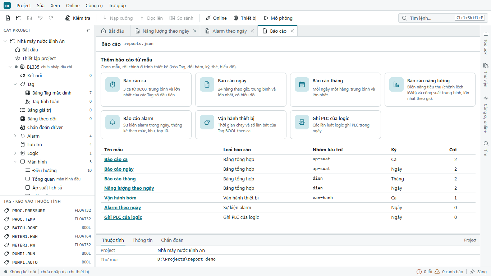

Trình thiết kế có ba vùng:

- **Cấu trúc báo cáo** (trái): **Thông tin chung**, **Kỳ và nhóm hàng**, **Thẻ tổng hợp**, **Biểu đồ**, **Cột** (mỗi cột một mục), **Trang in**. Mục có lỗi có dấu đỏ.
- **Xem trước trực tiếp** (giữa): báo cáo dựng bằng **đúng mã của trang vận hành** trên **Dữ liệu mô phỏng** (hoặc **Dữ liệu thiết bị** khi Online). Bấm vào dải tiêu đề, hàng thẻ, biểu đồ hay tiêu đề cột để chọn phần đó. Nút **CSV**, **CSV (Excel vi-VN)**, **XLSX**, **PDF** xuất thử.
- **Thuộc tính** (phải): trường của phần đang chọn.

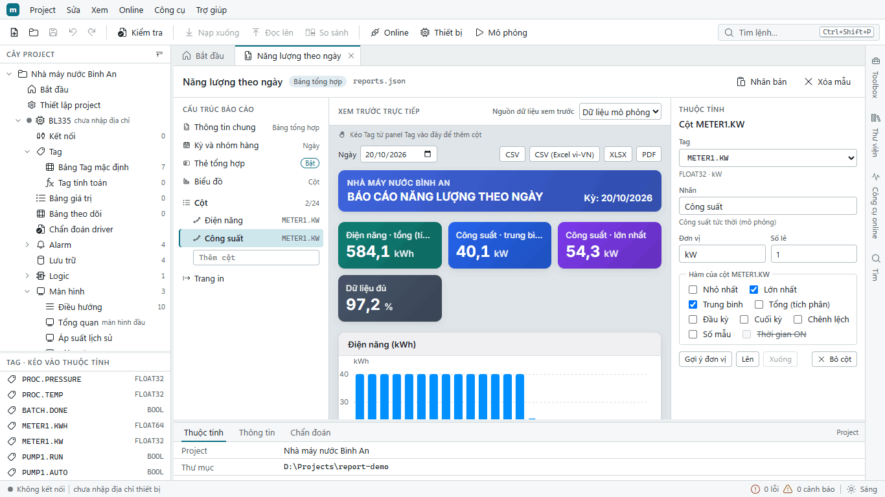

Thao tác:

1. **Thông tin chung**: tên, id, **Loại báo cáo** (Bảng tổng hợp, Vận hành thiết bị, Sự kiện alarm, Ghi PLC của logic), nhóm lưu trữ (chỉ nhóm có Tổng hợp), tiêu đề.
2. **Kỳ và nhóm hàng**: **Ngày** (hàng 15, 30 hoặc 60 phút), **Ca** (2, 3, 4, 6, 8 hoặc 12 ca từ giờ bắt đầu; nhãn ca hiện ngay), **Tuần** và **Tháng** (hàng theo ngày), **Khoảng ngày** (người xem chọn từ ngày đến ngày, tối đa 31 ngày).
3. **Thêm cột**: kéo Tag từ panel **Tag** thả vào vùng xem trước hoặc Cấu trúc, hoặc gõ tên ở ô **Thêm cột** (có gợi ý). Chỉ nhận Tag của nhóm lưu trữ; Vận hành thiết bị chỉ nhận Tag BOOL.
4. **Cột**: Tag, nhãn, đơn vị (**Gợi ý đơn vị**: kW + Tổng ra kWh, Thời gian ON ra giờ), số lẻ, hàm: **Trung bình**, **Nhỏ nhất**, **Lớn nhất**, **Tổng (tích phân)**, **Đầu kỳ**, **Cuối kỳ**, **Chênh lệch**, **Số mẫu**, **Thời gian ON** (Tag BOOL). Vận hành thiết bị: **Thời gian ON**, **Số lần bật**. **Lên**, **Xuống** đổi thứ tự; **Bỏ cột**.
5. **Thẻ tổng hợp**: bật, tắt hàng thẻ (giá trị cả kỳ của tối đa 4 cột đầu và Dữ liệu đủ).
6. **Biểu đồ**: **Tự chọn** (các cột cùng đơn vị với cột đầu; hàm cộng dồn vẽ cột, còn lại vẽ đường), **Đường**, **Cột**, **Không vẽ**.
7. **Trang in**: **Tên đơn vị** (chung cho mọi báo cáo; trống thì dùng tên project), **Logo đơn vị** (tệp `graphics/*.svg` hoặc `graphics/*.png` của project, tối đa 256 KiB; hiện trên dải tiêu đề của trang, PDF và XLSX; lỗi `E_RPT_LOGO`), khổ A4/A3, hướng, chân trang, dòng tổng.

Mỗi thay đổi hoàn tác được (Ctrl+Z). Lỗi `E_RPT_*` hiện tại trường và ở tab **Thông tin** của dock dưới (nhấp đúp để tới đúng chỗ); vẫn lưu được khi còn lỗi.

Báo cáo alarm và logic không có cột Tag: xem trước dùng sự kiện mô phỏng từ alarm và luật của project.

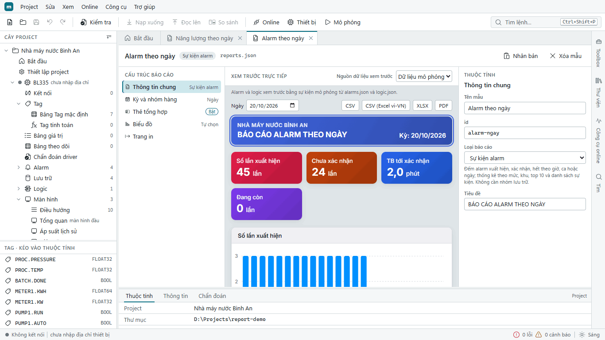

**Định dạng 1.1**: loại báo cáo, kỳ Tuần và Khoảng ngày, thẻ, biểu đồ, Thời gian ON và Tên đơn vị cần project định dạng 1.1. Project cũ: các tùy chọn này bị khóa kèm lý do; mở lại project và đồng ý nâng cấp ở hộp **Mở project định dạng …**. Project mẫu: `projects/report-demo`.

### 12.2. Recipe (công thức)

Recipe cho phép người vận hành nạp cả một bộ thông số (mẻ, sản phẩm) xuống PLC bằng một thao tác. Cần project định dạng 1.1.

- **Loại recipe**: danh sách Tag tham số (chỉ Tag ghi được: RW, không phải Tag tính toán, Tag mô phỏng chỉ loại Thủ công), mỗi tham số có nhãn, đơn vị, **Min**, **Max**, số lẻ, mô tả. Thứ tự tham số là thứ tự ghi xuống PLC.
- **Bản recipe**: tên và giá trị của mọi tham số (thiếu, sai kiểu hoặc ngoài giới hạn là lỗi).
- **Quyền** của loại (Thuộc tính): **Xem**, **Tải xuống** (mặc định operator), **Sửa trên thiết bị** (Đọc từ PLC, sửa, sao chép, xóa bản thiết bị; mặc định operator).

Thêm: chuột phải **Recipe** trên cây > **Thêm loại recipe**. Editor có ba vùng: danh sách loại (trái), lưới kiểu bảng tính (giữa: mỗi tham số một hàng, mỗi bản một cột; sửa tại ô, Enter/Tab/mũi tên, dán nhiều ô từ Excel), **Thuộc tính** (phải). Kéo Tag từ panel **Tag** thả vào lưới để thêm tham số. **Nhập CSV**/**Xuất CSV** trao đổi bảng với Excel (cột đầu `tagId`, mỗi bản một cột). Ô lỗi tô đỏ; mã `E_RECIPE_*` ở tab **Thông tin**.

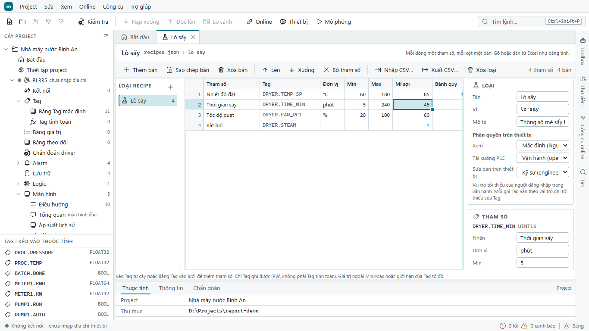

Trên thiết bị, bản của project chỉ đọc; bản do người vận hành tạo được lưu riêng trên thiết bị và không mất khi nạp lại project cùng `projectId`. Mỗi lần tải xuống ghi từng Tag qua cùng đường ghi có kiểm tra như nút trên màn hình (vai trò tối thiểu của Tag, giới hạn, trạng thái kết nối, tối đa 20 ghi/phút: recipe nhiều tham số tải chậm hơn), dừng ở tham số lỗi đầu tiên; audit có `recipe.download` và một `tag.write` cho từng tham số. Project mẫu: `projects/report-demo` (loại Lò sấy).

<a id="help-errors"></a>

## 13. Lỗi thường gặp

| Hiện tượng | Nguyên nhân thường gặp | Cách xử lý |
|---|---|---|
| Nút **Nạp xuống** bị khóa, "Project còn lỗi" | còn lỗi kiểm tra | mở tab **Thông tin** (Inspector), nhấp đúp từng lỗi để tới chỗ sai |
| `E_RUNTIME_TOO_OLD` | project cần runtime mới hơn | nhờ quản trị viên cập nhật runtime (mục 10.5) |
| Nạp xuống bị từ chối `DEVICE_BUSY` | thiết bị đang cập nhật runtime hoặc có người khác đang nạp xuống | chờ xong rồi nạp lại |
| Tag luôn BAD, lý do "Hết thời gian chờ thiết bị" | sai IP, cổng, Unit ID, hoặc tường lửa | **Thử kết nối**; kiểm tra mạng từ thiết bị tới PLC |
| Giá trị sai hẳn (rất lớn, âm lạ) | sai **Thứ tự byte** hoặc kiểu thô | đổi Thứ tự byte (ABCD, CDAB…), so với tài liệu PLC |
| `E_ADDR_SYNTAX`, `E_ADDR_AREA` | địa chỉ sai dạng hoặc ghi vào vùng chỉ đọc | dùng `HR`, `C` cho Tag ghi được |
| Ghi bị REJECTED `OUT_OF_LIMITS` | giá trị ngoài Ghi tối thiểu/tối đa | sửa giới hạn hoặc giá trị |
| Ghi TIMEOUT liên tục | PLC chậm, **Chờ trả lời** quá ngắn | tăng Chờ trả lời; kiểm tra tải của PLC |
| `E_SERIAL_NOT_ALLOWED` | cổng RS485 chưa được phép trên thiết bị | quản trị viên thêm vào `serialPorts` |
| Studio không thấy thiết bị | khác mạng con, tường lửa chặn UDP 8446 | **Thêm theo địa chỉ…** |
| "Chứng chỉ đã đổi" | thiết bị sinh lại chứng chỉ, hoặc nhầm thiết bị | hỏi quản trị viên trước khi gỡ ghim |
| `AUTH_LOCKED` khi đăng nhập | sai mật khẩu 5 lần từ máy này | chờ 5 phút, hoặc nhờ quản trị viên mở khóa |
| `E_EXPR_CYCLE` | Tag tính toán tham chiếu vòng | bỏ vòng (A dùng B, B dùng A) |
| Màn hình mở chậm | SVG quá lớn (`W_SVG_HEAVY`) | nhập lại với **Tối ưu**, bỏ ảnh nhúng lớn |
| `E_LOGIC_WRITE_UNDECLARED` | hành động **Ghi PLC** trỏ mục chưa khai | thêm mục ở nhóm **Ghi PLC** (mục 9) |
| Ghi bị REJECTED `OWNED_BY_LOGIC` | ghi tay vào Tag logic `LOGIC.…` | Tag logic chỉ đọc; đổi luật hoặc dùng Tag nội bộ khác |
| Luật chạy nhưng PLC không đổi | thiết bị tắt ghi từ logic (chip "Ghi PLC: tắt", `LOGIC_WRITES_OFF`) | quản trị viên bật `logic.writes` sau khi duyệt danh sách ghi |
| `E_SECURITY_LEVEL`, `E_SECURITY_ITEM` | vai trò tối thiểu sai, hoặc mức thao tác ở component chỉ hiển thị | mục 6.3 |
| Operator báo nút khóa "Cần quyền thao tác" dù vai trò đủ | quản trị viên đã giới hạn thao tác component đó cho nhóm khác, hoặc quy tắc mồ côi sau khi đổi mã component | hỏi quản trị viên (trang Quản trị, **Xem với tư cách**); không đổi mã component đã phân quyền (mục 6.3) |
| `E_TEMPLATE_TAG_REF`, `E_POPUP_ARGS` | tham số template hoặc `args` của popup cho Tag không có | sửa giá trị tham số hoặc thêm Tag |

## 14. Bảng tác vụ kiểm tra

Mỗi tác vụ dùng `projects/training-demo` và PLC giả lập (mục 1). Giáo trình: [docs/training/engineer.md](../training/engineer.md).

| # | Mục tiêu | Các bước | Kết quả mong đợi |
|---|---|---|---|
| K1 | Mở project | chép `training-demo`, **Mở project…**, **Kiểm tra** | thanh trạng thái "0 lỗi" |
| K2 | Mô phỏng không cần thiết bị | bật **Mô phỏng**, mở màn hình "Xu hướng" | đường `HL.SONG` dao động; nhãn "MÔ PHỎNG" |
| K3 | Thêm kết nối | thêm kênh Modbus TCP thứ hai tới giả lập, một thiết bị trường Unit ID 1 | **Kiểm tra** không có lỗi mới |
| K4 | Thêm Tag ngoài | thêm `BOM.LOI2` kiểu BOOL, địa chỉ `HR12.4` | Tag xuất hiện; không lỗi |
| K5 | Thêm Tag tính toán | thêm `BON.PHAN_TRAM_TRONG` = `100 - BON.MUC` | **Xem trước** cho giá trị đúng |
| K6 | Dựng màn hình | thêm màn hình "Bơm", một **Đèn báo** gắn `BOM.LOI`, một **Công tắc** gắn `BOM.LENH_CHAY` | thấy trong xem trước; mục menu mới khi thêm vào Điều hướng |
| K7 | Bảo mật nút | đặt **Vai trò tối thiểu** `engineer` cho công tắc vừa thêm (project 1.1: **Vai trò tối thiểu để thao tác**, mục 6.3) | trên trang vận hành, tài khoản operator thấy "Cần quyền engineer" |
| K8 | Nhập SVG | nhập một SVG bồn đơn giản, gắn **Mức đầy (bồn, thanh)** với `BON.MUC` | **Thử giá trị** 50 cho thấy nửa bồn |
| K9 | Ghim chứng chỉ, đăng nhập | **Thiết bị trong mạng…**, so fingerprint, **Ghim và tiếp tục**, **Đăng nhập…** | thanh trạng thái "Online", viền cam |
| K10 | Nạp xuống | **Nạp xuống…**, đọc xem trước, xác nhận | kết quả thành công; trang vận hành tự tải lại project mới |
| K11 | Thử kết nối | **Kết nối** > **Thử kết nối**, địa chỉ `HR100`, 1 thanh ghi | "Kết nối được", có giá trị thô |
| K12 | Theo dõi và ghi thử | **Bảng theo dõi**: thêm `BON.MUC_DAT`, ghi `40` | dòng hiện 40, quality GOOD |
| K13 | So sánh | sửa mô tả một Tag (không nạp), **So sánh với thiết bị** | dòng Tag đó hiện `≠` |
| K14 | Khôi phục | **Khôi phục bản trước…**, chọn bản trước | thiết bị chạy lại bản cũ; So sánh khớp bản cũ |
| K15 | Đọc lên | **Đọc lên…** > **Thành project mới** vào thư mục trống | project mở được, **Kiểm tra** 0 lỗi |
| K16 | Chẩn đoán lỗi kết nối | dừng giả lập; xem Tag và **Chẩn đoán driver**; chạy lại giả lập | Tag BAD rồi về GOOD; bộ đếm lỗi tăng |
| K17 | Alarm | đặt mức giả lập vượt 80 % (chờ dao động); xem trang Alarm | alarm "Mức bồn" mức Nhỏ hiện, xác nhận được |
| K18 | Logic | project đã nâng cấp lên 1.0.0 (mục 3); thêm Tag nội bộ BOOL `BON.BAO_CAO`; **Logic** > **Tạo logic.json**; thêm luật: khi `BON.MUC > BON.NGUONG_CAO` giữ 5000 ms thì **Đặt Tag** `BON.BAO_CAO = true`; **Thử logic**, đặt tay `BON.MUC` = 90, **Chạy** | hành động phát sinh sau 5 s; "Không gửi gì tới thiết bị" |
| K19 | Template | project 1.0.0; thêm Tag nội bộ BOOL `BOM2.LOI`, `BOM2.LENH_CHAY`; chọn đèn và công tắc ở K6, nhấp phải, **Tạo template…** id `bom`, tham số `prefix` (`tagPrefix`, mặc định `BOM`); **Thêm bản sao…** `bom2` với `prefix` = `BOM2` | 2 bản sao gắn đúng Tag; đổi màu đèn trong template rồi **Cập nhật mọi bản sao** đổi cả hai |
