# Hướng dẫn người vận hành

Dành cho người vận hành dùng trang mAT SCADA trên Chrome hằng ngày. Tài liệu ngắn, đọc trong 20 phút. Từ ngữ lạ: xem [Thuật ngữ](glossary.md). Mã lỗi: xem [Mã lỗi và cảnh báo](error-codes.md).

Áp dụng cho runtime 1.0.0 (bản 1.0); phần lớn cũng đúng với runtime 0.9. Trang đăng nhập bắt buộc, đổi mật khẩu và quyền theo trang, theo component (mục 2, 2.1, 3.1) có từ runtime báo API thiết bị 1.6.0. Chữ trên màn hình trong tài liệu này lấy đúng từ phần mềm. Ảnh chụp màn hình chụp giao diện web của trang vận hành trên Chrome (chế độ headless, khung 1366 × 768, theme sáng) với dữ liệu mẫu, dựng lại được bằng `node tools/docs-screenshots.mjs`; trên Windows phông chữ và khung cửa sổ có thể khác chút; màn hình của nhà máy bạn do kỹ sư vẽ nên khác ảnh.

## 1. Mở trang

1. Mở Chrome (bản 120 trở lên).
2. Gõ địa chỉ do quản trị viên cung cấp:
   - `https://<địa chỉ thiết bị>:8443/` để **xem và điều khiển**;
   - `http://<địa chỉ thiết bị>:8080/` chỉ để **xem**, và chỉ khi thiết bị không bắt buộc đăng nhập (mục 2).
3. Lần đầu Chrome có thể báo chứng chỉ chưa tin cậy. Không tự bấm "tiếp tục". Gọi quản trị viên để cài chứng chỉ cho máy này.

Trang mở ở màn hình đầu. Menu bên trái (hoặc trên) chứa các màn hình. Cửa sổ hẹp thì bấm nút menu ("Mở menu"). Đầu trang hiện "project · màn hình".

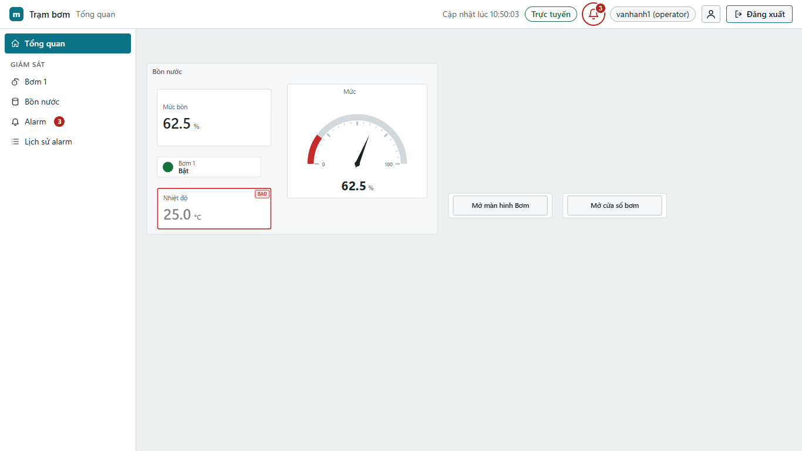

Một số nút mở cửa sổ chi tiết (popup) cho từng thiết bị, ví dụ bấm vào bơm P-07 mở cửa sổ chi tiết của đúng bơm P-07. Trước khi điều khiển, kiểm nhãn trên cửa sổ và tên Tag trong hộp xác nhận (mục 5) đúng thiết bị mình muốn. Đóng bằng nút **Đóng** hoặc Esc. Trang báo "tham số của cửa sổ sai (…)" thì cửa sổ không mở: báo kỹ sư.

## 2. Đăng nhập và đăng xuất

Mỗi người dùng tài khoản riêng do quản trị viên cấp. Tài khoản có **vai trò** (viewer, operator, engineer, administrator) và có thể thuộc **nhóm** (ví dụ "Vận hành ca A"); quản trị viên dựa vào đó để cho bạn xem trang nào, bấm được nút nào (mục 3.1).

**Đăng nhập bắt buộc** (thiết bị cài mới mặc định như vậy): chưa đăng nhập thì mọi địa chỉ, kể cả liên kết tới một màn hình, đều mở trang **Đăng nhập mAT SCADA**.

1. Mở `https://<địa chỉ thiết bị>:8443/`, hoặc liên kết được gửi tới một màn hình (ví dụ `https://<địa chỉ thiết bị>:8443/#/bom1`).
2. Trang đăng nhập hiện tên project và tên thiết bị bên trái. Mở từ liên kết thì dưới nút có dòng "Sau khi đăng nhập sẽ mở /bom1".
3. Nhập **Tài khoản** và **Mật khẩu**, bấm **Đăng nhập** (hoặc Enter).
4. Trang mở thẳng màn hình đã định (không có thì mở màn hình đầu). Thanh trên hiện tên của bạn và vai trò, ví dụ "vh1 (operator)".
5. Xong ca: bấm **Đăng xuất**. Trang về trang đăng nhập.

Lần đầu mở trên một máy: mở mục **Vân tay chứng chỉ (SHA-256)** và đối chiếu với vân tay quản trị viên đưa ("Đối chiếu với vân tay ghi trên thiết bị trước khi tin chứng chỉ."). Khác thì không đăng nhập, báo quản trị viên.

Mở bằng `http://` khi thiết bị bắt buộc đăng nhập: trang chỉ hiện "Cần mở bằng HTTPS để đăng nhập" kèm liên kết **Mở trang đăng nhập (HTTPS)**. Bấm liên kết.

**Không bắt buộc đăng nhập** (ví dụ màn hình kiosk trong phòng điều khiển): xem giá trị không cần đăng nhập; cần đăng nhập để điều khiển, xem lịch sử, xem báo cáo. Bấm **Đăng nhập** ở thanh trên (chỉ có khi trang mở bằng `https://`), nhập **Tài khoản** và **Mật khẩu** trong hộp Đăng nhập.

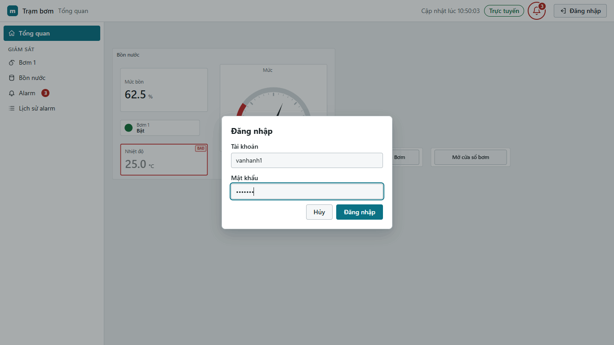

Thông báo khi không đăng nhập được:

| Thông báo | Ý nghĩa | Việc cần làm |
|---|---|---|
| "Sai tài khoản hoặc mật khẩu" | gõ sai, hoặc tài khoản đã bị quản trị viên tắt | gõ lại, kiểm tra Caps Lock và bộ gõ tiếng Việt; vẫn không được thì hỏi quản trị viên |
| "Tài khoản bị khóa tạm do nhập sai nhiều lần. Thử lại sau N phút (lúc HH:MM)." | sai 5 lần liên tiếp từ máy này | chờ hết thời gian (5 phút; lại sai nhiều lần trong ngày thì lâu hơn, tối đa 60 phút); khóa chỉ áp cho tài khoản này **trên máy này**, máy khác vẫn đăng nhập được; cần gấp thì gọi quản trị viên mở khóa |
| "Thiết bị đang bận kiểm tra đăng nhập khác, thử lại sau giây lát" | nhiều người đăng nhập cùng lúc | chờ 1 giây rồi bấm lại; không bị khóa |
| "Chỉ đăng nhập được qua HTTPS" | trang mở bằng `http://` | mở lại bằng `https://` |

Phiên tự hết sau một thời gian không thao tác (mặc định 30 phút) hoặc sau tối đa 12 giờ.

- Thiết bị bắt buộc đăng nhập: trang hiện "Phiên đã hết, đang chuyển tới trang đăng nhập…" rồi mở trang đăng nhập. Đăng nhập lại thì về đúng màn hình đang xem.
- Thiết bị không bắt buộc: trang hiện "Phiên đã hết hạn, đăng nhập lại." và nút **Đăng nhập lại**. Trong lúc đó trang vẫn hiện giá trị, chỉ khóa điều khiển.

**Bị đăng xuất giữa ca:** khi quản trị viên đổi vai trò, nhóm, đặt lại mật khẩu hay tắt tài khoản của bạn, mọi phiên của bạn kết thúc ngay (trên mọi máy), trang về trang đăng nhập như khi hết phiên. Đăng nhập lại để nhận quyền mới; không đăng nhập được thì hỏi quản trị viên. Khi quản trị viên chỉ đổi quyền theo trang hay theo component, bạn **không** bị đăng xuất: menu và các nút tự cập nhật trong khoảng 1 giây, không cần F5.

### 2.1. Đổi mật khẩu của tôi

1. Bấm nút tài khoản (hình người) ở thanh trên. Menu hiện tên, vai trò và nhóm của bạn ("Nhóm: …" hoặc "Không thuộc nhóm nào").
2. Chọn **Đổi mật khẩu của tôi**.
3. Nhập **Mật khẩu hiện tại**, **Mật khẩu mới**, **Nhập lại mật khẩu mới**. Mật khẩu mới dài 15 đến 128 ký tự ("Nên dùng một câu dễ nhớ."), không chứa tên tài khoản; dòng dưới ô báo "Còn thiếu N ký tự" hoặc "Đủ độ dài".
4. Bấm **Đổi mật khẩu**. Xong: "Đã đổi mật khẩu. Các phiên khác của bạn đã bị đăng xuất." (máy này vẫn giữ phiên). Bấm **Đóng**.

Thông báo thường gặp: "Mật khẩu hiện tại không đúng", "Hai lần nhập mật khẩu mới không khớp", "Mật khẩu mới phải khác mật khẩu hiện tại", "Mật khẩu mới chưa đạt quy tắc: cần ít nhất 15 ký tự". Quên mật khẩu: nhờ quản trị viên đặt lại; không tự đặt lại được trên trang.

## 3. Chế độ chỉ xem

Trang ở chế độ chỉ xem khi:

- mở bằng `http://`: dải trên hiện "Chế độ chỉ xem. Mở bằng HTTPS để điều khiển." kèm liên kết **Mở bằng HTTPS**;
- chưa đăng nhập, hoặc tài khoản có vai trò `viewer`;
- cổng HTTPS của thiết bị không chạy: "Chế độ chỉ xem. Cổng HTTPS của thiết bị không chạy, chưa điều khiển được."

Nút điều khiển bị khóa hiện biểu tượng ổ khóa và lý do, ví dụ "Đăng nhập để điều khiển", "Cần quyền operator", "Tag chỉ đọc", "Mất kết nối dữ liệu".

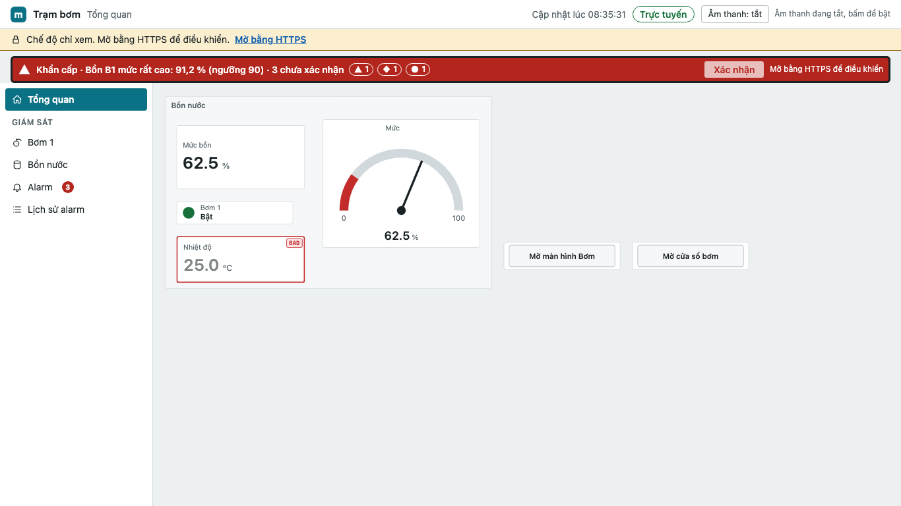

### 3.1. Trang và nút theo quyền của tài khoản

Quản trị viên quyết định mỗi người (hoặc mỗi nhóm) xem được trang nào, thấy và bấm được component nào. Vì vậy hai người cùng vai trò có thể thấy trang khác nhau.

- **Menu** chỉ có các trang bạn được xem.
- Mở một trang không được xem (gõ địa chỉ, liên kết cũ, hoặc vừa bị thu quyền): trang hiện **"Không có quyền xem trang này"** và "Tài khoản của bạn chưa được cấp quyền xem trang "…", hoặc trang không còn trong project. Hỏi quản trị viên nếu bạn cần trang này.", kèm nút **Về trang đầu**.
- **Component bị ẩn:** chỗ của nó để trống. Đó không phải lỗi màn hình: bạn không được xem component đó. Màn hình mà mọi component đều bị ẩn hiện "Không có nội dung bạn được xem".
- **Component bị khóa:** nút, công tắc, ô đặt giá trị hiện mờ, có ổ khóa và dòng lý do:
  - "Cần quyền thao tác": bạn thấy component nhưng chưa được thao tác (quản trị viên chỉ cho nhóm khác, ví dụ Quản đốc);
  - "Cần quyền operator", "Cần quyền engineer": vai trò của bạn thấp hơn mức kỹ sư đặt cho component;
  - "Cần quyền xem cửa sổ này": nút mở một cửa sổ chi tiết (popup) mà bạn không được xem.
- Cần thêm quyền: báo quản trị viên tên màn hình và tên nút. Không mượn tài khoản của người khác.

Máy chủ kiểm quyền ở mọi lệnh: dữ liệu của trang và component bạn không được xem không được gửi tới máy của bạn, lệnh ghi gửi thiếu quyền bị từ chối và ghi vào nhật ký.

## 4. Đọc giá trị và trạng thái

Mỗi giá trị có một dấu ở góc khi dữ liệu không tốt. Không có dấu là giá trị tốt (GOOD).

| Dấu | Trạng thái | Ý nghĩa | Việc cần làm |
|---|---|---|---|
| "●", viền vàng | UNCERTAIN (không chắc) | có giá trị nhưng chưa chắc đúng, ví dụ bị cắt về giới hạn | dùng thận trọng; báo kỹ sư nếu kéo dài |
| "BAD", viền đỏ, chữ mờ | BAD (lỗi) | không đọc được từ PLC (mất kết nối, thiết bị báo lỗi) | **không** dựa vào giá trị này; kiểm tra tại chỗ |
| "STALE", viền xám đứt | STALE (mất dữ liệu) | giá trị cũ, không còn cập nhật | xem mục 7 (mất kết nối) |
| "?", viền xám chấm | không rõ | Tag lạ với thiết bị; điều khiển bị khóa | báo kỹ sư |

Rê chuột lên dấu để xem lý do, ví dụ "Lỗi: Mất kết nối thiết bị".

**Màn hình bố cục lưới** (project 1.1): các ô xếp theo hàng và cột; trang cuộn dọc khi dài. Trên máy tính bảng dọc hoặc điện thoại (màn hình hẹp dưới 768 điểm ảnh) các ô xếp chồng thành một cột theo thứ tự từ trên xuống, trái sang phải. Màu sắc theo **chủ đề** kỹ sư chọn cho project (Sáng đa sắc, Công nghiệp trầm hoặc Tối).

## 5. Điều khiển có xác nhận

Cần: trang `https://`, đã đăng nhập, vai trò `operator` trở lên.

1. Bấm nút, công tắc, hoặc nhập giá trị vào ô **Đặt giá trị** rồi Enter (hoặc **Ghi**). Số thập phân dùng **dấu chấm**, ví dụ `42.5`.
2. Hộp **Xác nhận ghi giá trị** hiện: Tag, mô tả, thiết bị, giá trị hiện tại → giá trị mới, đơn vị, giới hạn, tài khoản của bạn.
3. Đọc kỹ. Đúng thì bấm **Xác nhận**. Sai thì bấm **Hủy** hoặc Esc. Nút **Hủy** được chọn sẵn để tránh bấm nhầm.
4. Xem dải kết quả ngay trên nút.

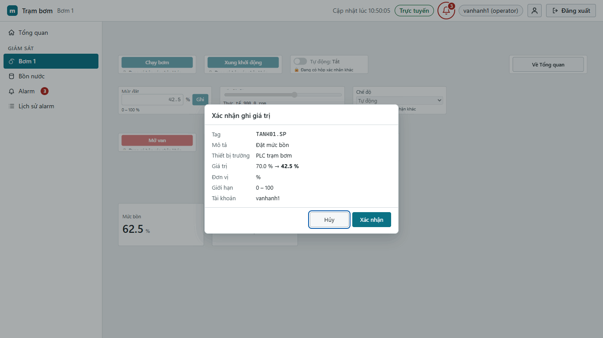

Kết quả lệnh:

| Dải hiện | Trạng thái | Ý nghĩa | Việc cần làm |
|---|---|---|---|
| "⏳ Đang gửi…" | | lệnh đang đi | chờ |
| "⏳ Đã nhận, đang chờ đọc lại" | ACCEPTED | thiết bị đã nhận lệnh, đang chờ PLC xác nhận | chờ vài giây |
| "✔ Đã ghi và xác nhận" | CONFIRMED | PLC đã nhận và giá trị đọc lại khớp | xong (dải tự tắt sau 4 s) |
| "✖ Bị từ chối" | REJECTED | lệnh không được gửi (lý do ghi sau tiêu đề) | đọc lý do; không bấm lại liên tục |
| "⚠ Không chắc đã ghi, kiểm tra giá trị thực trước khi thử lại" | TIMEOUT | PLC không trả lời kịp | kiểm tra giá trị thực (tại chỗ hoặc trên màn hình) rồi mới thử lại |
| "✖ Ghi thất bại" | FAILED | PLC hoặc đường truyền báo lỗi | thử lại một lần; còn lỗi thì báo kỹ sư |
| "⚠ Không rõ kết quả, kiểm tra giá trị thực" | không rõ | runtime dừng giữa chừng | kiểm tra giá trị thực |

Lý do thường gặp sau tiêu đề: "Không đủ quyền", "Ngoài giới hạn cho phép", "Mất kết nối với thiết bị", "Ghi quá nhanh", "Giá trị đã đổi so với lúc nhấn", "Thiết bị không trả lời khi ghi", "Giá trị đọc lại khác giá trị đã ghi". Mã trong ngoặc (ví dụ `(OUT_OF_LIMITS)`) để báo cho kỹ sư.

Nút xung (bấm rồi tự nhả): hộp xác nhận ghi "Xung N ms rồi trả về giá trị ngược". Một xung đang chạy thì không bấm được xung khác cho cùng Tag.

**Logic tự động:** project có thể có logic chạy trên thiết bị (hẹn giờ, lịch, đếm giờ chạy, tự bật tắt khi đủ điều kiện). Giá trị do logic đặt có thể tự đổi mà không ai bấm; ghi tay vào chúng bị từ chối với mã `(OWNED_BY_LOGIC)`. Kỹ sư cho biết thiết bị nào do logic điều khiển. Logic không thay khóa liên động và dừng khẩn tại chỗ. Thấy thiết bị do logic điều khiển chạy sai (ví dụ bơm tự bật tắt liên tục): vận hành theo quy trình tại chỗ và báo ngay quản trị viên; quản trị viên có lệnh dừng mọi lệnh ghi PLC của logic từ Studio.

## 6. Alarm

- **Banner** dưới thanh trên hiện alarm quan trọng nhất: mức ưu tiên, nội dung, số alarm chưa xác nhận. Bấm banner để mở trang **Alarm**.
- Bốn mức ưu tiên, mỗi mức một hình: **Khẩn cấp** (tam giác có "!"), **Quan trọng** (hình thoi), **Nhỏ** (hình tròn), **Lưu ý** (hình vuông có "i").
- Trạng thái: "Đang có, chưa xác nhận", "Đang có, đã xác nhận", "Đã hết, chưa xác nhận", "Tạm ẩn".

Xử lý một alarm:

1. Đọc nội dung, xem giá trị lúc bật.
2. Xử lý tại hiện trường theo quy trình của nhà máy.
3. Bấm **Xác nhận** trên dòng alarm (hoặc phím Shift+A). Tên bạn hiện ở cột "Người xác nhận".
4. **Xác nhận tất cả** (Ctrl+Shift+A) chỉ xác nhận các alarm đang hiện lúc bấm.

**Tạm ẩn** (phím S): dùng khi alarm báo sai đã biết (ví dụ cảm biến đang sửa). Bắt buộc ghi lý do (tối đa 120 ký tự), chọn thời gian 15 phút đến 8 giờ. Alarm tạm ẩn vẫn được ghi lịch sử, không hiện ở banner, không kêu, tự hết khi hết hạn. Xem ở tab **Tạm ẩn**; gỡ sớm bằng **Gỡ tạm ẩn**.

**Âm thanh** mặc định tắt. Bấm "Âm thanh: bật/tắt" ở thanh trên để bật trên máy này. **Tắt tiếng** làm im alarm hiện tại mà không xác nhận; alarm mới vẫn kêu.

Lịch sử alarm: menu **Lịch sử alarm**.

**Email cảnh báo:** nếu quản trị viên đã bật (hướng dẫn quản trị mục 4.5), bạn nhận email khi alarm xuất hiện, hết hoặc chưa được xác nhận sau một khoảng thời gian. Tiêu đề có tên trạm và mức, ví dụ "[Trạm bơm số 1] Khẩn cấp: Mức bể cao"; nhiều alarm gần nhau gom vào một email "… 5 sự kiện alarm (2 Khẩn cấp, 3 Quan trọng)". Nội dung có thời gian, mức, Tag và giá trị, thông điệp, trạng thái và liên kết **Mở trang Alarm**. Email chỉ để báo: **xác nhận alarm trên trang Alarm** (trả lời email không có tác dụng). Xác nhận rồi thì không còn email nhắc lại. Muốn nhận hay thôi nhận, nhờ quản trị viên sửa **Email** trong tài khoản của bạn.

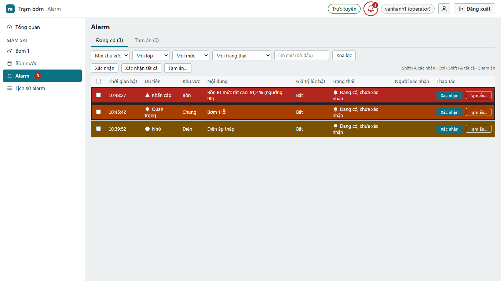

## 7. Mất kết nối

Góc trên hiện trạng thái kết nối:

| Hiện | Ý nghĩa |
|---|---|
| "Trực tuyến" (xanh) | bình thường |
| "Đang kết nối…" | đang nối lại |
| "Mất kết nối — dữ liệu đang hiển thị là cũ" (đỏ) | trang không nhận được dữ liệu mới; mọi giá trị chuyển STALE; điều khiển bị khóa |

Trang **tự nối lại**, không cần F5. Kèm theo là "Cập nhật cuối HH:MM:SS".

- "Hệ thống đã đạt tối đa 10 kết nối. Vui lòng thử lại sau." (hoặc "Hệ thống đã đạt số kết nối tối đa…"): cả thiết bị đã đủ số trang đang mở. Đóng trang thừa ở máy khác hoặc chờ trang tự thử lại.
- "Máy này đã mở tối đa 5 kết nối dữ liệu sống. Đóng bớt tab hoặc thử lại sau.": máy của bạn (hoặc các máy dùng chung đường mạng ra, ví dụ cùng VPN) đã mở đủ số trang cho phép. Đóng tab thừa; nếu nhiều trạm thật sự cần mở cùng lúc, báo quản trị viên.
- Khi quản trị viên cập nhật phần mềm thiết bị (runtime), trang không có thông báo riêng: trang mất kết nối khoảng 10–30 giây rồi tự nối lại. Quản trị viên nên báo trước.
- "Đang nạp project mới…": kỹ sư vừa nạp project, trang tự tải lại.
- "Không có project hợp lệ trên thiết bị": báo kỹ sư.
- Mất kết nối quá 5 phút: gọi kỹ sư (mục 9).

## 8. Lịch sử và báo cáo

Cần trang `https://` và đăng nhập.

- **Lịch sử**: chọn nhóm lưu trữ, chọn tối đa 16 Tag, chọn khoảng (1 giờ đến 30 ngày, Hôm nay, Hôm qua). Có biểu đồ và bảng; **Xuất CSV** để tải.
- **Báo cáo**: chọn kỳ rồi bấm **Xem**. Kỳ theo mẫu: **Ngày**, **Ngày làm việc** (báo cáo ca: ca đêm sau 0 giờ thuộc ngày làm việc hôm trước), **Tuần** (thứ Hai đến Chủ nhật), **Tháng**, hoặc **Từ ngày** – **Đến ngày** (tối đa 31 ngày). Đường dẫn giữ kỳ đã chọn (F5 vẫn xem đúng kỳ đó). Tải **CSV**, **CSV Excel**, **XLSX** hoặc **PDF**: các tệp có cùng số với trang.

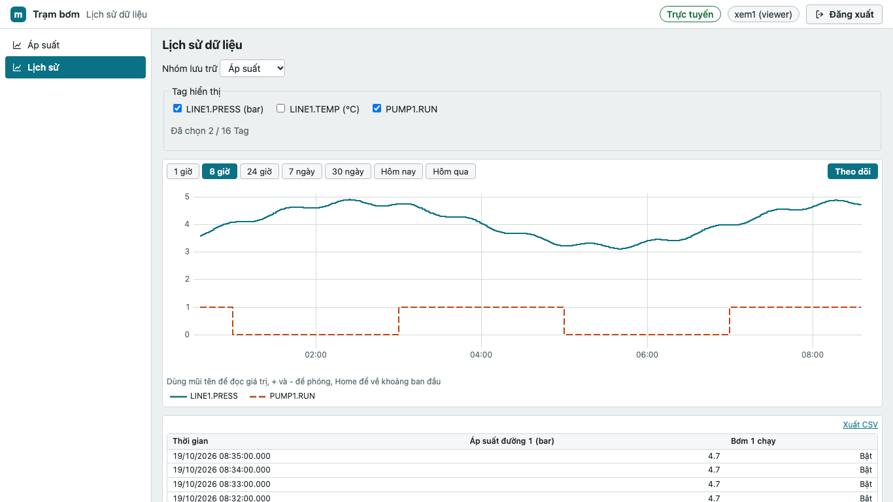

### 8.1. Đọc một báo cáo

Từ trên xuống:

1. **Dải tiêu đề**: logo và tên đơn vị, tên báo cáo, kỳ.
2. **Thẻ tổng hợp** màu: giá trị cả kỳ của các cột đầu (ví dụ tổng điện năng, công suất trung bình, lớn nhất) và **Dữ liệu đủ** (phần trăm thời gian có dữ liệu; dưới 100 % là thiết bị có lúc không ghi).
3. **Biểu đồ** trong khung có tiêu đề: rê chuột lên cột hay điểm để xem số.
4. **Bảng số liệu**: một hàng mỗi giờ, ca hoặc ngày; hàng xen màu; **Tổng** ở cuối luôn thấy khi cuộn. Hàng của kỳ chưa tới ghi "chưa tới"; ô gạch chấm là hàng thiếu dữ liệu (dưới 95 %).

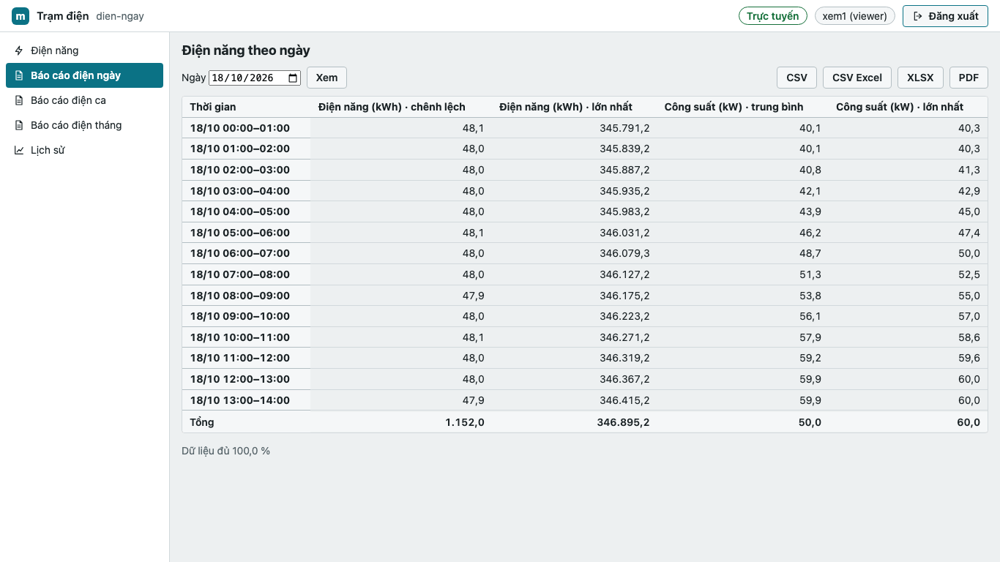

### 8.2. Báo cáo alarm, vận hành thiết bị, logic

- **Báo cáo alarm**: số lần alarm xuất hiện, được xác nhận, hết theo giờ (ca, ngày); thẻ **Số lần xuất hiện**, **Chưa xác nhận**, **TB tới xác nhận** (phút), **Đang còn**; bảng **Theo mức ưu tiên**, **Theo khu vực**, **Top 10 alarm xảy ra nhiều nhất** và **Danh sách sự kiện** (thời điểm, sự kiện, alarm, mức, khu, nội dung, người xác nhận). Cần quyền xem trang Alarm. Mỗi kỳ đọc tối đa 5.000 lần xảy ra; danh sách hiện 1.000 sự kiện đầu (báo cáo ghi rõ khi bị cắt).
- **Vận hành thiết bị**: **thời gian ON** (giờ chạy) và **số lần bật** của bơm, quạt theo giờ, ca hoặc ngày. Lần bật ngay tại đầu kỳ không được đếm (không biết trạng thái trước kỳ). Nhóm lưu trữ ghi quá nhiều dòng (trên 10.000 dòng trong kỳ) thì cột số lần bật để trống kèm ghi chú.
- **Ghi PLC của logic**: các lần luật logic ghi PLC (**Thành công**, **Lỗi**, **Bị chặn** do tắt ghi hay giới hạn tần suất), theo luật và danh sách. Thiết bị chạy runtime cũ báo "chưa hỗ trợ báo cáo logic".

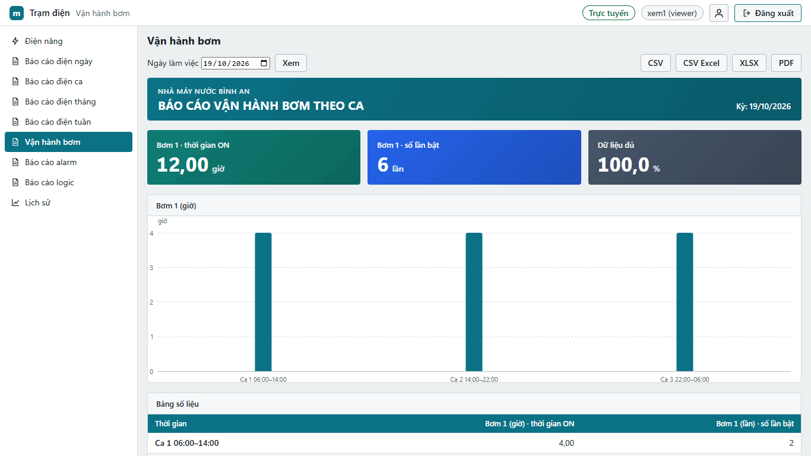

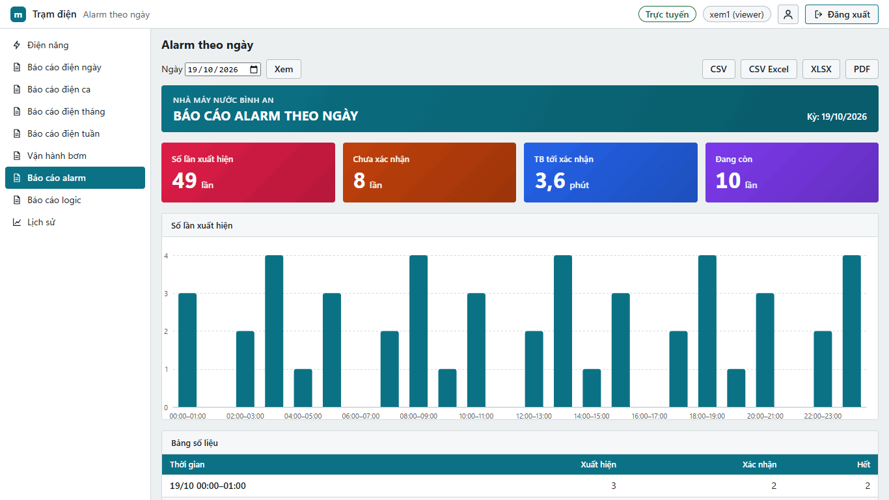

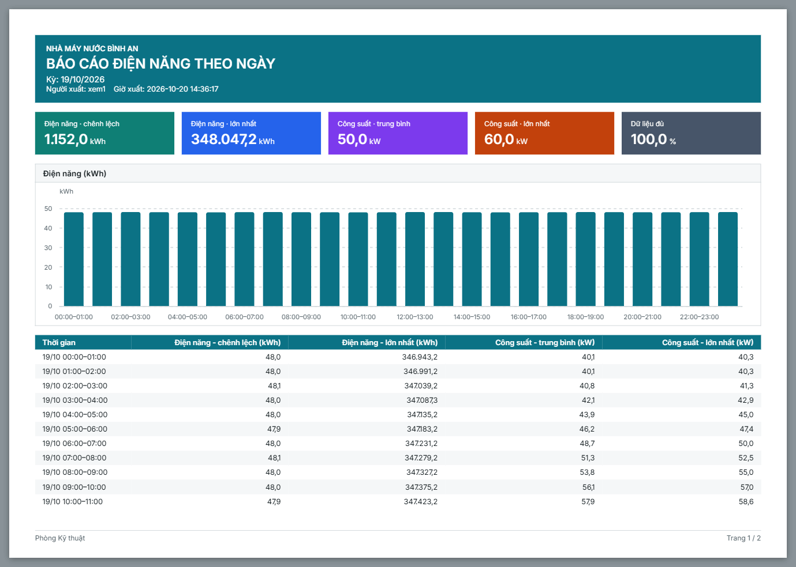

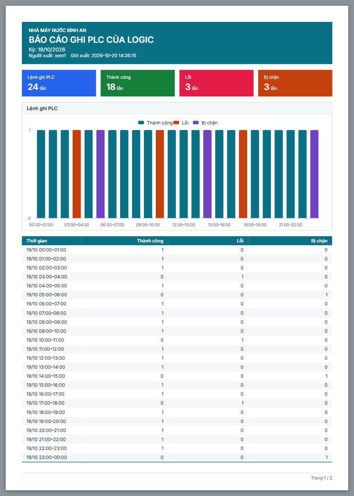

### 8.3. Recipe (công thức)

Mục **Recipe** trên menu (cần `https://` và đăng nhập). Chọn loại bên trái; bảng có mỗi tham số một hàng, mỗi bản recipe một cột (huy hiệu **Project** hoặc **Thiết bị**) và cột **Hiện tại trên PLC** (cập nhật 2 giây một lần). Chọn một bản: ô khác giá trị trên PLC được tô.

- **Tải xuống**: hộp xác nhận liệt kê mọi tham số sẽ đổi (cũ → mới). Bấm **Tải xuống** để ghi lần lượt từng Tag; tiến trình hiện từng dòng **Đã ghi**, **Lỗi** (kèm lý do), **Bỏ qua**. Một ghi lỗi thì dừng: các tham số trước đó **đã nằm trên PLC**, tham số sau không ghi. Kiểm tra máy rồi tải lại. Giá trị ngoài giới hạn bị từ chối trước khi ghi bất kỳ Tag nào.
- **Đọc từ PLC**: lưu giá trị đang chạy thành bản mới (mọi Tag phải có chất lượng tốt).
- **Sửa**, **Xóa**: chỉ với bản **Thiết bị**; bản **Project** dùng **Sao chép** để tạo bản sửa được.
- Người khác vừa sửa: trang báo và tải lại bảng; làm lại thao tác.

Nút chỉ hiện theo vai trò của bạn. Mọi thao tác được ghi nhật ký.

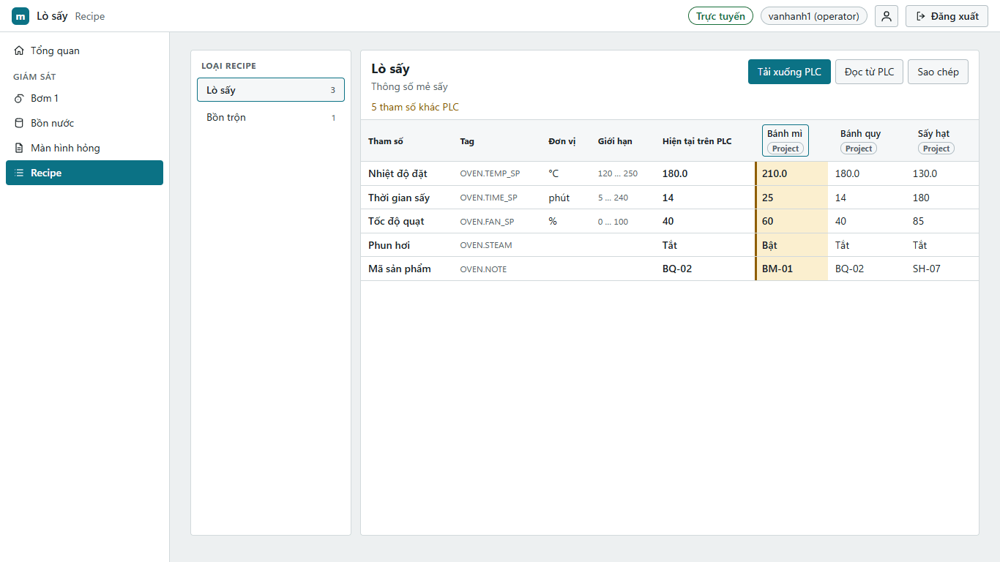

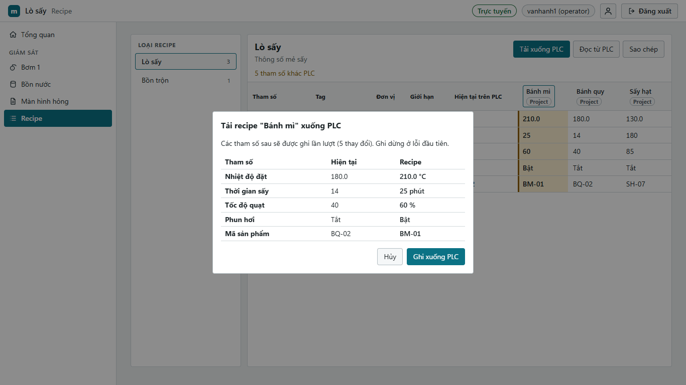

## 9. Khi có sự cố: làm gì, gọi ai

Ghi lại: giờ, màn hình, thông báo (chụp màn hình nếu được), mã trong ngoặc.

| Tình huống | Làm ngay | Gọi |
|---|---|---|
| Giá trị BAD hoặc STALE ở nhiều chỗ | kiểm tra tại chỗ; không điều khiển dựa vào giá trị đó | kỹ sư hệ thống |
| Lệnh TIMEOUT hoặc không rõ kết quả | kiểm tra giá trị thực trước khi thử lại | kỹ sư nếu lặp lại |
| Mất kết nối > 5 phút | vận hành theo quy trình dự phòng tại chỗ | kỹ sư hệ thống |
| Bị khóa đăng nhập, quên mật khẩu | chờ khóa tự hết | quản trị viên |
| "Không có quyền xem trang này", nút khóa "Cần quyền thao tác" mà ca bạn cần dùng | vận hành tại chỗ theo quy trình nếu gấp | quản trị viên |
| Chrome báo chứng chỉ | không bấm tiếp tục | quản trị viên |
| Alarm Khẩn cấp | quy trình an toàn của nhà máy | trưởng ca |

Điền số điện thoại của nhà máy (phần mềm không có mục này):

| Vai trò | Tên | Điện thoại |
|---|---|---|
| Trưởng ca | | |
| Kỹ sư hệ thống | | |
| Quản trị viên | | |

## 10. Bảng tác vụ kiểm tra

Dùng khi huấn luyện ([giáo trình vận hành](../training/operator.md)). Mỗi tác vụ làm được mà không hỏi là đạt.

| # | Mục tiêu | Các bước | Kết quả mong đợi |
|---|---|---|---|
| V1 | Đăng nhập | mở liên kết `https://…:8443/#/bom1` khi chưa đăng nhập, nhập tài khoản ở trang đăng nhập | về thẳng màn hình Bơm 1; thanh trên hiện tên và "(operator)" |
| V2 | Đọc trạng thái | trên "Tổng quan", chỉ ra một giá trị GOOD và giải thích dấu BAD, STALE | nói đúng ý nghĩa và việc cần làm (mục 4) |
| V3 | Ghi giá trị có xác nhận | nhập `50` vào "Mức đặt", Enter, đọc hộp xác nhận, **Xác nhận** | dải "✔ Đã ghi và xác nhận" |
| V4 | Hủy lệnh nhầm | bấm công tắc "Chạy bơm", bấm **Hủy** | không có lệnh nào; công tắc giữ trạng thái |
| V5 | Xử lý alarm | khi có alarm "Mức bồn", mở trang Alarm, **Xác nhận** | cột "Người xác nhận" có tên mình |
| V6 | Tạm ẩn alarm | chọn alarm, **Tạm ẩn…**, ghi lý do, 15 phút | alarm sang tab "Tạm ẩn", có đếm ngược |
| V7 | Nhận biết mất kết nối | người dạy rút mạng máy trạm; quan sát rồi cắm lại | nói được "dữ liệu là cũ, điều khiển khóa"; trang tự về "Trực tuyến" |
| V8 | Đăng xuất | **Đăng xuất** | thiết bị bắt buộc đăng nhập: về trang đăng nhập; không bắt buộc: thanh trên hiện "Chưa đăng nhập", điều khiển khóa |
| V9 | Đổi mật khẩu | nút tài khoản > **Đổi mật khẩu của tôi**, nhập mật khẩu hiện tại và mật khẩu mới 15 ký tự trở lên | "Đã đổi mật khẩu. Các phiên khác của bạn đã bị đăng xuất."; đăng nhập lại bằng mật khẩu mới được |
| V10 | Nhận biết khóa do quyền | trên màn hình người dạy đã giới hạn, chỉ ra một nút "Cần quyền thao tác" và một trang "Không có quyền xem trang này" | nói đúng: thiếu quyền của tài khoản, không phải lỗi thiết bị; báo quản trị viên |
