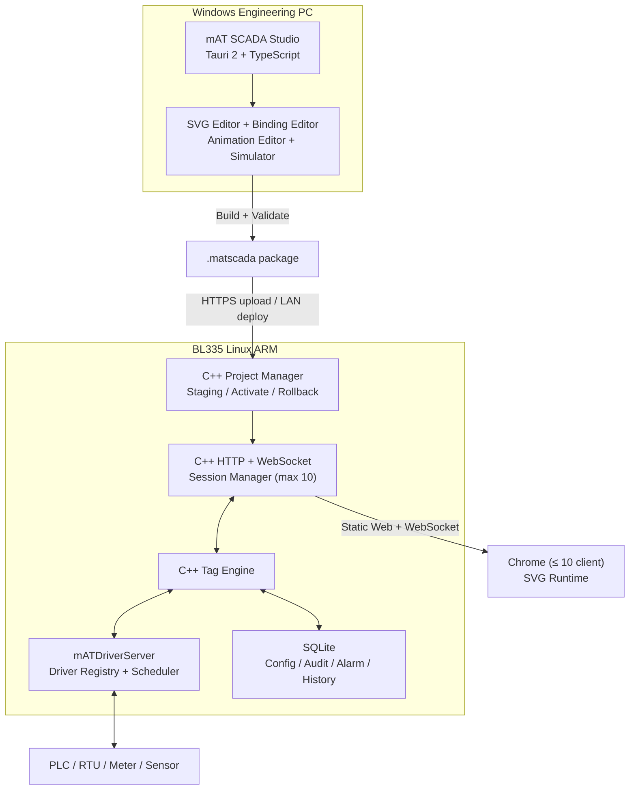

# mAT SCADA Platform — Kế hoạch kỹ thuật tổng thể

> **Phạm vi:** Kế hoạch triển khai MVP  
> **Ngày:** 10/10/2026  
> **Thiết bị đích giai đoạn 1:** BL335L-SOM335-X1 (Allwinner T113-i), Linux ARM 32-bit (armhf), Cortex-A7 2 nhân 1.2 GHz, RAM 1 GB, eMMC 8 GB  
> **Studio:** Tauri 2 + TypeScript, chạy trên Windows 10/11  
> **Runtime/backend:** C++17 trên BL335  
> **Trình duyệt client:** **Chỉ Google Chrome / Chromium**  
> **Giới hạn client:** **Tối đa 10 client đồng thời**  
> **Ưu tiên số 1:** SVG Designer + Tag Binding + Animation + Export/Runtime, triển khai theo hướng **vertical slice trên thiết bị thật trước**
> **Lộ trình hiện hành (2026-10-11):** [lộ trình v2](docs/plans/roadmap-v2.md), Phương án B "SCADA trước, trình vẽ sau", thay các mục §0, §12.2, §13, §15 của tài liệu này (Constitution 2.0.0).

---

## 0. Tóm tắt tính năng đang phát triển

> **Thay bởi lộ trình v2** (mục 1 và 4 của [roadmap-v2.md](docs/plans/roadmap-v2.md)) từ ngày 2026-10-11. Bảng dưới giữ lại để tham khảo.

| # | Nhóm tính năng | Nội dung chính | Sprint |
|---|---|---|---|
| 1 | Nền tảng thiết bị | Image Linux ARM, cross-toolchain, đo tài nguyên, web server C++, đánh giá Go/No-Go | 0 |
| 2 | Runtime trên BL335 | HTTP + WebSocket, Mock Tag, hiển thị SVG trên Chrome, giới hạn 10 client, tự kết nối lại | 1 |
| 3 | Import SVG | Đọc SVG từ Inkscape/Illustrator/CorelDRAW, lọc mã độc, định danh phần tử ổn định | 2 |
| 4 | Canvas editor (Studio) | Chọn, di chuyển, đổi kích thước, xoay, nhóm, căn chỉnh, zoom/pan, undo/redo, lưu/mở project | 3 |
| 5 | Tag Binding & Expression | Tag Browser, kéo thả gán Tag, chuyển đổi giá trị, xử lý quality xấu, biểu thức an toàn | 4 |
| 6 | Animation, Action, Phân quyền | 10 kiểu animation, điều hướng/popup/ghi Tag có xác nhận, đăng nhập, role, audit, quản lý phiên | 5 |
| 7 | Build & Deploy | Kiểm tra project, đóng gói `.matscada`, deploy qua HTTPS, kích hoạt atomic, rollback | 6 |
| 8 | Hoàn thiện & pilot | Test tải 10 client, soak 7 ngày, test mất điện, review bảo mật, bộ cài, tài liệu | 7 |
| 9 | Driver | Modbus TCP/RTU làm song song trong MVP; OPC UA ở giai đoạn Driver Core | 2–7 |

---

## 1. Tầm nhìn và phạm vi

Xây dựng bộ sản phẩm miniSCADA cho phép thiết kế HMI/SCADA trên máy tính kỹ thuật, xuất thành project có phiên bản và triển khai lên thiết bị công nghiệp nhỏ. Runtime chạy trên BL335 và phục vụ màn hình qua trình duyệt Chrome trong mạng LAN; không cần cloud và không cần môi trường đồ họa desktop trên BL335.

Ba thành phần sản phẩm:

1. **mATDriverServer** (C++): kết nối thiết bị đa giao thức, polling, read/write, Tag Engine, diagnostics.
2. **mAT SCADA Studio** (Tauri + TypeScript): designer trên Windows, import SVG, thiết kế screen, gắn Tag/animation, mô phỏng, build/export/deploy.
3. **mAT SCADA Runtime** (C++ host + TypeScript/SVG bundle chạy trên Chrome): nhận project, phát dữ liệu Tag qua WebSocket, hiển thị và điều khiển; alarm/trend/historian theo giai đoạn.

### 1.1. Định vị sản phẩm

| Giải pháp | Đặc điểm | Khác biệt của mAT SCADA |
|---|---|---|
| FUXA (mã nguồn mở) | Web SCADA SVG, Node.js | Runtime C++ nhẹ, chạy tốt trên ARM 32-bit 1 GB; project có phiên bản, deploy atomic, rollback |
| Ignition Perspective, WinCC Unified | Tính năng mạnh, chi phí license cao, cần phần cứng mạnh | Giá thành thấp, phần cứng nhỏ, phù hợp máy đơn lẻ và trạm nhỏ |
| HMI panel truyền thống | Màn hình gắn liền thiết bị | Hiển thị trên mọi máy có Chrome trong LAN, tối đa 10 điểm xem/điều khiển |

### 1.2. Các quyết định đã chốt

| Hạng mục | Quyết định |
|---|---|
| Thiết bị ưu tiên | BL335 ARM 32-bit (armhf). x64 để giai đoạn sau; tránh viết code phụ thuộc nền tảng |
| OS phát triển | Ubuntu 20.04 tối giản theo BSP của nhà sản xuất (kernel 5.4.x) |
| OS thương mại | Quyết định ở cuối Sprint 0: Buildroot (khuyến nghị) hoặc Ubuntu có kế hoạch vá bảo mật riêng. Xem mục 11.1 |
| Backend | C++17, CMake + Ninja, cross-toolchain `arm-linux-gnueabihf` |
| Web server | **CivetWeb** (mặc định) hoặc Drogon; chốt bằng benchmark Sprint 0 |
| Studio | Tauri 2 + TypeScript + Vite, Windows 10/11 (không hỗ trợ Windows 7/8) |
| Trình duyệt Runtime | **Chrome/Chromium ≥ 120** trên Windows, Linux, Android. Không hỗ trợ chính thức Edge, Firefox, Safari |
| Số client | **Tối đa 10 phiên WebSocket đồng thời**, cấu hình được ở mức thấp hơn |
| Graphics | SVG gốc, DOM SVG; SVG.js hỗ trợ thao tác; interact.js hỗ trợ drag/resize |
| Runtime UI | TypeScript + HTML/CSS + SVG, build thành static assets nén sẵn (gzip/brotli) |
| Database | SQLite, WAL, `synchronous=NORMAL`, trên phân vùng data riêng |
| Trend | uPlot (giai đoạn SCADA Features) |
| Project | `.matproj` (nguồn chỉnh sửa), `.matscada` (package triển khai) |
| Driver MVP | Mock/Simulation; Modbus TCP/RTU thử nghiệm |

### 1.3. Về việc chỉ hỗ trợ Chrome

- Studio dùng WebView2 (nhân Chromium) nên Preview và Runtime cùng engine render. Parity chỉ còn phụ thuộc chênh lệch phiên bản Chromium.
- **Chrome trên iOS/iPadOS không được hỗ trợ**, vì Apple bắt buộc mọi trình duyệt trên iOS dùng engine WebKit, nên về bản chất đó là Safari.
- Runtime kiểm tra trình duyệt khi tải trang. Nếu không phải Chromium ≥ 120, trang hiển thị cảnh báo "Trình duyệt không được hỗ trợ" và vẫn cho xem ở chế độ chỉ đọc (cấu hình được: chặn hẳn hoặc cảnh báo).
- Khuyến nghị cho màn hình vận hành cố định: chạy Chrome ở chế độ kiosk (`--kiosk --app=https://<ip-bl335>/`).

### 1.4. Không nằm trong MVP

- Hỗ trợ đầy đủ mọi PLC/driver; MVP chỉ có Mock Tag và Modbus thử nghiệm.
- IEC 61850, DNP3, BACnet MS/TP và các protocol stack chuyên sâu.
- Cloud, multi-site, high availability, cluster, redundancy.
- Script JavaScript tùy ý trong project.
- Historian quy mô lớn hoặc lưu mọi Tag mỗi giây.
- Trình duyệt ngoài Chrome/Chromium; thiết bị iOS/iPadOS.
- Hơn 10 client đồng thời.

---

## 2. Giả định nhân sự

Timeline trong tài liệu này giả định đội ngũ sau:

| Vai trò | Số lượng | Phụ trách chính |
|---|---|---|
| Frontend/TypeScript (có kinh nghiệm SVG/DOM) | 2 | Studio editor, shared packages, Runtime web |
| C++ / Embedded Linux | 1 | Runtime host, Tag Engine, driver, build ARM, OS image |
| QA / DevOps | 0,5 | CI, test tự động, test trên thiết bị, soak test |
| Tech Lead / PM / UX | 0,5 | Kiến trúc, ADR, release gate, UX Studio |

**Quy đổi:** nếu đội chỉ có 1–2 người, nhân thời gian khoảng **1,8–2 lần**. Nếu dev frontend chưa có kinh nghiệm làm editor đồ họa, cộng thêm 3–4 tuần cho Sprint 3.

---

## 3. Sơ đồ kiến trúc



**Quy tắc bắt buộc:**

- Browser không truy cập PLC trực tiếp; mọi Tag đi qua Tag Engine.
- Studio và Runtime dùng chung schema, expression và semantic animation (chung package).
- Render SVG và animation chạy trên Chrome của client, không chạy trên CPU BL335.
- BL335 không cài môi trường đồ họa, không chạy trình duyệt.

---

## 4. Công nghệ và tiêu chí lựa chọn

| Thành phần | Lựa chọn | Ghi chú |
|---|---|---|
| C++ | C++17 | Tương thích toolchain ARM là điều kiện quyết định |
| Build | CMake, Ninja, cross-toolchain armhf | Build native x64 để unit test; cross-compile armhf trong CI; sysroot lấy từ image thật |
| Web server | CivetWeb (mặc định), Drogon (ứng viên) | Có HTTP + WebSocket + TLS; chốt theo benchmark RSS/CPU Sprint 0 |
| TLS | mbedTLS hoặc OpenSSL của image | Chứng chỉ sinh riêng cho từng thiết bị |
| JSON | nlohmann/json | Chỉ dùng ở control plane; hot path WebSocket dùng serializer gọn |
| Logging | spdlog (hoặc logger tối giản) | Rotation, rate limit, ghi vào tmpfs, chỉ lỗi nghiêm trọng ghi xuống eMMC |
| DB | SQLite | Prepared statements, migration, WAL, retention |
| Studio desktop | Tauri 2 | WebView2; bộ cài kèm WebView2 offline (Fixed Version hoặc Evergreen Standalone) |
| UI | TypeScript, Vite | Vanilla TS + component module; không bắt buộc React/Vue |
| SVG | Native SVG DOM + SVG.js | SVG.js không thay thế schema binding |
| Interaction | interact.js | Kiểm chứng với transform lồng nhau ngay Sprint 3 |
| Test frontend | Vitest, Playwright (Chromium) | Unit + e2e + parity screenshot |
| Test C++ | GoogleTest, CTest | Unit + integration + soak |
| Formatting | clang-format, ESLint, Prettier | Bắt buộc trong CI |

**Giấy phép:** đánh giá license từng thư viện/driver trước khi đưa vào sản phẩm thương mại (CivetWeb: MIT; SQLite: public domain; open62541: MPL-2.0; libmodbus: LGPL-2.1; Snap7: LGPL-3.0). Thư viện LGPL phải link động hoặc tuân thủ điều khoản cho phép thay thế thư viện.

---

## 5. Kiến trúc code và repository

```text
mat-scada/
├── CMakeLists.txt
├── README.md
├── docs/
│   ├── architecture/
│   ├── adr/                      # Architecture Decision Records
│   ├── protocols/
│   └── deployment/
├── schemas/
│   ├── project.schema.json
│   ├── screen.schema.json
│   ├── binding.schema.json
│   ├── animation.schema.json
│   ├── tag.schema.json
│   └── protocol-version.json
├── core/
│   ├── tag-engine/
│   ├── driver-manager/
│   ├── connection-manager/
│   ├── poll-scheduler/
│   ├── alarm-engine/             # phase SCADA Features
│   ├── logic-engine/             # phase SCADA Features
│   ├── historian/                # phase SCADA Features
│   ├── auth-audit/
│   ├── session-manager/          # giới hạn 10 client
│   └── project-manager/
├── drivers/
│   ├── sdk/
│   ├── simulation/
│   ├── modbus/
│   └── opcua/                    # các driver khác thêm theo roadmap
├── server/
│   ├── http/
│   ├── websocket/
│   ├── api/
│   └── static/
├── apps/
│   ├── studio/
│   │   ├── src-tauri/
│   │   └── src/
│   └── runtime-web/
├── packages/
│   ├── svg-model/               # ID, document model, parse/sanitize
│   ├── svg-renderer/            # dùng chung Studio và Runtime
│   ├── binding-engine/
│   ├── animation-engine/
│   ├── expression-engine/
│   ├── live-client/             # WebSocket client, reconnect, resync
│   ├── symbol-library/
│   └── ui-components/
├── tests/
│   ├── fixtures/svg/
│   ├── integration/
│   ├── performance/
│   ├── parity/
│   └── e2e/
├── tools/
│   ├── project-packager/
│   ├── project-validator/
│   ├── load-tester/             # mô phỏng 10–11 client
│   └── protocol-simulators/
├── deployment/
│   ├── os-image/                # Buildroot/Ubuntu config, phân vùng
│   ├── systemd/
│   └── update/                  # gói cập nhật runtime
└── .github/workflows/
```

### 5.1. Quy tắc dependency

- `svg-model` không phụ thuộc Tauri, UI riêng của trình duyệt hay C++.
- `svg-renderer`, `binding-engine`, `animation-engine`, `expression-engine`, `live-client` được dùng chung cho Studio Preview và Runtime Web.
- `apps/studio` chỉ bổ sung công cụ chỉnh sửa, property panel, undo/redo; không chứa logic runtime riêng.
- `apps/runtime-web` chỉ chứa hiển thị, tương tác và giao tiếp API.
- `core/` không include code UI và không parse SVG để render.
- Driver chỉ phát `TagUpdate`/`WriteResult` qua API nội bộ, không ghi DB tùy ý.
- Expression engine có hai bản (TypeScript cho client, C++ cho validator/calculated tag phía server ở phase sau), dùng chung bộ test vector JSON để bảo đảm kết quả giống nhau.

---

## 6. Ngân sách tài nguyên trên BL335

Đây là **mục tiêu thiết kế**, xác nhận bằng đo đạc ở Sprint 0 và Sprint 7.

### 6.1. RAM (tổng 1 GB)

| Thành phần | Ngân sách | Ghi chú |
|---|---|---|
| Kernel + OS + systemd + sshd (idle) | ≤ 200 MB | Đo ngay tuần 1; tắt service không cần thiết |
| Process `mat-runtime` (HTTP, WS, Tag Engine, driver, 10 client) | ≤ 150 MB RSS | Giới hạn cứng bằng systemd `MemoryMax=300M` |
| SQLite page cache | ≤ 32 MB | `PRAGMA cache_size` |
| tmpfs (log, staging tạm) | ≤ 64 MB | Giới hạn kích thước mount |
| Dự phòng / filesystem cache | ≥ 400 MB | Cảnh báo khi RAM khả dụng < 250 MB |

**Mỗi client WebSocket:** hàng đợi gửi tối đa 256 KB. Client chậm vượt ngưỡng sẽ bị đánh dấu `resync_required` rồi ngắt, không để hàng đợi phình làm ảnh hưởng client khác.

### 6.2. CPU (2 × Cortex-A7 1.2 GHz)

| Kịch bản chuẩn | Mục tiêu |
|---|---|
| 500 Tag, polling 1 s, 10 client subscribe | CPU trung bình ≤ 30%, đỉnh ≤ 60% |
| 1.000 Tag, polling 1 s, 10 client | CPU trung bình ≤ 50% (mục tiêu thử nghiệm) |
| 10 client cùng tải lại trang (cold load) | Hoàn tất ≤ 5 s, không timeout WebSocket |

Biện pháp: static assets nén sẵn (không nén lúc chạy), header `Cache-Control`/`ETag`, delta theo subscription, gộp update theo chu kỳ 100–250 ms, deadband.

### 6.3. eMMC (8 GB)

| Phân vùng | Kích thước gợi ý | Chế độ |
|---|---|---|
| rootfs A | 1,5 GB | Read-only khi vận hành |
| rootfs B (cập nhật A/B) | 1,5 GB | Read-only |
| data (config, project, SQLite) | 3 GB | ext4, `data=ordered`, `noatime` |
| backup (project trước, config export) | 1 GB | Ghi khi deploy/backup |
| dự phòng | còn lại | |

**Ngân sách ghi:** mục tiêu ≤ 2 GB/ngày ở cấu hình chuẩn. Theo dõi chỉ số tuổi thọ eMMC (`/sys/class/mmc_host/.../life_time` hoặc `mmc extcsd read`) và cảnh báo khi vượt 70%.

### 6.4. Chỉ tiêu benchmark tổng hợp

| Chỉ tiêu | Mục tiêu |
|---|---|
| Tag | 500 Tag (MVP), kiểm thử thêm 1.000 |
| Chu kỳ polling | 1–5 s, tùy kênh truyền (xem 6.5) |
| Client đồng thời | **10 (giới hạn cứng)**; client thứ 11 bị từ chối có thông báo |
| SVG | 300–500 element/screen |
| Thời gian mở screen trên Chrome | ≤ 2 s (LAN 100 Mbps, PC văn phòng phổ thông) |
| Độ trễ Tag → hiển thị | ≤ chu kỳ polling + 500 ms |
| FPS animation | ≥ 30 FPS với 50 animation đồng thời trên PC phổ thông |
| Soak test | 7 ngày (MVP), 30 ngày (trước bản thương mại) |

### 6.5. Băng thông RS485 / Modbus RTU

Đây là giới hạn thực tế của chu kỳ polling, không phải CPU.

Ở 9600 baud (11 bit/ký tự), đường truyền đạt khoảng 870 byte/s:

| Kiểu đọc | Thời gian một transaction (ước tính, gồm turnaround ~20 ms) | 500 Tag |
|---|---|---|
| Đọc block 50 thanh ghi liên tiếp | ≈ 160 ms | ~10 transaction ≈ **1,6 s** |
| Đọc rời từng thanh ghi | ≈ 40 ms | ~500 transaction ≈ **20 s** |

Hệ quả và quy tắc:

- Tag Engine phải **gộp thanh ghi liên tiếp** thành block (có cấu hình độ hở tối đa cho phép).
- Studio/validator **ước tính chu kỳ quét** của mỗi kênh RS485 và cảnh báo khi vượt chu kỳ yêu cầu.
- Khuyến nghị 19200–115200 baud và chia nhiều kênh nếu số slave lớn.
- Modbus TCP không bị giới hạn này; giới hạn chính là thời gian đáp ứng của thiết bị.

---

## 7. Module ưu tiên 1 — SVG Designer

### 7.1. Luồng người dùng

1. Tạo project, chọn kích thước màn hình (1920×1080, 1366×768 hoặc viewBox responsive).
2. Tạo Screen, import SVG hoặc kéo symbol từ Library.
3. Chọn element/group, chỉnh Position, Size, Rotation, Fill, Stroke, Opacity, Layer.
4. Gán Tag cho từng thuộc tính; khai báo mapping, expression và fallback khi quality xấu.
5. Gắn animation và action (navigation, popup, ghi Tag có xác nhận).
6. Bật Simulation, đổi giá trị Mock Tag và xem Preview trực tiếp.
7. Validate, build `.matscada`, deploy lên BL335, mở bằng Chrome.

### 7.2. Bố cục Studio

- **Top Toolbar:** Open/Save, Undo/Redo, Align, Zoom, Preview, Build, Deploy.
- **Project Explorer:** Screens, Symbols, Assets, Tags, Drivers (Alarms, Logic ở phase sau).
- **Canvas:** viewBox, zoom/pan, rulers, snap/grid, selection handles.
- **Property Inspector:** General, Geometry, Appearance, Bindings, Animations, Actions.
- **Tag Browser:** tìm kiếm, cây Tag, kéo thả để bind, xem kiểu/quality.
- **Bottom Panel:** Validation, Output, Diagnostics, Simulator.

### 7.3. Hỗ trợ phần tử SVG

**MVP:** `svg`, `g`, `rect`, `circle`, `ellipse`, `line`, `polyline`, `polygon`, `path`, `text`, `tspan`, `defs`, `linearGradient`, `radialGradient`, `clipPath`, `use`, `symbol`, `transform`, `viewBox`.

- Nested `svg`, `mask`, `filter`, `pattern`: giữ nguyên hiển thị, **không cho chỉnh sửa sâu**, hiển thị cảnh báo rõ ràng.
- Chuẩn hóa khi import: tách CSS `<style>` nội tuyến thành thuộc tính trình bày có kiểm soát; chuẩn hóa đơn vị; giải `use` theo tùy chọn (giữ tham chiếu hoặc bung ra).

**Bảo mật import:** loại bỏ `script`, event attributes (`on*`), `foreignObject`, URL tài nguyên ngoài, link `javascript:`/`data:` nguy hiểm, CSS `@import`/`url()` ra ngoài. Dùng **allowlist** trên cây DOM đã parse (không dùng regex). Giới hạn kích thước file (mặc định 5 MB), số node (mặc định 20.000), độ sâu (mặc định 32). Có test XSS, SVG bomb (`use` lồng nhau đệ quy) và entity expansion.

### 7.4. Định danh đối tượng

- Mỗi element có `elementUid` ổn định, độc lập với `id` gốc trong SVG.
- Lưu ánh xạ `elementUid → DOM element` khi render.
- Khi import lại SVG đã chỉnh sửa: đối chiếu theo `id` gốc, đường dẫn cấu trúc và hình học; cảnh báo và hỗ trợ remap binding khi cấu trúc thay đổi.
- Group có binding riêng; binding của phần tử con ghi đè binding cùng target của group.
- Undo/redo dùng command history, không snapshot toàn bộ DOM.

### 7.5. Công cụ chỉnh sửa MVP

| Tính năng | MVP | Sau MVP |
|---|---|---|
| Import SVG | Có | Import hàng loạt, remap nâng cao |
| Select / multi-select | Có | Lasso nâng cao |
| Move / resize / rotate | Có (phần tử và group cấp 1) | Edit path nodes; transform lồng sâu |
| Group / ungroup | Có | Symbol variants |
| Align / distribute | Có | Smart guides |
| Zoom / pan / grid / snap | Có | Rulers chuyên sâu |
| Layers / z-order | Có | Nested component editor |
| Property inspector | Có | CSS class editor |
| Undo / redo | Có (≥ 100 bước) | History timeline |
| Tag Binding | Có | Binding templates |
| Animation Preview | Có | Timeline/keyframe editor |
| Export / Deploy | Có | Cộng tác cloud |

**Giới hạn có chủ đích:** MVP không làm công cụ vẽ path tự do. Người dùng vẽ hình phức tạp bằng Inkscape/Illustrator rồi import. Studio tập trung vào bố cục, binding và animation.

---

## 8. Tag Binding và Animation Engine

### 8.1. Tag data model

```ts
export type TagQuality = 'GOOD' | 'BAD' | 'UNCERTAIN' | 'STALE';
export type TagDataType =
  | 'BOOL' | 'INT16' | 'UINT16' | 'INT32' | 'UINT32'
  | 'INT64' | 'UINT64' | 'FLOAT32' | 'FLOAT64' | 'STRING';

export interface TagSnapshot {
  id: string;
  type: TagDataType;
  value: boolean | number | string | null; // INT64/UINT64 truyền dạng string
  quality: TagQuality;
  sourceTimestamp: number;  // epoch ms UTC
  serverTimestamp: number;  // epoch ms UTC
  revision: number;
}
```

- INT64/UINT64 truyền dạng chuỗi thập phân để không mất chính xác trong JavaScript.
- Timestamp thống nhất dùng **epoch milliseconds UTC**; hiển thị theo múi giờ cấu hình của project.

### 8.2. Binding schema mẫu

```json
{
  "schemaVersion": "1.0.0",
  "elementUid": "el_pump_01",
  "bindings": [
    {
      "id": "bind_run_color",
      "target": "style.fill",
      "source": { "type": "tag", "tagId": "PUMP01.RUN" },
      "transform": {
        "kind": "discreteMap",
        "cases": [
          { "equals": true, "value": "#22c55e" },
          { "equals": false, "value": "#64748b" }
        ]
      },
      "onBadQuality": { "mode": "override", "value": "#f59e0b" }
    }
  ]
}
```

**Allowlist binding target:** `style.fill`, `style.stroke`, `style.opacity`, `style.visibility`, `text.content`, `transform.rotate`, `transform.translateX`, `transform.translateY`, `transform.scale`, `geometry.levelPercent`, `component.state`. Không cho bind thuộc tính tùy ý hoặc URL bên ngoài.

**Kiểu transform:** `direct`, `linearScale` (min/max đầu vào → đầu ra, có clamp), `discreteMap`, `rangeMap`, `format` (định dạng số/chuỗi), `expression`.

### 8.3. Animation types

| Animation | Inputs | Kết quả |
|---|---|---|
| State Color | Boolean/Enum | Đổi fill/stroke theo trạng thái |
| Rotation | BOOL + speed | Motor/quạt quay hoặc dừng |
| Blink | Alarm state | Nhấp nháy theo mức cảnh báo |
| Level Fill | Numeric + min/max | Mức chất lỏng theo % (dùng clipPath) |
| Flow | BOOL + direction | Dòng chảy trong ống (`stroke-dashoffset`) |
| Translation | Numeric + range | Di chuyển đối tượng |
| Scale | Numeric + range | Co giãn đối tượng |
| Visibility | Expression | Hiện/ẩn |
| Numeric/Text | Tag + format | Hiển thị số/chuỗi |
| Multi-state | Enum/Expression | Chuyển trạng thái component |

**Nguyên tắc hiệu năng (tối ưu cho Chrome):**

- Chỉ cập nhật DOM khi giá trị thực sự đổi; gom thay đổi trong một `requestAnimationFrame`.
- Animation lặp (quay, nhấp nháy, dòng chảy) dùng CSS animation / Web Animations API để Chrome tối ưu.
- Xoay quanh tâm dùng `transform-box: fill-box; transform-origin: center` (hành vi ổn định trên Chromium).
- Tạm dừng animation khi tab ẩn (`visibilitychange`) hoặc screen không hiển thị.
- Giới hạn mặc định 200 animation đồng thời mỗi screen; validator cảnh báo khi vượt.
- Hủy toàn bộ animation và listener khi chuyển screen (test rò rỉ bộ nhớ bằng Chrome DevTools heap snapshot).

### 8.4. Expression Engine

Không dùng `eval`/`new Function`. MVP hỗ trợ AST parser cho: literal, Tag reference, `!`, `&&`, `||`, `==`, `!=`, `<`, `<=`, `>`, `>=`, `+`, `-`, `*`, `/`, `%`, ngoặc, toán tử điều kiện `? :`, và các hàm an toàn `min`, `max`, `clamp`, `abs`, `round`, `floor`, `ceil`.

Quy tắc:

- Type-check khi build; lỗi type chặn build.
- Giới hạn: độ dài ≤ 512 ký tự, độ sâu AST ≤ 16, ≤ 64 node.
- Chia cho 0 và NaN trả về quality `BAD`; Tag missing chặn build, Tag quality xấu lan truyền quality xấu nhất.
- Dependency graph xác định danh sách Tag cần subscribe cho mỗi screen.
- Expression chỉ dùng để tính toán/hiển thị; lệnh ghi bắt buộc đi qua action có kiểm tra quyền.

### 8.5. Action model

```json
{
  "event": "click",
  "action": "writeTag",
  "tagId": "PUMP01.CMD_START",
  "value": true,
  "requireConfirmation": true,
  "requiredPermission": "tag.write",
  "auditCategory": "operator_command"
}
```

Action MVP: `navigate`, `openPopup`, `closePopup`, `writeTag`, `toggleTag`, `pulseTag` (ghi 1 rồi tự trả 0 sau N ms, thực hiện ở server).

Mọi action ghi phải được backend kiểm tra role, quyền trên Tag, trạng thái hệ thống, rồi ghi audit. Không tin `requiredPermission` từ project như một lớp bảo vệ độc lập. **Web SCADA không phải lớp an toàn**; interlock và safety thực thi ở PLC/phần cứng.

---

## 9. Project format và JSON schema

### 9.1. Hai định dạng

- `.matproj`: nguồn chỉnh sửa, chứa editor state, asset gốc, symbol, lịch sử schema.
- `.matscada`: gói ZIP để triển khai, chỉ gồm asset/config đã validate, không chứa secret dạng plaintext.

```text
plant_demo.matscada
├── manifest.json
├── screens/
│   ├── overview.svg
│   ├── overview.screen.json
│   └── overview.bindings.json
├── symbols/
├── assets/
├── tags/
│   └── definitions.json
├── drivers/
│   └── connections.json       # không chứa mật khẩu; secret nhập trên thiết bị
├── users/
│   └── roles.json             # định nghĩa role, không chứa tài khoản/mật khẩu
└── checksums.json
```

### 9.2. Manifest mẫu

```json
{
  "format": "matscada-package",
  "schemaVersion": "1.0.0",
  "projectId": "factory-demo",
  "projectName": "Factory Demo",
  "projectVersion": "1.0.0",
  "buildId": "2026-10-10.001",
  "minRuntimeVersion": "1.0.0",
  "targetPlatform": "linux-armv7",
  "entryScreen": "overview",
  "screens": ["overview"],
  "maxClients": 10,
  "supportedBrowsers": [{ "engine": "chromium", "minVersion": 120 }],
  "requiredCapabilities": ["svg-runtime", "tag-subscription", "basic-animation"],
  "assetsDigest": "sha256:PLACEHOLDER_GENERATED_DURING_BUILD"
}
```

`maxClients` trong project chỉ được phép **≤ giới hạn cứng của runtime (10)**; runtime lấy giá trị nhỏ hơn.

### 9.3. Screen schema mẫu

```json
{
  "id": "overview",
  "name": "Overview",
  "svgFile": "screens/overview.svg",
  "viewBox": [0, 0, 1920, 1080],
  "fitMode": "contain",
  "background": "#0f172a",
  "bindingFile": "screens/overview.bindings.json",
  "navigation": { "home": "overview" }
}
```

### 9.4. Versioning và migration

- `schemaVersion` theo SemVer. Tăng MAJOR khi thay đổi không tương thích.
- Studio tự migrate `.matproj` cũ lên schema mới (giữ bản sao trước migrate).
- Runtime từ chối package có `minRuntimeVersion` lớn hơn phiên bản runtime và báo lỗi rõ ràng.

### 9.5. Project validator

Bắt buộc kiểm tra:

1. JSON schema và phiên bản tương thích.
2. ID duy nhất, reference tồn tại, Tag đúng kiểu dữ liệu.
3. SVG sanitize; giới hạn kích thước, số node, độ sâu.
4. Binding target, animation, action nằm trong allowlist.
5. Expression parse và type-check thành công.
6. Asset checksum khớp; chặn path traversal.
7. Tổng package không vượt quota thiết bị (mặc định 50 MB).
8. Không có credential plaintext, file thực thi, script từ xa.
9. Capability của project phù hợp với thiết bị; `maxClients ≤ 10`.
10. Ước tính chu kỳ quét mỗi kênh driver không vượt chu kỳ yêu cầu (cảnh báo).
11. Validator chạy ở **cả Studio và Runtime**; Runtime không kích hoạt project nếu validation thất bại.

---

## 10. API, WebSocket và quản lý phiên

### 10.1. HTTP REST

| Method | Endpoint | Chức năng | Quyền |
|---|---|---|---|
| POST | `/api/v1/auth/login` | Đăng nhập | công khai (có rate limit) |
| POST | `/api/v1/auth/logout` | Đăng xuất | đã đăng nhập |
| GET | `/api/v1/system/info` | Phiên bản, capability, health, số client | read |
| GET | `/api/v1/sessions` | Danh sách phiên đang kết nối | administrator |
| DELETE | `/api/v1/sessions/{id}` | Ngắt một phiên | administrator |
| GET | `/api/v1/projects/active` | Project đang chạy | read |
| GET | `/api/v1/screens` | Danh sách screen | read |
| GET | `/api/v1/tags?prefix=...` | Metadata/snapshot Tag | read |
| POST | `/api/v1/tags/write` | Ghi Tag | tag.write |
| POST | `/api/v1/deploy/stage` | Upload package vào staging | deploy |
| POST | `/api/v1/deploy/activate` | Kích hoạt package đã validate | deploy |
| POST | `/api/v1/deploy/rollback` | Khôi phục phiên bản trước | deploy |
| GET | `/api/v1/diagnostics` | CPU, RAM, eMMC, driver status | diagnostics.read |
| GET | `/api/v1/audit` | Nhật ký audit | administrator |
| GET | `/api/v1/alarms` | Danh sách alarm (phase sau) | read |
| GET | `/api/v1/history` | Truy vấn lịch sử (phase sau) | read |

Mọi endpoint thay đổi trạng thái cần xác thực, chống CSRF (cookie `SameSite=Strict` + header CSRF token), kiểm tra quyền phía server, giới hạn payload và ghi audit. Không đưa secret vào URL.

### 10.2. Giới hạn 10 client đồng thời

**Định nghĩa:** một "client" là **một phiên WebSocket `/api/v1/live` đang hoạt động** (mỗi tab Chrome mở Runtime là một phiên). Request HTTP tĩnh không tính vào giới hạn nhưng có rate limit.

**Hành vi:**

| Tình huống | Xử lý |
|---|---|
| Đang có < 10 phiên | Chấp nhận kết nối |
| Đã đủ 10 phiên, có client mới | Server trả message `error` mã `MAX_CLIENTS_REACHED` rồi đóng WebSocket (close code 4429). Trang Runtime hiển thị "Hệ thống đã đạt tối đa 10 kết nối. Vui lòng thử lại sau." và tự thử lại sau 30 s |
| Client mất kết nối | Giải phóng slot sau khi heartbeat timeout (mặc định 15 s) |
| Một trình duyệt mở nhiều tab | Mỗi tab tính một phiên. Runtime dùng `BroadcastChannel` để cảnh báo người dùng khi mở tab trùng |
| Cần giải phóng slot | Administrator xem danh sách phiên và ngắt phiên qua API/trang quản trị |
| Đặt chỗ cho quản trị (tùy chọn, mặc định tắt) | Giữ 1 trong 10 slot cho role `engineer`/`administrator` |

**Cấu hình:** `max_clients` trong file cấu hình thiết bị, giá trị 1–10. Giá trị > 10 bị bỏ qua và ghi log cảnh báo.

**Giám sát:** số phiên hiện tại, số lần từ chối do đầy, thời gian kết nối trung bình hiển thị trong diagnostics.

### 10.3. Ví dụ ghi Tag

```json
{
  "tagId": "PUMP01.CMD_START",
  "value": true,
  "requestId": "cmd-01",
  "expectedRevision": 42
}
```

Phản hồi phân biệt `ACCEPTED`, `REJECTED`, `TIMEOUT`, `FAILED`, `CONFIRMED` (nếu protocol cho phép xác minh). HTTP 200 **không có nghĩa PLC đã thực thi lệnh**.

### 10.4. WebSocket `/api/v1/live`

Client subscribe:

```json
{
  "type": "subscribe",
  "requestId": "sub-001",
  "tags": ["PUMP01.RUN", "TANK01.LEVEL"],
  "mode": "delta"
}
```

Server snapshot:

```json
{
  "type": "snapshot",
  "subscriptionId": "sub-001",
  "sequence": 100,
  "tags": [
    {
      "id": "TANK01.LEVEL",
      "value": 65.2,
      "quality": "GOOD",
      "serverTimestamp": 1791601200000,
      "revision": 17
    }
  ]
}
```

- Message: `hello`, `subscribe`, `unsubscribe`, `snapshot`, `delta`, `heartbeat`, `error`, `resync_required`.
- `sequence` tăng dần để phát hiện mất dữ liệu; mất sequence hoặc reconnect → lấy snapshot mới.
- Heartbeat mỗi 5 s; timeout 15 s.
- Delta được gom theo chu kỳ 100–250 ms, chỉ gửi Tag client đã subscribe.
- Reconnect phía client dùng exponential backoff (1 s → 30 s) có jitter.

---

## 11. Nền tảng thiết bị và vận hành

### 11.1. Hệ điều hành

| Giai đoạn | OS | Ghi chú |
|---|---|---|
| Phát triển, PoC, pilot | Ubuntu 20.04 tối giản (BSP nhà sản xuất, kernel 5.4.x) | Dùng đúng image này cho cross-compile và test |
| Thương mại | **Buildroot (khuyến nghị)** hoặc Ubuntu có chính sách vá riêng | Ubuntu 20.04 đã hết hỗ trợ chuẩn từ 04/2025; Buildroot cho image nhỏ, rootfs read-only, kiểm soát được bản vá |

Quyết định cuối cùng ghi vào ADR ở cuối Sprint 0, dựa trên mức hỗ trợ BSP của nhà sản xuất.

**Kiểm tra bắt buộc tuần đầu:** `uname -a`, `uname -m`, `getconf LONG_BIT`, `ldd --version`, `free -m`, `df -h`, `lsb_release -a`, `cat /proc/cpuinfo`, filesystem và mount option, quyền `/dev/tty*`, systemd, RTC, thông tin eMMC (`mmc extcsd read`).

### 11.2. Lưu trữ và chống mất điện

- rootfs read-only khi vận hành; chỉ phân vùng data được ghi.
- Log thường ghi vào tmpfs (giới hạn kích thước); chỉ log lỗi nghiêm trọng và audit ghi xuống eMMC.
- SQLite: `journal_mode=WAL`, `synchronous=NORMAL`, checkpoint định kỳ, batch write. WAL được thiết kế để an toàn khi crash: mất điện có thể mất vài transaction cuối nhưng không làm hỏng DB, **miễn là eMMC thực hiện đúng lệnh flush**. Vì vậy phải có test mất điện thực tế.
- History: chỉ Tag được chọn, có deadband, retention và giới hạn dung lượng DB.
- Khuyến nghị phần cứng: supercap hoặc UPS nhỏ để kịp sync khi mất nguồn (đánh giá theo yêu cầu khách hàng).

### 11.3. Bảo mật

- **Tài khoản:** tài khoản cục bộ trên thiết bị, role `viewer`, `operator`, `engineer`, `administrator` (có thể tùy biến). Mật khẩu băm bằng PBKDF2-SHA256 hoặc bcrypt, tham số chỉnh để mất khoảng 200–300 ms trên Cortex-A7.
- **Phiên đăng nhập:** cookie `HttpOnly`, `Secure`, `SameSite=Strict`; idle timeout 30 phút (cấu hình được); khóa tài khoản tạm thời sau 5 lần sai.
- **Viewer không đăng nhập (tùy chọn):** cho phép chế độ chỉ xem không cần đăng nhập cho màn hình kiosk; vẫn tính vào giới hạn 10 client.
- **HTTPS trong LAN:** mỗi thiết bị tự sinh chứng chỉ khi khởi tạo lần đầu và hiển thị fingerprint trên trang quản trị. Hỗ trợ nạp chứng chỉ do CA của khách hàng cấp. Studio ghim (pin) fingerprint của thiết bị khi deploy.
- **Ghi Tag:** xác nhận trên UI, kiểm tra quyền phía server, audit đầy đủ (ai, lúc nào, từ IP nào, giá trị cũ/mới, kết quả).
- **Package:** giới hạn kích thước, chống ZIP bomb và path traversal, checksum, schema validation.
- **Runtime:** chạy dưới user quyền tối thiểu, chỉ được cấp quyền cổng serial cần thiết; systemd sandboxing (`ProtectSystem`, `NoNewPrivileges`).
- **Không coi SCADA web là lớp an toàn máy móc.**

### 11.4. Triển khai project (atomic activation)

stage → validate → backup project đang chạy → activate → health check (60 s) → tự rollback nếu lỗi.

Mất điện ở bất kỳ bước nào: khi khởi động lại, runtime luôn quay về project hợp lệ gần nhất.

### 11.5. Cập nhật phần mềm runtime (OTA)

- Gói cập nhật runtime có chữ ký số, upload qua Studio hoặc trang quản trị.
- Cập nhật kiểu A/B partition (Buildroot) hoặc A/B thư mục cài đặt (Ubuntu); khởi động lỗi → tự quay về bản cũ.
- Runtime kiểm tra tương thích schema project trước khi cho phép cập nhật.

### 11.6. Thời gian hệ thống

- Đồng bộ NTP (máy chủ cấu hình được, thường là server nội bộ nhà máy).
- Dùng RTC có pin nếu phần cứng hỗ trợ; nếu không có NTP và RTC, timestamp được đánh dấu "chưa đồng bộ" trong diagnostics và audit.

### 11.7. Vận hành

- Systemd service, restart policy, watchdog (`WatchdogSec`), health endpoint.
- Diagnostics: CPU, RAM, nhiệt độ, dung lượng và tuổi thọ eMMC, trạng thái driver, số client.
- Backup/restore cấu hình qua trang quản trị hoặc Studio.

### 11.8. License sản phẩm

- License gắn với ID phần cứng của thiết bị (serial SoC/eMMC), file license có chữ ký.
- Có thể phân cấp theo số Tag, số driver; **số client tối đa luôn ≤ 10**.
- Chi tiết mô hình kinh doanh do bộ phận kinh doanh chốt; kỹ thuật chỉ cần cơ chế kiểm tra license offline.

### 11.9. Studio trên Windows

- Hỗ trợ Windows 10 (bản 1809 trở lên) và Windows 11, x64.
- Bộ cài MSI/NSIS kèm WebView2 offline cho máy kỹ thuật không có Internet.
- Ký số bộ cài (code signing) để tránh cảnh báo SmartScreen.

---

## 12. C++ Core và DriverServer

### 12.1. Driver interface dự kiến

```cpp
class IIndustrialDriver {
public:
    virtual ~IIndustrialDriver() = default;
    virtual DriverInfo info() const = 0;
    virtual Result configure(const DriverConfig&) = 0;
    virtual Result connect() = 0;
    virtual void disconnect() = 0;
    virtual DriverStatus status() const = 0;
    virtual ReadResult read(const std::vector<TagAddress>&) = 0;
    virtual WriteResult write(const std::vector<WriteRequest>&) = 0;
    virtual DriverDiagnostics diagnostics() const = 0;
};
```

Interface định hướng, chưa phải header compile-ready. Bản đầu driver đăng ký tĩnh; nếu phát triển plugin nhị phân độc lập, dùng C ABI có version.

### 12.2. Driver roadmap

> **Thay bởi lộ trình v2** (mục 4.8 "Các đợt driver" của [roadmap-v2.md](docs/plans/roadmap-v2.md)) từ ngày 2026-10-11. Thứ tự driver chốt theo PLC khách hàng thực tế.

| Mức | Driver | Thời điểm |
|---|---|---|
| **MVP** | Simulation/Mock, Modbus TCP, Modbus RTU (thử nghiệm) | Trong MVP Graphics |
| **P1** | Modbus TCP/RTU hoàn chỉnh, OPC UA Client (open62541) | Driver Core |
| **P2** | Siemens S7 (Snap7), Mitsubishi MC/SLMP, Omron FINS, MQTT, SNMP | Theo nhu cầu thị trường |
| **P3** | EtherNet/IP, BACnet/IP, IEC 60870-5-104, DNP3, M-Bus, Beckhoff ADS, IEC 61850... | Theo dự án cụ thể |

Danh sách P2/P3 là backlog, không phải cam kết. Mỗi driver trước khi phát hành phải có: bảng model/firmware đã test, license, mức hỗ trợ read/write, phần cứng test, mức RAM/CPU trên BL335.

### 12.3. Tag Engine

- Tag ID/path ổn định; loại internal, external, calculated (phase sau), simulation.
- Quality `GOOD`, `BAD`, `UNCERTAIN`, `STALE`; timestamp nguồn và server.
- Poll group, **gộp block thanh ghi**, deadband, cache, write queue ưu tiên cao hơn read.
- Backpressure, timeout, reconnect exponential backoff.
- Diagnostics theo driver, connection, Tag (số lỗi, thời gian quét thực tế).
- Publish theo subscription, không gửi mọi thay đổi tới mọi client.

---

## 13. Kế hoạch triển khai MVP (vertical slice trước)

> **Thay bởi lộ trình v2** từ ngày 2026-10-11. Sprint 0–1 đã làm theo mục này (`specs/001-platform-validation`, `specs/002-vertical-slice`). Từ GĐ 0 trở đi làm theo mục 4 của [roadmap-v2.md](docs/plans/roadmap-v2.md); Sprint 2–7 dưới đây chỉ còn để tham khảo.

**Nguyên tắc:** đưa runtime lên BL335 và Chrome **ngay từ Sprint 1** với JSON binding viết tay. Editor trong Studio được xây sau, để sinh ra đúng định dạng mà runtime đã chạy ổn định.

### Sprint 0 — Kiểm chứng nền tảng (2 tuần)

**Công việc**

- Thu thập thông tin BL335 (mục 11.1); chốt image phát triển; dựng sysroot và cross-toolchain.
- Đo RAM/CPU baseline của OS idle.
- PoC server C++ (CivetWeb và Drogon tối giản): phục vụ file tĩnh + WebSocket đẩy 500 Tag giả lập mỗi giây tới 10 client.
- Viết `tools/load-tester` mô phỏng 10 client + client thứ 11.
- Tạo monorepo, CI (lint, test, build x64 + armhf).
- Khởi tạo Tauri 2 trên Windows + Vite + TypeScript; dựng bộ cài thử với WebView2 offline.
- Chuẩn bị ≥ 10 SVG fixture thực tế (bồn, motor, van, ống, đồng hồ, icon, nested group, gradient, clipPath, use) từ Inkscape, Illustrator, CorelDRAW.
- ADR: web server, OS thương mại, UID, schema/versioning, ngân sách tài nguyên.

**Tiêu chí Go/No-Go**

| # | Tiêu chí | Ngưỡng Go | Nếu không đạt |
|---|---|---|---|
| 1 | Cross-compile và chạy binary C++17 trên BL335 | Chạy được, không lỗi ABI | Đổi toolchain/sysroot; cân nhắc Buildroot ngay |
| 2 | RAM OS idle | ≤ 250 MB | Tối giản image, tắt service |
| 3 | RSS server PoC với 10 client, 500 Tag/1 s | ≤ 60 MB | Chọn web server nhẹ hơn |
| 4 | CPU server PoC với 10 client, 500 Tag/1 s | Trung bình ≤ 30% | Tối ưu serializer, tăng chu kỳ gom delta |
| 5 | Client thứ 11 bị từ chối đúng, 10 client còn lại không bị ảnh hưởng | Đạt | Sửa session manager |
| 6 | Chrome mở SVG fixture từ BL335 | ≤ 2 s | Nén sẵn assets, kiểm tra mạng |
| 7 | Studio Tauri cài được trên Windows 10/11 offline | Đạt | Đổi chế độ đóng gói WebView2 |

**Nghiệm thu:** báo cáo đo đạc + ADR được duyệt + quyết định Go.

### Sprint 1 — Vertical slice trên thiết bị (2 tuần)

**Công việc**

- Schema v0: project, screen, binding, tag.
- Package dùng chung bản đầu: `svg-renderer`, `binding-engine` (direct, discreteMap, linearScale), `live-client`.
- Runtime web: tải 1 screen SVG + binding JSON viết tay, subscribe Tag, đổi màu/quay/level.
- C++ runtime: Mock Tag provider, WebSocket snapshot/delta/heartbeat, session manager giới hạn 10, kiểm tra trình duyệt Chromium.
- Deploy thủ công (copy thư mục) lên BL335 qua systemd service.

**Nghiệm thu:** 10 tab Chrome trên các máy khác nhau xem cùng màn hình bồn nước + motor chạy theo Mock Tag từ BL335; tab thứ 11 nhận thông báo đầy; rút mạng rồi cắm lại → tự reconnect và resync.

### Sprint 2 — SVG document model & importer (2 tuần)

**Công việc**

- Import SVG, sanitize theo allowlist, parse document, sinh `elementUid` ổn định.
- Hỗ trợ group, layer, viewBox, preserveAspectRatio, chuẩn hóa style.
- Test fixture từ 3 phần mềm; test XSS, SVG bomb.
- Lưu/đọc screen JSON; cảnh báo phần tử không hỗ trợ.
- Song song (dev C++): khung Tag Engine thật + driver Modbus TCP đọc cơ bản.

**Nghiệm thu:** 10 fixture import và render đúng trong cả Studio và Runtime trên Chrome; SVG độc hại bị loại bỏ an toàn; UID không trùng và ổn định qua save/reopen.

### Sprint 3 — Canvas editor (3 tuần)

**Công việc**

- Select/multi-select, move, resize, rotate (phần tử và group cấp 1), group/ungroup, align/distribute.
- Zoom/pan, grid, snap, phím tắt.
- Property inspector; undo/redo bằng command stack.
- Save/open `.matproj`, autosave và khôi phục khi Studio bị tắt đột ngột.

**Nghiệm thu:** thao tác chính ổn định; undo/redo 100 bước; save/reopen không lệch layout, không mất UID; xử lý đúng SVG có transform lồng nhau trong bộ fixture.

### Sprint 4 — Tag Browser, Binding, Expression (2–3 tuần)

**Công việc**

- Tag schema hoàn chỉnh, mock tag provider trong Studio, kéo Tag thả vào thuộc tính.
- Binding allowlist, đủ các kiểu transform, quality fallback.
- Expression parser, type-check, dependency graph; bộ test vector dùng chung.
- Preview cập nhật trực tiếp với mock data.
- Song song (dev C++): Modbus RTU, gộp block thanh ghi, ước tính chu kỳ quét.

**Nghiệm thu:** màn hình bồn nước + motor được tạo hoàn toàn trong Studio (không viết tay JSON) và chạy đúng trên runtime; quality BAD hiển thị rõ; không dùng eval.

### Sprint 5 — Animation, Action, Auth (2–3 tuần)

**Công việc**

- Animation: state color, rotation, blink, level fill, visibility, text, flow, translation, scale, multi-state.
- Animation preview với start/stop, giá trị Tag thay đổi.
- Action: navigate, popup, writeTag/toggle/pulse có xác nhận.
- Auth trên runtime: đăng nhập, role, phiên, CSRF, audit ghi Tag; trang quản trị phiên (xem/ngắt client).
- Giới hạn số animation, dừng khi tab ẩn, hủy khi đổi screen.

**Nghiệm thu:** demo bồn nước, motor, van, ống dẫn; ghi Tag bị từ chối khi không đủ quyền và có audit; không rò rỉ bộ nhớ sau 100 lần chuyển screen (heap snapshot Chrome).

### Sprint 6 — Build, Export, Deploy (2 tuần)

**Công việc**

- Project validator (Studio và Runtime), đóng gói `.matscada`, checksum.
- Deploy từ Studio qua HTTPS: stage → validate → backup → activate → health check → rollback.
- Ghim fingerprint chứng chỉ thiết bị trong Studio.
- Parity test tự động: screenshot Studio Preview so với Runtime Chrome trên toàn bộ fixture.

**Nghiệm thu:** export trên Windows → deploy lên BL335 → 10 client Chrome xem đúng màn hình, animation, dữ liệu; package lỗi bị từ chối; mất điện giữa lúc activate vẫn khởi động lại với project hợp lệ.

### Sprint 7 — Hardening & pilot (3 tuần)

**Công việc**

- Test tải: 300–500 element/screen, 500 và 1.000 Tag, 10 client liên tục + client thứ 11.
- Soak test 7 ngày; test mất điện ≥ 100 lần; test package corrupt; test reconnect mạng.
- Security review (XSS, CSRF, quyền, ZIP, brute-force login).
- Bộ cài Studio có ký số; tài liệu người dùng, hướng dẫn cài đặt; logging; UX polish.

**Nghiệm thu:** đạt ngân sách tài nguyên ở mục 6 hoặc có báo cáo giới hạn kèm phương án; không còn lỗi blocker/critical.

### Tổng thời gian

| Sprint | Thời gian |
|---|---|
| Sprint 0 — Kiểm chứng nền tảng | 2 tuần |
| Sprint 1 — Vertical slice | 2 tuần |
| Sprint 2 — Importer | 2 tuần |
| Sprint 3 — Canvas editor | 3 tuần |
| Sprint 4 — Binding & Expression | 2–3 tuần |
| Sprint 5 — Animation, Action, Auth | 2–3 tuần |
| Sprint 6 — Build/Deploy | 2 tuần |
| Sprint 7 — Hardening & pilot | 3 tuần |
| **Tổng MVP** | **18–20 tuần** (với đội ngũ ở mục 2) |

Đã bao gồm Modbus TCP/RTU làm song song. Không bao gồm alarm, trend, historian, các driver P1/P2 khác.

---

## 14. Test plan và tiêu chí chất lượng

### 14.1. Unit tests

- SVG UID, geometry transform, import/export, sanitizer.
- Binding transform, quality fallback, expression parsing/type-check (test vector dùng chung TS/C++).
- Animation lifecycle, state transition, disposal.
- JSON schema validation và migration.
- Session manager: đếm, giới hạn, giải phóng slot.

### 14.2. Integration tests

- Studio project → package → deploy → C++ import → Runtime render trên Chrome.
- WebSocket subscribe/snapshot/delta/heartbeat/reconnect/resync.
- **Giới hạn client:** 10 client kết nối thành công, client thứ 11 bị từ chối với mã `MAX_CLIENTS_REACHED`; một client ngắt → client mới vào được sau heartbeat timeout; admin ngắt phiên.
- Write Tag: role bị từ chối/cho phép, audit, xác nhận.
- Driver Modbus: timeout, mất kết nối, khôi phục, gộp block.

### 14.3. Kiểm thử trình duyệt

- Chrome stable mới nhất và Chrome 120 trên Windows; Chromium trên Linux; Chrome trên Android tablet (tối thiểu 1 mẫu tầm trung).
- Trình duyệt không hỗ trợ (Firefox, Safari): hiển thị đúng cảnh báo theo cấu hình.
- Parity screenshot Studio (WebView2) ↔ Runtime (Chrome) với ngưỡng sai khác pixel cho phép.

### 14.4. Security tests

- SVG XSS, `foreignObject`, ảnh/script bên ngoài, SVG bomb.
- ZIP traversal, ZIP bomb, JSON hỏng, payload quá lớn.
- Ghi/deploy trái phép, CSRF, hết hạn phiên, brute-force login.
- Expression không hợp lệ, AST lồng sâu, quá nhiều animation.
- Cố tình mở > 10 kết nối WebSocket từ một máy (chống chiếm slot): rate limit theo IP.

### 14.5. Performance & reliability tests

- Đo RAM/CPU BL335 theo kịch bản ở mục 6.
- Soak test 7 ngày với 10 client, ghi lại RSS mỗi giờ (phát hiện memory leak).
- Mất điện ≥ 100 lần: DB và project vẫn nhất quán.
- Ước tính lượng ghi eMMC mỗi ngày.

### 14.6. Definition of Done cho MVP

- [ ] Studio cài/chạy được trên Windows 10/11 bằng bộ cài offline có ký số.
- [ ] Tạo project, screen, import SVG và chỉnh sửa element.
- [ ] Lưu/reopen không mất hình học, UID, binding.
- [ ] Gắn Tag vào fill, text, rotation, visibility, level.
- [ ] Mock Tag simulator hoạt động trong Studio.
- [ ] Export `.matscada` có validate và checksum.
- [ ] Deploy từ Studio lên BL335, kích hoạt atomic, rollback hoạt động.
- [ ] Runtime trên Chrome hiển thị giống Preview (parity test đạt).
- [ ] WebSocket snapshot/delta/reconnect hoạt động.
- [ ] **Tối đa 10 client đồng thời; client thứ 11 bị từ chối có thông báo; admin xem/ngắt được phiên.**
- [ ] Trình duyệt không phải Chromium nhận cảnh báo đúng cấu hình.
- [ ] Đăng nhập, phân quyền, audit cho ghi Tag/deploy/login.
- [ ] Modbus TCP đọc/ghi được với ít nhất 1 PLC thật; Modbus RTU đọc được qua RS485.
- [ ] Báo cáo CPU/RAM/eMMC và giới hạn thử nghiệm; soak test 7 ngày đạt.
- [ ] Tài liệu kiến trúc, schema, API, hướng dẫn cài đặt và vận hành.

---

## 15. Lộ trình sau MVP

> **Thay bởi lộ trình v2** (mục 4 của [roadmap-v2.md](docs/plans/roadmap-v2.md): bảng giai đoạn GĐ 0–6 và ước lượng) từ ngày 2026-10-11.

| Giai đoạn | Nội dung | Ước lượng |
|---|---|---|
| MVP Graphics | Studio + Binding + Animation + Deploy + Runtime + Modbus | 18–20 tuần |
| Driver Core | OPC UA Client, hoàn thiện Modbus, diagnostics driver | 6–8 tuần (bắt đầu song song từ Sprint 5) |
| SCADA Features | Alarm, Trend (uPlot), Historian, Logic/calculated Tag | 8–12 tuần |
| OS thương mại | Image Buildroot, A/B update, rootfs read-only | 4–6 tuần (song song) |
| Pilot & Release | Pilot tại 1–2 khách hàng, soak 30 ngày, QA, tài liệu | 6–8 tuần |
| Driver Expansion | Các driver P2 theo nhu cầu | Liên tục |

Các giai đoạn có phần chạy song song; không cộng đơn giản. Ước tính bản thương mại đầu tiên (gồm OPC UA, alarm, trend) khoảng **9–12 tháng** với đội ngũ ở mục 2.

---

## 16. Đăng ký rủi ro

| Rủi ro | Mức độ | Cách giảm thiểu | Người theo dõi |
|---|---|---|---|
| Editor SVG phức tạp hơn dự kiến (transform lồng nhau, undo/redo) | **Cao** | Giới hạn MVP (mục 7.5), không làm vẽ path, Sprint 3 kéo dài 3 tuần, fixture thật | Tech Lead |
| Thiếu nhân sự hoặc nhân sự thiếu kinh nghiệm editor đồ họa | **Cao** | Nêu rõ giả định ở mục 2; điều chỉnh timeline sớm | PM |
| SVG từ nhiều phần mềm không đồng nhất | Cao | Fixture thực tế, sanitizer, canonical model, cảnh báo unsupported | FE |
| BL335 thiếu dependency / lỗi ABI armhf | Cao | Sprint 0 Go/No-Go, sysroot từ image thật, build armhf trong CI | C++ |
| OS Ubuntu 20.04 hết hỗ trợ | Cao | ADR OS thương mại, chuyển Buildroot | C++ / Tech Lead |
| Chu kỳ polling RS485 không đạt | Trung bình | Gộp block, ước tính chu kỳ trong Studio, khuyến nghị baud cao | C++ |
| eMMC hỏng sớm / mất điện | Trung bình | rootfs read-only, tmpfs log, WAL, retention, test mất điện, theo dõi tuổi thọ | C++ / QA |
| Studio ↔ Runtime hiển thị khác nhau | Trung bình (đã giảm nhờ chỉ hỗ trợ Chrome) | Shared renderer, parity screenshot test | FE |
| Animation nặng trên client yếu | Trung bình | CSS/WAAPI, RAF, giới hạn animation, dừng khi ẩn | FE |
| Client chiếm slot (tab treo, mở nhiều tab) | Trung bình | Heartbeat timeout, cảnh báo tab trùng, admin ngắt phiên, rate limit theo IP | C++ |
| RAM 1 GB | Thấp–Trung bình | Ngân sách mục 6, `MemoryMax`, đo liên tục trong CI trên thiết bị | C++ |
| Lệnh ghi PLC không an toàn | Cao | Phân quyền, xác nhận, audit, interlock ở PLC | Tech Lead |
| Package lỗi làm dừng vận hành | Cao | Validator 2 phía, atomic activation, rollback | C++ |
| License thư viện/driver | Trung bình | Rà soát license trước khi tích hợp, ma trận driver | Tech Lead |
| Scope creep tính năng/driver | Cao | MVP cố định, roadmap MVP/P1/P2/P3, release gate | PM |

---

## 17. Việc cần làm ngay (tuần 1)

1. Thu thập thông tin BL335 theo mục 11.1; xác nhận cổng serial, network, RTC, eMMC.
2. Chốt image phát triển, dựng sysroot + cross-toolchain armhf.
3. Tạo monorepo theo mục 5, cấu hình CI build x64 + armhf.
4. Viết PoC server CivetWeb/Drogon: static + WebSocket 500 Tag; viết load-tester 10 + 1 client.
5. Khởi tạo Tauri 2 Studio + runtime-web; dựng bộ cài thử với WebView2 offline.
6. Thu thập ≥ 10 SVG fixture thực tế.
7. Viết bản nháp schema v0 (project, screen, binding, tag).
8. Đo baseline RAM/CPU và điền bảng Go/No-Go; chốt ADR cuối tuần 2.

---

## 18. Nguồn tham khảo công nghệ

- Tauri: https://tauri.app/
- WebView2 distribution: https://learn.microsoft.com/microsoft-edge/webview2/concepts/distribution
- Vite: https://vite.dev/
- SVG.js: https://svgjs.dev/
- interact.js: https://interactjs.io/
- uPlot: https://github.com/leeoniya/uPlot
- CivetWeb: https://github.com/civetweb/civetweb
- Drogon: https://github.com/drogonframework/drogon
- SQLite WAL: https://www.sqlite.org/wal.html
- Buildroot: https://buildroot.org/
- libmodbus: https://libmodbus.org/
- open62541: https://open62541.org/
- Eclipse Paho: https://eclipse.dev/paho/

---

**Kết luận:** kế hoạch tập trung xây dựng hoàn chỉnh chuỗi **SVG Designer + Tag Binding + Animation + Export/Runtime** trên BL335, với các ràng buộc vận hành: **chỉ Chrome/Chromium** và **tối đa 10 client đồng thời**. Runtime được đưa lên thiết bị thật ngay từ Sprint 1, và quyết định Go/No-Go ở Sprint 0 dựa trên số liệu đo thực tế. Editor Studio là phần rủi ro lớn nhất về tiến độ nên được giới hạn phạm vi rõ ràng và có thời gian đệm.
