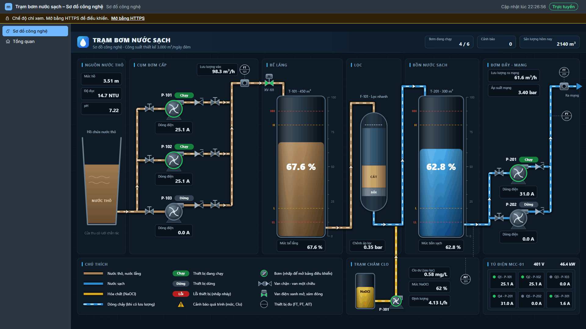

# Trạm bơm nước sạch – Sơ đồ công nghệ (project mẫu SVG)

Project mẫu định dạng 1.1, chủ đề Tối, trình diễn sơ đồ công nghệ SVG kiểu HMI hiệu năng cao (ISA-101): nền xanh than, thiết bị xám, màu chỉ dùng cho trạng thái (chạy xanh lá, dừng xám, lỗi đỏ, cảnh báo cam) và loại môi chất (nước thô nâu nhạt, nước sạch xanh dương, hóa chất vàng). Chạy được ngay không cần PLC: mọi Tag là Tag mô phỏng hoặc Tag tính toán.

## Quy trình trên sơ đồ

Hồ chứa nước thô → 3 bơm cấp P-101, P-102, P-103 (song song, van chặn hai đầu, van một chiều) → đồng hồ FT-101, van điện XV-101 → bể lắng T-101 (thang mức, vạch HH/H/L/LL) → bể lọc nhanh F-101 → bồn nước sạch T-201 → 2 bơm đẩy P-201, P-202 → FT-201, PT-201 → mạng cấp nước. Trạm châm Clo: bồn NaOCl T-301 và bơm định lượng P-301 châm vào ống sau lọc, AIT-301 đo Clo dư. Tủ điện MCC-01 có 6 ngăn (đèn trạng thái, dòng điện).

## Tệp

| Tệp | Nội dung |
|---|---|
| `graphics/so-do-cong-nghe.svg` | bản vẽ 1600 × 900, khoảng 60 KB, 5 lớp (`data-mat-layer`): Nền, Đường ống, Dòng chảy, Thiết bị, Nhãn và cảnh báo |
| `screens/so-do-cong-nghe.screen.json` | màn hình SVG toàn trang (màn hình đầu) |
| `screens/tong-quan.screen.json` | màn hình lưới: 4 thẻ chỉ số màu; sơ đồ SVG 8 cột cạnh biểu đồ xu hướng mức 4 cột; dòng điện động cơ và bảng giá trị |
| `screens/thu-vien.screen.json` | màn hình lưới **Thư viện component**: đủ 28 loại widget của catalog, nhóm theo mục Hiển thị, Thẻ & KPI, Biểu đồ, Bảng và Alarm, Điều khiển, Lịch sử; cuối trang 12 ký hiệu SVG của thư viện ký hiệu (`graphics/symbols/`, mỗi ký hiệu có hoạt ảnh gắn Tag) |
| `alarms.json`, `alarm-classes.json` | 5 alarm trên Tag mô phỏng (nhiệt độ mẫu, mức bể lắng, mức bồn sạch, Clo dư, P-102 lỗi): thỉnh thoảng có alarm đang hoạt động |
| `logging.json` | nhóm lưu trữ `thu-vien` (chu kỳ 1 phút, có tổng hợp) cho các widget lịch sử |
| `screens/faceplate-bom.screen.json` | popup faceplate có tham số `prefix`, `title`: đèn chạy/lỗi, dòng điện, giờ chạy, chế độ, lệnh chạy tay |
| `screens/*.so_do.bindings.json` | binding của từng item SVG (theo `data-mat-uid`) |
| `tags.json` | Tag mô phỏng và tính toán (thêm DEMO.* cho trang Thư viện; DEMO.CMD, DEMO.SP, DEMO.SPEED, DEMO.MODE là Tag nội bộ ghi được cho widget điều khiển): bơm chạy luân phiên (sóng vuông), P-102 thỉnh thoảng lỗi, lưu lượng theo số bơm chạy, mức dao động |

## Hoạt ảnh dùng trên sơ đồ

| Hoạt ảnh | Phần tử |
|---|---|
| Mức chất lỏng | bể lắng, bồn sạch, bồn NaOCl (`geometry.levelPercent`); hồ chứa hình thang (`geometry.clipLevel`) |
| Quay liên tục | cánh của 6 bơm khi trạng thái = Chạy |
| Màu viền, màu nền (rời rạc) | vỏ bơm, ô trạng thái, đèn ngăn MCC, van XV-101, ô Cảnh báo trên tiêu đề (khoảng) |
| Dòng chảy | vạch chạy trên ống khi có lưu lượng; tốc độ theo lưu lượng, ẩn khi lưu lượng 0 (kèm Độ mờ) |
| Nhấp nháy | vỏ bơm khi lỗi |
| Chữ hiển thị giá trị | các ô số liệu: mức %, lưu lượng m³/h, áp suất bar, Clo dư mg/L, dòng điện A, giờ chạy |
| Ẩn/hiện | biểu tượng lỗi bơm, cảnh báo mức cao/thấp, Clo dư thấp |

Nhấp một bơm (P-101 đến P-202) mở popup `faceplate-bom` với `prefix` là mã bơm.

## Sửa bản vẽ

Tệp SVG, binding, Tag và màn hình sinh từ `tools/svg-showcase/generate.mjs` (toạ độ, uid và binding ở cùng một chỗ nên luôn khớp nhau): sửa script rồi chạy `node tools/svg-showcase/generate.mjs`. Test `packages/project-schema/src/svg-showcase.test.ts` kiểm project qua `validateProject` 0 lỗi, SVG qua bộ lọc không bị loại phần nào. Ảnh chụp: `node tools/docs-screenshots.mjs so-do`; trang Thư viện component: `node tools/docs-screenshots.mjs web-thu-vien` (toàn trang và từng mục, rộng 1920).

Chữ dùng phông Inter khi máy có cài, không có thì Segoe UI hoặc phông sans-serif của trình duyệt.
