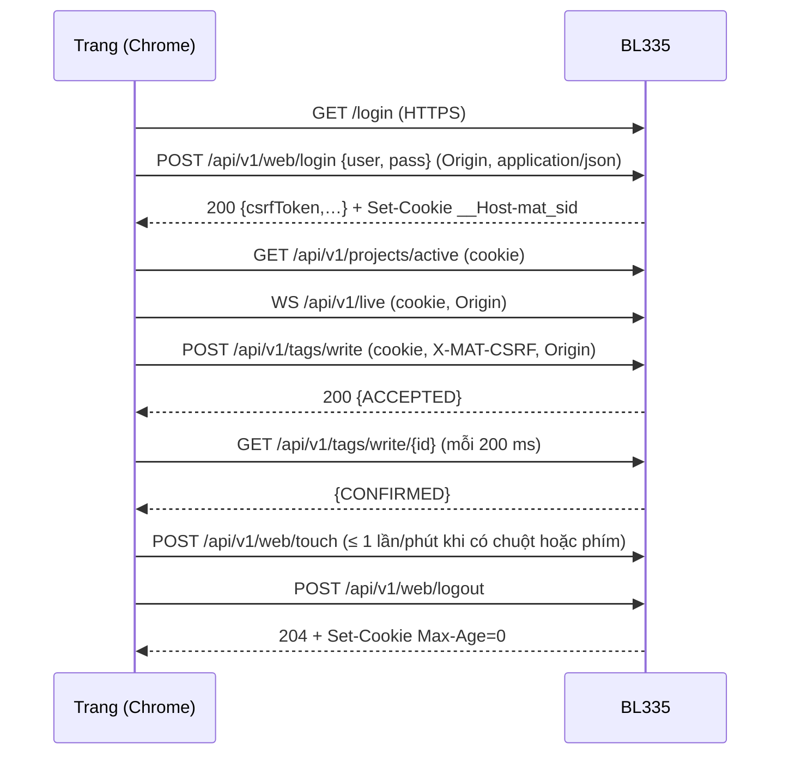

# Contract: phiên web, cookie, CSRF và hành vi của trang

**Feature**: [spec.md](../spec.md) FR-038…FR-052, SC-005…SC-009 · **Data model**: [data-model.md](../data-model.md) §9 · **Research**: R13–R15, R25 · **ADR**: [021](../../../docs/adr/021-web-login-certificates.md)

Hợp đồng chi tiết của phiên web ở BL335 (C++) và ở trang (TS). Endpoint và mã lỗi: [device-api-1.2.md](device-api-1.2.md).

## 1. Bản ghi phiên (BL335, trong bộ nhớ)

| Trường | Ý nghĩa |
|---|---|
| `kind` | `web` (phiên Bearer của 005 là `bearer`) |
| `tokenHash` | SHA-256 của token `matw_…` (token không được giữ) |
| `csrf` | token CSRF (32 byte ngẫu nhiên, base64url), **bản rõ** vì phải trả lại ở `GET /web/session`; chỉ trong RAM, không vào audit, log hay `system/info` |
| `user`, `role`, `rev` | tài khoản, role lúc đăng nhập, phiên bản tài khoản (`rev` đổi thì hủy) |
| `ip` | địa chỉ nguồn lúc đăng nhập (IPv4 ánh xạ xét như IPv4) |
| `createdAt`, `lastActivityAt`, `idleLimitS`, `maxLimitS` | đồng hồ đơn điệu (`CLOCK_BOOTTIME`) |

- Tối đa 8 phiên `web`; tổng với phiên Bearer ≤ 32.
- `csrf` đi qua `execv` trong `auth-state.json` trên tmpfs (quyền `0600`, `matscada`), cùng cách với token băm của 005. Lưu bản rõ có rủi ro tương đương token đó nằm trong RAM của trình duyệt; kiểm so hằng thời gian.

## 2. Vòng đời



- Trang khôi phục sau F5: `GET /api/v1/web/session` (cookie) → `csrfToken`, hạn; 401 thì chế độ chỉ xem.
- Hết hạn: mọi yêu cầu sau 401 `SESSION_EXPIRED`; WebSocket mang cookie đóng 4401 trong ≤ 60 s (ADR-018).

## 3. Cookie và header chính xác

```text
Set-Cookie: __Host-mat_sid=matw_<43 ký tự base64url>; Secure; HttpOnly; SameSite=Strict; Path=/
```

- Thứ tự thuộc tính không quan trọng; test kiểm **có đủ** `Secure`, `HttpOnly`, `SameSite=Strict`, `Path=/` và **không có** `Domain`, `Max-Age`, `Expires` (trừ lúc xóa).
- Yêu cầu: `Cookie: __Host-mat_sid=…`; `X-MAT-CSRF: <csrfToken>`; `Origin: https://192.168.1.110:8443`.
- So sánh `Origin`: chuỗi bằng `"https://" + Host` (không phân biệt hoa thường, không có `/` cuối). `Origin: null` (iframe sandbox, tệp cục bộ): từ chối.

## 4. Hành vi của trang (`apps/runtime-web`)

- **Khởi động:** nếu HTTPS: `GET /api/v1/web/session` → có phiên thì `session = {user, role, csrf}`; 401 thì `session = null`. Nếu HTTP: không gọi (cookie không có), hiện dải "Chế độ chỉ xem" kèm liên kết HTTPS.
- **Đăng nhập:** hộp thoại; gửi `POST web/login`; thành công giữ `csrf` trong biến của module (không `localStorage`, không URL, không `window` toàn cục); thất bại hiện câu theo mã; hộp xóa mật khẩu khỏi DOM sau khi gửi (đặt `value = ''`).
- **Gửi lệnh:** header `X-MAT-CSRF`; `credentials: 'same-origin'` (mặc định); không đặt `Origin` bằng tay (trình duyệt gửi).
- **Hết hạn:** nhận 401 `SESSION_EXPIRED` hoặc `SESSION_INVALID` từ bất kỳ yêu cầu nào thì `session = null`, mọi `ControlController.recompute()`, banner "Phiên đã hết hạn, đăng nhập lại", không xóa màn hình; hộp xác nhận đang mở bị hủy.
- **Touch:** mọi `pointerdown`/`keydown` hợp lệ đặt cờ; bộ hẹn 60 s gọi `touch` nếu cờ bật rồi tắt cờ.
- **Đăng xuất:** `POST web/logout` rồi `session = null`; xóa mọi bộ đệm dữ liệu điều khiển.
- **Hai tab:** không đồng bộ trạng thái trong trang; tab nhận 401 ở lần gọi kế tiếp và tự khóa.
- **Đổi project (005):** trang tự tải lại, `GET session` khôi phục phiên.
- **Không có** lưu mật khẩu trong trang; thuộc tính `autocomplete` đúng (`username`, `current-password`).

## 5. Bộ ca tấn công (SC-007)

Mỗi ca chạy với client Node (`tools/web-it.ps1 -Scenario attack`), giả lập PLC kiểm "0 lệnh tới thiết bị trường", và kiểm audit. Phiên hợp lệ có sẵn: `S` (operator), `V` (viewer).

| # | Ca | Mong đợi |
|---|---|---|
| A1 | `POST tags/write` bằng cookie `S`, **không** `X-MAT-CSRF` | 403 `CSRF_FAILED` |
| A2 | CSRF sai (đổi 1 ký tự) | 403 `CSRF_FAILED` |
| A3 | CSRF của phiên khác (`S2`) | 403 `CSRF_FAILED` |
| A4 | `Origin: https://evil.example` | 403 `ORIGIN_MISMATCH` |
| A5 | thiếu `Origin` | 403 `ORIGIN_MISMATCH` |
| A6 | `Origin: null` | 403 `ORIGIN_MISMATCH` |
| A7 | `Origin: http://<host>:8080` (HTTP, cùng máy) | 403 `ORIGIN_MISMATCH` |
| A8 | cookie qua HTTP (8080) | cookie bỏ qua; `tags/write`: 403 `HTTPS_REQUIRED`; trang: chế độ chỉ xem |
| A9 | cookie `S` gọi `POST /api/v1/projects/…/deploy` (nạp xuống) | 403 `SESSION_SCOPE` |
| A10 | cookie `S` gọi `GET /api/v1/audit` | 403 `SESSION_SCOPE` |
| A11 | cookie `S` gọi `POST /api/v1/drivers/test`, `GET serial/ports`, `GET drivers/diagnostics` | 403 `SESSION_SCOPE` |
| A12 | cookie engineer gọi nạp xuống | 403 `SESSION_SCOPE` |
| A13 | token `matw_…` trong `Authorization: Bearer` | 403 `SESSION_SCOPE` |
| A14 | token `mats_…` (Bearer của Studio) trong cookie | không phiên: 401 `AUTH_REQUIRED` |
| A15 | `GET` đổi trạng thái (`GET tags/write?value=…`) | 405 hoặc không có route; 0 ghi |
| A16 | `POST tags/write` với `Content-Type: text/plain` | 415 hoặc 400; 0 ghi |
| A17 | form `application/x-www-form-urlencoded` từ trang khác | 415 |
| A18 | `GET web/session` với `Sec-Fetch-Site: cross-site` | 403 `FETCH_SITE` |
| A19 | WebSocket có cookie, không `Origin` | 403 trước khi lấy slot |
| A20 | WebSocket có cookie, `Origin` lạ | 403 trước khi lấy slot |
| A21 | đặt cookie phiên do client tự chọn (`__Host-mat_sid=matw_chosen`) | 401 `SESSION_INVALID`; sau `login` thành công token khác hẳn (không cố định phiên) |
| A22 | dùng cookie `S` sau `logout` | 401 |
| A23 | dùng cookie `S` từ IP khác | 401 `SESSION_INVALID` |
| A24 | cookie `V` (viewer) ghi Tag | 403 `FORBIDDEN`, audit `tag.write` `denied` |
| A25 | login CSRF: `POST web/login` với `Origin` lạ | 403 `ORIGIN_MISMATCH` |
| A26 | 6 lần login sai cùng tên | lần 6: 429 `AUTH_LOCKED`; đăng nhập đúng cũng 429 trong 5 phút |
| A27 | 9 lần login đúng liên tiếp (9 phiên) | phiên web cũ nhất bị loại; phiên 1 dùng lại: 401 |
| A28 | đổi mật khẩu tài khoản (CLI) khi `S` đang mở | `S` bị hủy: 401 |
| A29 | XSS: `props.label` = `` | hiện dạng chữ; 0 thực thi |
| A30 | clickjacking: nhúng trang trong `<iframe>` | bị chặn (`frame-ancestors 'none'`) |

Mỗi ca ghi nhận: mã HTTP, số lệnh tới giả lập (phải 0), dòng audit (`access.denied` hoặc `tag.write` `denied`, trừ A8, A15, A16, A17, A21 chỉ đếm).

## 6. Test C++

`core/auth/tests/web_session_test.cpp` (đồng hồ giả): tạo, hết hạn rảnh, hết hạn tối đa, `touch`, IP, `rev`, quota và loại phiên cũ nhất, token hai loại, `csrf` so hằng thời gian, đi qua `execv` (lưu và đọc `auth-state.json`), không có token trong audit hay log.
