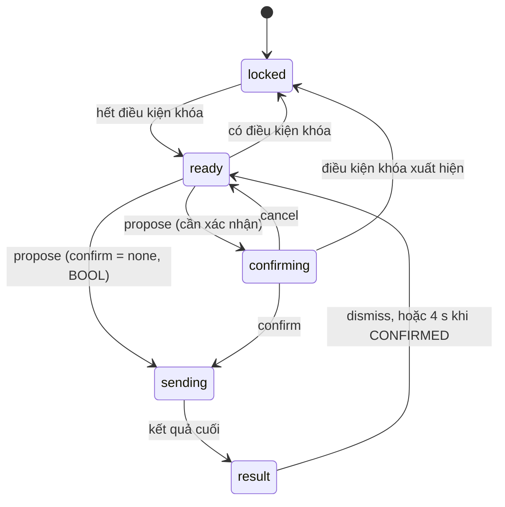

# Data Model: Màn hình v1, widget và điều khiển từ Chrome

**Feature**: [spec.md](spec.md) · **Plan**: [plan.md](plan.md) · **Research**: [research.md](research.md)

Feature này đổi định dạng project lên **0.3.0** (schema, luật, ví dụ đủ: [contracts/project-format-0.3.md](contracts/project-format-0.3.md)) và thêm:

- trạng thái trên trang runtime: nguồn dữ liệu, bộ điều khiển, dữ liệu biểu đồ, phiên;
- trạng thái trên BL335: phiên web, cấu hình, chứng chỉ, mở rộng yêu cầu ghi;
- trạng thái trong Studio: tài liệu màn hình, vùng nhìn, vùng chọn, cử chỉ, clipboard.

Thời điểm dạng ms UTC (`…Ms`, `updatedAt`) hoặc ISO 8601 UTC (`…At`). Đơn vị vị trí và cỡ là **đơn vị thiết kế** (số nguyên) trừ khi ghi khác.

## 1. Màn hình (`ScreenModel`, file `screens/<id>.screen.json`)

| Trường | Kiểu | Bắt buộc | Ràng buộc |
|---|---|---|---|
| `schemaVersion` | chuỗi | có | bằng `project.json` |
| `id` | chuỗi | có | `^[a-z0-9][a-z0-9-]{0,47}$`, khớp tên file |
| `name` | chuỗi | có | 1–80 |
| `kind` | `screen` \| `popup` | | mặc định `screen` |
| `size` | `{ width, height }` | có | số nguyên, 64–4096 × 64–2304; mặc định khi tạo mới 1920 × 1080 |
| `fitMode` | `contain` \| `cover` \| `stretch` \| `fit-width` \| `none` | | mặc định `contain` |
| `background` | màu | | `#RGB` hoặc `#RRGGBB` |
| `items` | mảng `Item` | có | ≤ 250; thứ tự = lớp, đầu ở dưới |

Quan hệ: màn hình thuộc `project.screens`; một màn hình có 0–250 item; màn hình `popup` chỉ được mở bởi hành động `popup` của một nút.

## 2. Item `svg`

| Trường | Kiểu | Ghi chú |
|---|---|---|
| `id`, `name`, `type: "svg"` | | |
| `x`, `y`, `width`, `height` | số nguyên | vị trí và cỡ của khung chứa SVG |
| `locked`, `hidden` | bool | |
| `svgFile`, `bindingFile` | đường dẫn | trong project; file phải có |
| `viewBox` | 4 số | `[minX, minY, w, h]`, w và h > 0 |
| `fit` | `contain` \| `cover` \| `stretch` | SVG vừa khung của item |
| `elements` | `{ elementUid, name?, kind? }[]` | ≤ 2.000; uid duy nhất trong item |

Khi chạy: một Shadow DOM riêng (ADR-007), `Map<elementUid, Element>` lập một lần, `DomApplier` với binding đã tải.

## 3. Item `widget`

| Trường | Kiểu | Ghi chú |
|---|---|---|
| `id`, `name`, `type: "widget"` | | |
| `widget` | chuỗi | loại trong danh mục (15 loại) |
| `x`, `y`, `width`, `height`, `locked`, `hidden` | | như item `svg` |
| `props` | đối tượng | theo danh mục |
| `tags` | `{ [slot]: tagId \| tagId[] }` | |
| `events` | `{ click?: Action }` | chỉ `button` |
| `security` | `{ minRole }` | chỉ widget điều khiển |

## 4. Hành động và điều hướng

**`Action`** (khóa `action`):

| `action` | Trường | Ghi chú |
|---|---|---|
| `write` | `value` | Tag của khe `target`; kiểu và giới hạn theo Tag |
| `toggle` | | Tag BOOL; gửi kèm `expect` |
| `pulse` | `value` (BOOL), `durationMs` (100–10000) | BL335 giữ nhịp |
| `navigate` | `screen` | màn hình `screen` |
| `popup` | `screen` | màn hình `popup` |
| `closePopup` | | |

**`Navigation`** (`project.json`): `position` (`left` \| `top` \| `hidden`), `items`: mảng `NavItem`, mỗi phần tử `{ label, screen, icon? }` hoặc nhóm `{ label, icon?, items: NavLeaf[] }` (một cấp); ≤ 32 mục lá; `label` 1–40; `icon` trong bộ 16 tên.

## 5. Danh mục widget (`schemas/widgets.catalog.json`)

`{ catalogVersion, widgets: [ { id, group, label, defaultSize, minSize, slots[], props[], events[] } ] }`; `slots[]`: `{ name, required, multi, max?, types[], needsWrite }`; `props[]`: `{ name, kind, min?, max?, maxLength?, options?, items?, fields?, allowAuto?, default, group }`; `events[]`: `{ name, actions[] }`. Chi tiết và 15 mục: [contracts/widget-catalog.md](contracts/widget-catalog.md).

## 6. Dữ liệu của trang runtime (trong bộ nhớ trình duyệt)

| Thực thể | Trường | Ghi chú |
|---|---|---|
| **`TagState`** | `value`, `quality` (`GOOD` \| `UNCERTAIN` \| `BAD` \| `STALE` \| `UNKNOWN`), `reason?`, `updatedAt?` | `UNKNOWN`: Tag mà thiết bị báo không có |
| **`LiveTagSource`** | `Map<id, TagState>` cho tập đăng ký hiện tại; `connection` (`live`/`stale`/`offline`); bộ đếm người đăng ký theo Tag | đổi đăng ký bằng `LiveConnection.setTags` (hợp mọi người đăng ký); khi mất kết nối đặt `STALE` cho mọi Tag |
| **`ProjectSummary`** | `project`, `tags`, `valueTables`, `connections`, `navigation`, `screens[]` | từ `projects/active` (0.3) |
| **`ScreenCache`** | ≤ 8 `ScreenModel` đã tải (LRU) | không giữ DOM |
| **`Route`** | `screenId`, `kiosk` | từ `location.hash`, `location.search` |
| **`PopupState`** | `screenId \| null` | không nằm trong URL |
| **`WebSession`** | `{ user, role, csrf, expiresAt, idleExpiresAt } \| null` | `csrf` chỉ trong biến của module |

Vòng đời: tải trang → `ProjectSummary` → `Route` → tải màn hình → dựng → đăng ký → (đổi `Route` → bỏ đăng ký cũ → màn hình mới).

## 7. Điều khiển (phía trang)

**`WriteSpec`** → `POST tags/write`: `kind`, `tag`, `value`, `pulseMs?`, `expect?`, `context {screen, widget}`; `requestId` UUID v4 sinh lúc xác nhận.

**`WriteOutcome`**: `status` (`ACCEPTED`, `CONFIRMED`, `REJECTED`, `TIMEOUT`, `FAILED`, `UNKNOWN`), `code?`, `message?`, `retryAfterMs?`, `readback?`.

**`ControlState`** (mỗi widget điều khiển một máy trạng thái):

**Bảng mã khóa:** `NO_SESSION`, `ROLE`, `INSECURE`, `HTTPS_DOWN`, `SESSION_EXPIRED`, `PROJECT_CHANGING`, `LIVE_LOST`, `TAG_UNKNOWN`, `TAG_READONLY`, `QUALITY_BAD`, `NO_VALUE`, `BUSY`, `OTHER_DIALOG` (thứ tự kiểm và chữ: [contracts/ui-components-api.md](contracts/ui-components-api.md) §5).

**Bảng mã lý do** hiển thị: lấy từ 006 (data-model §8, §9), thêm `STALE_EXPECTATION`, `EXPECT_NOT_BOOL`, `PULSE_NOT_BOOL`, `PULSE_RANGE`, `PULSE_RELEASE_FAILED`, `FETCH_SITE`, `CSRF_FAILED`, `ORIGIN_MISMATCH`, `SESSION_SCOPE`.

## 8. Dữ liệu biểu đồ (trong trình duyệt)

| Thực thể | Trường | Ghi chú |
|---|---|---|
| **`ChartWindow`** | `capacity` (3600), `windowSec`, `sampleMs`, `series` (≤ 8) | không biết Tag, không biết uPlot |
| Mỗi đường | `t: Float64Array(capacity)`, `y: Float64Array(capacity)`, `head`, `count` | vòng; `y = NaN` khi ngắt đoạn |
| Mẫu | `t` (ms UTC, giờ BL335 ưu tiên), `y` | một mẫu mỗi `sampleMs` theo giờ thật; khoảng thiếu > 3 × `sampleMs` chèn một `NaN` |
| **Cột, tròn** | chỉ giá trị hiện tại của các Tag | không bộ đệm |

Khối lượng: 8 đường × 3600 × 16 byte ≈ 460 KB mỗi biểu đồ; 16 biểu đồ ≈ 7,4 MB (chỉ phía trình duyệt).

## 9. Phiên web (BL335)

| Trường | Ghi chú |
|---|---|
| `kind` (`web`), `tokenHash`, `csrf`, `user`, `role`, `rev`, `ip` | [contracts/web-session.md](contracts/web-session.md) §1 |
| `createdAt`, `lastActivityAt`, `idleLimitS`, `maxLimitS` | đồng hồ đơn điệu |
| Quota | ≤ `webMaxSessions` phiên web (8); tổng ≤ 32; đầy thì loại phiên web rảnh lâu nhất |
| Bền | trong RAM; qua `execv` bằng `auth-state.json` (tmpfs, `0600`) |

Cookie là **tham chiếu** tới phiên (token `matw_…`); không có dữ liệu người dùng trong cookie.

## 10. Cấu hình runtime và chứng chỉ

| Thực thể | Trường | Ghi chú |
|---|---|---|
| `runtime.json` | `viewerLogin`, `webSessionIdleMin`, `webMaxSessions`, `webSessionMaxHours` | [contracts/device-config-007.md](contracts/device-config-007.md) §1 |
| **Chứng chỉ thiết bị** | PEM chứng chỉ (+ chuỗi), khóa riêng (chỉ trên thiết bị), SAN (IP, DNS), fingerprint SHA-256, nguồn (`self-signed` \| `imported`) | `tls/server.pem`, `server.pem.prev` |
| **Khóa chờ** | `pending-key.pem` (ECDSA P-256) | giữa `--make-csr` và `--import-cert` |
| **CSR** | PKCS#10 PEM | `tls/csr-<thời điểm>.pem` |
| `system/info.web` | `https`, `httpsPort`, `login`, `viewerLogin` | công khai |
| `system/info.warnings` | thêm `TLS_NO_IP_SAN`, `TLS_SAN_MISMATCH`, `HTTPS_DOWN` | |

## 11. Yêu cầu ghi: phần mở rộng và audit

Thêm vào **Yêu cầu ghi** của 006 (data-model §9):

| Trường | Ý nghĩa |
|---|---|
| `context` | `{ screen, widget }` (≤ 64 byte mỗi trường) |
| `expect` | BOOL: giá trị hiện tại mà người dùng thấy |
| `pulseMs` | 100–10000 |
| `phase` | thêm `release` |
| `pulse` | `{ valueMs, released }` trong kết quả |

**Audit** (`audit.db`, không đổi lược đồ): `tag.write` có `channel` = `web` (hoặc `studio`), `detail` thêm `context`, `pulseMs`, `expect`; `auth.login`, `auth.logout`, `auth.session_evicted` với `channel` = `web`; `access.denied` thêm mã `SESSION_SCOPE`, `CSRF_FAILED`, `ORIGIN_MISMATCH`, `FETCH_SITE`; `tls.regen`, `tls.csr`, `tls.import`.

## 12. Tóm tắt dự án cho trang (`projects/active`, 0.3)

Xem [contracts/device-api-1.2.md](contracts/device-api-1.2.md) §4. Quy ước: Tag trong `tags` có đủ `limits`, `access`, `kind`, `valueTable`, `unit`, `min`, `max`, `description` để widget hiển thị và để `ControlController` kiểm. Không có `items`; màn hình tải theo `screens[].file`.

## 13. Tài liệu màn hình trong Studio

| Thực thể | Trường | Ghi chú |
|---|---|---|
| **`ScreenDoc`** | `ScreenModel` + `dirty` | một tab editor Màn hình mỗi màn hình; nằm trong `ProjectDoc` |
| **`Selection`** | `ids: string[]`, `primary?: string` | `primary` là item chính của căn chỉnh "cùng rộng/cao" |
| **`Viewport`** | `zoom` (0,1–4), `panX`, `panY`, `grid` (bật/tắt), `gridSize` (5–100), `snap` (bật/tắt), `guides` (bật/tắt) | giữ khi đổi tab |
| **`PreviewMode`** | `off` \| `sim` \| `device` | như 004, 006 |
| **`ScreenIssue`** | `Issue` + `itemId?` + `field?` | từ validator; tô viền và nhảy tới |

## 14. Cử chỉ và lịch sử

| Thực thể | Trường |
|---|---|
| **`Gesture`** | `kind` (`idle`, `marquee`, `moving`, `resizing`, `panning`, `tool-drop`), điểm bắt đầu, vùng chọn lúc bắt đầu, hộp bao ban đầu, `handle?`, kết quả bắt dính (`dx`, `dy`, `guides[]`) |
| **`Guide`** | `axis` (`x` \| `y`), `at`, `from`, `to`, `kind` (`edge` \| `center` \| `grid` \| `screen`) |
| **`HistoryStep`** | snapshot chuỗi JSON của file màn hình (cơ chế `app/history.ts`: 100 bước, `mergeKey`) |

Một cử chỉ liên tục (kéo, đổi cỡ) là đúng một bước; thao tác nhiều item là một bước.

## 15. Kéo thả và clipboard

| Thực thể | Trường |
|---|---|
| **`DragPayload`** | MIME `application/x-mat-widget` (loại) hoặc `application/x-mat-tag` (id Tag); chuỗi thường |
| **`Clip`** | bản sao các item (id cũ → id mới khi dán), lấy từ `Ctrl+C`; sống trong bộ nhớ của Studio, không dùng clipboard hệ thống |

## 16. Giới hạn tóm tắt

| Mục | Giới hạn |
|---|---|
| màn hình mỗi project | 32 (cả popup) |
| item mỗi màn hình; item `svg` | 250; 8 |
| Tag riêng biệt mỗi màn hình (kèm popup nó mở) | 1.000 (cảnh báo > 500) |
| biểu đồ mỗi màn hình; đường mỗi biểu đồ đường; Tag cột; Tag tròn; dòng bảng Tag | 16; 8; 12; 8; 50 |
| cửa sổ biểu đồ; lấy mẫu; điểm mỗi đường | 10–3600 s; ≥ 250 ms; 3600 |
| `size` | 64–4096 × 64–2304 |
| mục menu | 32 |
| phiên web | 8 (cấu hình 1–16); tổng 32 |
| file màn hình | ≤ 1 MiB (ước 250 item ≈ 67 KB) |
| hoàn tác | 100 bước |
