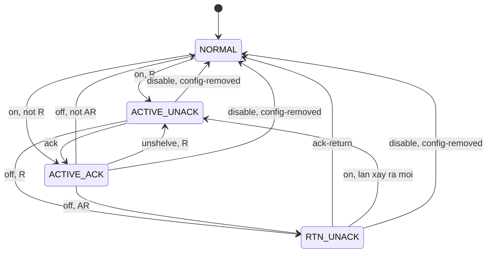

# Data Model: Alarm theo ISA-18.2

**Feature**: [spec.md](spec.md) · **Hợp đồng**: [project-format-0.5](contracts/project-format-0.5.md), [alarm-engine](contracts/alarm-engine.md), [alarm-store](contracts/alarm-store.md) · **Bản trước**: [007 data-model](../007-screens-widgets/data-model.md)

Feature này đổi định dạng project lên **0.4.0** (hai file mới `alarms.json`, `alarm-classes.json`), thêm file `alarm.db` trên BL335, bản tin live 1.3.0, API thiết bị 1.3.0, sáu hành động audit, và trạng thái trong trang runtime, widget, Studio.

Quy ước: thời điểm dạng ms UTC (`…Ms`) hoặc ISO 8601 UTC (`…At`). Thứ tự sự kiện dựa trên **mã lần xảy ra** (`occurrence`) và **revision**, không dựa trên giờ treo tường (FR-024). Mọi mốc tính trễ dùng đồng hồ đơn điệu (`…Mono`), chỉ ở RAM. Ưu tiên bằng chữ (`critical`, `major`, `minor`, `advisory`) trong JSON và bằng số 1 đến 4 trong SQL (1 = `critical`).

## 1. `alarms.json` (project 0.4)

Tệp tùy chọn, khai bằng `alarmFile` ở `project.json`. Schema: `schemas/alarms.schema.json`. Luật và mã lỗi: [project-format-0.5.md](contracts/project-format-0.5.md).

**Cấp tệp:**

| Trường | Kiểu | Bắt buộc | Ràng buộc |
|---|---|---|---|
| `schemaVersion` | chuỗi | có | bằng `project.json` |
| `areas` | mảng `Area` | không | ≤ 64; xem §2 |
| `alarms` | mảng `AlarmDef` | có | tổng instance ≤ 500; tệp ≤ 512 KiB |

**`AlarmDef` (chung):**

| Trường | Kiểu | Bắt buộc | Ràng buộc |
|---|---|---|---|
| `id` | chuỗi | có | `^[A-Za-z][A-Za-z0-9_]{1,47}$`, duy nhất; `.` không được có (dành cho hậu tố ngưỡng) |
| `type` | `digital` \| `limit` \| `quality` | có | |
| `name` | chuỗi | có | 1 đến 80 ký tự |
| `area` | chuỗi | không | id khu vực có trong `areas`; thiếu = "Chung" |
| `text` | chuỗi | không | ≤ 200 ký tự, chỉ thẻ của FR-005; thiếu = nội dung mặc định (D9) |
| `enabled` | bool | không | mặc định `true`; `false` = định nghĩa nằm trong project nhưng không tạo instance |
| `onDelayMs` | số nguyên | không | 0 đến 86.400.000; mặc định 0 |
| `offDelayMs` | số nguyên | không | 0 đến 86.400.000; mặc định 0 |

**`digital`** thêm:

| Trường | Kiểu | Bắt buộc | Ràng buộc |
|---|---|---|---|
| `tag` | chuỗi | có | Tag BOOL hoặc số nguyên |
| `trigger` | bool | có | `true`: bật khi giá trị "đúng" (số nguyên khác 0 là đúng); `false`: bật khi "sai" |
| `class` | chuỗi | có | id lớp |

**`limit`** thêm:

| Trường | Kiểu | Bắt buộc | Ràng buộc |
|---|---|---|---|
| `tag` | chuỗi | có | Tag số (INT hay FLOAT) |
| `limits` | đối tượng | có | 1 đến 4 khóa trong `HH`, `H`, `L`, `LL`; xem dưới |
| `deadband` | số | không | ≥ 0, hữu hạn, mặc định 0; nhỏ hơn khoảng cách tới ngưỡng kề cùng phía |

`limits.<tên>`:

| Trường | Kiểu | Bắt buộc | Ràng buộc |
|---|---|---|---|
| `value` | số | có | hữu hạn; thứ tự `LL < L < H < HH` giữa các ngưỡng có mặt |
| `class` | chuỗi | có | id lớp riêng của ngưỡng |
| `text` | chuỗi | không | ghi đè `text` của alarm cho ngưỡng này |

`limit` không có khóa `class` ở cấp alarm; mỗi ngưỡng là một instance độc lập `<id>.<ngưỡng>` (D7).

**`quality`** thêm:

| Trường | Kiểu | Bắt buộc | Ràng buộc |
|---|---|---|---|
| `tag` | chuỗi | một trong hai | Tag bất kỳ kiểu |
| `device` | chuỗi | một trong hai | id thiết bị trường trong `connections.json`; đúng một trong `tag`, `device` |
| `on` | `bad` \| `notGood` | không | mặc định `bad`: BAD; `notGood`: BAD hoặc UNCERTAIN |
| `class` | chuỗi | có | id lớp |

Instance: `digital`, `quality` → id = `id`; `limit` → `<id>.<ngưỡng>` cho mỗi ngưỡng có mặt. Tổng số instance của project = số alarm `digital` + `quality` đang `enabled` + số ngưỡng của mọi alarm `limit` đang `enabled`.

## 2. `alarm-classes.json` và khu vực

Tệp tùy chọn, khai bằng `alarmClassFile`. Schema: `schemas/alarm-classes.schema.json`.

| Trường | Kiểu | Bắt buộc | Ràng buộc |
|---|---|---|---|
| `schemaVersion` | chuỗi | có | bằng `project.json` |
| `classes` | mảng `AlarmClass` | có | 1 đến 16 |

**`AlarmClass`:**

| Trường | Kiểu | Bắt buộc | Ràng buộc |
|---|---|---|---|
| `id` | chuỗi | có | `^[a-z][a-z0-9_]{1,31}$`, duy nhất |
| `name` | chuỗi | có | 1 đến 40 |
| `priority` | `critical` \| `major` \| `minor` \| `advisory` | có | |
| `color` | `red` \| `orange` \| `amber` \| `blue` \| `purple` \| `teal` \| `gray` \| `green` | có | tám token thiết kế (D24) |
| `blink` | bool | không | mặc định `false` |
| `requiresAck` | bool | không | mặc định `true` |
| `ackReturn` | bool | không | mặc định `false`; chỉ có nghĩa khi `requiresAck` |
| `sound` | `none` \| `beep` \| `double` \| `siren` | không | mặc định `none` |
| `chatterLimit` | số nguyên | không | 0 đến 100; mặc định 5; 0 tắt tự cách ly |

**`Area`** (mảng `areas` trong `alarms.json`):

| Trường | Kiểu | Bắt buộc | Ràng buộc |
|---|---|---|---|
| `id` | chuỗi | có | `^[a-z0-9][a-z0-9-]{0,31}$`, duy nhất |
| `name` | chuỗi | có | 1 đến 40 |

Khu vực nằm trong `alarms.json` (không phải file riêng) vì chỉ có hai trường và đổi cùng lúc với alarm; một cấp phẳng (D32). Alarm không `area` thuộc "Chung" (id ảo `""`, tên hiển thị "Chung", không khai trong `areas`).

## 3. `alarm.db` (SQLite, `<dataDir>/alarm.db`)

Riêng, tách khỏi `history.db` và `audit.db` (D12). Chi tiết truy vấn, bảo trì, ước tính: [alarm-store.md](contracts/alarm-store.md).

**PRAGMA** (đặt ngay sau khi mở, theo mẫu `core/historian/local_store.cpp`; `page_size` đặt trước khi tạo WAL):

```sql
PRAGMA page_size=4096;            -- chỉ có tác dụng ở file mới
PRAGMA journal_mode=WAL;
PRAGMA synchronous=NORMAL;        -- không có ngoại lệ Constitution thứ ba (D13)
PRAGMA cache_size=-2048;          -- 2 MiB (FR-037)
PRAGMA temp_store=MEMORY;
PRAGMA journal_size_limit=4194304;
PRAGMA wal_autocheckpoint=1000;   -- mặc định, ghi rõ để không đổi ngầm
PRAGMA foreign_keys=OFF;
```

Quyền file `0600` (`-wal`, `-shm` theo), như `audit.db` (`makePrivate`).

**Lược đồ phiên bản 1:**

```sql
CREATE TABLE IF NOT EXISTS alarm_meta(
  key   TEXT PRIMARY KEY,
  value TEXT NOT NULL
) WITHOUT ROWID;

CREATE TABLE IF NOT EXISTS alarm_occurrence(
  id               INTEGER PRIMARY KEY,
  alarm_id         TEXT    NOT NULL,
  fingerprint      TEXT    NOT NULL,
  ts_active_ms     INTEGER NOT NULL,
  clock_ok         INTEGER NOT NULL CHECK(clock_ok IN (0, 1)),
  ts_ack_ms        INTEGER,
  ack_user         TEXT,
  ts_return_ms     INTEGER,
  ts_return_ack_ms INTEGER,
  return_ack_user  TEXT,
  priority         INTEGER NOT NULL CHECK(priority BETWEEN 1 AND 4),
  class            TEXT    NOT NULL,
  area             TEXT,
  text             TEXT    NOT NULL,
  text_fold        TEXT    NOT NULL,
  value_active     REAL,
  quality_active   TEXT    NOT NULL CHECK(quality_active IN ('GOOD', 'UNCERTAIN', 'BAD')),
  reason           TEXT,
  flags            INTEGER NOT NULL DEFAULT 0 CHECK(flags BETWEEN 0 AND 3),
  repeat_count     INTEGER NOT NULL DEFAULT 1 CHECK(repeat_count >= 1),
  closed           INTEGER NOT NULL DEFAULT 0 CHECK(closed IN (0, 1)),
  closed_by        TEXT CHECK(closed_by IS NULL OR
                              closed_by IN ('return', 'config', 'disabled', 'restart-lost')),
  CHECK((closed = 0) = (closed_by IS NULL))
);
CREATE INDEX IF NOT EXISTS alarm_occ_ts       ON alarm_occurrence(ts_active_ms);
CREATE INDEX IF NOT EXISTS alarm_occ_alarm_ts ON alarm_occurrence(alarm_id, ts_active_ms);
CREATE INDEX IF NOT EXISTS alarm_occ_prio_ts  ON alarm_occurrence(priority, ts_active_ms);
CREATE INDEX IF NOT EXISTS alarm_occ_open     ON alarm_occurrence(alarm_id) WHERE closed = 0;

CREATE TABLE IF NOT EXISTS alarm_override(
  alarm_id    TEXT    NOT NULL,
  kind        TEXT    NOT NULL CHECK(kind IN ('shelve', 'disable')),
  user        TEXT    NOT NULL,
  reason      TEXT    NOT NULL,
  system      INTEGER NOT NULL DEFAULT 0 CHECK(system IN (0, 1)),
  ts_start_ms INTEGER NOT NULL,
  clock_ok    INTEGER NOT NULL CHECK(clock_ok IN (0, 1)),
  ts_end_ms   INTEGER,
  PRIMARY KEY(alarm_id, kind),
  CHECK((kind = 'shelve') = (ts_end_ms IS NOT NULL))
) WITHOUT ROWID;
```

**Cột `alarm_occurrence`** (FR-038, cộng bốn cột kỹ thuật `fingerprint`, `text_fold`, `repeat_count`, `closed`):

| Cột | Kiểu | Bắt buộc | Ràng buộc và ý nghĩa |
|---|---|---|---|
| `id` | INTEGER PK | có | mã lần xảy ra, tăng dần; không dùng lại (xem [alarm-store.md](contracts/alarm-store.md) §3) |
| `alarm_id` | TEXT | có | id instance (`TANK_B1_LEVEL.HH`) |
| `fingerprint` | TEXT | có | 16 ký tự hex FNV-1a 64 của điều kiện (loại, Tag hoặc thiết bị, ngưỡng, `trigger`, `on`); dùng để đối chiếu khi khởi động (FR-023) |
| `ts_active_ms` | INTEGER | có | giờ treo tường lúc bật; có thể sai khi `clock_ok` = 0 |
| `clock_ok` | INTEGER | có | 0 hoặc 1 |
| `ts_ack_ms`, `ack_user` | INTEGER, TEXT | không | lúc và người xác nhận (FR-030); NULL = chưa |
| `ts_return_ms` | INTEGER | không | lúc điều kiện hết; NULL = chưa hết hoặc đóng do `config`, `disabled`, `restart-lost` |
| `ts_return_ack_ms`, `return_ack_user` | INTEGER, TEXT | không | xác nhận hết; khi xác nhận một lần cho lần xảy ra đã hết mà chưa xác nhận, cả `ts_ack_ms` và `ts_return_ack_ms` cùng được ghi |
| `priority` | INTEGER | có | 1 đến 4, chụp từ lớp lúc bật |
| `class`, `area` | TEXT | có, không | id lớp (chụp lúc bật); id khu vực hoặc NULL |
| `text` | TEXT | có | nội dung đã chèn, ≤ 200 ký tự (D10) |
| `text_fold` | TEXT | có | `foldText(text || ' ' || alarm_id || ' ' || tên khu vực)`: bỏ dấu, hạ chữ; để tìm chữ ([alarm-store.md](contracts/alarm-store.md) §7) |
| `value_active` | REAL | không | giá trị Tag lúc bật (BOOL: 0 hoặc 1); NULL với alarm `quality` thiết bị |
| `quality_active` | TEXT | có | `GOOD`, `UNCERTAIN`, `BAD` lúc bật |
| `reason` | TEXT | không | `reason` của Tag lúc bật (FR-020) |
| `flags` | INTEGER | có | bit 0 `startup`, bit 1 `inputBad` (FR-036) |
| `repeat_count` | INTEGER | có | mặc định 1; ở lần xảy ra kích hoạt tự cách ly = số lần bật tổng cộng trong đợt cách ly (FR-035) |
| `closed` | INTEGER | có | 0 = đang mở (còn chưa `NORMAL`), 1 = đã đóng |
| `closed_by` | TEXT | không | `return`, `config`, `disabled`, `restart-lost`; NULL khi `closed` = 0 |

Lần xảy ra **mở** là lần chưa về `NORMAL` (`ACTIVE_UNACK`, `ACTIVE_ACK`, `RTN_UNACK`). Mỗi instance có tối đa một lần xảy ra mở.

**Cột `alarm_override`:** `alarm_id` (instance), `kind` (`shelve` | `disable`), `user` (người; `system` cho tự cách ly), `reason` (1 đến 120 ký tự), `system` (1 = tự cách ly do chập chờn), `ts_start_ms`, `clock_ok`, `ts_end_ms` (chỉ shelve: hết hạn theo giờ treo tường). Khóa chính `(alarm_id, kind)`: một instance có thể vừa shelved vừa disabled.

**`alarm_meta`:** `schema` = `'1'` (D37); `clean` = `'0'` khi đang chạy, `'1'` khi tắt sạch; `high_water` = mã lần xảy ra lớn nhất từng cấp (ghi khi dọn và khi tắt sạch); `created_ms`; `last_purge_ms`.

**Migration nội bộ (D37):** số nguyên `schema` trong `alarm_meta`.

- Khi mở: đọc `schema`; thiếu (file mới) thì tạo lược đồ phiên bản hiện hành và ghi `schema`.
- `schema` nhỏ hơn hằng của mã: chạy lần lượt `migrate(n → n+1)` trong **một transaction mỗi bước** (`BEGIN IMMEDIATE`), cập nhật `schema` cuối mỗi bước; hỏng giữa chừng thì bước đó lùi lại, lần khởi động sau chạy lại.
- Thêm cột tùy chọn (`ALTER TABLE … ADD COLUMN`, có `DEFAULT`) và chỉ mục mới: tăng `schema`, bước migration chỉ chạy `ALTER`/`CREATE INDEX IF NOT EXISTS`; không đụng dữ liệu cũ.
- `schema` lớn hơn hằng của mã (runtime cũ mở file mới): **không mở**, không đổi tên (không hỏng); `logState` = `error`, `system/info` ghi `schemaTooNew`, động cơ vẫn chạy; ghi nhật ký một lần.
- Không có `VACUUM` tự động (Edge Cases "Lưu trữ").

## 4. Trạng thái trong RAM của động cơ

Động cơ ở `core/alarm/alarm_engine.{hpp,cpp}` và `packages/alarm-engine/src/engine.ts`; ngữ nghĩa: [alarm-engine.md](contracts/alarm-engine.md).

**`Instance`** (một đối tượng cho mỗi instance; mảng cấp phát một lần khi nạp, không cấp phát trong `step`):

| Trường | Ghi chú |
|---|---|
| `id`, `defId`, `limitName` | `limitName` ∈ `HH`, `H`, `L`, `LL` hoặc rỗng |
| `kind`, `tagSlot`, `deviceSlots[]` | vị trí trong mảng mẫu Tag của tick |
| `threshold`, `deadband`, `trigger`, `on` | từ định nghĩa |
| `onDelayMs`, `offDelayMs`, `classId`, `areaId`, `fingerprint` | |
| `state` | `NORMAL`, `ACTIVE_UNACK`, `ACTIVE_ACK`, `RTN_UNACK` |
| `rawCond` | điều kiện sau hysteresis (Schmitt) |
| `cond` | điều kiện đã qua trễ (`true` khi lần xảy ra đang "đang có") |
| `pendingSinceMono` | mốc bắt đầu chờ trễ; `-1` khi không chờ |
| `inputBad` | cờ hiển thị |
| `shelve` | `{ untilMono, untilEpoch, clockOk, user, reason, system }` hoặc rỗng |
| `disabled` | bool (từ `alarm_override`) |
| `occurrence` | mã lần xảy ra mở; 0 nếu không có hoặc "bóng" (xem alarm-engine §8) |
| `occ` | bản sao hàng đang mở (các cột §3) |
| `chatterRing[]` | ≤ `chatterLimit` mốc đơn điệu của lần bật gần nhất |
| `ghostCount` | số lần bật bị nuốt trong đợt tự cách ly |
| `rev` | revision lần đổi cuối (cho `upToRevision`) |

**Hàng đợi ghi** (động cơ đẩy, luồng ghi `alarm.db` rút; chi tiết [alarm-store.md](contracts/alarm-store.md) §5): bản đồ `occurrenceId → Row` (bản mới nhất thắng), danh sách thay đổi `alarm_override`, danh sách khóa `alarm_meta`. Tối đa 5.000 hàng chờ; vượt thì bỏ hàng **đã đóng** cũ nhất (`droppedChanges`++); hàng đang mở và override không bị bỏ.

**Hàng đợi live** (động cơ đẩy một chiều, `LiveHub` rút trước `hub.tick()`; không khóa): vòng SPSC 4.096 `AlarmEvent`; đầy thì động cơ dồn thành sự kiện `Resync` (hub gửi lại `alarmSnapshot` cho mọi phiên đăng ký) thay vì chờ. Mỗi phiên có thêm `pending: Map<instanceId, AlarmItem>` và tập `removed` để dồn (FR-047).

**Hộp thư lệnh:** hàng đợi có khóa ngắn (chỉ hoán đổi vector) cho `Command` của API; `step` rút ở đầu tick.

**Ảnh chụp đọc:** sau mỗi tick có thay đổi, động cơ công bố `std::shared_ptr<const AlarmView>` (bất biến) cho `GET /api/v1/alarms`, `previewAck` và `system/info`; luồng HTTP không bao giờ chạm `Instance`.

## 5. Bảng chuyển trạng thái ISA

Trạng thái: `NORMAL` (N), `ACTIVE_UNACK` (AU), `ACTIVE_ACK` (AA), `RTN_UNACK` (RU). Cờ độc lập: `shelved` (S), `disabled` (D). `R` = lớp có `requiresAck`; `AR` = lớp có `ackReturn` (chỉ khi R).

**Hành động phụ** (chữ cái trong ô):

| Mã | Hành động |
|---|---|
| `a` | ghi audit **trước** (FULL, đồng bộ trên luồng HTTP; xem §8) |
| `w` | đẩy thay đổi vào hàng đợi ghi `alarm.db` |
| `l` | phát `alarmDelta` (mục `changed`) và cập nhật `counts` |
| `x` | đóng lần xảy ra (`closed` = 1, đặt `closed_by`) |
| `o` | mở lần xảy ra mới (cấp mã, chụp nội dung, ghi flags) |
| `r` | `removed` trong delta (instance hết khỏi tập hiện hành) |
| `s` | ghi audit hệ thống không đồng bộ qua hàng đợi ghi (lúc hết hạn, tự cách ly) |



**Bảng đầy đủ** (hàng = trạng thái trước; cột = sự kiện; `KTT` = không thể tới, xem ghi chú dưới bảng). "S" trong ô nghĩa là cờ `shelved` giữ nguyên qua chuyển trạng thái; các sự kiện `on` và `off` đến cả khi `shelved` (FR-031: vẫn đánh giá và ghi lịch sử).

| Trước | `on` (đúng sau trễ bật) | `off` (sai sau trễ tắt) | `ack` | `ack-return` | `shelve` | `unshelve` (người hoặc hết hạn) | `disable` | `enable` | `config-removed` | `restart-reconcile` |
|---|---|---|---|---|---|---|---|---|---|---|
| **N** | R: **AU**; không R: **AA**; `o w l` | KTT | `NOT_ACTIVE`; không đổi; không audit | `NOT_ACTIVE`; không đổi | cờ S bật; N; `a w l` | cờ S tắt; N; `a`, hết hạn `s`; `w l r` | cờ D bật; N; `a w l` | cờ D tắt; N (đánh giá từ đầu); `a w l` | bỏ instance; `l r` | N nếu không có hàng mở; điều kiện đúng ngay lần đánh giá hợp lệ đầu: `on` với flag `startup` |
| **AU** | KTT | R luôn đúng ở trạng thái này: **RU**, ghi `ts_return`; `w l` | **AA**; `ts_ack`, `ack_user`; `a w l` | KTT (xác nhận AU là `ack`) | cờ S bật; AU; `a w l`; bỏ khỏi banner, âm thanh, đếm | cờ S tắt; AU; `a`/`s w l`; hiện lại | đóng `disabled`; **N**; `a x w l r` | KTT | đóng `config`; bỏ; `x w l r` | AU (xác nhận chưa commit hoặc chưa có) |
| **AA** | KTT | AR: **RU**; không AR: **N** và `x` (`return`); `w l`, N thì `r` | `ALREADY_ACKED`; không đổi; không audit | KTT | cờ S bật; AA; `a w l` | R và điều kiện còn đúng: **AU** (cấp lại thông báo, giữ mã; cột `ts_ack` giữ giá trị cũ cho tới khi xác nhận lại); không R: AA | đóng `disabled`; **N**; `a x w l r` | KTT | đóng `config`; `x w l r` | AA nếu `ts_ack` đã commit, không thì AU (hướng an toàn) |
| **RU** | đóng lần xảy ra cũ (`return`); **AU** lần **mới**; `x o w l` | KTT | KTT (xác nhận RU là `ack-return`) | **N**; `ts_return_ack`; `x` (`return`); `a w l r` | cờ S bật; RU; `a w l` | cờ S tắt; RU; `a`/`s w l` | đóng `disabled`; **N**; `a x w l r` | KTT | đóng `config`; `x w l r` | RU (`ts_return` đã commit); nếu chưa commit thì AU |

**Ghi chú cho các ô:**

- Kết quả của lệnh `ack` được tính theo thứ tự: `NOT_FOUND` (instance không có) → khác mã lần xảy ra: `NOT_ACTIVE` nếu instance ở N, ngược lại `STALE` → `SHELVED` (cờ S) → theo trạng thái (`NOT_ACTIVE`, `ALREADY_ACKED`, `ACKED`). Các kết quả không phải `ACKED` không đổi trạng thái và không ghi audit.
- `ack` cho AU và `ack-return` cho RU là cùng một lệnh API; động cơ chọn theo trạng thái (cột nào áp dụng). Hai ô `KTT` ở cột kia là do lệnh luôn được chuyển đúng cột.
- Không R: `on` đi thẳng **AA** (thông tin); `off` từ AA về **N** (AR vô nghĩa). Khi lớp đổi lúc nạp project (R từ có sang không): AU thành AA, RU thành N và đóng (FR-023: lớp đổi không đóng lần xảy ra, trừ hệ quả này).
- AU `off` không R: không thể tới vì AU chỉ có khi R; trường hợp lớp đổi được xử lý ở ghi chú trên.
- `disabled` (D): `on`, `off` không được gửi tới instance; `enable` chỉ có nghĩa khi D bật (D tắt: `NOT_DISABLED`, không đổi).
- Khi `shelve` do tự cách ly (chập chờn): bốn ô `shelve` như trên nhưng có `s`, và `on` trong đợt cách ly không `o` mà tăng `ghostCount` ([alarm-engine.md](contracts/alarm-engine.md) §8).
- `restart-reconcile` là sự kiện của `load()`, không phải của `step`; AU, AA, RU được dựng lại từ hàng mở của `alarm.db` rồi điều kiện được đánh giá lại (FR-022).

**Tính đầy đủ (SC-005):** 4 trạng thái × 10 sự kiện = 40 ô; test đơn vị `core/alarm/tests/state_table_test.cpp` và `packages/alarm-engine/src/engine.test.ts` đi qua cả 40 ô và kiểm KTT bằng khẳng định nội bộ (hàm `transition()` trả `Impossible`).

**Luồng xác nhận** (ack một mục, role `operator`):

```mermaid
sequenceDiagram
    participant P as Trang Alarm
    participant A as API alarms/ack
    participant U as audit.db FULL
    participant E as AlarmEngine
    participant W as Hang doi ghi alarm.db
    participant H as LiveHub
    participant C as Moi client
    P->>A: POST ack items id, occurrence + CSRF
    A->>A: kiem role, Origin, CSRF; khoa ackMutex
    A->>E: previewAck tren anh chup (khong khoa)
    E-->>A: ACKED hoac ALREADY_ACKED, STALE, ...
    alt khong co muc nao se ACKED
        A-->>P: 200 results (khong audit)
    else co muc ACKED
        A->>U: append alarm.ack (commit FULL)
        alt audit loi
            U-->>A: AuditUnavailable
            A-->>P: 503 AUDIT_UNAVAILABLE, trang thai khong doi
        else audit ok
            A->>E: submit Command ack (cap id, occurrence)
            E->>E: tick ke tiep: ap dung, dich AU sang AA
            E->>W: hang day du, bien ts_ack, ack_user
            E->>H: AlarmEvent state AU to AA
            H->>C: alarmDelta changed, counts, sequence+1
            E-->>A: CommandResult ACKED
            A-->>P: 200 results ACKED
        end
    end
```

## 6. Bản tin live 1.3.0

Chi tiết giao thức: `contracts/live-protocol-1.3.md` (tài liệu riêng của feature). Phần này cố định dữ liệu. `sequence` là số tăng 1 mỗi bản tin alarm **trên từng phiên**, bắt đầu 1 ở `alarmSnapshot`; `revision` là số tăng toàn cục của động cơ (mỗi thay đổi một số), dùng làm `upToRevision` của "xác nhận tất cả" (FR-028; xem Điểm cần sửa spec 4).

**Client → server:**

```json
{ "type": "subscribeAlarms" }
{ "type": "unsubscribeAlarms" }
```

`subscribeAlarms` lần hai trên cùng phiên thay đăng ký và nhận snapshot mới. Phiên không có quyền đọc live (đã bị từ chối ở bước `hello`) không tới được đây.

**`hello`** (thêm trường): `"features": ["alarms"]` khi project có alarm; không có alarm thì không có phần tử `alarms` (FR-049); client 1.2.0 bỏ qua trường lạ.

**`alarmSnapshot`** (đầy đủ):

```json
{
  "type": "alarmSnapshot",
  "sequence": 1,
  "revision": 8412,
  "ts": 1791601205000,
  "clockOk": true,
  "counts": {
    "active": 3, "unacked": 2, "rtnUnack": 1, "shelved": 1, "disabled": 0,
    "unackedByPriority": { "critical": 1, "major": 0, "minor": 1, "advisory": 0 },
    "activeByPriority":  { "critical": 1, "major": 1, "minor": 1, "advisory": 0 }
  },
  "classes": [
    { "id": "critical", "name": "Khẩn cấp", "priority": "critical", "color": "red",
      "blink": true, "requiresAck": true, "ackReturn": false, "sound": "siren" },
    { "id": "minor", "name": "Nhỏ", "priority": "minor", "color": "amber",
      "blink": false, "requiresAck": true, "ackReturn": false, "sound": "beep" }
  ],
  "areas": [ { "id": "bon", "name": "Bồn" }, { "id": "bom", "name": "Bơm" } ],
  "alarms": [
    { "id": "TANK_B1_LEVEL.HH", "defId": "TANK_B1_LEVEL", "limit": "HH",
      "name": "Mức bồn B1", "class": "critical", "area": "bon", "priority": "critical",
      "state": "ACTIVE_UNACK", "inputBad": false, "occurrence": 20311, "rev": 8409,
      "tsActiveMs": 1791601190000, "clockOk": true,
      "value": 91.2, "quality": "GOOD",
      "text": "Mức bồn B1 rất cao: 91.2 % (ngưỡng 90)" },
    { "id": "TANK_B1_LEVEL.H", "defId": "TANK_B1_LEVEL", "limit": "H",
      "name": "Mức bồn B1", "class": "minor", "area": "bon", "priority": "minor",
      "state": "ACTIVE_ACK", "inputBad": false, "occurrence": 20310, "rev": 8412,
      "tsActiveMs": 1791601170000, "clockOk": true,
      "tsAckMs": 1791601200000, "ackUser": "operator1",
      "value": 82.5, "quality": "GOOD",
      "text": "Mức bồn B1 cao: 82.5 % (ngưỡng 80)" },
    { "id": "PUMP2_FAULT", "defId": "PUMP2_FAULT", "name": "Bơm 2 lỗi",
      "class": "critical", "area": "bom", "priority": "critical",
      "state": "RTN_UNACK", "inputBad": false, "occurrence": 20305, "rev": 8398,
      "tsActiveMs": 1791601000000, "clockOk": true, "tsReturnMs": 1791601100000,
      "value": 1, "quality": "GOOD", "text": "Bơm 2 lỗi" },
    { "id": "PLC1_LINK", "defId": "PLC1_LINK", "name": "Mất kết nối PLC1",
      "class": "minor", "priority": "minor", "state": "NORMAL", "inputBad": false,
      "occurrence": 0, "rev": 8300,
      "shelve": { "user": "operator1", "reason": "Bảo trì cáp", "untilMs": 1791604800000,
                  "remainingS": 3595, "system": false } }
  ]
}
```

**`AlarmItem`** (dùng ở snapshot, delta, `GET /api/v1/alarms`):

| Trường | Kiểu | Bắt buộc | Ghi chú |
|---|---|---|---|
| `id` | chuỗi | có | id instance |
| `defId` | chuỗi | có | id định nghĩa |
| `limit` | `HH` \| `H` \| `L` \| `LL` | không | chỉ alarm `limit` |
| `name` | chuỗi | có | tên định nghĩa |
| `class`, `area`, `priority` | chuỗi | có, không, có | lớp hiện hành, khu vực (thiếu = Chung), ưu tiên hiện hành |
| `state` | `NORMAL` \| `ACTIVE_UNACK` \| `ACTIVE_ACK` \| `RTN_UNACK` | có | `NORMAL` chỉ ở item shelved hoặc disabled |
| `shelve` | `{ user, reason, untilMs, remainingS, system }` | không | có khi đang shelved; `untilMs` là giờ treo tường; `remainingS` tính tại lúc gửi |
| `disabled` | bool | không | có và `true` khi bị vô hiệu |
| `inputBad` | bool | có | |
| `occurrence` | số nguyên | có | 0 khi không có lần xảy ra mở hoặc lần "bóng" |
| `rev` | số nguyên | có | revision lần đổi cuối |
| `tsActiveMs`, `clockOk` | số, bool | không | có khi `occurrence` > 0 |
| `tsAckMs`, `ackUser`, `tsReturnMs` | | không | như `alarm_occurrence` |
| `value`, `quality`, `reason`, `text` | | không | giá trị, quality, lý do và nội dung **lúc bật** (D10) |
| `startup`, `repeat` | bool, số | không | cờ `startup`; `repeat` = `repeat_count` khi > 1 |

**`alarmDelta`:**

```json
{
  "type": "alarmDelta",
  "sequence": 2,
  "revision": 8420,
  "ts": 1791601205250,
  "counts": { "active": 3, "unacked": 1, "rtnUnack": 1, "shelved": 1, "disabled": 0,
              "unackedByPriority": { "critical": 0, "major": 0, "minor": 1, "advisory": 0 },
              "activeByPriority":  { "critical": 1, "major": 1, "minor": 1, "advisory": 0 } },
  "changed": [
    { "id": "TANK_B1_LEVEL.HH", "defId": "TANK_B1_LEVEL", "limit": "HH", "name": "Mức bồn B1",
      "class": "critical", "area": "bon", "priority": "critical", "state": "ACTIVE_ACK",
      "inputBad": false, "occurrence": 20311, "rev": 8420, "tsActiveMs": 1791601190000,
      "clockOk": true, "tsAckMs": 1791601205200, "ackUser": "operator1", "value": 91.2,
      "quality": "GOOD", "text": "Mức bồn B1 rất cao: 91.2 % (ngưỡng 90)" }
  ],
  "removed": [ "PUMP2_FAULT" ]
}
```

- `changed`: item đầy đủ (không phải so sánh trường), mỗi `id` một lần; `removed`: instance về `NORMAL` mà không shelved, hoặc bị xóa khỏi project; cùng `id` không bao giờ vừa ở `changed` vừa ở `removed` trong một bản tin.
- Kích thước: một item ≤ 700 byte; một delta chứa ≤ 100 item (200 alarm đổi trong một tick được chia thành 2 delta liên tiếp, `sequence` liên tục); snapshot 200 item ≈ 140 KB, tách thành `alarmSnapshot` tối đa 100 item mỗi bản tin với trường `"part": 1, "parts": 2` (client chỉ coi là xong khi đủ `parts`); mọi bản tin ≪ hàng đợi 256 KB (SC-018).
- Dồn khi hàng đợi gần đầy (≥ 50 % của 256 KB): phiên giữ `pending`/`removed` thay vì xếp bản tin; cuối tick gửi một delta dồn (bản mới nhất mỗi `id`; `id` vừa bị `removed` vừa `changed` thì cái sau thắng); `sequence` chỉ tăng khi bản tin thật sự được xếp.
- Client đứt `sequence` (nhận `n+2` sau `n`): gửi lại `subscribeAlarms`.
- `alarmSnapshot` rỗng (không alarm): `"alarms": []`, `counts` toàn 0.

## 7. API thiết bị 1.3.0 (request, response)

Chi tiết quyền, mã lỗi, ví dụ: `contracts/device-api-1.3.md`. Thân JSON UTF-8; mọi `id` là id instance. Quyền theo FR-051.

### `GET /api/v1/alarms` (viewer)

Response 200: cùng cấu trúc `alarmSnapshot` §6 bỏ `type`, `sequence`, `part`, thêm `"supported": true`; cột `alarms` đủ mọi item (không chia phần); header `Cache-Control: no-store`. Project không có alarm: `{ "supported": true, "alarms": [], "classes": [], "areas": [], "counts": {…0…}, "revision": 0 }`.

### `GET /api/v1/alarms/history` (viewer)

| Tham số | Kiểu | Ràng buộc |
|---|---|---|
| `from`, `to` | ms UTC | mặc định `to` = bây giờ, `from` = `to` − 24 h; `to − from` ≤ 366 ngày; `from` ≤ `to` |
| `alarmId` | chuỗi | id instance, khớp đúng |
| `area`, `class` | chuỗi | khớp đúng id; `area=` rỗng nghĩa "Chung" |
| `priority` | `critical`…`advisory` | lọc "từ mức này trở lên" |
| `state` | `active` \| `acked` \| `closed` \| `all` | mặc định `all`; xem [alarm-store.md](contracts/alarm-store.md) §4 |
| `q` | chuỗi | ≤ 80 ký tự; tìm không phân biệt hoa thường và dấu |
| `limit` | số nguyên | 1 đến 500, mặc định 100 |
| `beforeId` | số nguyên | trang tiếp theo |

Response 200:

```json
{
  "from": 1791514800000, "to": 1791601205000,
  "rows": [
    { "id": 20311, "alarmId": "TANK_B1_LEVEL.HH", "tsActiveMs": 1791601190000, "clockOk": true,
      "tsAckMs": 1791601205200, "ackUser": "operator1", "tsReturnMs": null,
      "tsReturnAckMs": null, "returnAckUser": null,
      "priority": "critical", "class": "critical", "area": "bon",
      "text": "Mức bồn B1 rất cao: 91.2 % (ngưỡng 90)", "value": 91.2, "quality": "GOOD",
      "reason": null, "flags": { "startup": false, "inputBad": false }, "repeat": 1,
      "closed": false, "closedBy": null }
  ],
  "nextBeforeId": 20250,
  "serverTs": 1791601205100,
  "logState": "running"
}
```

`nextBeforeId` là `null` khi hết. `logState` ≠ `running` thì giao diện báo "lịch sử có thể thiếu". Lỗi 400 `BAD_QUERY` kèm `detail` (tham số sai); không có trường nào cho phép đưa chuỗi vào SQL.

### `POST /api/v1/alarms/ack` (operator; cookie + CSRF + Origin)

Request, ba hình:

```json
{ "items": [ { "id": "TANK_B1_LEVEL.HH", "occurrence": 20311 } ] }
```

```json
{ "all": true, "upToRevision": 8412,
  "filter": { "area": "bon", "class": null, "priority": "major", "state": null, "q": null } }
```

`items` ≤ 200 phần tử; `all` và `items` loại trừ nhau; `upToRevision` = `revision` của bản tin cuối mà trang đã vẽ; mỗi trường `filter` tùy chọn và có nghĩa như bộ lọc bảng (`state` ∈ `unack`, `rtn`).

Response 200:

```json
{ "results": [ { "id": "TANK_B1_LEVEL.HH", "occurrence": 20311, "result": "ACKED" } ],
  "summary": { "acked": 1, "alreadyAcked": 0, "notActive": 0, "stale": 0, "shelved": 0, "notFound": 0 },
  "auditId": 5521, "revision": 8420 }
```

`result` ∈ `ACKED`, `ALREADY_ACKED`, `NOT_ACTIVE`, `STALE`, `SHELVED`, `NOT_FOUND`. Chế độ `all` trả `results` chỉ cho `ACKED` (tối đa 500; còn lại nằm trong `summary`). Không có mục nào `ACKED` thì `auditId` = `null` và không ghi audit. Lỗi: 503 `AUDIT_UNAVAILABLE` (trạng thái không đổi), 504 `ALARM_TIMEOUT` (động cơ không xử lý lệnh trong 2 s; lệnh bị hủy trong hộp thư nếu chưa chạy), 429 (giới hạn tốc độ chung).

### `POST /api/v1/alarms/shelve` (operator; cookie được)

```json
{ "id": "PLC1_LINK", "reason": "Bảo trì cáp", "durationS": 3600 }
```

Response 200: `{ "id": "PLC1_LINK", "result": "SHELVED", "untilMs": 1791604800000, "durationS": 3600, "auditId": 5522 }`. Lỗi: 422 `SHELVE_RANGE` (thiếu hoặc quá 120 ký tự `reason`, `durationS` ngoài 60 đến 28.800, đã đủ 50 instance shelved; `detail.cause` ∈ `reason`, `duration`, `limit`), 404 `ALARM_NOT_FOUND`, 503 `AUDIT_UNAVAILABLE`. Shelve lần hai trên instance đang shelved: thay thời hạn và lý do, `result` = `SHELVED`.

### `POST /api/v1/alarms/unshelve` (operator; cookie được)

`{ "id": "PLC1_LINK" }` → 200 `{ "id": "PLC1_LINK", "result": "UNSHELVED", "auditId": 5523 }`; instance không shelved: `result` = `NOT_SHELVED`, không audit. Lỗi 404 `ALARM_NOT_FOUND`, 503.

### `POST /api/v1/alarms/disable` (engineer; **chỉ Bearer**, `cookieAllowed` = false)

`{ "id": "TT_BON3_LEVEL.H", "reason": "Cảm biến hỏng, chờ thay" }` → 200 `{ "id", "result": "DISABLED", "auditId" }`. `reason` 1 đến 120 ký tự. Lỗi: 400 `BAD_QUERY` (thiếu `reason`), 404, 503. Đã disabled: `result` = `ALREADY_DISABLED`, không audit.

### `POST /api/v1/alarms/enable` (engineer; chỉ Bearer)

`{ "id": "TT_BON3_LEVEL.H" }` → 200 `{ "id", "result": "ENABLED", "auditId" }`; chưa disabled: `NOT_DISABLED`.

### `GET /api/v1/system/info` (khối `alarms`, FR-092)

```json
{ "alarms": { "supported": true, "instances": 200, "active": 3, "unacked": 2, "shelved": 1,
  "disabled": 0, "logState": "running", "droppedChanges": 0, "dbBytes": 1843200,
  "tickMaxUs1m": 640 } }
```

`logState` ∈ `running`, `paused`, `error`.

## 8. Audit: hành động mới (27 → 33)

`kAuditActions` đổi `std::array<…,27>` thành `…,33>`; thêm vào `auditActionName`; `auditLimited` quyết định gộp. `audit.db` không đổi lược đồ. Cột `source` = địa chỉ client (IP) hoặc `system`.

| `action` | `result` | `channel` | `target` | `detail` (JSON ≤ 1 KiB) | Gộp 60 s |
|---|---|---|---|---|---|
| `alarm.ack` | `ok` | `web`, `https` | id instance; xác nhận hàng loạt: `all:<bộ lọc>` ví dụ `all:area=bon;priority=major` | một: `{ "occurrence": 20311 }`; hàng loạt: `{ "count": 7, "ids": ["…" ≤ 10], "upToRevision": 8412 }` | không |
| `alarm.ack` | `denied` | `web`, `https` | id hoặc `all:…` | `{ "reason": "role" }` | có (10 dòng/phút, như `access.denied`) |
| `alarm.ack` | `denied` | `web`, `https` | `live` | `{ "code": "LIVE_ACK_NOT_ALLOWED" }` (bản tin `ack` trên WebSocket) | có |
| `alarm.shelve` | `ok` | `web`, `https` | id | `{ "reason": "Bảo trì cáp", "durationS": 3600, "untilMs": 1791604800000 }` | không |
| `alarm.shelve` | `ok` | `system` | id | `{ "reason": "chatter", "durationS": 600, "count": 5, "windowS": 60 }` | có (10 dòng/phút) |
| `alarm.shelve` | `denied` | `web`, `https` | id | `{ "reason": "role" }` hoặc `{ "reason": "limit" }` | có |
| `alarm.unshelve` | `ok` | `web`, `https` | id | `{ "occurrence": 20311 }` hoặc `{}` | không |
| `alarm.unshelve` | `ok` | `system` | id | `{ "reason": "expired" }` hoặc `{ "reason": "chatter-end", "count": 17 }` | có |
| `alarm.unshelve` | `denied` | `web`, `https` | id | `{ "reason": "role" }` | có |
| `alarm.disable` | `ok` | `https` | id | `{ "reason": "Cảm biến hỏng, chờ thay" }` | không |
| `alarm.disable` | `denied` | `web`, `https` | id | `{ "reason": "role" }` hoặc `{ "reason": "cookie" }` | có |
| `alarm.enable` | `ok` | `https` | id | `{}` | không |
| `alarm.enable` | `denied` | `web`, `https` | id | như `alarm.disable` | có |
| `alarm.purged` | `ok` | `system` | `alarm.db` | `{ "reason": "retention", "rows": 1000, "olderThanMs": 1776000000000 }` hoặc `{ "reason": "size", "rows": 1000, "bytes": 67108864 }` | không (≤ 1 dòng/giờ do dọn mỗi giờ) |
| `alarm.purged` | `ok` | `system` | `alarm.db` | `{ "reason": "corrupt", "renamedTo": "alarm.db.corrupt-1791601200" }` (mã `code` = `DB_CORRUPT`) | không |

Quy tắc:

- Hành động của người dùng: backend kiểm role, **ghi audit và commit trước**, rồi mới áp dụng (FR-088). Lỗi ghi → `AuditUnavailable` → 503 `AUDIT_UNAVAILABLE` và không áp dụng.
- Hành động `system` (tự cách ly, hết hạn, dọn) ghi **không đồng bộ** qua luồng ghi `alarm.db` (không bao giờ chặn tick) rồi gọi `AuditLog::append`; mất vài dòng khi mất điện là chấp nhận được (không phải bằng chứng xác nhận).
- `auditLimited(action, result, channel)`: trả `true` cho mọi dòng `denied` của sáu hành động và mọi dòng `channel = system` của `alarm.shelve`, `alarm.unshelve`; còn lại `false`. Số dòng gộp dùng cột `count` có sẵn.
- `alarm.ack` hàng loạt ghi **một** dòng; không có dòng cho mục `ALREADY_ACKED` hay `STALE`.
- Mỗi dòng `ok` do người dùng có `user` và `role` (cột có sẵn); `detail` không chứa mật khẩu hay token (kiểm `findSecretKey` có sẵn).

## 9. Phía trang và widget

Chi tiết: `contracts/ui-alarm.md`.

**`AlarmSource`** (`packages/ui-components/src/alarm/alarm-source.ts`):

| Thành viên | Kiểu | Ghi chú |
|---|---|---|
| `snapshot()` | `AlarmItem[]` | bản hiện hành, đã sắp mặc định (ưu tiên, `tsActiveMs` giảm dần) |
| `subscribe(onChange)` | trả hàm hủy | gọi sau mỗi `alarmSnapshot`, `alarmDelta`, đổi `status`, tối đa một lần mỗi khung hình |
| `counts()` | `AlarmCounts` | §6 |
| `classes()` | `AlarmClassInfo[]` | |
| `status()` | `'live' \| 'stale' \| 'unsupported' \| 'off'` | `stale` khi mất kết nối; `unsupported` khi thiết bị không có `features.alarms` |

**`ActionHost` mở rộng:** `ackAlarms(items | { all, upToRevision, filter }) → Promise<AckOutcome>`, `shelveAlarm(id, reason, durationS) → Promise<ShelveOutcome>`; `writeBlocked()` dùng chung để khóa nút kèm lý do.

**Trạng thái client** (trong bộ nhớ trình duyệt):

| Thực thể | Trường | Ghi chú |
|---|---|---|
| `AlarmClientState` | `items: Map<id, AlarmItem>`, `counts`, `classes`, `areas`, `revision`, `sequence`, `status`, `partsPending` | cập nhật theo `id`, không dựng lại toàn bảng (FR-066) |
| `AlarmViewState` | `tab` (`active` \| `shelved`), `filter {area, class, priority, state, q}`, `sort {column, dir}`, `selected: Set<id>` | giữ khi `401/403` dẫn tới đăng nhập (FR-064) |
| `SoundState` | `enabled` (từ `localStorage`, `try/catch`), `muted` (tắt tiếng đến alarm mới) | mặc định `enabled = false` (FR-059) |
| `HistoryViewState` | `from`, `to`, `filter`, `rows`, `nextBeforeId`, `follow` | CSV lấy trang 500 dòng tới 100.000 |

## 10. Studio

Chi tiết: `contracts/studio-alarm-editor.md`.

| Thực thể | Trường | Ghi chú |
|---|---|---|
| `AlarmDoc` (`apps/studio/src/model/alarm-doc.ts`) | `areas`, `alarms`, `classes`, `errors` | một tài liệu cho hai file; lệnh hoàn tác theo đối tượng (id) |
| Dòng lưới | khóa `defId`; cột id, tên, loại, Tag hoặc thiết bị, HH, H, L, LL, deadband, trễ bật, trễ tắt, lớp, khu vực, nội dung, bật/tắt | alarm `limit` một dòng với bốn cột ngưỡng; lớp theo ngưỡng chỉnh ở ô con (ô ngưỡng có phần phụ "lớp") |
| `TestSession` (Thử alarm, `alarm-sim.ts`) | `engine` (`@mat/alarm-engine`), `sim` (SimEngine 006), `virtualClock` (`nowMonoMs`, `nowEpochMs`), `speed` (1, 5, 20), `manualTags`, `log[]` | không dùng thời gian thật cho trễ; nhật ký ≤ 1.000 dòng |
| Trạng thái sống (Online) | `Map<id, AlarmItem>` từ `AlarmSource` của live 1.3.0 | chỉ đọc; cột có viền cam (studio-ux §5) |

Studio ghi `alarms.json` và `alarm-classes.json` theo định dạng ổn định ([project-format-0.5.md](contracts/project-format-0.5.md) §9).

## 11. Cấu hình runtime

Thêm vào cấu hình thiết bị (`server/config.*`; khóa trong `device-config` cùng chỗ với `historian`), mặc định và khoảng:

| Khóa | Mặc định | Khoảng | Ghi chú |
|---|---|---|---|
| `alarmRetentionDays` | 180 | 1 đến 3.650 | FR-040 |
| `alarmMaxBytes` | 67.108.864 (64 MiB) | 4 MiB đến 1 GiB | kích thước dùng (trang đã dùng), FR-040 |
| `alarmCommitMs` | 2.000 | 200 đến 60.000 | FR-039 |
| `alarmCommitRows` | 200 | 10 đến 5.000 | |
| `alarmBufferMax` | 5.000 | 500 đến 100.000 | |
| `alarmChatterWindowS` | 60 | 10 đến 600 | cửa sổ đếm bật |
| `alarmChatterShelveS` | 1800 | 60 đến 86.400 | thời gian tự cách ly |
| `alarmMaxShelved` | 50 | 1 đến 200 | FR-034 |
| `alarmPurgeIntervalS` | 3.600 | 60 đến 86.400 | |
| `alarmPurgeBatch` | 1.000 | 100 đến 5.000 | |
| `alarmHistoryMaxLimit` | 500 | 50 đến 1.000 | |

`minFreeBytes` dùng chung với `history.db`. Giá trị ngoài khoảng: bị kẹp và ghi cảnh báo lúc khởi động (như các khóa 003).

## 12. Giới hạn tóm tắt

| Giới hạn | Giá trị | Nguồn |
|---|---|---|
| Instance mỗi project | ≤ 500 (cảnh báo > 200) | FR-009 |
| Lớp, khu vực | ≤ 16, ≤ 64 | FR-007, FR-008 |
| `alarms.json` | ≤ 512 KiB | FR-009 |
| Nội dung `text` | ≤ 200 ký tự (chèn xong cắt `…`) | FR-005 |
| `name` | 1 đến 80 | FR-002 |
| Trễ | 0 đến 86.400.000 ms | FR-010 |
| Tag đọc mỗi tick | ≤ 200 Tag (đã khử trùng), `snapshot` một lần | D30 |
| Thời gian `step` | ≤ 2 ms cho 500 instance | FR-021 |
| Shelve | 60 đến 28.800 s, ≤ 50 cùng lúc, lý do 1 đến 120 | FR-031, FR-034 |
| Tự cách ly | `chatterLimit` (mặc định 5) bật trong 60 s → 30 phút | FR-035 |
| Hàng đợi ghi | 5.000 hàng; commit 2.000 ms hoặc 200 thay đổi | FR-039 |
| `alarm.db` | 180 ngày, 64 MiB, cache 2 MiB | FR-037, FR-040 |
| Hàng đợi live mỗi phiên | 256 KB (có sẵn); alarm dồn khi ≥ 50 % | FR-047 |
| Bản tin alarm | ≤ 100 item mỗi bản tin | §6 |
| Lịch sử | ≤ 500 dòng mỗi trang; khoảng ≤ 366 ngày; `q` ≤ 80; CSV ≤ 100.000 dòng | FR-053, FR-061 |
| Xác nhận | ≤ 200 mục mỗi yêu cầu; một dòng audit; chờ động cơ ≤ 2 s | FR-029 |
| Audit alarm | `alarm.*` gộp 60 s, 10 dòng/phút cho dòng bị từ chối và `system` | FR-088, FR-090 |

## Điểm cần sửa spec

1. **FR-038 thiếu cột.** Đã xử lý trong spec (FR-036, FR-038: thêm `fingerprint`, `text_fold`, `repeat_count`, `closed`; `closedBy` thêm `chatter`).
2. **FR-035 và FR-031/FR-038:** Đã xử lý trong spec (FR-035, US3 kịch bản 7: đếm tại lần bật thứ `chatterLimit`; lần bật đó là dòng tổng kết).
3. **`unshelve` ở trạng thái `ACTIVE_ACK`:** Đã xử lý trong spec (FR-031: `ACTIVE_ACK` + lớp `requiresAck` + điều kiện còn đúng thì `ACTIVE_UNACK`, cùng mã lần xảy ra).
4. **`upToRevision` (FR-028) và `sequence` theo phiên (FR-047).** Đã xử lý trong spec (D42: `upToRevision` = `revision` toàn cục, mỗi instance có `rev`).
5. **Mã lỗi `ALARM_TIMEOUT` (504).** Đã xử lý trong spec (FR-050).
6. **Bộ lọc lịch sử (FR-053):** Đã xử lý trong spec (FR-053: `priority` từ mức đó trở lên; `acked`, `closed`, `active` theo cột `ts_ack_ms`, `closed`).
7. **Snapshot gồm instance `disabled`:** Đã xử lý trong spec (FR-046).
8. **`GET /api/v1/alarms` có `revision`** (không có `sequence`): Đã xử lý trong spec (FR-047, D42).
